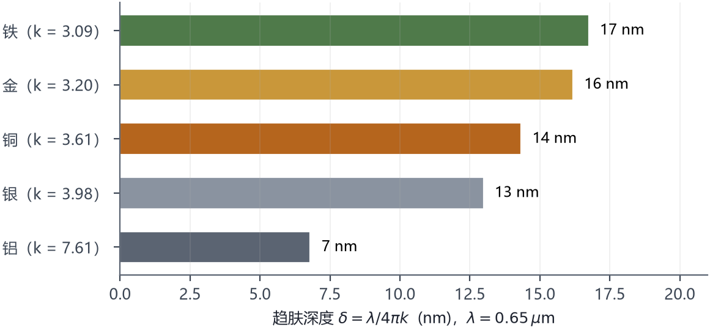
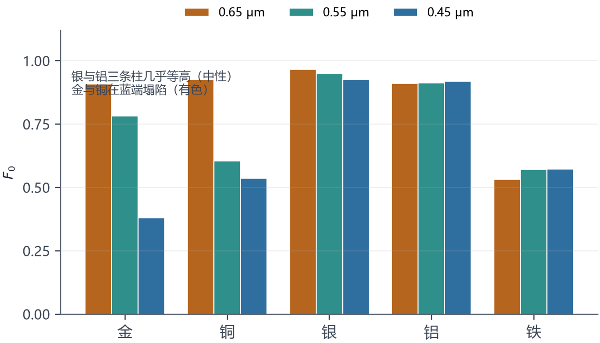
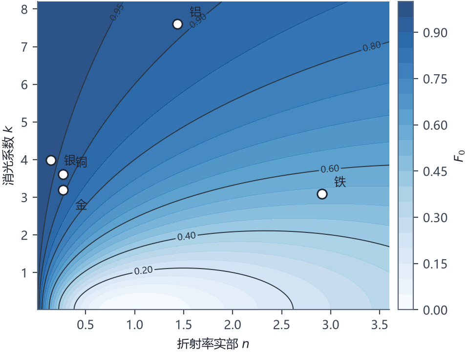

# 第 1 章 金属的光学

## 1.1 一块铜板

桌上放一块刚抛光的铜板。它偏红，但不是颜料那种红：亮部接近白，中间调是温暖的橙金，暗部偏深褐。把它的照片放进取色器，中间调的平均色大概是 $(0.72,0.45,0.20)$ 这样的数值。

现在在渲染器里做一个球，基色填这个数值，金属度设成 1，粗糙度调到 0.15，打一盏面光源。出来的球看起来像镀了一层铜色的塑料。它缺少三样东西：暗部不够暗，因为真实的铜在掠射时反射率接近 1，而球体的边缘本应有强烈的轮廓反射；颜色在掠射时没有变淡，因为真实金属的反射率高到一定程度之后，不同波长之间的差异比例被压缩了；它没有映出环境，因为一个只带颜色的金属球必须靠反射周围的东西来提供亮度。

这三样都属于同一个问题的不同侧面，而问题的根在界面。要把它讲清楚，得先知道光在金属里遇到了什么。

## 1.2 电子在金属里是自由的

电介质里的电子被原子核束缚，可以看成一个个弹簧振子。外来光波的电场推动电子，电子在平衡位置附近振荡，极化强度跟着振荡，这个响应可以用一个束缚振子的介电函数描述。它的共振在紫外，所以在可见光波段，折射率随频率缓慢上升，也就是正常色散。

金属里有另一类电子。外层电子不属于任何单个原子，在整个晶格里自由移动，形成电子气。它们没有回复力，电场推一下，电子就整体位移或者加速流动，只是被晶格散射不断损耗能量。Drude 在 1900 年用这个图像写出了金属的介电函数

$$\varepsilon(\omega)=1-\frac{\omega_p^2}{\omega^2+\mathrm{i}\gamma\omega},\qquad \omega_p^2=\frac{N e^2}{\varepsilon_0 m} , \tag{1.1}$$

其中 $N$ 是自由电子数密度，$m$ 是电子质量，$\gamma$ 是散射率，描述电子多久被撞一次。$\omega_p$ 叫等离子频率，金、银、铜都在 $10^{16}\,\mathrm{rad/s}$ 量级，对应的波长在紫外。

把实部和虚部分开：

$$\varepsilon_r=1-\frac{\omega_p^2}{\omega^2+\gamma^2},\qquad \varepsilon_i=\frac{\omega_p^2\gamma}{\omega(\omega^2+\gamma^2)} . \tag{1.2}$$

在可见光波段，$\omega<\omega_p$，所以 $\varepsilon_r<0$。这一条是金属与一切其他材料的根本区别。介电常数为负意味着波在介质里不能传播：波矢变成虚数，场沿传播方向指数衰减，没有传播的波。能量只能原路返回或者被吸收，于是反射率很高。

式 (1.1) 只在红外准得住。可见光下的金和铜有一个 Drude 模型没算进去的通道：d 能带上的电子可以被蓝光直接激发到费米面以上，这叫带间跃迁。它让金在 2.4 eV（约 520 nm）以下出现额外吸收，蓝光被吃掉，剩下的红黄反射出来，这就是金的颜色。铜的带间跃迁阈值低一些，蓝绿都被吃掉，于是更红。银的 d 带很深，跃迁阈值在紫外，可见光波段几乎没有带间吸收，所以银在整个可见光范围内都很白。铝的带间跃迁在 800 nm 附近，还带一个等离子共振，结果是在可见光里很平、在紫外有一个陡降。

这也是为什么这本书不打算从第一原理算出金属的颜色。要算准，得知道能带结构。工程上的做法是查表：$n$ 和 $k$ 都是测出来的，见附录 B。

## 1.3 复折射率的两个分量

式 (1.1) 的 $\varepsilon$ 是复数，折射率就是它的平方根，也是复数：

$$\tilde{n}=\sqrt{\varepsilon}=n+\mathrm{i}k . \tag{1.3}$$

表示成平面波 $\exp[\mathrm{i}(\mathbf{k}\cdot\mathbf{x}-\omega t)]$，代入 $k=\tilde{n}\omega/c$，得到

$$\exp\!\left(\mathrm{i}\frac{\omega}{c}n\,\hat{\mathbf{s}}\cdot\mathbf{x}\right)\exp\!\left(-\frac{\omega}{c}k\,\hat{\mathbf{s}}\cdot\mathbf{x}\right) . \tag{1.4}$$

第一个因子是振荡，第二个因子是衰减。两个分量分工明确：$n$ 决定波在介质里的相位速度 $c/n$，$k$ 决定振幅沿传播方向掉得多快。

衰减到 $1/e$ 所需的距离叫趋肤深度

$$\delta=\frac{\lambda}{4\pi k} , \tag{1.5}$$

$\lambda$ 是真空波长。图 1-1 把五种金属在 0.65 μm 处的值画出来，最大的是铁，17 nm，最小的是铝，7 nm。作为对照，可见光的波长是 400 到 700 nm，也就是说光在金属里走不到波长的三十分之一就被吸收掉了。

这个尺度感很重要。它解释了为什么金属的外观几乎完全由界面决定：任何一块厚度超过 50 nm 的金属膜都是不透明的，光根本没有机会走到内部再回来。它也解释了为什么氧化层这么要紧——一层 20 nm 的氧化亚铜，厚度已经和趋肤深度同量级，它改变的不只是界面，而是整个"有效界面"。

## 1.4 颜色长在界面上

颜料和金属都会给人"颜色"的印象，但机制完全不同。

颜料颗粒是透明的电介质，$k$ 很小，光能进去。进去之后，某些波长的光被分子吸收（转换成热），剩下的在颗粒之间多次散射，最后从表面附近出来。出来多少取决于吸收系数 $\sigma_a$ 和光走过的路程 $d$，可以用 Beer–Lambert 定律写

$$T(\lambda)=\exp\!\left(-\sigma_a(\lambda)\,d\right) . \tag{1.6}$$

这里的颜色依赖于厚度：一层薄薄的红漆偏粉，因为走的路程短、吸收不充分；涂厚了就变深红。也依赖于基底：白底上的红漆亮，黑底上的红漆暗。颜料是体积效应。

金属不是。光在界面上就被反射掉大部分，剩下的一点点钻进十几纳米就被吸收干净，来不及走到任何地方再出来。所以金属的颜色由界面反射率随波长的变化决定。垂直入射时这个反射率是

$$F_0=\frac{(n-1)^2+k^2}{(n+1)^2+k^2} , \tag{1.7}$$

把式 (1.3) 代进 Fresnel 公式并在 $\theta_i=0$ 处取值就能得到，第 2 章会完整推一遍。式 (1.7) 说明 $F_0$ 由 $n$ 和 $k$ 共同决定，$k$ 越大越接近 1。

图 1-2 把五种金属在三个波长上的 $F_0$ 画在一起。银的三根柱几乎等高，0.97 到 0.93，所以银是中性色；铝也平，0.91 上下；铁在 0.53 到 0.57 之间，也是中性但暗。金在红端 0.91，到蓝端掉到 0.38；铜在红端 0.93，绿端 0.61，蓝端 0.54。这个"红高蓝低"的形状，就是金色和铜色的来源。

图的纵轴上限是 1，说明这些数值都很大。这是金属的第二个特征：$F_0$ 不是 0.04 这个量级，而是 0.5 到 0.98。一个电介质球，垂直看只有 4% 的光被反射，正对光源时几乎看不出高光；一个金属球，垂直看就有 90% 的光被反射，它看起来"亮"不是因为它在发光，而是因为它把周围的一切都映了出来。

## 1.5 为什么不能靠调色

把 $F_0$ 当颜色填进材质参数里，会同时犯两个错。

第一个错是把 $F_0$ 当成了漫反射率。$F_0$ 是镜面反射在垂直入射时的值，它乘的是 $D$ 和 $G$，描述的是一条窄窄的反射瓣。如果美术给你一个 $(0.72,0.45,0.20)$ 的基色，你把它直接塞进 $F_0$，那么这个球在整个半球上的反射能量会远大于漫反射球，高光又会窄得几乎看不见。

第二个错是忽略了 $F_0$ 只是在垂直入射时成立。金属的反射率随角度上升，但色调的走向不同：金在掠射时三个通道都趋向 1，颜色变淡；而铜在紫外的 $F_0$ 很小，某些角度下蓝通道的相对提升会比红通道快，颜色会往冷里偏一点。这一点在第 2 章会看到具体的曲线。

图 1-3 给出了另一条思路。既然 $F_0$ 是 $(n,k)$ 的函数，那么可以在 $(n,k)$ 平面上画等值线，看每个金属落在哪里。金、铜、银都落在 $k$ 大而 $n$ 小的一角，它们贴着 $F_0>0.9$ 的等值线；铝落在 $k$ 很大、$n$ 也大的位置，同样在 0.9 以上；铁落在中间，$F_0$ 只有 0.53，所以铁的金属感弱，看起来更像深灰的漆。

这张图还顺带说明了一件容易被忽略的事：$F_0$ 对 $k$ 的依赖远强于对 $n$ 的依赖。$k$ 从 3 涨到 8，$F_0$ 从 0.8 涨到 0.95；$n$ 从 0.2 涨到 3，$F_0$ 只从 0.93 掉到 0.75。所以在只有 RGB 三个数的材质系统里，$F_0$ 的三个通道实际上主要在编码"这个波长上电子气有多不透明"，而不是编码"颜色"。

## 1.6 三个流传很广的误解

**金属没有漫反射。** 真实金属的粗糙表面确实会表现出接近漫反射的行为，但那是微表面的多次散射加上表面以下的氧化层、污染物造成的，不是金属本身的性质。把金属的漫反射项设成基色会很方便地让暗部有颜色，代价是所有金属看起来都像刷了漆。

**金属度是一个插值参数。** 在实时管线里，金属度常常用来在"电介质解"和"金属解"之间插值。这在物理上是没有依据的：界面只有一种身份，要么有自由电子要么没有。它之所以好用，是因为真实的过渡状态（脏的金属、部分氧化的金属、镀层磨损）在统计上确实介于两者之间，而线性插值恰好是个不太糟糕的近似。代价是插值出来的中间态既不满足 $F_0$ 随波长变化的规律，也不满足能量守恒的边界。第 7 章讲氧化层时会给出一个稍微靠谱一点的替代方案。

**$k$ 可以忽略。** 有人为了省事只存 $n$，用 $F_0=((n-1)/(n+1))^2$ 算反射率。对金属而言这个式子的误差是灾难性的：铝的 $n=1.44$，按这个式子算出来 $F_0=0.03$，而实际值是 0.91。$k$ 不是修正项，它和 $n$ 一样是主项。

---

这一章要带走的是三件事。金属的复折射率来自自由电子气，$n$ 管相位、$k$ 管衰减，可见光在金属里只能走十几纳米。颜色的来源是界面反射率随波长的变化，不是体积吸收。$F_0$ 的量级是 0.5 到 0.98，用 $k$ 近似为零的公式会错得离谱。

下一章把界面写完整：反射率随角度怎么变，Schlick 近似什么时候还能用。
