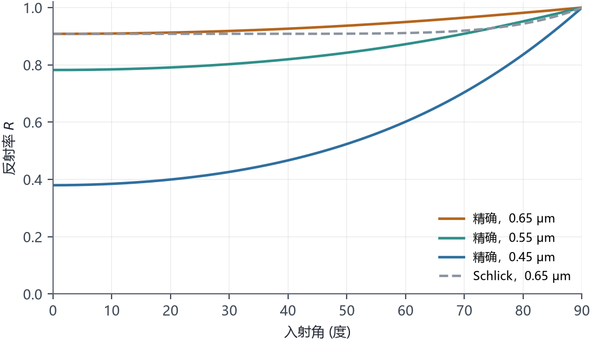
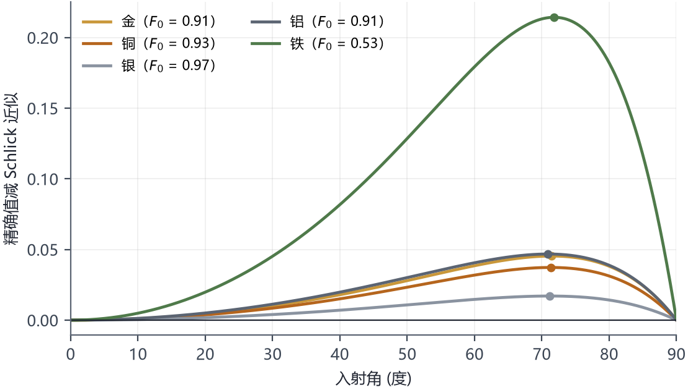
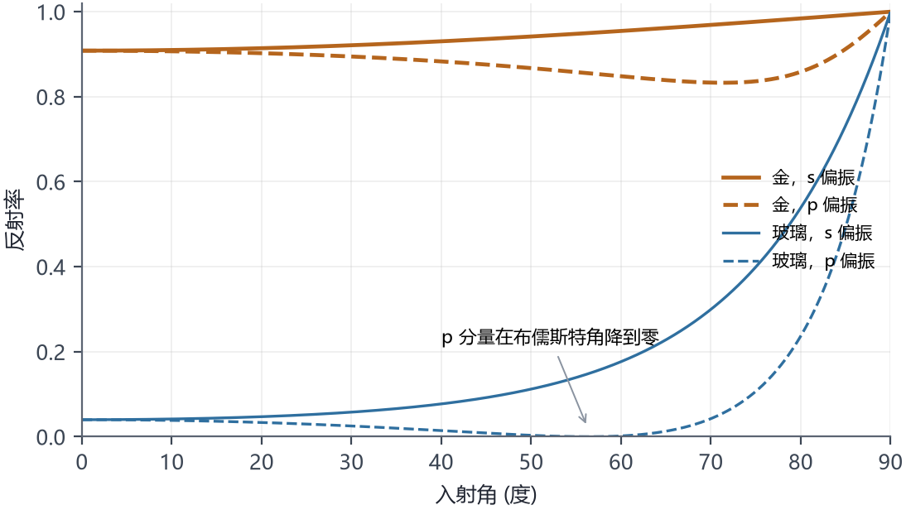

# 第 2 章 导体 Fresnel 与 F0

## 2.1 边缘比中心亮

把一块抛光铝板立在桌上，从正上方看它，亮度大约是入射光的九成。把视线压低到几乎贴着板面看，亮度接近满值，而且能清楚看到对面窗户的倒影。

反射率随角度上升，这是所有界面共同的行为。区别在起点与上升的快慢。空气到玻璃的界面从 0.04 起步，一直躺到 45 度，然后陡然上升，80 度时已经 0.4。金属从 0.9 起步，前 40 度几乎不动，之后缓慢爬升，最后一段和玻璃一样冲向 1。

这条曲线的两端由两个数决定：垂直入射的 $F_0$，和掠射角的 1。中间的形状由材料决定。Schlick 用一个五次幂把两端连起来，对玻璃够用，对金属不一定。这一章写出精确曲线，再算清楚近似错在哪。

## 2.2 复数的 Snell 定律

界面上的反射系数来自边界条件，推导与电介质完全一样，只是折射率换成了复数。麻烦在于 Snell 定律

$$\sin\theta_t=\frac{n_1}{\tilde n_2}\sin\theta_i \tag{2.1}$$

右边的 $\tilde n_2$ 是复数，所以 $\sin\theta_t$ 也是复数。这不是数学游戏：$\theta_t$ 不再是一个角度，它是"折射波沿界面方向的波矢分量"的记号，其虚部描述波沿法向的衰减。

真正要用的量是 $\cos\theta_t$。由 $\sin^2+\cos^2=1$

$$\tilde n_2\cos\theta_t=\sqrt{\tilde n_2^{\,2}-n_1^2\sin^2\theta_i}\equiv w . \tag{2.2}$$

这一步里有一个选择：开方有两个根，取虚部为正的那个，因为波必须沿传播方向衰减而不能增长。

设 $\tilde n=\tilde n_2/n_1$（后面默认从空气入射，$n_1=1$），式 (2.2) 的被开方数是

$$\tilde n^2-\sin^2\theta_i=(n^2-k^2-\sin^2\theta_i)+\mathrm{i}\,2nk . \tag{2.3}$$

它是一个复数，写成 $w=a+\mathrm{i}b$。复数开方的标准做法是模与辐角，但对 $a^2-b^2+\mathrm{i}2ab$ 这种形式有更直接的代数解：

$$a=\sqrt{\frac{\sqrt{(n^2-k^2-\sin^2\theta_i)^2+4n^2k^2}+(n^2-k^2-\sin^2\theta_i)}{2}} , \tag{2.4}$$

$$b=\sqrt{\frac{\sqrt{(n^2-k^2-\sin^2\theta_i)^2+4n^2k^2}-(n^2-k^2-\sin^2\theta_i)}{2}} . \tag{2.5}$$

$a$ 和 $b$ 就是电介质情形里 $\tilde n\cos\theta_t$ 的实部与虚部。取 $b\ge0$ 即满足衰减条件。

## 2.3 两个分量的功率反射率

把 $w=a+\mathrm{i}b$ 代回 s 偏振的振幅系数。从空气入射时

$$r_s=\frac{\cos\theta_i-w}{\cos\theta_i+w}=\frac{(\cos\theta_i-a)-\mathrm{i}b}{(\cos\theta_i+a)+\mathrm{i}b} . \tag{2.6}$$

取模平方，交叉项抵消：

$$R_s=|r_s|^2=\frac{(\cos\theta_i-a)^2+b^2}{(\cos\theta_i+a)^2+b^2} . \tag{2.7}$$

p 偏振要小心，因为分子分母上是 $\tilde n^2\cos\theta_i$ 而不是 $\cos\theta_i$。用 $\tilde n\cos\theta_t=w$ 乘以 $\tilde n$，得到 $\tilde n^2\cos\theta_i-w$：

$$R_p=|r_p|^2=\frac{\left[(n^2-k^2)\cos\theta_i-a\right]^2+\left[2nk\cos\theta_i-b\right]^2}{\left[(n^2-k^2)\cos\theta_i+a\right]^2+\left[2nk\cos\theta_i+b\right]^2} . \tag{2.8}$$

非偏振光的反射率是两个分量的平均

$$R=\tfrac12\left(R_s+R_p\right) . \tag{2.9}$$

式 (2.7) 到 (2.9) 就是全部。没有近似，没有拟合参数，给定 $(n,k)$ 和角度就能算。计算量是几个平方根和几次除法，比一次纹理采样贵不了多少。

垂直入射时 $\cos\theta_i=1$，$\sin\theta_i=0$，于是 $a=n$、$b=k$，两个分量相等：

$$F_0=\frac{(n-1)^2+k^2}{(n+1)^2+k^2} , \tag{2.10}$$

这正是第 1 章的式 (1.7)。推导到这里，它不再是一个需要记住的结论，而是式 (2.7) 在 $\theta_i=0$ 处的特例。

## 2.4 Schlick 错在哪里

Schlick 近似写成

$$F(\cos\theta)\approx F_0+(1-F_0)(1-\cos\theta)^5 . \tag{2.11}$$

它的两个端点是对的：$\cos\theta=1$ 给 $F_0$，$\cos\theta=0$ 给 1。问题全在中间。

图 2-1 把金在三个波长上的精确曲线画在一起，并叠了一条 0.65 μm 的 Schlick。图 2-2 直接画差值。五种金属的误差都是正的，也就是精确值比 Schlick 高，峰值出现在 71 度附近。金 +0.045，铜 +0.037，银 +0.017，铝 +0.047，铁 +0.214。

规律很清楚：误差的大小与 $1-F_0$ 相关。$F_0$ 越接近 1，Schlick 越准。银的 $F_0=0.97$，误差只有 0.017；铁只有 0.53，误差 0.21，几乎等于把整条曲线抬错了四成。

直觉上的原因：Schlick 把曲线的形状固定成一个五次幂，实际上这条曲线的形状由 $k$ 决定。$k$ 大时，界面附近的场衰减极快，折射波几乎不存在，反射率在整个角度范围都接近 1，曲线很平；$k$ 小时，材料开始像电介质，曲线更像玻璃那条。铁的 $k$ 只有 3 左右，是五种金属里最小的，所以它的曲线最"不像金属"，也最偏离固定形状的五次幂。

误差 0.05 意味着什么？对一个只靠方向光渲染的球，高光边缘的亮度会偏低 5%，看不出。但只要做能量守恒检验（第 9 章），方向反照率会系统性偏低，白炉测试里球体会比环境暗 4% 到 5%，足以让人怀疑别处出了问题。做观感对比时，铁、钛、铬这类 $F_0$ 在 0.5 到 0.6 的金属会明显偏暗，尤其是轮廓附近。

一个实用的判断标准：$F_0>0.85$ 的金属（银、铝、金、铜、铑、铂）可以用 Schlick，误差不超过 0.05；$F_0<0.7$ 的（铁、钛、铬、镍）在要求准确时应该用完整公式。计算成本上，完整公式是几次开方，在现代 GPU 上完全负担得起，代价主要是没法把它预先烘成一张两参数的 LUT。

## 2.5 金属没有布儒斯特角

图 2-3 把金的 $R_s$ 与 $R_p$ 分开画，并叠了玻璃的两条。

玻璃的 p 分量在 56.3 度降到零，这就是布儒斯特角。金属的 p 分量在 78 度附近有一个极小值 0.83，但降不到零，之后重新上升。

原因还是 $k$。布儒斯特角是"反射波的振动方向恰好等于折射波的传播方向、偶极子辐射不出去"的几何条件。金属里折射波是一个迅速衰减的场，没有确定的传播方向，这个几何条件构不成，所以 $r_p$ 只是变小，不会为零。

这一点在渲染里的实际后果：偏振镜可以几乎完全消掉玻璃和水的反光，对金属只能压掉一部分，而且角度很窄。做偏振渲染时如果对金属套用电介质的布儒斯特结论，会得到一个不存在的暗斑。

## 2.6 什么时候必须用完整公式

四种情况需要放弃 Schlick。

角度扫过掠射区。轮廓光靠的就是掠射角附近的反射率。Schlick 在 85 度处误差的绝对值不大，但那是相对误差最大的一段。

能量检验。做白炉测试时，反射率误差会直接累积成能量误差，无法与采样误差区分。第 9 章的流程要求 BSDF 的方向反照率与 1 的偏差在千分之一量级，Schlick 达不到。

波长相关的外观。金的 $F_0$ 在红蓝之间差 0.53，接近掠射时三个通道的曲线形状不同，色调随角度有细微变化。用 Schlick 时三个通道共享同一个形状，这个变化被抹掉。

资产来自实测。如果某个材质库给的是 $(n,k)$ 数据表（很多扫描材质库确实这么做），就没有理由再退回到近似。

反过来，什么时候可以用 Schlick：$F_0$ 高于 0.85、视角集中在 0 到 60 度、渲染目标是观感而不是测量。绝大多数实时场景落在这个范围里，所以 Schlick 仍然是最常用的形式。知道它的误差量级，比换掉它更重要。

## 2.7 微表面里用哪个角

这条规则前面提过，但它是金属渲染里最常见的错误之一，值得再强调一次。

在微表面模型里，宏观表面被一堆朝向各异的小面代替。光打到某个小面上，那个小面的法线是半程向量 $h$。Fresnel 的角度是入射方向与小面法线的夹角，也就是

$$F=F(\omega_i\cdot h)=F(\omega_o\cdot h) . \tag{2.12}$$

两个等号都成立，因为反射定律保证了 $\omega_i$ 和 $\omega_o$ 与 $h$ 的夹角相等。

写成 $F(\omega_o\cdot n)$ 的后果在金属上比在电介质上严重得多。粗糙度高时，掠射视角下的 $\omega_o\cdot n$ 接近 0，$F$ 被推到 1，金属的轮廓会出现一圈不该有的白边，而且这圈白边还会随粗糙度变宽。用 $\omega_o\cdot h$ 时，$h$ 的方向已经把微表面的朝向算进去了，轮廓处的 $F$ 只反映那些真正朝向观察者的微面。

顺带一个相关的问题。导体 Fresnel 的 $F_0$ 是三个通道各自的 $(n,k)$ 算出来的，所以 $F$ 也是三个通道各自的角度函数。有些实现只在垂直入射处区分通道，角度项共用一个标量，这会丢掉“金在掠射时比蓝端更快趋近 1”这个差异。量级不大，但在高光占比很高的画面里能看出来。

---

这一章的结论可以压缩成两句。导体的反射率由式 (2.7) 到 (2.9) 给出，$F_0$ 是它在垂直入射处的特例；Schlick 的误差随 $1-F_0$ 增长，银可以忽略，铁必须换公式。

还有一句实践上的提醒：微表面里 Fresnel 的角度是 $\omega\cdot h$，不是 $\omega\cdot n$。

界面讲完了，接下来进入表面。第 3 章开始处理那个决定高光形状的量：法线分布，以及当表面有方向性时它该怎么写。
