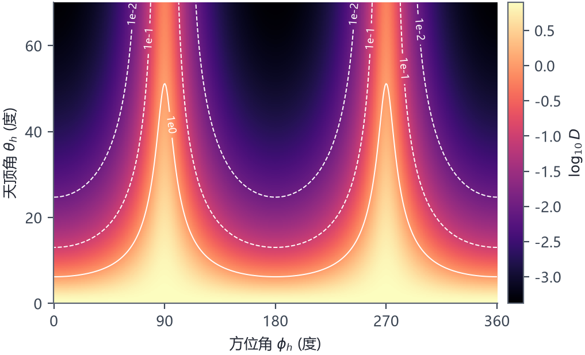
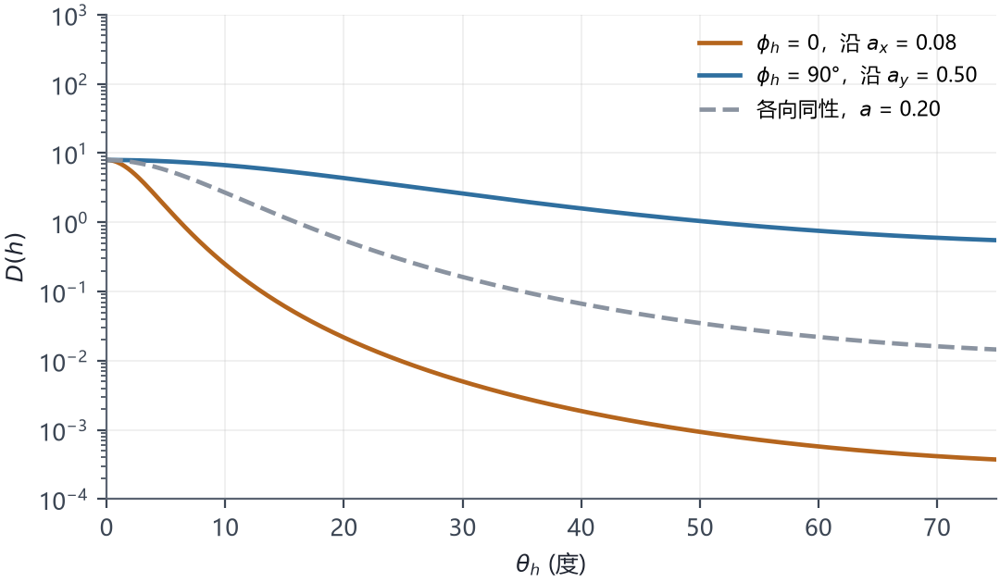
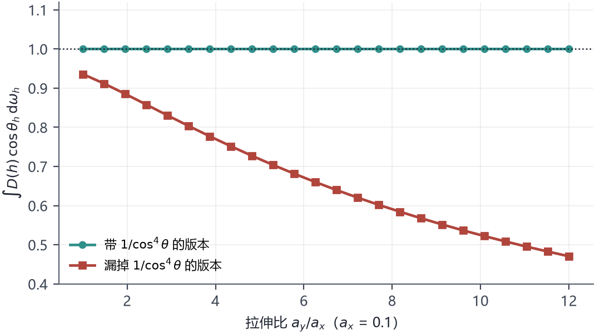

# 第 3 章 各向异性微表面

## 3.1 拉过丝的铝板

一块拉丝铝板放在窗前。窗户在它上面的倒影不是窗户的形状，是一条竖直的亮带，被拉长、被抹平，窗框完全看不见。把板子转 90 度，亮带跟着转成水平。

各向同性的微表面模型预测不出这个现象。它的法线分布只跟 $\theta_h$ 有关，与方位角无关，所以无论板子怎么转，反射瓣的截面都是同一个圆。要得到一条带，必须让法线分布在不同方位上有不同的宽度。

这一章把这个"不同"写成公式，并且盯住一件事：归一化。分布的形状可以随便挑，但它必须满足投影面积的归一化条件，否则能量会在你察觉不到的地方漏掉。

## 3.2 坡度分布

微表面的标准图像是：宏观平面 $z=0$，上面叠着一层高度起伏。每个微面有一个法线 $m$，把 $m$ 投影到宏观平面，得到坡度向量

$$\mathbf{m}=\left(-\frac{m_x}{m_z},-\frac{m_y}{m_z}\right)=\left(\tan\theta_m\cos\phi_m,\ \tan\theta_m\sin\phi_m\right) . \tag{3.1}$$

负号是因为法线朝上时，坡面朝下倾。坡度的两个分量定义在无限大的平面上，这个平面比半球好处理：它是一个线性空间，可以做各向异性的缩放。

各向同性 GGX 的坡度分布，在各向异性下的自然推广是把 $m_x$ 与 $m_y$ 分别除以两个不同的尺度：

$$P(\mathbf{m})=\frac{1}{\pi a_xa_y}\cdot\frac{1}{\left(1+\dfrac{m_x^2}{a_x^2}+\dfrac{m_y^2}{a_y^2}\right)^2} . \tag{3.2}$$

这是 GGX（Trowbridge–Reitz）分布的两参数版本，$a_x$、$a_y$ 分别控制 $x$ 与 $y$ 方向坡度的典型大小。式 (3.2) 的归一化可以手算：令 $u=m_x/a_x$、$v=m_y/a_y$，$d m_xd m_y=a_xa_y\,du\,dv$，于是

$$\int P\,d\mathbf{m}=\frac{1}{\pi}\int\!\!\int\frac{du\,dv}{(1+u^2+v^2)^2}=\frac{1}{\pi}\cdot\pi=1 . \tag{3.3}$$

用极坐标：$u=r\cos\alpha$、$v=r\sin\alpha$，分子 $rdrd\alpha$ 除以 $(1+r^2)^2$，对 $r$ 积分得 $1/2$，对 $\alpha$ 积分得 $2\pi$，合计 $\pi$。系数 $\pi a_xa_y$ 就是从这里来的,它本来是为了让两个方向的缩放互相抵消。

式 (3.2) 的等值线是椭圆，长轴沿着 $a$ 大的那个方向。$a_x$ 小的地方，$m_x$ 稍微偏离 0 就会让分母暴涨，分布被压扁。所以 $a$ 是“坡度铺开程度”，不是“坡度上限”。

## 3.3 换回法线空间

渲染器要的不是坡度分布，是半球上的法线分布 $D(h)$，要求 $\int D\cos\theta_h\,d\omega_h=1$。两个量之间差一个变换的 Jacobian。

推导分两步。第一步，把坡度换成球坐标。由式 (3.1)，$m_x=\tan\theta\cos\phi$、$m_y=\tan\theta\sin\phi$，偏导矩阵的行列式是 $\tan\theta\sec^2\theta$，所以

$$d m_x\,d m_y=\tan\theta\sec^2\theta\,d\theta\,d\phi . \tag{3.4}$$

第二步，把球坐标的体元换成立体角。$d\omega=\sin\theta\,d\theta\,d\phi$，代入

$$d m_x\,d m_y=\frac{\tan\theta\sec^2\theta}{\sin\theta}\,d\omega=\frac{1}{\cos^3\theta}\,d\omega . \tag{3.5}$$

概率必须相等：法线落在 $d\omega$ 里的概率等于坡度落在对应 $d\mathbf{m}$ 里的概率，也就是 $D(h)\cos\theta_h\,d\omega=P(\mathbf{m})\,d\mathbf{m}$。整理得到

$$D(h)=\frac{P(\mathbf{m})}{\cos^4\theta_h} . \tag{3.6}$$

分母 $\cos\theta_h$ 来自立体角与投影面积的关系，$\cos^3\theta_h$ 来自坡度的 Jacobian，合起来是四次方。

把式 (3.2) 代进去，并用 $1/\cos^2\theta=1+\tan^2\theta$ 把表达式整理成常见的形式：

$$D(h)=\frac{1}{\pi a_xa_y\cos^4\theta_h}\cdot\frac{1}{\left(1+\tan^2\theta_h\left(\dfrac{\cos^2\phi_h}{a_x^2}+\dfrac{\sin^2\phi_h}{a_y^2}\right)\right)^2} . \tag{3.7}$$

这就是各向异性 GGX。它在 $a_x=a_y=a$ 时退化为标准的各向同性 GGX，这一点可以直接验算：式 (3.7) 的括号里变成 $1+\tan^2\theta/a^2$，乘上 $\cos^4$ 之后是 $(\cos^2\theta+\sin^2\theta/a^2)^2\cdot a^4$，即 $\cos^4\theta(\cos^2\theta+\sin^2\theta/a^2)^2$，与 $\alpha^2/(\pi\cos^4\theta(\alpha^2+\tan^2\theta)^2)$ 一致。

图 3-1 把式 (3.7) 画出来。$a_x=0.08$、$a_y=0.50$，等值线是沿 $\phi=90$ 度方向拉长的椭圆，在 $\phi=0$ 附近极快地衰减，在 $\phi=90$ 附近铺得很开。注意这是对数尺度：沿 $a_x$ 方向，$\theta_h$ 到 10 度时 $D$ 已经掉到峰值的百分之一；沿 $a_y$ 方向，同样的位置只掉不到两成。

图 3-2 给出两个方向的切片，并叠了一条各向同性的曲线。三条线在 $\theta_h=0$ 处都等于 $1/(\pi a_xa_y)$，离开原点之后行为完全不同。

## 3.4 投影面积的归一化

归一化条件写成

$$\int_{\Omega}D(h)\,\cos\theta_h\,d\omega_h=1 . \tag{3.8}$$

它的含义是：微表面的投影面积等于宏观平面的面积。宏观上看一块面积 $A$ 的板子，微观上把它看成许多小面，这些小面在法线方向上的投影之和必须正好是 $A$，不能多也不能少。多出来的部分会让反射凭空变亮，少掉的部分让画面发暗。

式 (3.8) 对各向异性版本是一个真正的约束，因为很容易写出"看起来像椭圆"但不满足它的分布。一个常见的写法是直接对 $\tan\theta$ 做各向异性缩放：

$$D_{\text{错}}(h)=\frac{1}{\pi a_xa_y}\cdot\frac{1}{\left(1+\tan^2\theta_h\left(\dfrac{\cos^2\phi}{a_x^2}+\dfrac{\sin^2\phi}{a_y^2}\right)\right)^2} , \tag{3.9}$$

它缺了式 (3.7) 里的 $1/\cos^4\theta_h$。图 3-3 是两个版本的归一化积分：正确的版本在所有拉伸比下都等于 1（误差在 $10^{-3}$ 以内，来自离散网格），错误版本从 0.93 一路掉到 0.47。

有意思的地方是错误版本的曲线还在随拉伸比下降。原因是漏掉的因子与 $\theta$ 有关，而拉伸比越大，分布中有贡献的法线越集中在 $\theta$ 较大的区域（沿 $a_y$ 方向是高角度的长尾），所以损失越多。这意味着同一个着色器在不同拉伸比下能量损失的比例不同，看起来像"拉伸越大越暗"。

这个错误的危害在于它不显眼。渲染一张拉丝金属的静帧，错误版本会暗 20% 到 50%，你会以为是光照强度或者色调映射的问题。白炉测试能一秒抓出它（第 9 章），但那需要你先想到去做。

## 3.5 遮蔽项怎么推广

各向同性的 Smith 遮蔽模型把微表面看成随机高度场，用一维的斜率分布算出遮蔽概率。各向异性下这套推导仍然成立，只是在每个方向上要用对应方向的一维投影分布。

结果的形式和各向同性一模一样，只是 $\tan^2\theta$ 前面乘的系数要换成投影粗糙度：

$$\Lambda(\omega)=\frac{1}{2}\left(-1+\sqrt{1+\alpha_o^2\tan^2\theta}\right),\qquad \alpha_o^2=a_x^2\cos^2\phi+a_y^2\sin^2\phi . \tag{3.10}$$

$\alpha_o$ 是把两个方向的粗糙度投影到 $\omega$ 所在的方位平面上。$\phi=0$ 时 $\alpha_o=a_x$，$\phi=90$ 度时 $\alpha_o=a_y$，中间按余弦平方插值。遮蔽与阴影函数是

$$G_1(\omega)=\frac{1}{1+\Lambda(\omega)},\qquad G_2(\omega_i,\omega_o)=\frac{1}{1+\Lambda(\omega_i)+\Lambda(\omega_o)} . \tag{3.11}$$

需要说明的是，式 (3.10) 对严格各向异性 Smith 模型是一个近似。准确的 $\Lambda$ 要对坡度分布做一维数值积分（Heitz 2014 给出了解析形式，但对 GGX 相当长）。投影粗糙度版本在 $\theta\to0$ 与各向同性情形的两端准确，中间差得不多，是常见实现采用的形式。

另一个容易搞错的地方：$\phi$ 必须与 $D$ 用同一个方位角基准。$D$ 里的 $\phi_h$ 是半程向量的方位角，$G$ 里的 $\phi$ 是入射（或出射）方向的方位角。把 $h$ 的方位角拿去算 $G$，在高粗糙度时误差明显，因为 $h$ 与 $\omega$ 的方向可以差很多。

## 3.6 为什么不能用两条各向同性 GGX 相加

有一种写法是取两个方向的粗糙度，分别算两个各向同性 GGX，再按权重混合。它看起来能产生椭圆，实际上不行：混合分布的等值线是两个圆的加权和，像一团模糊的圆环。椭圆需要在同一个分母里同时出现 $m_x^2/a_x^2$ 与 $m_y^2/a_y^2$，加法做不到。

---

这一章的核心是三个式子。坡度分布 (3.2)，法线分布 (3.7)，以及它的归一化条件 (3.8)。$1/\cos^4\theta$ 这个因子来自坡度到法线的变换，漏掉它会让能量随拉伸比漏掉，而画面只是看起来暗一点。

遮蔽项用投影粗糙度 $\alpha_o$ 推广，形式与各向同性一致。

下一章处理一个更具体的问题：$a_x$ 和 $a_y$ 该贴在哪个方向上，以及这个选择如何决定高光带的朝向。
