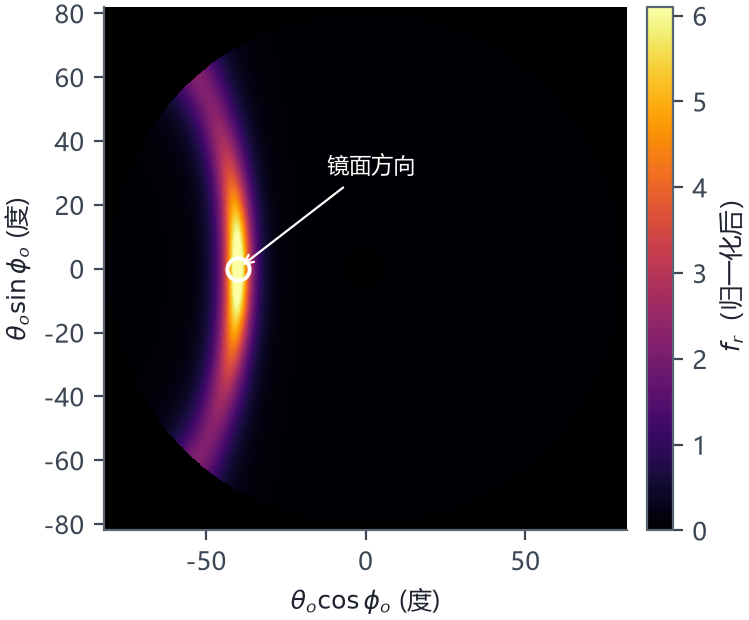
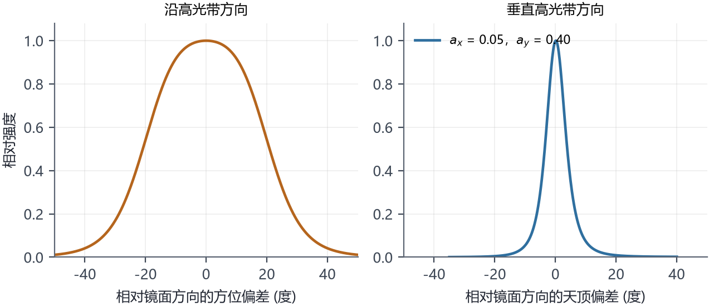
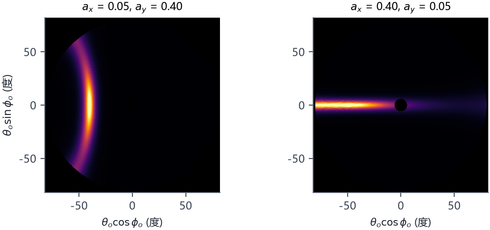

# 第 4 章 切线空间与拉伸的高光

## 4.1 一条亮带的两个问题

拉丝金属的高光是一条带，这已经有公式可以算了。剩下两个问题都是几何的。

第一个：这条带朝哪个方向。把拉丝面板转 90 度，亮带跟着转 90 度，可它转到的位置与"丝纹"本身差了 90 度——亮带垂直于丝纹，而不是沿着丝纹。这个关系必须从反射几何推出来，不能靠记住。

第二个：$a_x$ 和 $a_y$ 到底贴在哪个方向上。着色器里有两个粗糙度参数，还有一组切线基，还有一张各向异性方向贴图。四个东西里任意两个对不上，高光就会差 90 度。这个错误在项目里非常常见，因为它的症状只是"看起来不对劲"，不报错，也不会让能量不守恒。

## 4.2 切线基

每个着色点需要一个局部坐标系。取宏观法线 $n$，再取一个与它垂直的单位向量 $t$ 作切线，第三个向量由叉积给出

$$b=n\times t . \tag{4.1}$$

$t$ 与 $b$ 张成切平面，$(t,b,n)$ 是一个右手系——只要 $t$ 与 $n$ 垂直且都归一化。式 (4.1) 的顺序决定了手性，写成 $t\times n$ 得到的是左手系，$b$ 的方向反过来，各向异性的效果就镜像了。

给定一个方向 $\omega$，它在切线空间里的方位角是

$$\phi=\operatorname{atan2}(\omega\cdot b,\ \omega\cdot t) . \tag{4.2}$$

式 (3.7) 里的 $\phi_h$ 就是这个量，$t$ 对应 $\phi=0$，$b$ 对应 $\phi=90$ 度。

实际系统里 $t$ 通常来自两个地方：网格的切线属性（由 UV 展开和法线贴图推导），或者一张方向贴图编码的角度。前者的问题是它跟着 UV 走，而 UV 的朝向由美术展开决定，与工艺方向无关；后者的问题是它需要一个额外的通道，且必须与 UV 对齐。两条路都要显式地把"丝纹方向"映射到 $t$ 上。

## 4.3 为什么带子垂直于丝纹

把微表面的响应看成一个放大过程。

假设某个微面的法线相对宏观法线倾斜了一个小角度 $\delta$，倾斜方向沿着 $x$。入射方向固定，反射方向由 $r=i-2(i\cdot m)m$ 给出。对 $m$ 求导，倾斜 $\delta$ 会让反射方向偏转 $2\delta$，方向也沿 $x$。所以反射方向的角分布宽度是法线倾斜分布宽度的两倍。

这个二倍关系是各向异性高光的核心。它说明：高光在某个方向上的宽度，由法线在那个方向上的倾斜散布决定，比例因子是 2。

现在看拉丝表面。丝纹是一组平行沟槽，沟槽沿 $y$ 方向延伸，横截面在 $x$ 方向上起伏。沿 $y$ 走，高度几乎不变；沿 $x$ 走，高度快速上下。于是法线只在 $x$ 方向上倾斜，倾斜量的大小由坡度分布 $a_x$ 控制，而 $y$ 方向的倾斜几乎为零。

代进上面的结论：反射方向只在 $x$ 方向散开，$y$ 方向几乎不散。落到画面上，就是一个沿 $y$ 拉长的亮带——垂直于丝纹。

反过来验证：如果丝纹沿 $x$（沟槽横截面在 $y$ 方向起伏），法线只在 $y$ 方向倾斜，亮带沿 $x$ 拉长，仍然垂直于丝纹。方向关系与丝纹的绝对朝向无关，只与"哪条轴垂直于丝纹"有关。

还有一层：沟槽是连续的，同一个横向位置上，沿 $y$ 走一整段高度都一样，所以反射方向在 $y$ 方向上的一致性可以保持很长的距离。这就是为什么亮带可以拉得很长，而不是一个椭圆——法线分布在 $y$ 方向上的相关长度远大于 $x$ 方向。严格说，微表面模型假设法线是独立同分布的，没有相关长度这个概念，所以它给出的是一条"宽椭圆"而不是"长条"。真实拉丝金属上看到的极长的亮带，一部分来自这个空间相关性，微表面模型只能近似。这一点在第 6 章讲工艺时会再提。

图 4-1 是式 (3.7) 加微表面 BRDF 算出来的结果，画在方向空间的极坐标投影上，横轴是 $\theta_o\cos\phi_o$、纵轴是 $\theta_o\sin\phi_o$。入射方向在天顶角 40 度、方位角 0 度，镜面方向落在 $(-40,0)$，用白圈标出。亮带沿纵轴延伸，也就是沿 $\phi=90$ 度方向。取 $a_x=0.05$、$a_y=0.40$，$x$ 方向窄、$y$ 方向宽，与推导一致。

## 4.4 两个剖面差多少

图 4-2 把这张图切了两刀。左图沿亮带方向切，横轴是相对镜面方向的方位偏差，半高全宽 41.8 度。右图垂直于亮带切，横轴是天顶偏差，半高全宽 7.4 度。两个数字差了 5.6 倍。

拿这两个数与理论比一下。$a_x=0.05$ 对应坡度散布约 0.05 弧度，二倍放大后 0.1 弧度，即 5.7 度。实测 7.4 度，多出来的是 GGX 的长尾与遮蔽项的影响。$a_y=0.40$ 对应 0.8 弧度，45.8 度，实测 41.8 度，略小，因为宽到 40 度以上时几何项开始压制。

顺带一个对照：同一条曲线在两方向都是 $a=0.2$ 时，垂直方向的半高全宽是 32.8 度。所以 $a_x=0.05$、$a_y=0.40$ 这组参数的"平均"粗糙度接近 $a=0.2$，但垂直方向紧了一倍多，这就是高光看起来"锐利"的原因。

实践上的意义：$a_x$ 决定亮带有多细，$a_y$ 决定亮带有多长。美术调节时这两个参数应该分开给，用一个各向异性比例加一个基准粗糙度来控制，比给两个独立的 $a$ 更好调。第 8 章会说明为什么很多引擎宁愿只用两个参数，以及这样做的代价。

## 4.5 差 90 度是怎么发生的

把两个粗糙度贴到两个方向上有两种约定，两者都对，只是互相差 90 度。

约定 A：$a_x$ 是沿切线 $t$ 的粗糙度，$a_y$ 沿副切线 $b$。丝纹沿 $t$ 时，交叉方向是 $b$，所以 $a_y>a_x$。

约定 B：引擎把"各向异性方向"定义为亮带拉伸的方向，也就是 $t$ 本身表示拉伸轴。此时丝纹沿 $t$，需要 $a_x>a_y$。

两种约定在数学上完全等价（交换名字而已），但混用会让亮带转 90 度。图 4-3 把两种情形画在一起，其他条件都不变：左图 $a_x<a_y$，亮带竖直；右图 $a_x>a_y$，亮带水平。差别只是交换了两个数。

排查方法很直接：做一张只有一根丝纹方向的测试贴图，用平行光从侧面照，看亮带是垂直还是平行于丝纹。这与渲染器的约定无关，是物理事实。用这个结果去反推你的着色器里哪个参数是拉伸轴。

## 4.6 五个常见错误

**切线没有归一化。** 顶点切线经过插值之后长度会变，如果着色器里直接用它或者用它构基，$\phi$ 的分布会被拉歪。正确做法是先做 Gram–Schmidt 正交化再归一化：

$$t'=\frac{t-(t\cdot n)n}{\left|t-(t\cdot n)n\right|} . \tag{4.3}$$

不做正交化时，$t$ 与 $n$ 不垂直，$b=n\times t$ 的长度也不为 1，切平面被剪切，高光带会歪成一个斜的椭圆。症状是"带子方向对了但两端不对称"，很容易被当成法线贴图的问题。

**副切线的符号。** $b=n\times t$ 与 $b=t\times n$ 差一个负号，$\phi$ 因此整体偏移 $\pi$。对 $a_x=a_y$ 没影响，对各向异性则把亮带镜像。如果金属板上贴了各向异性方向贴图，而这个符号在切线空间变换（TBN 乘法顺序）里被翻了一次，贴图里画的方向就会反。

**用 $\omega\cdot n$ 算 Fresnel。** 第 2 章讲过。各向异性表面的高光带两端在掠射方向上延伸得很远，这些位置的 $\omega_o\cdot n$ 很小，用错的后果是亮带两端出现不该有的高光爆点。

**$\alpha$ 与 $\alpha^2$ 混用。** 有的实现里参数是 $\alpha$，有的是 $\alpha^2$（坡度方差），有的是"粗糙度"经过一次 $r^2$ 映射。交换 $a_x$ 与 $a_y$ 时如果其中一个走了不同的映射路径，两个方向就对不齐。

**丝纹方向在 UV 空间与切线空间不一致。** 各向异性方向贴图通常是按 UV 存的（红色通道存角度之类），而切线基来自 UV 的导数。如果模型的 UV 有旋转、有镜像、或者切线由法线贴图的通道重建而不是网格属性，两者之间就有一个额外的旋转。这种情况下的症状是亮带方向随 UV 岛变化——同一个零件上不同 UV 岛的高光方向不一样。看到这种画面，先去看 UV，不要怀疑公式。

## 4.7 采样时要注意什么

各向异性 GGX 的采样不能沿用各向同性的做法。标准的做法是把方向变换到"拉伸前的空间"：把 $\omega$ 的 $x$ 分量除以 $a_x$、$y$ 分量除以 $a_y$（或按引擎约定乘），在变换后的空间里用各向同性的可见法线分布采样（Heitz 2018），再把结果变换回去。

$$\omega'=\left(a_x\omega_x,\ a_y\omega_y,\ \omega_z\right),\qquad h=\text{normalize}\left(\frac{h'_x}{a_x},\frac{h'_y}{a_y},h'_z\right) . \tag{4.4}$$

pdf 也要跟着换空间。变换的行列式是 $a_xa_y$，所以从变换空间回到原空间时 pdf 乘 $1/(a_xa_y)$ 或者相反，取决于你把 pdf 定义在哪个变量上。漏掉这一项不会让图像有偏（因为 pdf 与 BRDF 同时被缩放时比例不变），但如果你的 MIS 权重把两个不同 pdf 混在一起，就会出错。

一个实用的检查：把采样出来的方向代回 BRDF 与 pdf，算 $f\cos/p$，对同一个入射方向做几千次采样取平均，结果应该收敛到方向反照率。各向异性版本的这个检验在第 9 章会用到，它比看图像可靠。

---

这一章的结论可以写成一句几何事实加一条工程纪律。法线在哪个方向上散布，高光就在哪个方向上散开，比例是 2，所以亮带垂直于丝纹。工程纪律是：先把"丝纹方向"和"拉伸轴"这两个概念在文档里钉死，再写代码，并且用一张单向丝纹的测试板验证。

下一章处理另一件事：这些公式在能量上并不完备。单次散射的各向异性微表面漏掉的能量，比各向同性更多。
