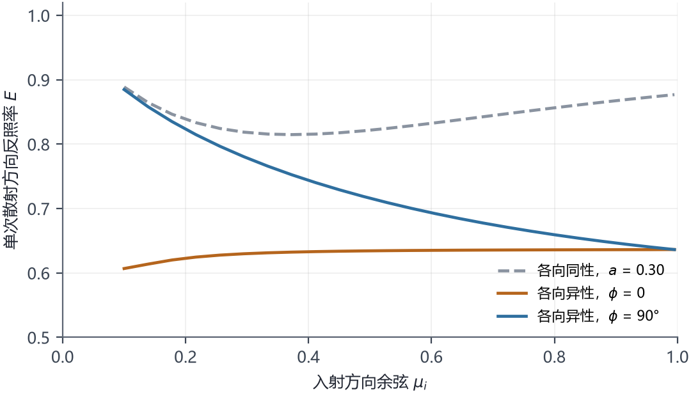
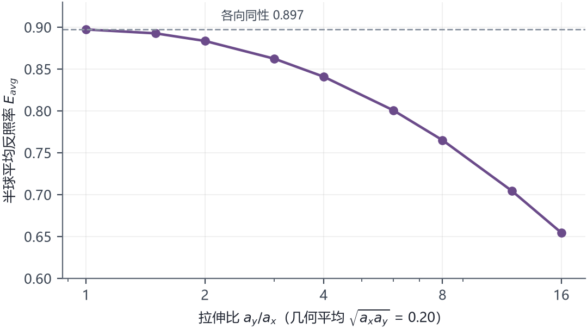
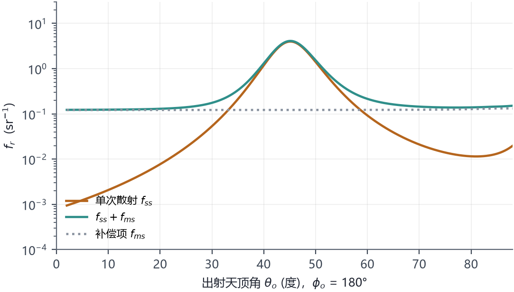

# 第 5 章 多次散射下的各向异性

## 5.1 一条应该更亮的带

把一块拉丝铝板放在一个均匀的白色环境里，$F_0$ 设成 1，也就是假设它完全不吸收。物理上它应该和环境的亮度完全一样，看不出边界。

各向同性的版本在这个测试里会暗一截，粗糙度越高暗得越多，这是单次散射微表面的固有缺陷，补偿办法在第 5.4 节给出。各向异性版本更糟：同一条亮带，用一个几何平均粗糙度相当的参数去比，它暗得更多。把拉伸比从 1 提到 16，平均反照率从 0.897 掉到 0.654。

这一章解释为什么，并给出补偿项在各向异性下的写法。

## 5.2 单次散射丢了什么

微表面模型的单次散射 BRDF 是

$$f_{\text{ss}}(\omega_i,\omega_o)=\frac{F(\omega_i\cdot h)\,D(h)\,G_2(\omega_i,\omega_o)}{4\left|\omega_i\cdot n\right|\left|\omega_o\cdot n\right|} . \tag{5.1}$$

它只算了"光打到一个小面上、反射一次、直接飞出去"这一条路径。凡是第一次反射就被相邻小面挡住的光，整个被丢掉——不是被吸收，而是没有进入这个公式。

定义方向反照率

$$E(\omega_i)=\int_\Omega f_{\text{ss}}(\omega_i,\omega_o)\cos\theta_o\,d\omega_o , \tag{5.2}$$

其中 $F$ 取 1，这样 $E$ 只反映几何损失，与材质无关。各向异性下 $E$ 同时依赖 $\mu_i=\cos\theta_i$ 与方位角 $\phi_i$，是一个二维函数。

再把 $E$ 在整个半球上求平均：

$$E_{\text{avg}}=\frac{1}{\pi}\int_0^{2\pi}\!\!\int_0^1E(\mu,\phi)\,\mu\,d\mu\,d\phi . \tag{5.3}$$

系数 $1/\pi$ 让 $E\equiv1$ 时平均值为 1。各向同性时这个式子退化成 $2\int E\mu\,d\mu$。

## 5.3 各向异性为什么丢得更多

原因不在 $E$ 的性质，而在粗糙度的取值范围。

各向同性材质的粗糙度有一个上限，过了上限表面就接近完全的随机粗糙，再高也没有新的形态。各向异性把这件事改了：一个拉伸比为 $r$ 的表面，两个方向的粗糙度是 $a/\sqrt r$ 与 $a\sqrt r$。保持几何平均不变、把 $r$ 拉到 16，较粗的那个方向就到 $a\sqrt{16}=4a$。取 $a=0.05$，得到 $a_y=0.2$；取 $a=0.2$，$a_y$ 就是 0.8，已经进入单次散射损失剧烈的区间。

图 5-1 画了三条 $E(\mu)$ 曲线。灰虚线是各向同性 $a=0.3$，两条实线是 $a_x=0.05$、$a_y=0.80$ 的两个方位角切片。

读这张图要注意两件事。方位角切片之间的差别很大，$\phi=90$ 度（宽的方向）从掠射处的 0.88 一路降到垂直入射的 0.64，$\phi=0$（窄的方向）整条曲线都在 0.60 到 0.64 之间，几乎是平的。窄方向反而更暗，原因是能量在出射时被投进了宽方向，而宽方向的遮蔽最严重。反照率是对整个半球积分的结果，不只看入射那一侧。

第二件事是曲线的形状在两端都翘起来。这不是笔误。Smith 遮蔽模型在掠射下的行为本身就不够准，$G_2$ 里 $1/\mu_i$ 的奇点被 $\Lambda$ 抵消掉之后，极限值是一个有限的数，而真实表面在极掠射时应当更低。所以图 5-1 在 $\mu_i<0.1$ 的那一段，只能当作模型的自洽结果，不能当作物理真值。做补偿表的实现会把 $\mu$ 截断在 0.05 左右，避免把这一段拟合进去。

图 5-2 给出半球平均随拉伸比的变化，几何平均固定在 0.20。

数字是这样的：拉伸比 1 时 0.897，2 时 0.884，4 时 0.841，8 时 0.765，16 时 0.654。也就是拉伸比 16 的表面，单次散射丢掉了近三分之一的能量。各向同性要到 $a\approx0.7$ 才会丢这么多，而那时候表面已经不像金属了。

这解释了一个常见的观察：拉丝金属在实时渲染里总是偏暗，美术为了让高光看起来对，把环境强度调高，结果暗部又被提亮成灰色。根源是这条曲线，不是色调映射。

## 5.4 补偿项怎么推广

Kulla 和 Conty 在 2017 年给出的补偿项，在各向异性下的形式几乎不变：

$$f_{\text{ms}}(\omega_i,\omega_o)=\frac{\big(1-E(\omega_i)\big)\big(1-E(\omega_o)\big)}{\pi\big(1-E_{\text{avg}}\big)} . \tag{5.4}$$

分子是两端的损失概率相乘，分母保证总量对上。唯一的变化是 $E$ 的两个自变量都要带上方位角，$E_{\text{avg}}$ 换成式 (5.3) 的半球平均。

验证一下它的归一化。把它在整个半球上积分：

$$\int_\Omega f_{\text{ms}}\cos\theta_o\,d\omega_o=\frac{1-E(\omega_i)}{1-E_{\text{avg}}}\cdot\frac{1}{\pi}\int_\Omega\big(1-E(\omega_o)\big)\cos\theta_o\,d\omega_o=1-E(\omega_i) , \tag{5.5}$$

上面这一步用了式 (5.3) 的定义。补上的能量正好等于入射方向上丢的那部分，所以 $f_{\text{ss}}+f_{\text{ms}}$ 的方向反照率恒等于 1。这个恒等式不依赖各向同性，方位角只是跟着 $E$ 走。

图 5-3 把补偿项加进 BRDF 之后的样子画出来。入射天顶角 45 度，取 $a_x=0.05$、$a_y=0.80$，沿 $\phi_o=180$ 度的镜面平面切片。

补偿项是一条水平线，$0.122\ \mathrm{sr^{-1}}$，与出射方向无关。这个数值可以手算：$(1-0.636)^2/(\pi(1-0.654))$，其中 0.636 是 $\phi=0$ 方向上 45 度入射的 $E$，0.654 是半球平均。在峰值处（45 度附近）它只占总量的百分之几；在偏离 60 度以外的地方，它比单次散射项大一个数量级。

这个形状正是物理上应该有的。多次反弹之后，光在微面之间被打散了很多次，出射方向上的记忆基本消失，于是它看起来像一层漫反射的底。补偿项不是"提亮"，它是把丢失的那部分能量按一个平滑的方向分布还回去。

## 5.5 Fresnel 加权

上面的推导假设 $F=1$。真实的金属每次碰到界面只反射一部分，剩下进入材料被吸收。反弹 $k$ 次的路径携带的能量按 $F^{k}$ 衰减，把它展开成等比级数求和，补偿项要乘一个因子

$$f_{\text{ms}}\leftarrow f_{\text{ms}}\cdot\frac{F_{\text{avg}}^2\,E_{\text{avg}}}{1-F_{\text{avg}}\big(1-E_{\text{avg}}\big)} , \tag{5.6}$$

其中 $F_{\text{avg}}$ 是 Fresnel 在半球上的余弦加权平均

$$F_{\text{avg}}=2\int_0^1F(\mu)\,\mu\,d\mu . \tag{5.7}$$

分子的 $F_{\text{avg}}^2$ 对应"进一次、出一次"，分母是归一化。$F_{\text{avg}}$ 对 Schlick 形式有闭式解：把 $F_0+(1-F_0)(1-\mu)^5$ 代进式 (5.7)，五次项积分是 $1/21$，于是

$$F_{\text{avg}}\approx F_0+\frac{1-F_0}{21} . \tag{5.8}$$

对金属，$F_0$ 在 0.5 到 0.98 之间，$F_{\text{avg}}$ 与 $F_0$ 只差百分之二左右。对电介质，$F_0=0.04$，$F_{\text{avg}}=0.086$，差别一倍多，所以这个修正对塑料、清漆更重要，对金属反而是小量。用完整导体 Fresnel 时需要数值积分式 (5.7)，而它对波长仍然敏感，所以 $F_{\text{avg}}$ 也要按通道各算一遍。

式 (5.6) 对金属的净效果是把补偿项乘上一个接近 0.9 的系数。看起来不大，但在高粗糙度的金和铜上，它能抵消掉 5% 到 8% 的亮度，正好是那种"总觉得暗一点"的差别。

## 5.6 实现上的取舍

精确做法是存一张三维表 $E(\mu,\phi,a_x,a_y)$，运行时插值。三维表的体积不小，而且需要一张额外的二维纹理（$\mu,\phi$）来查，代价太高。

常见的降级是只用一维 $E(\mu)$，把方位角的影响吸收进一个"有效粗糙度"里。两种取法：几何平均 $\sqrt{a_xa_y}$，或者沿入射方位角的投影 $\alpha_o$。前者在拉伸比小的时候准确，后者在拉伸比大的时候更贴近。

用 $\alpha_o$ 的版本有一个好处：它与遮蔽项共用一个量，代码里不用引入新的概念。代价是它倾向于高估反照率，因为宽方向的能量损失被窄方向的 $E$ 低估了。以图 5-2 的 $r=16$ 为例，在 $\phi=0$ 处 $\alpha_o=a_x=0.05$，一维表给出 0.99，而真值是 0.63，差了 0.36；用几何平均 0.2 查到 0.90，仍然高估 0.25。这个差值是系统性的，表现为金属在高拉伸比下偏亮。

另一种做法是干脆不补偿。对实时渲染，这是最简单也最常见的方案，代价就是那个"拉丝金属偏暗、高拉伸更暗"的现象。如果项目里的金属粗糙度集中在 0.2 到 0.4、拉伸比不超过 4，补偿带来的差别在 3% 以内，不补偿也能接受。一旦拉伸比到 8 以上，就必须补偿，否则美术会为了提亮而把环境调得很高。

还有一种取巧的做法：把补偿项写成一个常数，乘在 $f_{\text{ss}}$ 上。这样能量能对上平均值，但方向分布错了，亮带的形状会被整体放大而不是被填上一层底。做白炉测试的时候它会过 1（因为常数乘法在低 $E$ 的方向上补多了），所以这种写法在能量检验里过不去。

---

这一章要记住的是一条因果链。各向异性把粗糙度的上限推高，粗糙度高的方向单次散射损失大，损失的能量必须补回来，补偿项在各向异性下仍然是一个与出射方向无关的底，只是 $E$ 变成了二维函数。

还有一个数：几何平均 0.2、拉伸比 16 的表面，单次散射只返回三分之二的能量。

下一章离开公式，去看这些参数在真实工艺上对应什么。拉丝、喷砂、锤纹的统计性质差别很大，其中一种根本不适合用各向异性 BRDF 描述。
