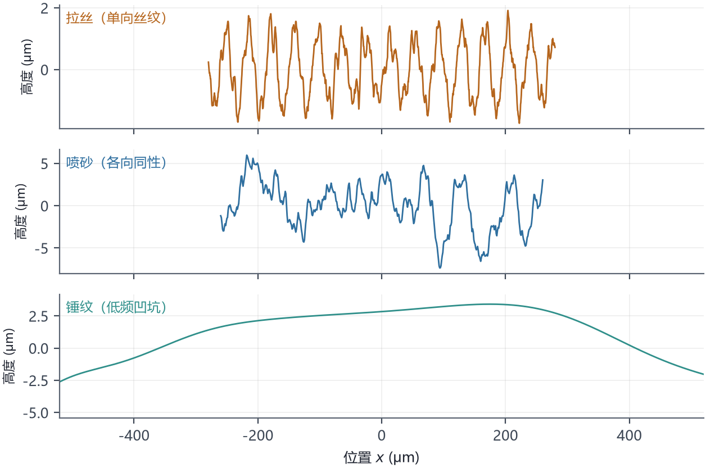
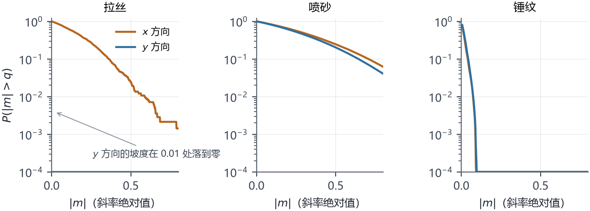
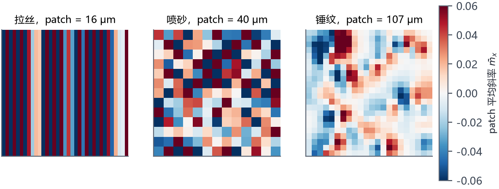

# 第 6 章 拉丝、锤纹与测量

## 6.1 三种板子

车间里做出来的金属表面，很少只有"粗糙度"一个属性。

拉丝板上有平行的细纹，纹路间距在几十到几百微米，深浅不一，沿纹路方向基本不变。喷砂板是另一回事，表面布满随机朝向的小坑，没有方向感，近看像橘子皮。锤纹板又不一样，表面是一片大尺度的起伏，每个起伏有指甲盖那么大，反射的是一片扭曲的环境。

三种表面在照片上一眼可辨，但用同一个各向异性 BRDF 去描述它们，只有前两种大致能对上。这一章说明为什么，以及拿到实测数据之后该怎么用。

## 6.2 表面统计的四个量

描述一个粗糙表面，工程上用四个量。

**坡度分布。** 法线偏离宏观法线的统计。这是 NDF 直接对应的量。

**粗糙度的方向性。** 坡度分布在两个方向上宽窄是否相同。相同就是各向同性，差很多就是各向异性。

**相关长度。** 相邻两点的坡度有多相关。它决定"表面花纹有多大的块"，与坡度大小完全独立：一个平缓的大起伏，坡度可以很小，但相关长度很长。

**高度直方图。** 起伏是否围绕一个平面上下对称。压花、腐蚀、磨损会让它偏斜，但这一项对反射的影响远小于前三项，多数模型忽略。

各向异性 BRDF 只吃前两个量，第三个量它完全没有概念。这就是锤纹的麻烦所在。

## 6.3 拉丝：一维的随机高度场

把丝纹理想化成一组平行的沟槽，高度只随垂直于丝纹的方向变化：

$$h(x,y)=h(x)=\sum_{k=1}^{N}a_k\sin\!\left(\frac{2\pi x}{\lambda_k}+\varphi_k\right) . \tag{6.1}$$

波长 $\lambda_k$ 在几十微米量级上对数分布，相位 $\varphi_k$ 随机，幅度 $a_k$ 按"每个波长贡献相近的坡度"取，也就是 $a_k\propto\lambda_k$。这样叠加出来的轮廓在不同尺度上都有起伏，接近真实磨削留下的痕迹。

图 6-1 最上面一条就是式 (6.1) 的一条剖面，横向 1 毫米，纵向 4 微米。起伏是连续的、不平滑的，最大的峰谷差约 4 微米，对应坡度在 0.2 左右。



坡度只出现在 $x$ 方向。图 6-2 左边那张图把这件事画成了两条生存函数曲线：$P(|m|>q)$ 是"斜率绝对值超过 $q$ 的概率"。



$x$ 方向的曲线缓慢下降，到 $q=0.4$ 还有 1% 的概率；$y$ 方向的曲线在 $q=0.01$ 处垂直落到零。这就是"一维"的含义：所有坡度都在一条轴上，没有第二个方向的分量。

## 6.4 喷砂：各向同性的多尺度叠加

喷砂用高速颗粒撞击表面，坑的位置和朝向都随机。把它写成大量随机方向、随机波长的谐波叠加：

$$h(x,y)=\sum_{k=1}^{N}a_k\sin\!\left(\frac{2\pi}{\lambda_k}\left(x\cos\vartheta_k+y\sin\vartheta_k\right)+\varphi_k\right) , \tag{6.2}$$

$\vartheta_k$ 在 $[0,\pi)$ 上均匀分布。谐波数取几百，波长覆盖 1 到 60 微米。

图 6-1 中间那条剖面比拉丝的平滑一些，因为它把不同方向的起伏平均掉了。图 6-2 中间那张图里两条曲线几乎重合，差的那一点点来自有限样本的涨落。这是各向同性的直接证据。

坡度分布的尾部比拉丝更重：$q=0.8$ 时还有 5% 的概率，而拉丝在 $q=0.8$ 处已经是零。原因是喷砂的谐波数多、相位独立，叠加出来的分布更长尾。

## 6.5 锤纹：问题在尺度上

锤纹是手工或机械敲出来的凹坑，直径一到几毫米，深度几十微米。写成

$$h(x,y)=-\sum_{k=1}^{K}d_k\exp\!\left(-\frac{(x-x_k)^2+(y-y_k)^2}{2\sigma_k^2}\right) , \tag{6.3}$$

$\sigma_k$ 是凹坑半径，$d_k$ 是深度，位置随机。图 6-1 最下面那条剖面在 1 毫米窗口里只能看到一个完整的凹坑，因为凹坑的尺度就接近这个窗口。

它的坡度分布并不奇怪，图 6-2 右边那张图显示两个方向的曲线重合、且很快衰减，和喷砂同类。真正的问题在相关长度。

图 6-3 把这件事画出来。把每个表面切成 40×40 的小块，算每块的平均斜率，然后把这些平均值画成一张图。



拉丝那张是一组竖条：每一条对应一道沟槽，块与块之间变化剧烈，但在 $y$ 方向上完全一致。喷砂那张是随机噪点，相邻块之间毫无关系。锤纹那张是一大片连续的色块，跨越好几个 patch，说明斜率在空间上是缓慢变化的。

这个区别决定了两件事。

第一，锤纹的特征尺度远大于像素。一个凹坑横跨成百上千个像素，每个像素看到的是一个确定的、被轻微倾斜的表面。这种情况下，正确的做法是逐像素给法线，也就是法线贴图或者位移，而不是给一个统计分布。

第二，统计型 NDF 假设法线在着色点附近独立同分布。锤纹违反这个假设：相邻点的法线高度相关。用它去渲染整块板，得到的是整个板面上一片均匀的高光，而真实的锤纹板上高光被切成一串碎片，随观察角闪烁。

试图用各向异性 BRDF 去凑锤纹，能做到的最好结果是"平均宽度像了"。但高光的位置分布完全不对：真实的锤纹在一个像素内只有一两个朝向，而模型给出的是所有朝向都有一定概率。这解释了一个常见的失败：用 GGX 拟合锤纹的测量数据，误差在镜面峰附近可以做到很小，但只要视角一动，反射图案的整体结构就错了。

判断用哪种方法，看一个比值：特征尺度除以像素足迹。远大于 1，用贴图法线或位移；远小于 1，用统计 NDF；在 1 附近，两种都不对，需要预过滤的多尺度模型，或者干脆提高分辨率。这个判据对拉丝同样适用：如果丝纹间距小于像素，就该用各向异性 NDF 而不是法线贴图去画一根根丝。

## 6.6 拿到实测数据之后

各向异性 BRDF 的实测数据一般来自测角仪：固定样品，用一个探测器绕着它转，记录每个入射-出射方向对上的反射率。数据是四维的，通常稀疏采样，且只覆盖有限的角域。

用法分三步。

**校准。** 测角仪的读数要先除以一个已知反射率的标准件（通常是抛光熔石英或镀铝镜），再乘标准件的理论反射率。跳过这一步，得到的是"相对亮度"，可以拟合形状，不能比较绝对量级。绝对量级很重要，因为 $F_0$ 与 $a_x,a_y$ 之间是耦合的：$F_0$ 偏高、$a$ 偏低，可以在镜面峰附近给出几乎相同的曲线。

**初值。** 在镜面平面（$\phi_o=\phi_i+\pi$）上取两条正交的切片：一条沿丝纹方向扫，一条垂直于丝纹。两条切片的峰宽分别给出 $a_x$ 与 $a_y$ 的初值：峰宽约等于 $2a$，这是第 4 章的结论。有了初值再去做全局拟合，可以避免陷进局部极小。

**拟合。** 在对数空间做最小二乘，因为 BRDF 跨好几个数量级，线性空间的残差会被镜面峰主导。

```python
import numpy as np

def model(wi, wo, ax, ay, f0=1.0):
    h = wi + wo
    h = h / np.linalg.norm(h)
    ch2 = max(h[2], 1e-4) ** 2
    t2 = (1.0 - ch2) / ch2
    ph = np.arctan2(h[1], h[0])
    den = 1.0 + t2 * (np.cos(ph) ** 2 / ax ** 2 + np.sin(ph) ** 2 / ay ** 2)
    D = 1.0 / (np.pi * ax * ay * ch2 ** 2 * den ** 2)
    ci, co = max(wi[2], 1e-5), max(wo[2], 1e-5)
    F = f0 + (1 - f0) * (1 - np.dot(wi, h)) ** 5
    return F * D / (4 * ci * co)      # 略去 G，拟合时只用峰附近的数据
```

这段代码只是示意：省掉了 $G$，也只对镜面峰附近的数据有效。真实拟合要把 $G$ 与多次散射都放进去，否则拟合出来的 $a$ 会系统性偏小——因为模型缺少多次散射的宽底，只能靠收窄镜面峰去补偿总能量。

还有一个容易被忽略的偏置：测量样品表面有一层氧化膜。第 7 章会说明，几十纳米厚的膜会显著改变 Fresnel 反射率，而且在短波端更明显。用裸金属的公式去拟合一块氧化过的样品，得到的 $F_0$ 会偏离手册值，而 $a_x,a_y$ 也会跟着偏。

## 6.7 从测量到参数

实际项目里，很少有机会拿到测角仪数据。常见的情况是有一张产品照片，或者一段转台拍摄的视频。这时能做到的是：

先看高光带的形状，估计拉伸比。亮带的长度与宽度之比大致等于 $a_y/a_x$ 的开方乘以一个几何因子，第 4 章的 41.8 度对 7.4 度给出 5.6 倍，比例参数是 $0.40/0.05=8$。粗略地，宽度比接近参数比。

再看亮带的锐利程度，估计较小的那个 $a$。峰越窄，$a_x$ 越小，但它受相机分辨率与光源大小限制，低于某个值就分不出来了。

最后看整体亮度与色调，估计 $F_0$。这一步要小心环境光的影响：金属的亮度几乎全部来自环境反射，所以照片上的亮度是 $F_0$ 与环境的乘积。用照片反推 $F_0$ 之前，先确认环境的亮度。

三个量估完，通常还要做一件事：把参数放进渲染器，用同样的光照重拍一张，对比亮带的位置与宽度。参数对不对，看亮带，不看整体亮度。

---

这一章要说的是三件事。工艺的差别落在统计量上：坡度分布、方向性、相关长度各管一件事。各向异性 BRDF 只管前两个，锤纹的麻烦在第三个。拿到实测数据时，标定、初值、对数拟合三步不能省，而氧化膜会给拟合带来系统性偏置。

下一章处理这层膜。
