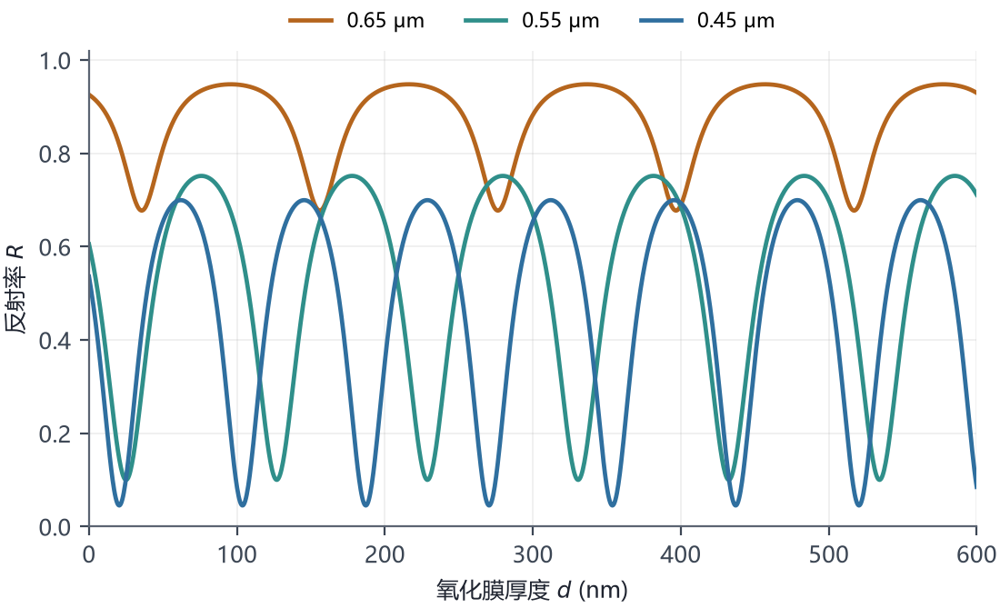
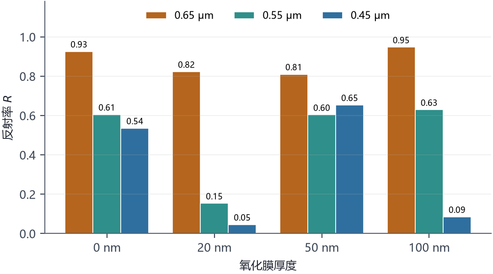
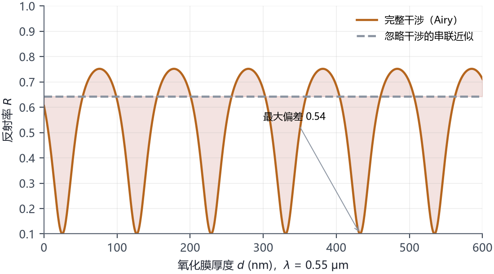

# 第 7 章 氧化层与薄膜

## 7.1 放久了的铜板

一块抛光铜板放在空气里，几天之后颜色就开始变。先是失去那种明亮的橙红，转而发暗、发褐，几个月后变成深棕，某些角度还泛一点紫。用手指擦一擦，亮色回来一部分，说明变化只发生在很薄的一层。

这一层是氧化亚铜，厚度在十到几十纳米之间。它的存在对渲染的影响比多数人以为的大，因为在蓝端，一层 20 纳米的膜就能把反射率从 0.54 压到 0.05。

这一章把这层膜算清楚。单层膜的公式很简单，麻烦的是把它接进微表面模型。

## 7.2 一层膜的振幅叠加

设空气、膜、金属的折射率分别是 $1$、$n_1$、$\tilde n_2=n+\mathrm{i}k$，膜厚 $d$。垂直入射时，界面 1 的振幅反射系数是实数

$$r_{01}=\frac{1-n_1}{1+n_1} , \tag{7.1}$$

界面 2 的是复数

$$r_{12}=\frac{n_1-\tilde n_2}{n_1+\tilde n_2} . \tag{7.2}$$

光在膜里往返一次，相位变化是

$$\delta=\frac{2\pi n_1 d}{\lambda} , \tag{7.3}$$

往返两趟，所以相位因子是 $e^{2\mathrm{i}\delta}$，同时振幅乘上界面的透射系数 $t_{01}t_{10}=1-r_{01}^2$。

总反射振幅是所有这些路径的叠加：

$$r=r_{01}+(1-r_{01}^2)\,r_{12}e^{2\mathrm{i}\delta}\left[1+r_{10}r_{12}e^{2\mathrm{i}\delta}+\left(r_{10}r_{12}e^{2\mathrm{i}\delta}\right)^2+\cdots\right] . \tag{7.4}$$

方括号里是等比级数，公比 $r_{10}r_{12}e^{2\mathrm{i}\delta}$，注意 $r_{10}=-r_{01}$。求和并整理：

$$r=\frac{r_{01}+r_{12}e^{2\mathrm{i}\delta}}{1+r_{01}r_{12}e^{2\mathrm{i}\delta}} . \tag{7.5}$$

反射率是 $R=|r|^2$。这个式子是 Airy 公式在垂直入射下的形式，它把膜内无穷多次往返的反射全部加起来，没有做近似。

推导里只用了一个假设：膜的两个界面是平行的。对于氧化膜，这个假设成立得相当好，因为膜是沿着金属表面长出来的，粗糙度大致跟随基底。

## 7.3 反射率随厚度振荡

式 (7.5) 的分子里两项各带一个相位，当 $2\delta$ 从 0 变到 $\pi$ 再变到 $2\pi$，两个界面贡献的相对相位翻转一次，$|r|^2$ 就在极大与极小之间走一个来回。转换的周期对应

$$2\delta=2\pi\ \Rightarrow\ d=\frac{\lambda}{2n_1} . \tag{7.6}$$

取 $n_1=2.70$、$\lambda=0.55\ \mu$m，周期是 102 nm。图 7-1 画了铜表面氧化亚铜膜在三个波长上的反射率随厚度的变化。

三条曲线的周期不同，红端最长、蓝端最短，比例就是波长的比例。它们的最小值位置也不同：0.55 μm 的第一个极小在 51 nm 附近，0.45 μm 的在 42 nm。这解释了为什么一块氧化程度不均匀的铜板，不同区域会呈现不同的颜色——厚度差 10 nm 就够。

极小的深度比预想的深。0.55 μm 处从 0.61 掉到 0.09。这不是"变暗了一点"，是把绿光几乎全部消灭。原因是两个界面的反射振幅接近相等、相位相反，形成相消干涉。对一块高反射的金属基底，需要一层高折射率的膜才能把反射压这么低，$n_1=2.7$ 刚好合适。

图 7-2 把三个波长上的值按厚度分组画出来，看色相的变化更直观。

零厚度时三通道是 0.93、0.61、0.54，红高蓝低，是正常的铜色。20 nm 时变成 0.82、0.15、0.05——蓝绿几乎被抽干，剩下的红强烈主导，颜色变成深红偏褐。50 nm 时三通道是 0.81、0.60、0.65，蓝色反而超过了绿色，色相偏紫。100 nm 时回到 0.95、0.63、0.09，红与蓝都高、绿低，呈现一种偏品红的光泽。

这一串颜色变化不是调色能复现的，因为它对厚度极端敏感，而且在自然光下还会随观察角度移动（斜入射时相位 $\delta$ 乘 $\cos\theta$，周期变长）。

## 7.4 什么时候可以不算干涉

真实世界里，薄膜的干涉经常看不见。原因有三个。

**膜太厚。** 光源都有带宽，不同波长的极小值位置不同。当膜厚超过相干长度

$$L_c\approx\frac{\lambda^2}{\Delta\lambda} , \tag{7.7}$$

各波长的振荡互相抵消，只剩下平均值。取 $\lambda=0.55\ \mu$m、$\Delta\lambda=20$ nm，得到 $L_c\approx15\ \mu$m。超过这个厚度的膜（比如清漆、涂层）不需要算干涉，用两次界面的强度叠加就够了。

**表面太糙。** 膜厚在空间上起伏，相位 $2\delta$ 跟着起伏，反射率在空间上平均后也被抹平。判据是膜厚起伏的均方根 $\sigma_d$ 满足 $4\pi n_1\sigma_d/\lambda\gg1$。对 $n_1=2.7$、$\lambda=0.55$，$\sigma_d$ 超过 30 nm 就基本看不见干涉了。

**角度分散。** 光源有大小、观察有立体角，斜入射角度不同，$\delta$ 不同，同样会抹平。

反过来，金属的氧化膜通常恰好落在"看得见"的区间：厚度几十纳米，比相干长度小两个数量级；膜跟着基底长，粗糙度低；氧化层薄，人眼在近距离观察时张角也小。

图 7-3 给出忽略干涉的代价。

串联近似把两次界面的强度反射率直接相加，得到一条水平的 0.637。完整公式在 0.09 到 0.75 之间振荡，最大偏差 0.55。也就是说，对这个厚度的膜，"忽略干涉"不是差一点，是完全不同的答案。

## 7.5 接进微表面模型

单层膜公式描述的是一个平面。金属表面是粗糙的，要把膜放进微表面框架，需要做几个决定。

**膜跟随基底。** 假设膜厚在微观尺度上均匀，每个微面上的膜厚都是 $d$。这要求膜的生长是保形的，对化学氧化基本成立，对喷涂的厚涂层不成立。

**膜的界面不改变法线。** 膜很薄，它的两个界面在几何上几乎平行于基底微面，所以微表面的法线分布与无膜时相同。厚度远小于横向尺度时这个近似很好，因为 30 nm 的膜长在 1 μm 的微面上，倾角几乎不变。

**$F$ 换成膜的反射率。** 微表面 BRDF 里的 $F(\omega_i\cdot h)$ 换成 $R_{\text{film}}(\omega_i\cdot h)$，也就是把式 (7.5) 在对应入射角上的值代进去。斜入射时公式要推广到复角，做法与第 2 章相同，只是多了一层。

这一步在实现上有一个陷阱：$R_{\text{film}}$ 依赖角度，而角度在微表面里是 $\omega\cdot h$。如果把膜的反射率当成一个与角度无关的常数去预积分，那么在不同粗糙度下会有不同的误差——粗糙度越高，$\omega\cdot h$ 的分布越宽，平均到的角度越偏，误差越大。

另一个陷阱是能量。膜的反射率在干涉极小处可以接近零，这不违反能量守恒（那部分能量进了金属被吸收），但它会让多次散射的补偿项失效：第 5 章的 $F_{\text{avg}}$ 假设反射率随角度单调上升，而膜的存在破坏了这个单调性。实际做法是用膜的反射率重新算一遍 $F_{\text{avg}}$ 与 $E$ 的耦合，或者干脆在膜的极小值附近接受几个百分点的能量误差。

## 7.6 常见近似

工程上有三种简化，各有适用范围。

**把它折进 $F_0$。** 只改垂直入射的反射率，保留 Schlick 的角度形状。这适合膜很薄（小于 10 nm）或者只想要颜色变化、不关心角度行为的场合。代价是掠射角的行为完全错了，因为膜在掠射时的干涉条件与垂直入射差很多。

**把它当成第二层 Fresnel。** 用 $R=R_{01}+(1-R_{01})^2R_{12}/(1-R_{01}R_{12})$，也就是图 7-3 里的串联近似。它给出正确的平均值，丢掉振荡。适合膜厚超过相干长度、或者膜厚在空间上很不均匀的情况，比如锈层、厚氧化皮。

**折射率混合。** 把膜与金属当成一个有效介质，用 Maxwell–Garnett 或者 Bruggeman 公式算有效折射率。适合多孔的、成分渐变的氧化层，比如铝表面那种由氧化物与空隙混合的层。这个做法需要体积分数这个额外参数，标定困难，一般只在做特定产品的匹配时使用。

三种近似都不是"偷懒"，而是针对不同物理情况的取舍。判断用哪一个，看两个量：膜厚与相干长度之比，以及膜厚起伏与波长之比。

## 7.7 单层近似之外还差什么

这一章只做了单层、垂直入射、标量强度。真实情况里还有三件事。

多层膜。氧化层外面可能还有一层污染物、一层漆、一层镀膜。多层要用传输矩阵，把每一层的相位与界面系数写成 $2\times2$ 矩阵连乘。

斜入射与偏振。斜入射时 s 与 p 两个分量的相位变化不同，干涉极小值的位置也不同。这就是为什么薄膜在偏振光下会呈现不同的颜色。

衍射与结构色。当表面结构的尺度与波长同量级时，干涉不再是"薄膜"问题，而是衍射问题。阳极氧化铝的着色、蝴蝶翅膀的颜色都属于这一类。

这三件事都要相位才能算。本章只给出 $R_{\text{film}}(\theta,\lambda)$ 这个接口与单层近似，式 (7.5) 是它在垂直入射、单层、标量近似下的特例；多层膜、角度扫掠与偏振要解传输矩阵，超出了本书的范围。

---

这一章的三件事。金属表面的几十纳米氧化膜会显著改变反射率，因为它产生了薄膜干涉。干涉让反射率随厚度振荡，周期是 $\lambda/2n$，三个颜色通道不同步，于是色相随厚度变化。什么时候可以忽略它，由相干长度与表面起伏共同决定，多数金属氧化层落在必须算的区间里。

下一章把这些内容压进实时管线：预积分、LUT、以及每个近似换来的代价。
