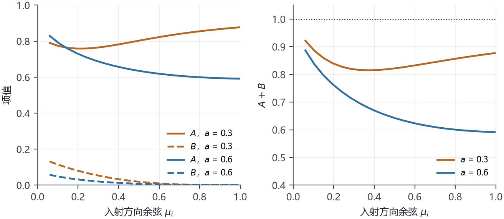
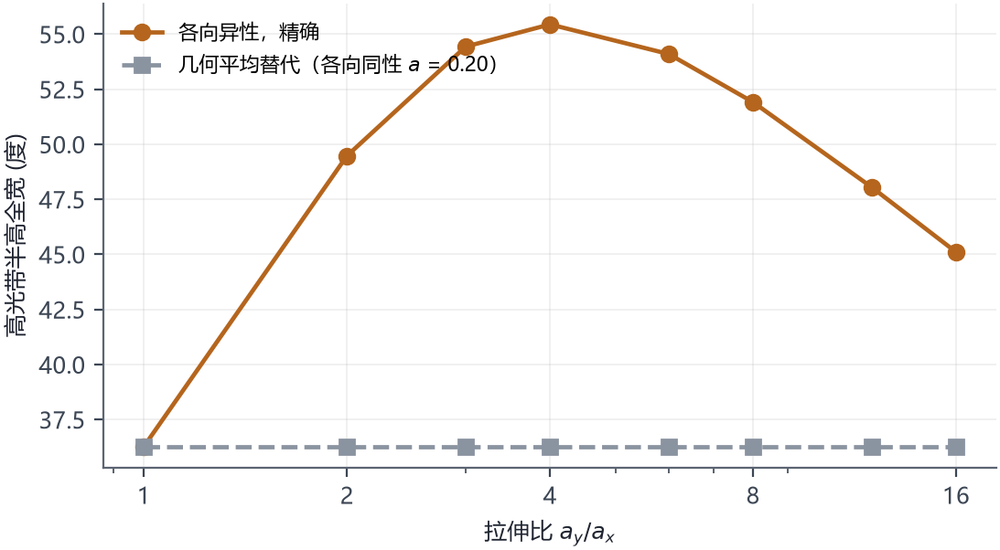
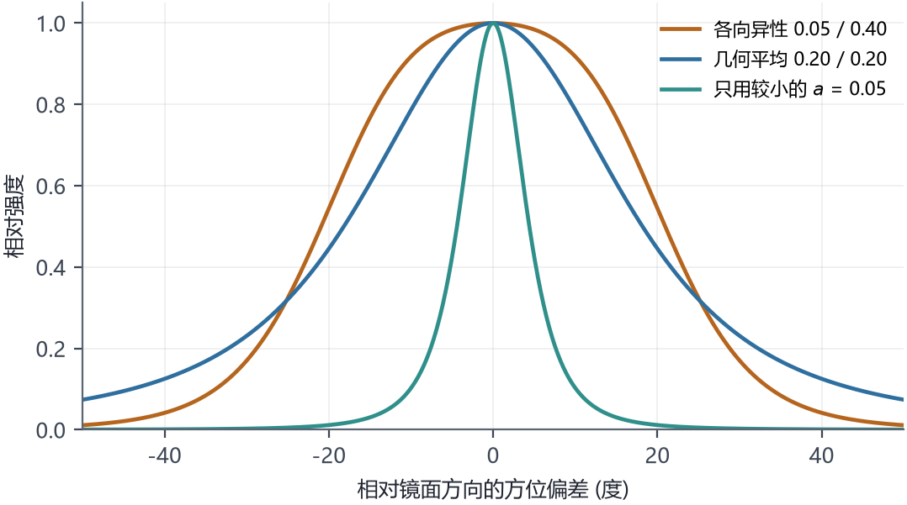

# 第 8 章 实时近似

## 8.1 一条要在一毫秒内算完的亮带

手机上的一个产品展示页面，金属外壳占画面三分之一，要跑 60 帧。

每一帧要对每个像素算入射方向上的环境积分。环境是一张贴图，可能是立方体图、可能是等距柱状投影，上面有窗户、天空、地面。积分要把半球上所有方向的光乘上 BRDF 加起来，而这个 BRDF 每一项都依赖粗糙度、两个方位角与 Fresnel。直接算不可能在一毫秒内完成。

实时渲染的做法是把这个积分拆成两个可以预先算好的部分。这一章说明这个拆分在各向异性下要改什么，以及每一次降级换来什么、丢掉什么。

## 8.2 split-sum 的分解

设环境辐亮度为 $L_i(\omega)$，微表面 BRDF 是 $f=F\,D\,G/(4\mu_i\mu_o)$。出射辐亮度是

$$L_o=\int_\Omega L_i(\omega)\,f(\omega,\omega_o)\,\cos\theta\,d\omega . \tag{8.1}$$

Karis 在 2013 年给出的近似是把积分拆成两个因子的乘积：

$$L_o\approx\underbrace{\int_\Omega L_i(\omega)\,D(\omega,\omega_o)\,\cos\theta\,d\omega}_{\text{预过滤环境}}\cdot\underbrace{\int_\Omega f(\omega,\omega_o)\,F(\omega\cdot h)\,\cos\theta\,d\omega}_{\text{BRDF 积分}} . \tag{8.2}$$

拆分的合法性依赖一个假设：第二个积分里的方向分布（由 $D$ 与 $G$ 决定）足够集中，使得 $L_i$ 在它上面近似常数，可以提到第一个积分外面。粗糙度越低，这个假设越好；粗糙度接近 1 时，反射瓣铺满整个半球，$L_i$ 的方差不小，误差就出来了。

第一个因子是预过滤环境贴图，按粗糙度分级模糊，运行时按粗糙度与反射方向采样。第二个因子只跟粗糙度、$\mu_o$ 与 $F_0$ 有关，可以预积分成一张二维表，运行时查表。

把 $F$ 拆成 $F_0+(1-F_0)(1-\cos)^5$，第二个积分变成 $F_0A+B$：

$$A(\mu_o,a)=\int_\Omega\frac{D\,G}{4\mu_i\mu_o}\left[1-\left(1-\omega\cdot h\right)^5\right]\cos\theta\,d\omega , \tag{8.3}$$

$$B(\mu_o,a)=\int_\Omega\frac{D\,G}{4\mu_i\mu_o}\left(1-\omega\cdot h\right)^5\cos\theta\,d\omega . \tag{8.4}$$

图 8-1 是这两个量的数值积分结果。

$A$ 随粗糙度上升，$B$ 随粗糙度下降。$A+B$ 有明确的含义：它就是单次散射的方向反照率，因为把它们相加正好等于把 $F$ 取 1 时的积分。

这个含义给出一个有用的检查：$A+B$ 小于 1 多少，就是单次散射损失了多少能量。$a=0.3$ 时垂直入射是 0.877，$a=0.6$ 时是 0.592。也就是说，粗糙的金属在实时管线里天然会暗四成。

问题在于很多实现把 $A+B$ 归一化到 1 再存进 LUT。这样画面更"亮"，但它把物理上真实的能量损失抹掉，换成了看起来差不多的亮度。代价是：当环境很暗、光源很强时，粗糙金属的高光与环境反射的比例会失衡；做白炉测试时也永远对不上。正确的做法是保留 $A+B$ 的损失，另外用第 5 章的补偿项把它补回来——补偿项是一个宽底，而 LUT 里 $A+B$ 的缺失是整体缩放，两者不能互相替代。

## 8.3 各向异性把 LUT 撑大了

各向同性时，第二个积分只依赖 $(\mu_o,a)$，两个参数，一张 128×128 的表就够。各向异性下它依赖 $(\mu_o,a_x,a_y,\phi_o)$，四个参数。

工程上的处理分三类。

**增维。** 把 LUT 扩成 $(\mu_o,a,\text{aspect})$ 三维，$\phi_o$ 用对称性折叠（$[0,\pi/2]$ 就够，其余由对称得到）。一张 $32\times32\times32$ 的三维表是 32K 个浮点，按 16 位存是 128 KB，可以接受。$a$ 取几何平均，aspect 取 $a_y/a_x$ 的对数。

**解析拟合。** 用几项解析函数去逼近积分结果，避免纹理。代价是精度，尤其是极端拉伸比与掠射角。

**降成二维。** 直接忽略拉伸，用 $\sqrt{a_xa_y}$ 查各向同性的表。这是最省的做法，也是误差最大的。

## 8.4 降维的代价

图 8-2 量化第三种做法。

固定几何平均 0.20，把拉伸比从 1 拉到 16，测高光带的半高全宽。拉伸比 1 时两条曲线重合，因为此时就是各向同性。拉伸比 2 时精确值是 49.5 度，近似值是 36.3 度，小了 27%；拉伸比 4 时精确 55.4 度，误差 35%；拉伸比 16 时精确 45.1 度，误差 20%。

误差不是单调的，因为精确曲线在拉伸比 4 附近有峰值。这个峰值来自两个方向的竞争：拉伸越大，宽方向的瓣越宽，但窄方向越窄，两者对"沿带方向的半高全宽"的贡献此消彼长。

对画面的影响是高光带明显偏短、偏窄。美术看不到"能量不对"，只看到"高光不够长"，于是去调各向异性强度，越调越偏。这类误差最难排查，因为它不违反直觉，只是数值错了。

顺带一个观察：几何平均这个替代方案在拉伸比小于 2 时误差可以忽略（这个区间里大部分材质都落在其中），在拉伸比大于 4 时就完全不能用了。所以很多引擎的做法是：拉伸比小于 4 用几何平均，超过就切到三维 LUT——两套路径，按材质打标签。

## 8.5 移动端的取舍

移动端更紧。三维 LUT 的纹理带宽、寄存器压力都受不了，常见的做法有两种。

**只保留窄方向的粗糙度。** 用 $a_x$ 当作唯一的粗糙度，等于假设宽方向无穷宽。图 8-3 把三种做法的剖面画在一起。

橙色是精确的各向异性 $a_x=0.05$、$a_y=0.40$，蓝色是几何平均 0.20，绿色是只用 0.05。绿色的峰最窄，两翼几乎没有；蓝色的两翼偏宽、峰值形状不对；橙色介于两者之间，是一个 0.05 的尖峰叠在一个 0.40 的宽包上。

这个"尖峰加宽座"的形状正是各向异性的特征，任何单一粗糙度都表现不出来。移动端接受这一点，是因为屏幕小、视角变化快，观众看不出两翼的差别；一旦放到大屏上做产品展示，这个近似就会被立刻发现。

**把各向异性折成一个亮度因子。** 用各向异性的能量比例去调制各向同性的结果，让"拉伸越大越暗"这个趋势对上。这连形状都不改，只改总量。它的优势是零成本，劣势是高光带的形状完全消失。

**用解析的各向异性 NDF 但不预过滤环境。** 环境用固定的几级模糊，BRDF 用完整的各向异性公式。这样高光带的形状对了，环境的模糊程度不对——同一张环境贴图被用在了不同的拉伸比上。代价是反射内容与粗糙度不匹配，但形状对了，观感通常更好。这一条在移动端是性价比最高的折中。

## 8.6 一个实现检查表

各向异性的实时实现，容易错的地方集中在几处。

参数的单调性。很多引擎把“粗糙度” $r$ 映射到 $\alpha=r^2$，各向异性再乘一个因子。如果 $a_x$ 与 $a_y$ 走了不同的映射路径，拉伸比就不是你以为的那个值。查法：把 $a_x,a_y$ 打印出来，与面板上的滑块值对照。
预过滤的方向。各向异性的预过滤环境必须沿着拉伸轴做一维模糊，而不是各向同性的高斯。如果预过滤用了各向同性模糊，那么无论 BRDF 多准，反射的内容都是错的。这一条在移动端几乎总是被牺牲掉。

LUT 的符号与范围。$\mu_o$ 在 LUT 里通常存成 $\sqrt{\mu_o}$ 或者 $\mu_o$ 的平方根映射，为的是在掠射处多分配精度。各向异性还要为 aspect 选一个映射，对数映射比线性好，因为 aspect 跨越两个数量级。

切线空间的约定。LUT 里的 $\phi_o$ 是相对切线的方位角，切线选错 90 度，整张表都用错方向。

能量。$A+B$ 的损失要么保留要么补偿，不能既归一化又加补偿项——那会过曝。两种做法选一种，并且在整个项目里保持一致。

---

这一章的三件事。split-sum 把环境积分拆成预过滤与 BRDF 两项，各向异性把 BRDF 项的参数从两个变成四个。降维到几何平均会在拉伸比大于 4 时产生 30% 量级的高光带宽误差。移动端的每一种近似都在牺牲形状、牺牲环境模糊、牺牲能量三者之间选一个。

下一章做一件更基本的事：证明自己写对了。
