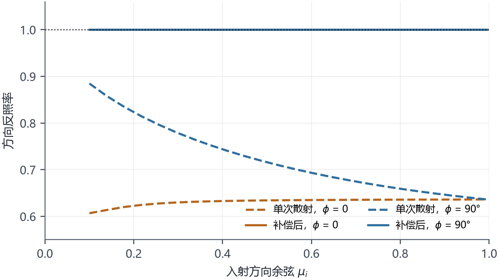
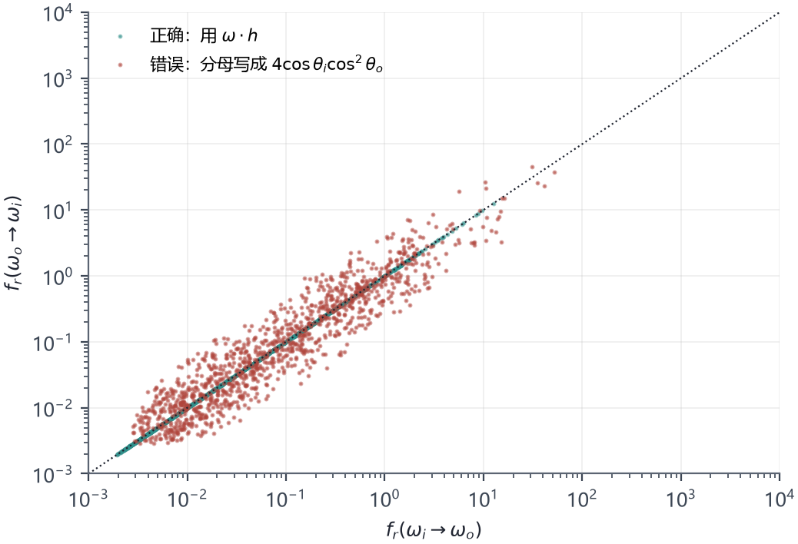
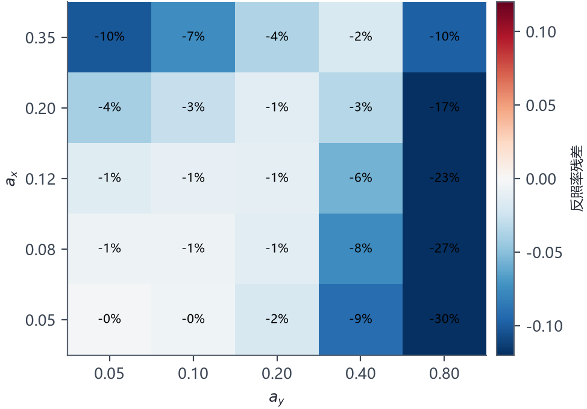

# 第 9 章 验证

## 9.1 一张说不清哪里不对的图

渲染一个拉丝钢的茶壶，背景是灰色渐变。光源是一盏面光，加一张环境贴图。图出来了，高光带在，方向也对，明暗过渡也顺。甲方说"感觉不太对"，你说不出哪里不对。

这种情况没法靠调参数解决，因为问题可能在任何一层：法线分布、遮蔽、能量、切线空间、预积分、色调映射。需要一个能定位到层的流程。

这一章给四组测试，从最便宜到最贵，每一组都能把问题范围缩小一半。

## 9.2 白炉：能量对不对

把材质的反射率设成 1（$F_0=1$，不吸收），环境换成均匀的白色，亮度记为 $L$。物理上物体应该完全消失，与背景一致。

测试的做法不是看图像，是算数。对给定的入射方向 $\omega_i$，把 BSDF 在整个半球上积分：

$$R(\omega_i)=\int_\Omega f_r(\omega_i,\omega_o)\cos\theta_o\,d\omega_o . \tag{9.1}$$

要求 $R(\omega_i)=1$，误差小于容差。各向异性要多测几个 $\phi_i$：$\phi=0$ 与 $\phi=90$ 度是两个极端，中间取两个。

图 9-1 是 $a_x=0.05$、$a_y=0.80$ 的结果。

单次散射的两个方位角相差很多：$\phi=0$ 全程在 0.60 到 0.64 之间，$\phi=90$ 从掠射的 0.88 一路降到 0.64。补偿之后两条都落到 1 上，这一版实现里残差在 $10^{-4}$ 量级，因为 E 的网格与补偿项的积分网格取成了同一套。

残差这么小是有前提的，实际渲染器做不到。查表用 32 个采样点、半球积分用 128×128，残差会回到 1% 到 2%，主要来自 $\mu$ 接近 0 那一段的插值。所以白炉测试的容差一般给 2%，超过就是有问题，而不是"精度不够"。

这一步能抓到的错误：$1/\cos^4$ 漏掉（第 3 章，会掉 30% 以上）、$D$ 的归一化常数错（少一个 $\pi$，整体偏 3 倍）、补偿项的 $1-E_{\text{avg}}$ 写反（补偿后过 1）、$G$ 用了 $G_1$ 而不是 $G_2$（偏高）。抓不到的错误：形状对但方向错（如切线选错），因为能量仍然守恒。

## 9.3 互易性：方向对称不对

第二个测试更便宜。随机取一千对方向 $(\omega_i,\omega_o)$，比较 $f_r(\omega_i,\omega_o)$ 与 $f_r(\omega_o,\omega_i)$。正确的实现里两者完全相同，误差在浮点精度内。

图 9-2 是一个正确的实现与一个故意写错的实现。

正确实现的所有点落在对角线上，分毫不差。错误实现把分母写成了 $4\cos\theta_i\cos^2\theta_o$，一个极容易打错的笔误，点的散布达到一个数量级，中位相对偏差 $10^{0.2}\approx1.6$ 倍。

这个测试的灵敏度取决于错误落在哪一项。同样是一处笔误，如果错在 Fresnel 的角度上（用 $\omega_o\cdot n$ 代替 $\omega_o\cdot h$），对 $F_0=0.9$ 的金属，中位偏差只有 0.3%，因为金属的 $F$ 因子本身在 0.9 到 1 之间，变化幅度只有 10%。换成 $F_0=0.04$ 的电介质，同一个错误的偏差会大一个数量级。所以互易性测试在金属上不如在白炉上灵敏，两个都要做。

抓得到的错误：$\cos\theta_i$ 与 $\cos\theta_o$ 换位、$D$ 或 $G$ 里混入了只与一侧有关的量、非对称的经验模型（某些布料模型）。抓不到的：整体缩放错误、粗糙度映射错误。

## 9.4 参数扫描：能量在参数空间里怎么变

前两个测试是点测试。第三个是把参数扫一遍，看残差在整个参数空间里的分布。

图 9-3 是一个有缺陷的实现：BRDF 用真实的各向异性形式，但补偿项用的是几何平均的一维表。

对角线（$a_x=a_y$）上的残差在 1% 以内，因为那里一维表是准确的。偏离对角线越多，残差越大：$a_x=0.05$、$a_y=0.80$ 处是 $-30\%$，$a_x=0.12$、$a_y=0.80$ 处是 $-23\%$。

这张图给出的信息比单个数字多。它告诉你哪一片参数区域是安全的，哪一片必须换更贵的做法。如果项目里的材质集中在拉伸比小于 4、几何平均小于 0.3 的区域，一维表够用；一旦有拉伸比 8 以上的资产，就必须上二维或三维表。

扫描的粒度不用很细。$5\times5$ 的网格、固定入射角 45 度、两个方位角，跑一次几秒钟，能覆盖大部分问题。

## 9.5 与参考对比

前三组测试都是自洽性检验，它们能发现实现错误，不能发现模型选择错误。要判断"模型本身对不对"，只能拿一条独立的路径去比。

参考实现通常有两种。一是蒙特卡洛积分器：同一个 BSDF，不做 split-sum、不做查表，直接对半球做重要性采样，采样数给到能收敛。这能验证所有的预积分、LUT、近似。二是另一个独立的渲染器，或者一组实测数据。

对比的做法要注意三点。用同一组随机数种子，否则噪声会掩盖系统性偏差。比较的是"每一个像素的均值"，不是"两幅图的相似度"，后者会被色调映射抹平。差异图的统计量用相对误差的中位数与 95 分位，不要用最大值，最大值永远出现在高光边缘。

一个常见的陷阱：参考实现与实时实现用了不同的 $\alpha$ 映射。如果一边是 $\alpha=r^2$、另一边是 $\alpha=r$，那么两条曲线在所有粗糙度上都对不上，而你会以为是 BRDF 的问题。对比之前先把参数映射对齐，最好打印出来核对。

## 9.6 一份 bug 清单

下面这些错误在这本书的范围内反复出现，按"症状"排。

**轮廓出现白边。** Fresnel 用了 $\omega\cdot n$，不是 $\omega\cdot h$。粗糙度越高越明显。

**整体偏暗、越粗糙越暗。** 少了 $1/\cos^4\theta$，或者少了多次散射补偿。用白炉测试区分：残差随粗糙度单调下降是前者，随拉伸比下降是后者。

**高光带方向差 90 度。** 切线选错，或者两个粗糙度交换了。用单向丝纹的测试板验证。

**高光带两端不对称。** 切线没有正交化或没有归一化。

**掠射处爆亮。** Schlick 用在 $F_0$ 很低的金属上（铁、钛），或者 Fresnel 的角度算错。

**粗糙金属的高光与环境亮度比例失衡。** split-sum 的 $A+B$ 被归一化到 1，同时没有补偿项，或者两者都做了。

**同一零件不同区域高光方向不同。** 各向异性方向贴图与 UV 不一致，或者 UV 有镜像。

**转动相机时高光带闪烁。** 预过滤环境用了各向同性模糊，或者 LOD 的粗糙度映射在各向异性下没改。

**金属看起来像涂了漆。** 漫反射项没有清零，或者 $F_0$ 被当成了基色。

**氧化层颜色不对但厚度看着对。** 用了串联近似而没算干涉，或者膜的折射率用了基底的值。

## 9.7 收尾：一次完整的标定

把前面几章串起来，一个拉丝金属资产的完整流程是这样。

先定方向。丝纹的方向在模型上要有一条明确的线：UV 的某一轴、或者一张方向贴图。用测试板确认渲染结果里的亮带垂直于它。

再定两个粗糙度。从参考照片上量高光带的长度与宽度，按第 4 章的比值关系给出 $a_x$、$a_y$ 的初值，然后微调到视觉一致。

再定 $F_0$。用附录 B 的 $(n,k)$ 算，不要凭颜色填。如果资产是合金或者有镀层，$F_0$ 只能实测或者查厂商数据。

再处理膜。看样品有没有氧化、有没有清漆。有就加一层，按第 7 章判断用完整公式还是近似。

最后跑测试。白炉、互易性、参数扫描、参考对比，四组都过，才进生产。

---

这一章的结论很朴素：先说清楚要验证什么，再选测试。白炉验能量，互易性验对称，参数扫描验适用范围，参考对比验模型。四组测试加起来不到一天的工作量，能省下后面几周的返工。

四组测试的顺序也有讲究，从便宜到贵：互易性几秒钟，白炉几秒钟，参数扫描几分钟，参考对比几小时。前两个在改代码的时候每次都要跑。
