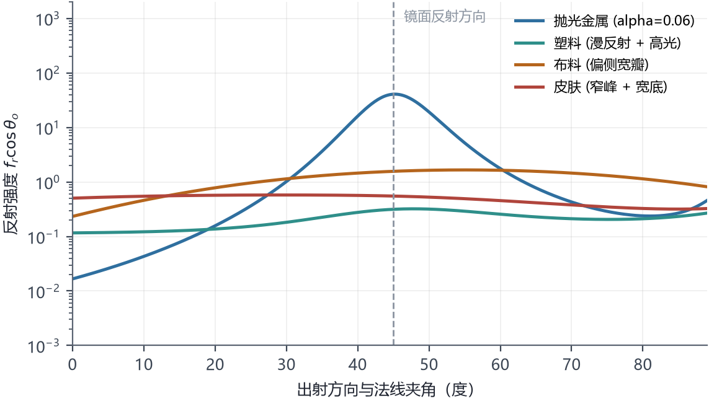
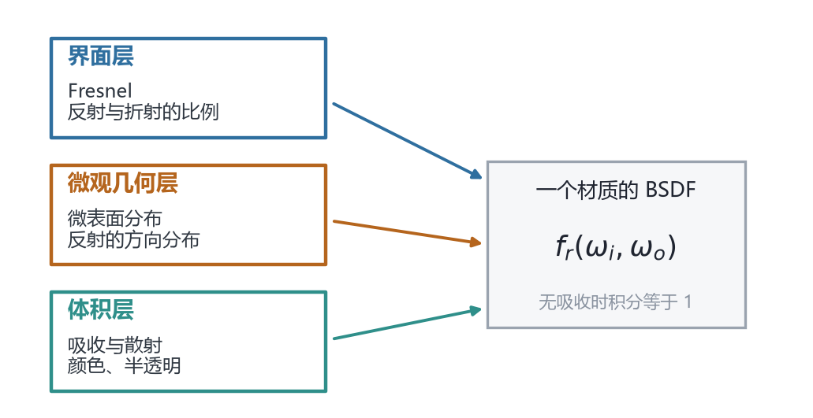

# 第 1 章 从光线追踪器到材质系统

## 1.1 一个能出图的光线追踪器

先假设你手上有一个这样的渲染器。它支持球体、平面、三角形，射线求交用暴力遍历，每个像素发一条光线，碰到物体就查一下材质，材质只有一个漫反射项：

$$L_o(x)=\frac{\rho}{\pi}\int_{\Omega}L_i(x,\omega_i)\cos\theta_i\,d\omega_i . \tag{1.1}$$

$\rho$ 是一个 $[0,1]$ 的三元组，美术叫它颜色。再配一个环境光和两个点光源，你能渲染出球、地面、影子，图像干净，边缘平滑，看起来一切正常。

这个渲染器在渲染石膏、白墙、纸的时候没有问题，因为这些物体的反射确实接近漫反射。但只要换成别的材料，问题立刻出现，而且每一种材料错的方式都不一样。

金属球渲染出来是灰的。你把 $\rho$ 调成金黄，它变成一个黄色的球，但高光还是白的、漫的，看起来像刷了金漆的塑料。镜面球更明显，它根本不该有漫反射，应该清晰地映出周围环境，可是公式 (1.1) 里没有"清晰"这个概念。

布料渲染出来像硬纸板。真实的布在边缘会亮起来，正面反而偏暗，绒毛的方向感很明显；而公式 (1.1) 给出的亮度只跟法线和光源夹角有关，和视线无关，所以从任何角度看都一样平。

皮肤渲染出来像塑料。真实的皮肤在背光时边缘透出红色，因为光钻进了肉里，散射几次从旁边出来；公式 (1.1) 认为光一碰到表面就立刻离开，没有任何"进去再出来"的路径。

玻璃更糟。你写了个折射，光线穿过玻璃球，图像却是黑的，因为折射之后你忘了让光线继续走，或者走了但没有考虑玻璃本身的吸收与内部的反射。

这四种错误不是参数没调好。它们的共同点是：公式里少了一整类路径。金属少的是"镜面反射且带颜色"，布料少的是"由大量朝向不同的纤维产生的宽而偏侧的反射"，皮肤少的是"进入介质内部再出射"，玻璃少的是"穿过界面之后的那一段路程"。

本书要做的，就是把这些路径一类一类补回公式里。

## 1.2 反射不是一个数，而是一个分布

把问题看得更仔细一点。给定一个入射方向 $\omega_i$，表面会向各个方向反射光。真正决定材质外观的，是"往哪个方向反射多少"这件事，也就是一个定义在出射方向上的函数。

公式 (1.1) 把这个函数取成了常数 $\rho/\pi$，意思是不管往哪个方向看，亮度都一样。这就是漫反射。真实材料的这个函数形状差别极大：

- 抛光金属和镜面，函数集中在镜面反射方向附近，几乎是一个尖峰。粗糙度越低，峰越窄。
- 塑料和清漆，峰很窄，但峰以外还有一层均匀的底，底来自颜料颗粒的多次散射。
- 布料和绒面，函数很宽，峰值不在镜面方向，而在偏离镜面方向的位置，掠射角时还会整体变亮。
- 皮肤，函数在表面附近有一个窄峰（油脂层），加上一个宽得多的、带颜色的底（真皮层散射）。

图 1-1 把这条曲线画了出来。四条曲线的差别，比任何颜色参数都更能说明材质是什么。你调 $\rho$ 只能整体缩放曲线的高度，调不出曲线形状的差异。

于是第一个结论得到：**材质的核心是一个关于方向的函数，不是一个颜色。** 颜色只是这个函数在某个条件下的积分结果。

## 1.3 材质要回答的五个问题

把上面这些整理一下，一个材质系统需要回答五个问题。后面每一章都在回答其中之一。

**第一，反射多少。** 给定入射方向，有多少比例的能量被反射回来。这个量叫方向反照率，它必须落在 0 到 1 之间，超过 1 就意味着凭空造能量。很多渲染器在这里出问题，因为把几个项相加时没有检查总和。

**第二，朝哪个方向反射。** 这就是图 1-1 的曲线形状。它由表面的微观几何决定：平面给出尖峰，粗糙面给出宽峰，纤维给出偏侧的峰。

**第三，颜色从哪里来。** 这里有两种完全不同的机制。一种是吸收：光进入材料，某些波长被吃掉了，剩下的反射出来，颜料和布料属于这一类。另一种是选择性反射：金属对不同频率的响应不同，红光的反射率就是比蓝光高，这个差别发生在界面本身，不涉及进入内部。两者在公式里的位置不同，混用会导致错误的能量行为。

**第四，没被反射的能量去了哪里。** 它可能穿过了表面（透明、半透明），可能进入了内部散射后从别处出来（次表面散射），也可能被吸收变成热。能量守恒要求这几种去向加起来等于入射。一个材质如果只写反射项而不写透射项，那么在物理上它等价于"剩下的全被吸收了"，这在玻璃上就错得很明显。

**第五，怎么采样。** 渲染器不会遍历所有方向，它按某个概率分布挑几个方向。分布挑得不好，方差就大；分布和公式不匹配，结果就有偏。这个问题的处理方式在每本书里都一样，但每种材质的最优分布不同。

## 1.4 一个材质的解剖：三层视角

面对一种新材料，一个有用的习惯是把它拆成三层来看。

**界面层。** 光遇到的第一件事是被反射还是被折射。这个比例由两侧的折射率决定，与表面的粗糙度无关，与颜色也无关。它只跟角度和波长有关。这就是 Fresnel 效应，第 3 章专门处理。

**微观几何层。** 表面在微观上不是平的，是一堆朝向各异的小面。这一层决定了反射分布的宽度和形状，也就是"粗糙度"到底作用在哪里。第 4 到 6 章处理。

**体积层。** 光进入材料之后，在内部被吸收和散射，可能走一段路再从别处出来。这一层决定了半透明、颜色饱和度、边缘光。第 7 章会碰到它的一小部分：光在微面之间来回反弹、被吸收掉一些。真正进到介质内部走一段再出来的情形，需要另一套函数，不在本书的范围内。

三层不是互斥的模型，而是同一个界面的三个侧面。写代码时它们可以合并成一个函数，但分析问题时分开看会清楚很多。举个例子，为什么金属的颜色必须来自界面层而布料颜色来自体积层，用这三层一看就明白：金属的自由电子在界面上就把某些频率的光挡回去了，光根本没进去；布料的染料在纤维内部，光必须进去走一圈才能被染色。

## 1.5 本书的路线

接下来的章节按依赖顺序排。

第 2 章给出 BSDF 与渲染方程的正式定义，把"方向函数"这件事写成可以运算的形式。第 3 章处理 Fresnel，这是所有材质共用的第一道门。

第 4 到 6 章是微表面理论，从法线分布讲到遮蔽函数，再拼成完整的 Cook–Torrance 形式。这部分是整本书最需要耐心的部分，后面每一章都会用到这里的结论。第 7 章处理一个容易被忽略的后果：单次散射的微表面会丢掉一部分能量，粗糙度越高丢得越多。

第 8 章讲光穿过界面，包括粗糙透射。第 9 章把两层材质叠起来，得到涂层、清漆这样的分层材质。

第 10 章讲采样。这一章的内容在实现时最容易被写错，也最容易被验证出来：pdf 少乘一个 Jacobian，图像只是噪一点，不报错，但结果是错的。

第 11 章讲参数化，说明为什么美术面板上的"粗糙度"和公式里的 $\alpha$ 不是同一个东西。第 12 章讲验证，给出一套能自己检查的流程。

第 13 章指出这套骨架的边界，也就是光谱和偏振这两个维度在什么地方会破坏 RGB 假设。第 14 章讨论材质系统怎么组织，把前面所有内容收进一个接口。

---

读完这一章，应该记住三件事。材质是一个关于方向的函数，不是一个颜色。材质要回答反射多少、朝哪反射、颜色从哪来、能量去哪了、怎么采样这五个问题。分析新材料时，把它拆成界面、微观几何、体积三层来看。

下一章把这些话说成公式。
