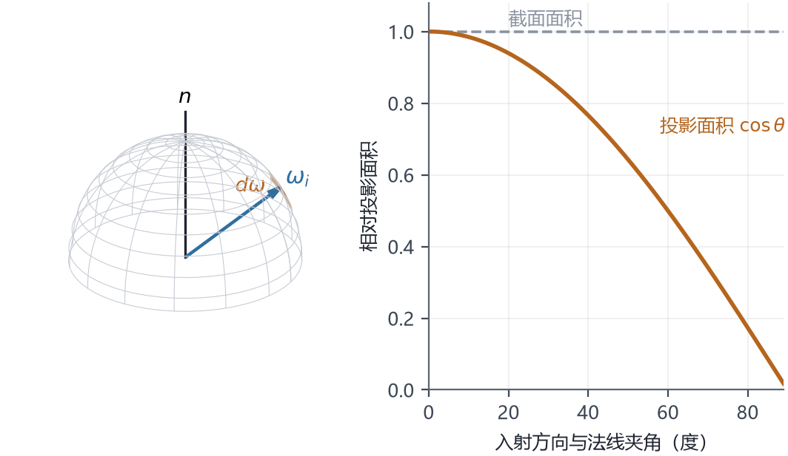
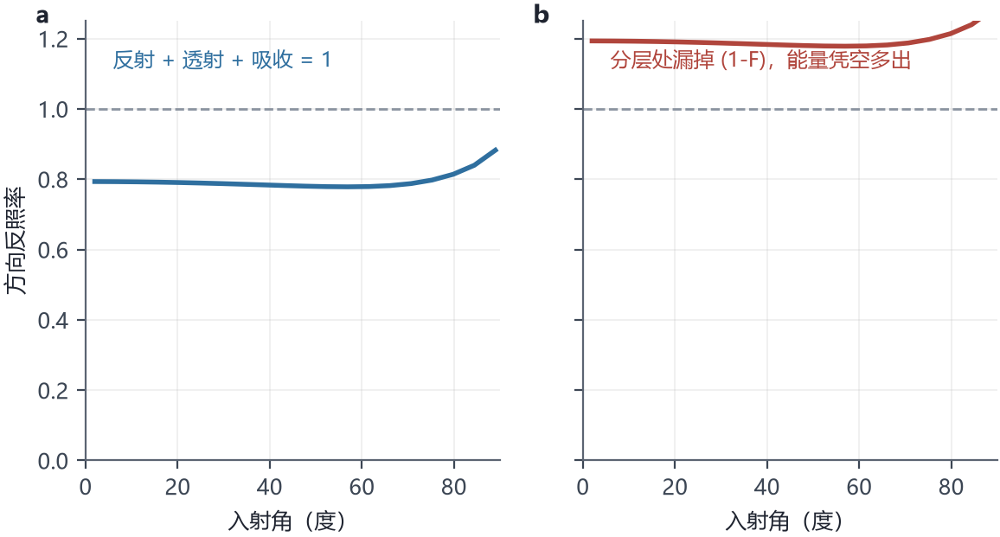

# 第 2 章 BSDF、渲染方程与互易性

## 2.1 为什么先要把定义写清楚

第 1 章说材质是一个关于方向的函数，这句话还是太模糊。函数定义在什么集合上，自变量是什么，值是什么单位，函数要满足什么约束，这些不写清楚，后面每推一步都要重新猜。

这一章把定义钉死。内容看起来偏形式化，但它们是后面所有公式的地基：微表面的分母为什么是 $4\cos\theta_i\cos\theta_o$，采样时 pdf 为什么要乘一个 Jacobian，能量守恒怎么检验，全都要回到这里的定义。

## 2.2 半球、立体角与投影

设表面点 $x$ 处的法线为 $n$，把法线朝外的那半个球面记为 $\Omega$。一个方向用单位向量 $\omega$ 表示，它与法线的夹角为 $\theta$，于是 $\cos\theta=\omega\cdot n$。

立体角是球面上的面积元除以半径平方。用球坐标写，$\theta$ 从 0 到 $\pi/2$，$\phi$ 从 0 到 $2\pi$：

$$d\omega=\sin\theta\,d\theta\,d\phi . \tag{2.1}$$

在半球上积分这个量，得到 $2\pi$，这是半球的总立体角。

渲染方程里经常出现 $\cos\theta\,d\omega$ 这一对。它不是随手写的权重，来源是"投影面积"：一束截面为 $dA$ 的光，斜着照到表面上，覆盖的面积是 $dA/\cos\theta$，所以单位表面积接收到的功率要乘 $\cos\theta$。这一项有时被叫做余弦因子，它跟材质无关，只跟几何有关。

## 2.3 辐亮度与它的不变性

渲染器追踪的量是辐亮度 $L$，单位是瓦特每平方米每球面度（$\mathrm{W\,m^{-2}\,sr^{-1}}$）。它描述的是"沿某个方向、穿过某个垂直截面、单位面积单位立体角的功率"。

辐亮度有一个很重要的性质：**在真空中沿一条射线传播时不变。** 原因是分子和分母同时随距离平方变化。距离变远，穿过单位面积的功率按 $1/r^2$ 衰减，同时该面积张开的立体角也按 $1/r^2$ 缩小，两个因子抵消。

这个性质是光线追踪能成立的前提。它意味着相机在远处和近处看到同一个发光面的亮度相同，意味着我们可以只追一条射线而不必关心它走了多远。它也解释了为什么渲染方程的两边都是 $L$：入射辐亮度和出射辐亮度可以直接用同一个量纲相加，中间的系数不需要带长度。

## 2.4 BRDF 的定义

现在考虑表面。入射方向 $\omega_i$ 带来辐亮度 $L_i$，我们希望知道出射方向 $\omega_o$ 上的辐亮度 $L_o$。

一个自然的想法是定义"反射率"，即出射功率比入射功率。但反射率丢掉了方向信息，不能描述图 1-1 那样的曲线。所以定义要更细：考虑入射方向附近一个很小的立体角 $d\omega_i$，它带来的辐照度增量是

$$dE_i(\omega_i)=L_i(\omega_i)\cos\theta_i\,d\omega_i , \tag{2.2}$$

这个增量在出射方向 $\omega_o$ 上产生的辐亮度增量记为 $dL_o$。两者的比值就是 BRDF：

$$f_r(\omega_i,\omega_o)=\frac{dL_o(\omega_o)}{dE_i(\omega_i)}=\frac{dL_o(\omega_o)}{L_i(\omega_i)\cos\theta_i\,d\omega_i} . \tag{2.3}$$

量纲是 $\mathrm{sr^{-1}}$。这个量纲常被忽略，但它在检查代码时很有用：如果某个实现里 $f_r$ 乘上 $\cos\theta$ 之后量纲不对，多半是漏了什么。

把所有入射方向加起来，得到渲染方程：

$$L_o(x,\omega_o)=\int_{\Omega}f_r(x,\omega_i,\omega_o)\,L_i(x,\omega_i)\cos\theta_i\,d\omega_i . \tag{2.4}$$

如果表面自己发光，右边再加一个 $L_e(x,\omega_o)$。这个式子就是第 1 章里 (1.1) 的推广：把常数 $\rho/\pi$ 换成函数 $f_r$。

## 2.5 能量守恒与方向反照率

BRDF 不能是任意函数。物理上的约束是：反射出去的总功率不能超过入射功率。把出射辐亮度在整个半球上积分，再除以入射辐照度，得到方向反照率

$$R(\omega_i)=\int_{\Omega}f_r(\omega_i,\omega_o)\cos\theta_o\,d\omega_o \le 1 . \tag{2.5}$$

对于不透明材质，等号成立意味着没有吸收；小于 1 的部分被吸收。对于透明材质，反射与透射加起来才满足这个约束。

这个不等式是整个渲染里最实用的检验工具。它的好处是不需要参考图，不需要另一个渲染器，只要在自己的 BSDF 上做一次数值积分，就能判断有没有造能量。第 12 章会把这件事做成一套流程。

需要提醒一点：$R(\omega_i)\le 1$ 是必要条件，不是充分条件。一个函数可以在每个入射方向上都满足这个不等式，却在某些出射方向上给出负值，或者在互易性上出错。所以检验通常是几条一起做。

## 2.6 互易性

BRDF 还有一个性质，交换入射和出射方向，函数值不变：

$$f_r(\omega_i,\omega_o)=f_r(\omega_o,\omega_i) . \tag{2.6}$$

这个性质叫互易性，也叫 Helmholtz 互易。它的物理来源是光路可逆：如果把一条从 $A$ 到 $B$ 的光路反过来走，能量的传递比例相同。在无磁场、线性介质、局部响应的条件下，这个结论成立。

互易性对渲染有两个实际意义。第一，它允许在双向方法里从任意一端开始追踪，结果一致。第二，它是一个便宜的自检手段：随机取几百对方向，比较 $f_r(\omega_i,\omega_o)$ 与 $f_r(\omega_o,\omega_i)$，如果不等，实现里一定有不对称的错误，比如把 $\cos\theta_i$ 和 $\cos\theta_o$ 弄混了。

要注意哪些模型天然不互易。带有方向性光源的模型、某些经验型布料模型、把多次散射近似成"沿视线方向补能量"的补偿项，都可能破坏互易性。这不一定是错误，但要知道代价：一旦不互易，双向路径追踪的那一半就不能用了。

## 2.7 BSDF 的家族

严格来说，$f_r$ 只描述反射。完整的表面散射函数叫 BSDF，包含反射和透射两部分：

$$f_s=f_r+f_t , \tag{2.7}$$

其中 $f_t$ 是双向透射分布函数 BTDF，描述光从一侧穿到另一侧。第 8 章会处理它。

再往外还有一类，光进入表面后在内部走了一段才从另一个点出来。这时候出射点不再是入射点，函数从"两个方向"变成"两个点加两个方向"，这就是 BSSRDF：

$$S(x_i,\omega_i;x_o,\omega_o) . \tag{2.8}$$

它不能写成 $f_r$ 的形式，因为它联系的是表面上两个不同位置。本书的其余部分只处理入射点与出射点重合的情形，需要这个更一般的量时，要把渲染方程的积分域从方向换成“面积乘方向”。

三者的关系可以用一句话概括：BSDF 假设入射点和出射点相同，BSSRDF 允许不同。什么时候这个假设会碎，取决于材料的散射平均自由程相对于像素尺寸有多大。

## 2.8 估计量形式

最后把渲染方程写成渲染器实际计算的形式。用蒙特卡洛积分，在半球上按某个概率密度 $p(\omega)$ 抽 $N$ 个方向：

$$L_o\approx\frac{1}{N}\sum_{k=1}^{N}\frac{f_r(\omega_i^{(k)},\omega_o)\,L_i(\omega_i^{(k)})\,\cos\theta_i^{(k)}}{p(\omega_i^{(k)})} . \tag{2.9}$$

这个式子是后面每一章最终要落到的地方。它有三个部分：材质函数、入射光、采样密度。材质函数写错，结果系统性偏差；采样密度写错，结果也有偏，但往往看起来只是噪；两者都写对，剩下的就是方差问题。

关于 $p$ 的一个常见误解是"只要是概率密度就行"。不对。$p$ 必须与你实际用来生成方向的变换严格对应。如果先用某个分布在法线空间里采样半程向量，再把它转换成出射方向，那么 $p$ 必须乘上这个转换的 Jacobian。第 10 章会把这个转换一步步算出来，因为这是实现中最容易错的地方。

---

这一章的定义后面会反复用到，值得记住的是三件事。BRDF 的单位是 $\mathrm{sr^{-1}}$，它的定义里带着 $\cos\theta_i\,d\omega_i$。能量守恒写成方向反照率不超过 1 的不等式。互易性是一个免费的自检工具，但它不是所有模型都满足。

下一章处理所有材质共用的第一道界面：Fresnel。
