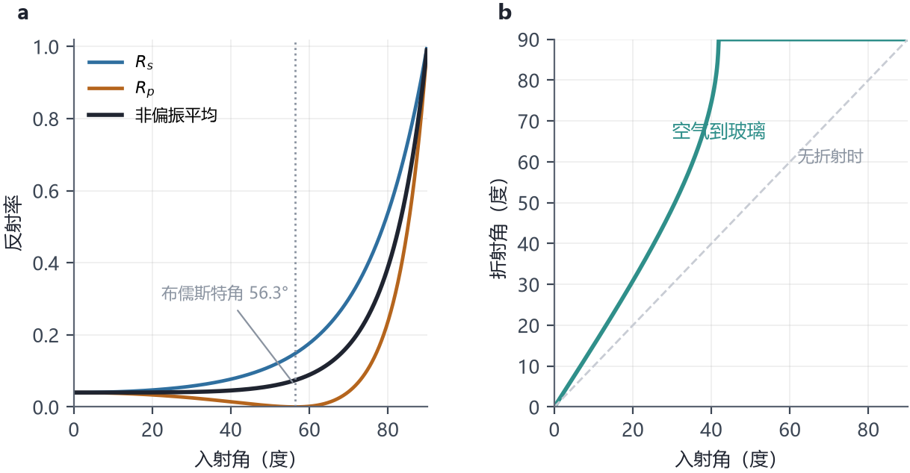
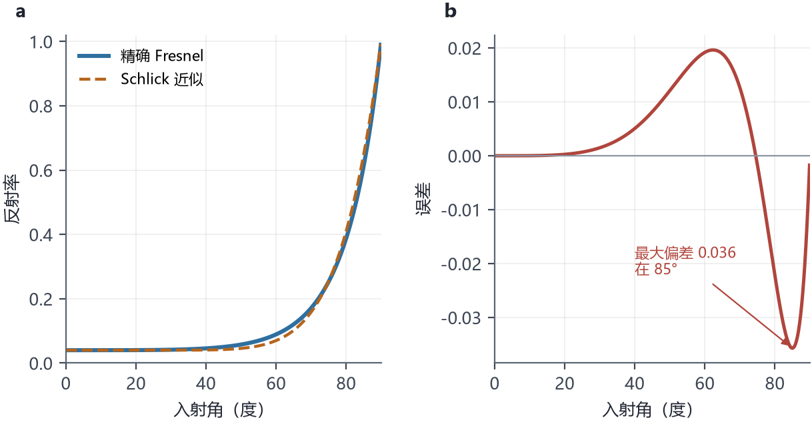
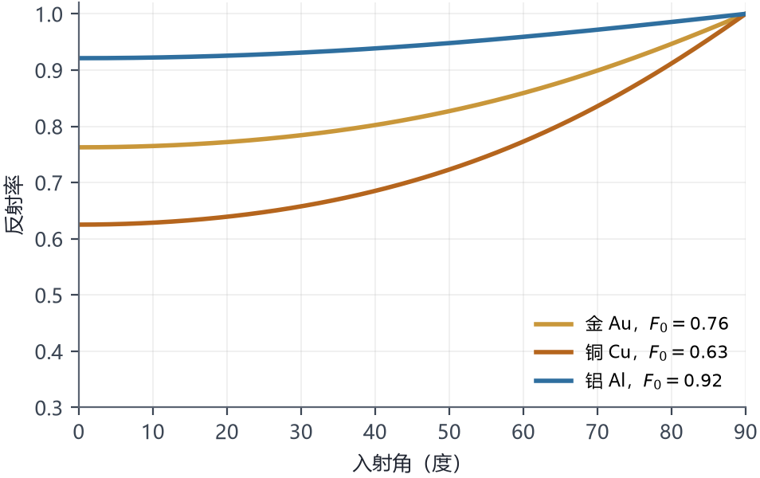

# 第 3 章 Fresnel：界面上的第一道门

## 3.1 一个每个人都知道但很少算过的现象

站在湖边往下看，水是透明的，能看见底。抬头看远处的水面，它像一面镜子，映着对岸的山。

同一片水，同一个角度以外什么都没变，只是视线和水平面的夹角变了。垂直往下看，反射很少；接近水平地看，反射几乎全部。这个变化很剧烈：从 10 度到 1 度，反射率可以从百分之几涨到百分之八十以上。

任何材质都有这一层。金属、塑料、皮肤、布料、玻璃，光遇到表面的第一件事都是决定"反射还是进去"。这个决定的概率只跟三个量有关：两侧的折射率、入射角、光的偏振。与粗糙度无关，与颜色无关，与表面下面是铜还是肉无关。

这一章把这个比例算出来。

## 3.2 边界条件给出的解

从麦克斯韦方程出发。设界面是平面 $z=0$，两侧是均匀无吸收介质，折射率分别为 $n_1$ 和 $n_2$。入射光、反射光、折射光都是平面波，频率相同。

边界上不能有电荷堆积，也不能有面电流，于是电场的切向分量连续，磁场的切向分量连续：

$$\mathbf{E}_i^{t}+\mathbf{E}_r^{t}=\mathbf{E}_t^{t},\qquad \mathbf{H}_i^{t}+\mathbf{H}_r^{t}=\mathbf{H}_t^{t} . \tag{3.1}$$

上标 $t$ 表示切向分量。把平面波表达式代进去，可以得到一个只跟角度有关的线性方程组。

关键一步是把入射光的电矢量分解成两个正交分量：垂直于入射面的分量（德语 senkrecht，记作 s），和平行于入射面的分量（记作 p）。这两个分量在边界上的行为不同，必须分开解。如果光是自然光，两个分量各占一半功率，互不干涉。

解这个方程组，得到振幅反射系数：

$$r_s=\frac{n_1\cos\theta_i-n_2\cos\theta_t}{n_1\cos\theta_i+n_2\cos\theta_t},\qquad
r_p=\frac{n_2\cos\theta_i-n_1\cos\theta_t}{n_2\cos\theta_i+n_1\cos\theta_t} . \tag{3.2}$$

其中 $\theta_t$ 由 Snell 定律给出：

$$n_1\sin\theta_i=n_2\sin\theta_t . \tag{3.3}$$

这两个式子是 Fresnel 在 1823 年从弹性以太理论推出的，后来被麦克斯韦方程重新解释。它们的结构值得看一眼：分子是两个"阻抗"之差，分母是两者之和，和传输线里的反射系数是同一个形状。这不是巧合，界面上的波阻抗在这里就是 $n\cos\theta$（s 偏振）或者 $n/\cos\theta$（p 偏振）。

## 3.3 从振幅到功率

$r_s$ 和 $r_p$ 是振幅之比，可以是负的，代表相位翻转。渲染器关心的是功率，所以要取模平方：

$$R_s=|r_s|^2,\qquad R_p=|r_p|^2 . \tag{3.4}$$

对于非偏振光，反射率取平均：

$$R=\frac{R_s+R_p}{2} . \tag{3.5}$$

图 3-1 里有三个值得注意的位置。

垂直入射时 $\theta_i=0$，两个分量相等，反射率是

$$R_0=\left(\frac{n_1-n_2}{n_1+n_2}\right)^2 . \tag{3.6}$$

空气到玻璃，$n_1=1,n_2=1.5$，得到 $R_0=0.04$。这就是为什么透明物体的正面反射只有百分之四，也是为什么塑料看起来"上面有一层薄薄的高光"。

第二个位置是布儒斯特角，$\theta_i=\arctan(n_2/n_1)$，此时 $r_p=0$，p 偏振完全透射。玻璃的布儒斯特角约 56 度。

第三个位置是 90 度，两个分量都趋于 1。这就是 3.1 节里"抬头看水面像镜子"的原因。

## 3.4 全反射

从光密介质射向光疏介质时（$n_1>n_2$），Snell 定律可能在某个角度之后无解：$\sin\theta_t=n_1\sin\theta_i/n_2$ 超过 1。这个角度叫临界角

$$\theta_c=\arcsin\frac{n_2}{n_1} . \tag{3.7}$$

超过临界角之后，没有传播的折射波，所有能量都被反射。这不是"反射率很高"，是严格的 1。

水到空气的临界角约 48.6 度，玻璃到空气约 41.8 度。这个现象在渲染里很重要：玻璃球内部的多次反射、水下的全反射亮斑、光纤的导光，都靠它。第 8 章讲透射时还会回来。

需要提醒的是，全反射时界面外仍然有场，只是沿表面指数衰减，叫隐失波。它不传能量，但在很近的距离上可以被另一个界面耦合出来，这就是 frustrated total internal reflection。渲染里通常忽略它，除非做很薄的水膜或者光学胶合。

## 3.5 Schlick 近似

Fresnel 公式用起来不算贵，但要开方、要算三角函数，在早期的着色器里是负担。Schlick 在 1994 年给了一个近似：

$$F(\cos\theta)\approx F_0+(1-F_0)(1-\cos\theta)^5 , \tag{3.8}$$

其中 $F_0=R_0$ 是垂直入射的反射率。

这个形式不是随便拟合的。它的三个性质对应三条物理约束。$\cos\theta=1$ 时它给出 $F_0$，与 (3.6) 一致。$\cos\theta=0$ 时它给出 1，对应掠射角全反射。中间用五次幂过渡，是因为真实的曲线在大部分角度上都很平，只在接近掠射时才陡峭上升，五次幂的形状刚好贴合。

图 3-2 显示了误差的量级。对于 $F_0=0.04$ 的电介质，Schlick 的最大误差在 0.03 左右，出现在接近掠射的地方。肉眼看不出这个差别，但如果用来做能量检验，0.03 的能量误差会让白炉测试的结果偏离 3%。

对于金属，$F_0$ 可以很大（金的 $F_0$ 在红光通道约 0.95），Schlick 的误差形态会变。金在垂直入射时反射率已经很高，误差主要出现在中间角度段，量级可到 0.1 以上。做金属的时候，如果对准确性有要求，最好用完整的导体 Fresnel，第 3.7 节给出公式。

## 3.6 导体：复折射率

金属不能只用实数折射率描述，因为光进去之后很快被自由电子吸收。描述它需要复折射率

$$\tilde{n}=n+\mathrm{i}k , \tag{3.9}$$

其中 $n$ 是通常的折射率，$k$ 是消光系数。两者都随波长变化，这就是金属有颜色的根源：金的 $k$ 在蓝光段远大于红光段，蓝光进去就被吃掉，反射出来的光偏黄红。

把 $\tilde n$ 代入 Fresnel 公式，需要小心。做法是令 $\cos\theta_t$ 也变成复数，由 Snell 定律的复数形式给出：

$$\tilde{\cos}\theta_t=\sqrt{1-\frac{n_1^2}{{\tilde n}_2^2}\sin^2\theta_i} . \tag{3.10}$$

然后直接把 $r_s,r_p$ 的表达式里的 $n_2\cos\theta_t$ 换成 ${\tilde n}_2\tilde{\cos}\theta_t$。开方要取虚部为正的那个根，保证波在介质里衰减而不是增长。

垂直入射时结果很简洁：

$$F_0=\frac{(n-1)^2+k^2}{(n+1)^2+k^2} . \tag{3.11}$$

这个式子说明，金属的 $F_0$ 主要由 $n$ 和 $k$ 的比值决定，可以接近 1。铝在可见光波段的 $F_0$ 约 0.91，银约 0.95，铁约 0.56。

图 3-3 用的是 550 纳米处的折射率，来自 Johnson 与 Christy 1972 年的测量。这也是本书里少数直接引用外部数据的地方：金属的折射率没法从公式推出来，必须实测。

## 3.7 Fresnel 在微表面里怎么用

这一节先给结论，第 4 到 6 章会解释为什么。

在微表面模型里，宏观表面被看作许多小平面。光线打到某个小面上，先要判断它是否被别的微表面挡住，然后在没被挡住的那部分上做 Fresnel 反射。关键的一点是：**Fresnel 用的角度不是视线与宏观法线的夹角，而是视线与微表面法线（半程向量）的夹角。**

$$F=F(\omega_o\cdot h) . \tag{3.12}$$

用 $\omega_o\cdot n$ 是一个很常见的错误。它的后果是：粗糙表面的边缘会过度变亮，因为 $\omega_o\cdot n$ 在掠射时接近 0，$F$ 接近 1，但真实情况是那些微表面的朝向已经被平均掉了，$\omega_o\cdot h$ 未必接近 0。

理解了这一点，微表面公式里出现 $F(\omega_i\cdot h)$ 就不奇怪了：光线打到小面上，小面的法线是 $h$，反射方向正好是 $\omega_o$，所以入射角是 $\omega_i$ 与 $h$ 的夹角。

## 3.8 一个容易忽略的细节：偏振

$R_s$ 和 $R_p$ 不相等，这意味着反射会改变偏振状态。用非偏振光照一个电介质，反射光会带上部分 s 偏振，这就是水面反光和玻璃反光的偏振现象，摄影里用偏振镜消除反光就是利用这一点。

在 RGB 渲染器里，这个效应通常被丢掉，只保留平均反射率。对大多数场景这没问题，因为光源本身不偏振，多次反弹之后偏振状态也被打乱。但有两类情况会露馅：一是偏振镜效果，二是强偏振光源下的金属。

完整的处理需要 Mueller 矩阵，把 BSDF 从标量函数升级成 $4\times4$ 矩阵。这个内容放在波动光学那一册，第 13 章只交代接口。

---

这一章的核心是两个式子：反射率由 Fresnel 方程给出，垂直入射时等于 $((n_1-n_2)/(n_1+n_2))^2$；Schlick 近似用一个五次幂把整条曲线压成一个公式，误差在电介质上约 0.03。

还有一个用法上的要点：微表面里 Fresnel 的角度是 $\omega\cdot h$，不是 $\omega\cdot n$。

下一章开始拆微表面，先处理那个决定反射分布形状的量：法线分布。
