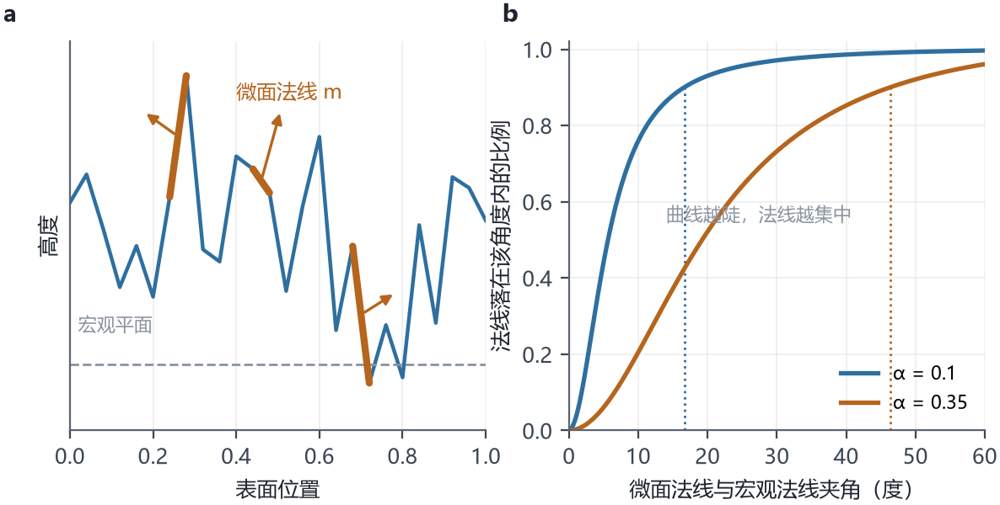
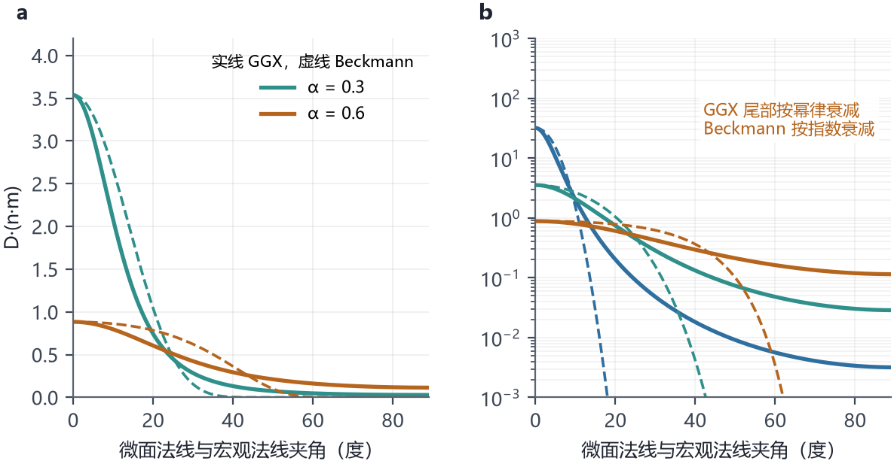
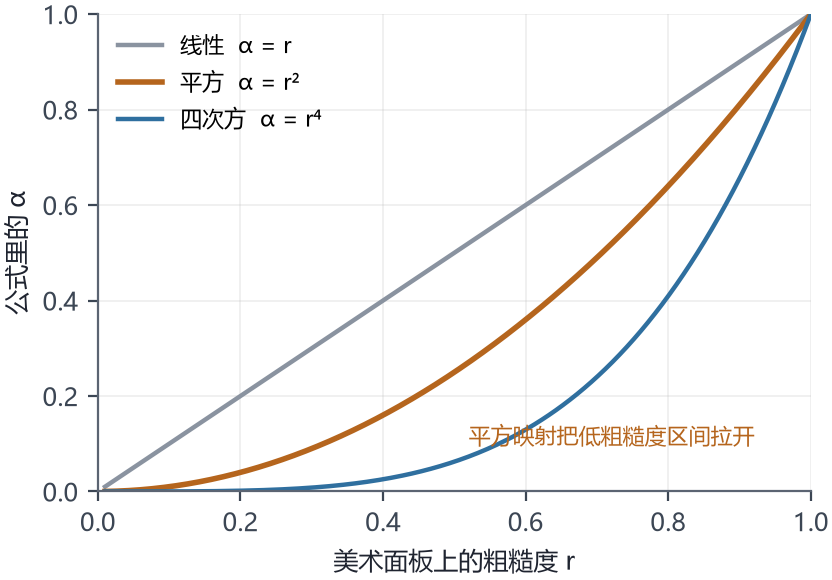

# 第 4 章 微表面理论（一）：把粗糙表面拆成小镜子

## 4.1 粗糙度改变了什么

拿两块金属，一块刚抛光，一块用砂纸磨过。抛光的那块能照出人影，磨过的那块只在某个角度有一片模糊的亮，其余地方灰蒙蒙。

两块金属的材质相同，折射率相同，垂直入射的反射率都是 0.9 以上。差别只有一个：抛光面的微观朝向几乎一致，磨砂面的微观朝向杂乱。光打到磨砂面上，每一小块微面都把光反射到不同方向，于是原本集中的镜面反射被摊开成一片。

这就是微表面理论的全部出发点。它不去追踪每一个微观起伏，而是假设表面由大量朝向各异的小平面组成，用统计的方式描述这些小平面的朝向分布，再求出宏观上看到的反射。

这个假设成立需要两个条件。第一，微面的尺度远大于波长，否则衍射效应不能忽略，几何光学的整个前提就不成立了。第二，微面的尺度远小于像素，否则会看到闪烁的颗粒感。真实表面大多落在这个区间里，所以这个模型适用范围很广。

## 4.2 形式化：高度场与法线分布

把表面看成一张高度场 $z=h(x,y)$，微观起伏叠加在宏观平面上。每个点的法线由梯度给出：

$$m=\frac{(-h_x,\,-h_y,\,1)}{\sqrt{h_x^2+h_y^2+1}} . \tag{4.1}$$

微表面理论不关心 $h$ 的具体形状，只关心这些法线的统计分布。定义一个函数 $D(m)$，使得 $D(m)\,d\omega_m$ 等于"法线落在 $d\omega_m$ 这个立体角内的微面，其投影面积占宏观表面积的比例"。

这个定义里的"投影面积"是关键。它保证了无论表面多粗糙，投影总面积等于宏观面积。写成积分就是归一化条件：

$$\int_{\Omega}D(m)\,(n\cdot m)\,d\omega_m=1 . \tag{4.2}$$

注意被积函数里多了一个 $n\cdot m$。很多人第一次实现时把归一化写成 $\int D\,d\omega=1$，结果粗糙度一高，能量就不对了。差别来自投影：一片倾斜的微面在宏观平面上占的面积比它自己的面积小，比例正好是 $n\cdot m$。

## 4.3 三个常用的法线分布

### 4.3.1 Beckmann 分布

最早的解析分布来自 Beckmann，它假设微面的斜率服从高斯分布：

$$D_{\text{Beck}}(m)=\frac{1}{\pi\alpha^2(n\cdot m)^4}\exp\left(-\frac{1-(n\cdot m)^2}{\alpha^2(n\cdot m)^2}\right) . \tag{4.3}$$

参数 $\alpha$ 有一个干净的统计意义：它是斜率的标准差。$\alpha=0.1$ 意味着微面斜率大多在 0.1 附近，表面接近镜面；$\alpha=0.5$ 意味着斜率可以到一半，表面明显粗糙。

Beckmann 分布的尾部衰减得很快，这是它的局限。真实粗糙表面的斜率分布尾部更重，也就是偶尔会出现很陡的微面。这个差别在高光边缘上能看出来：Beckmann 的高光边缘收得干净，真实金属的高光边缘拖得更远。

### 4.3.2 GGX（Trowbridge–Reitz）

Trowbridge 和 Reitz 在 1975 年提出另一种分布，后来被图形学重新发现，习惯叫 GGX：

$$D_{\text{GGX}}(m)=\frac{\alpha^2}{\pi\left((n\cdot m)^2(\alpha^2-1)+1\right)^2} . \tag{4.4}$$

它和 Beckmann 的区别在尾部。把两者画在对数坐标上，GGX 在 $n\cdot m$ 接近 0 的地方明显更高，也就是有更多陡峭的微面。这带来两个可见的后果：高光核心之外有一圈长长的辉光，掠射角时高光会沿着边缘延伸。真实金属、塑料、清漆的高光都有这个特征，所以 GGX 成了实际上的默认选择。

### 4.3.3 各向异性分布

拉丝金属、CD 表面、缎面布料有一个共同点：沿某个方向的粗糙度和垂直方向不同。描述这种表面需要两个粗糙度 $\alpha_x,\alpha_y$，法线分布变成

$$D(m)=\frac{1}{\pi\alpha_x\alpha_y\left(\dfrac{(t\cdot m)^2}{\alpha_x^2}+\dfrac{(b\cdot m)^2}{\alpha_y^2}+(n\cdot m)^2\right)^2} , \tag{4.5}$$

其中 $t,b$ 是表面上的两个切线方向。$\alpha_x=\alpha_y$ 时退化成各向同性形式。这个式子的形状和 (4.4) 一致，只是把标量 $\alpha$ 换成了一个随方位角变化的有效粗糙度。各向异性金属的高光就靠这个式子：两个方向的粗糙度差得越多，高光被拉得越细长。第 6 章会用它算一个拉丝表面的例子。

## 4.4 α 与美术面板上的粗糙度

公式里的 $\alpha$ 是斜率的统计量，美术面板上的"粗糙度"是一个 0 到 1 的旋钮，两者之间需要一个映射。

最简单的映射是直接相等，$\alpha=r$。它的缺点是低粗糙度区间变化太慢：$r$ 从 0.05 到 0.1，高光只变宽一点，而在真实材质上这个区间对应的是从镜子到磨砂玻璃的巨大差别。

Disney 的 principled BRDF 用平方映射，$\alpha=r^2$。它的效果是把低粗糙度区间拉开，让美术在光滑区间有更多操作余地。这不是物理推导的结果，是经验上更好用。

还有用四次方的，$\alpha=r^4$，把高光核心压得更小，适合做很亮的点光源反射。

三种映射都有实际使用，选哪一种取决于你的参数面板怎么设计。要提醒的是，纹理里存的通常不是 $\alpha$ 而是 $r$，如果加载贴图时忘了做这个映射，粗糙度会整体偏亮。

## 4.5 实现时的几个细节

**α 不能为 0。** $\alpha=0$ 时公式 (4.4) 的分子分母都趋于 0。做法是设一个下限，比如 $10^{-3}$，或者把 $\alpha$ 从 $\max(\alpha,10^{-3})$ 开始。这个下限不会影响视觉，因为小于千分之一的粗糙度已经和镜面无法区分。

**$n\cdot m$ 要夹紧。** 数值上可能出现负值或略大于 1 的情况，直接四次方会放大误差。计算前把 $n\cdot m$ 夹到 $[0,1]$。

**注意归一化用的是 $D\,(n\cdot m)$。** 采样法线时用 $D\,(n\cdot m)$ 作为分布，而不是 $D$，否则采样出来的法线分布不对。第 10 章会具体讲这个采样怎么实现。

**各向异性的切线要一致。** $t$ 和 $b$ 必须和纹理空间对齐，否则拉伸方向会转。这一点在模型导入时经常出错。

---

这一章建立了微表面的第一个部件：法线分布。它决定了反射分布的形状，也就决定了高光是尖是散。

只有法线分布还不够。光打到倾斜的微面上，可能被旁边的微面挡住，也可能自己挡住自己射向视线的路。这两个效应由遮蔽函数描述，是下一章的内容。
