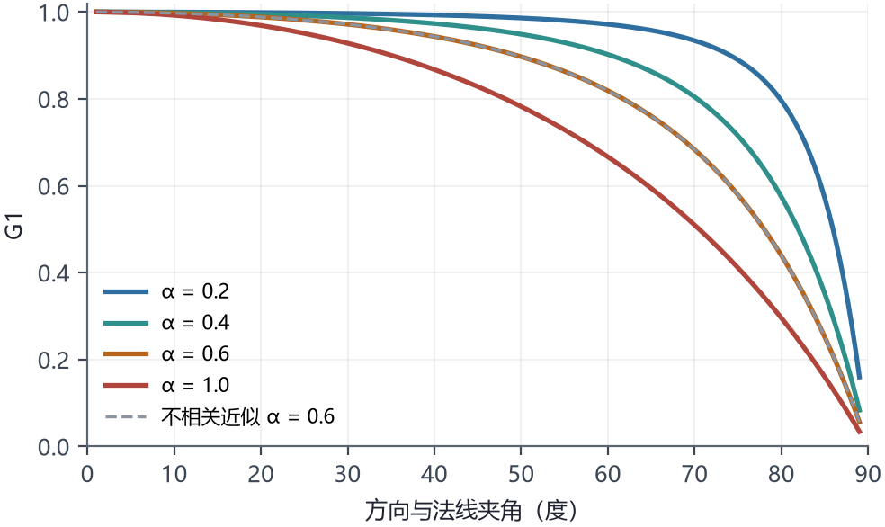
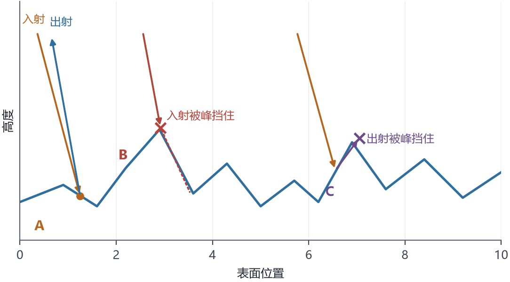

# 第 5 章 微表面理论（二）：遮蔽与 Smith 模型

## 5.1 一个对不上的亮度

把一块粗糙度 0.6 的金属球放在单个点光源下，用第 4 章的法线分布单独算高光，会得到一条很亮的带。但真实的球不是这样，高光明显更暗，而且在球的边缘，也就是视线接近掠射的地方，暗得更多。

差的这部分能量去哪了？没有去哪，它根本没反射出去。原因很直接：微表面是一张有起伏的地形，光从某个方向射进来，可能还没打到你关注的那个微面，就被前面更高的起伏挡住了；反弹出来的时候，也可能被后面的起伏挡住，到不了相机。

这两个效应分别叫阴影（shadowing）和遮蔽（masking）。它们不是吸收，能量没有消失，只是走了别的方向。但在单次散射的模型里，这部分能量被丢掉了，必须用一个因子把它从公式里扣掉，否则高光会整体偏亮。

## 5.2 定义遮蔽函数

考虑一个微面，法线为 $m$，入射方向 $\omega_i$，出射方向 $\omega_o$。定义两个概率：

- $G_1(\omega_i,m)$：从 $\omega_i$ 方向看，这个微面没有被其他微面挡住可见的概率；
- $G_1(\omega_o,m)$：沿 $\omega_o$ 方向，这个微面反射的光能顺利离开的概率。

两者合起来就是遮蔽-阴影函数 $G_2(\omega_i,\omega_o,m)$。最粗糙的近似是假设两者独立：

$$G_2(\omega_i,\omega_o,m)\approx G_1(\omega_i,m)\,G_1(\omega_o,m) . \tag{5.1}$$

这个近似用得很广，但它在物理上并不严格：挡住入射光和挡住出射光的往往是同一批微面，两个事件相关。高度相关的版本会在 5.5 节给出。

注意 $G_1$ 与微面法线 $m$ 有关。在完整的微表面公式里，$G_2$ 是要对 $m$ 积分的，但实际实现中几乎都用"对 $m$ 取某个代表值"的做法，具体的处理放在第 6 章。

## 5.3 Smith 模型

Smith 在 1967 年给出了一个可以解析计算的 $G_1$。它的假设是：表面高度是一个随机过程，某一点的遮挡只取决于该点相对于周围的高度分布，与更远的地方无关。

在这个假设下，$G_1$ 可以写成

$$G_1(\omega)=\frac{1}{1+\Lambda(\omega)} , \tag{5.2}$$

其中 $\Lambda$ 是一个与方向有关的量，含义是"单位长度内期望被遮挡的次数"。对不同的法线分布，$\Lambda$ 有不同的解析式。

对 GGX 分布，$\Lambda$ 有闭式解：

$$\Lambda(\omega)=\frac{-1+\sqrt{1+\alpha^2\tan^2\theta}}{2} , \tag{5.3}$$

其中 $\theta$ 是 $\omega$ 与宏观法线的夹角。写成用 $\cos\theta$ 表达的形式更方便实现：

$$\Lambda(\omega)=\frac{-1+\sqrt{1+\alpha^2(1-\cos^2\theta)/\cos^2\theta}}{2} . \tag{5.4}$$

对 Beckmann 分布，$\Lambda$ 里会出现误差函数，没有初等闭式，所以很多实现即使选了 Beckmann 分布，遮蔽项也用 GGX 的公式近似。这个混搭在实践中问题不大，因为遮蔽项对整体形状的影响比法线分布小。

图 5-1 显示了两件事。垂直看时 $G_1$ 接近 1，遮蔽几乎不发生。掠射时 $G_1$ 急剧下降，$\alpha=0.6$ 时在 5 度角附近只剩 0.2 左右。这就是为什么粗糙物体的边缘会明显变暗。

## 5.4 遮蔽的几何图像

把剖面画出来会更清楚。图 5-2 是一段粗糙表面，光从左上角斜射下来。打在 A 点的光能顺利进出，因为 A 处于一个局部高点；打在 B 点的光进去就被左边的峰挡住了；C 点能接收光，但反射方向被右边的峰挡住。

这个图像解释了为什么遮蔽在掠射时更严重：角度越平，光线穿过的水平距离越长，遇到起伏的机会越多。

它同时解释了另一个现象：真实粗糙表面的高光在掠射时不会像模型预测的那样亮。如果不加 $G$，GGX 的高光在掠射角会趋近一个很大的值，因为分母里的 $\cos\theta_i\cos\theta_o$ 趋近 0。加了 $G$ 之后，这个增长被压住了，形状才和实测对得上。

## 5.5 高度相关的 G2

分离式近似 (5.1) 在粗糙度大的时候误差明显。Heitz 在 2014 年讨论了这个问题，给出的高度相关版本是

$$G_2(\omega_i,\omega_o)=\frac{1}{1+\Lambda(\omega_i)+\Lambda(\omega_o)} . \tag{5.5}$$

和分离式的差别在于分母：分离式展开后是 $1+\Lambda_i+\Lambda_o+\Lambda_i\Lambda_o$，多了一个乘积项。所以分离式总是小于高度相关版本，也就是更暗。

哪个更对？取决于表面的高度相关性。真实表面的高度是连续的，一点被挡往往意味着附近也被挡，两个事件正相关，此时 (5.5) 更接近。分离式适合理想化的、高度不相关的表面。

实践中的建议是直接用 (5.5)。它只多一次加法和一次开方，误差却小得多，而且它是目前主流渲染器（包括 PBRT 和 Filament）的默认选择。

## 5.6 可见法线分布

采样的时候会遇到一个反过来的问题：我们不是从所有微面里随机挑一个，而是从"从视线方向看得见的那些微面"里挑。这个分布叫可见法线分布：

$$D_{\text{vis}}(m)=\frac{G_1(\omega_o)\,|m\cdot\omega_o|\,D(m)}{\cos\theta_o} . \tag{5.6}$$

分母的 $\cos\theta_o$ 是归一化用的。这个式子是 2018 年 Heitz 那篇 VNDF 采样论文的核心，第 10 章会用它构造采样器。

它带来的效果很直观：在掠射角下，能被看见的微面大多朝向视线，所以采样应该偏向这些朝向。用普通 $D$ 采样会在掠射角产生大量浪费，采样效率低，噪声大。这一点在第 10 章会用量化对比说明。

## 5.7 三个容易写错的地方

**把 $G$ 当成常数 1。** 低粗糙度时 $G$ 接近 1，看不出问题；一旦粗糙度上来，高光会明显偏亮，边缘尤其明显。

**用 $\cos\theta_i$ 而不是 $|m\cdot\omega_i|$。** 在微表面公式里，遮挡判定是针对微面的，角度要用微面法线算。用宏观法线会在中等粗糙度时产生可见的偏差。

**忘了 $G$ 是概率，不是权重。** $G$ 的值必须在 $[0,1]$ 之间。如果实现里出现了大于 1 的值，多半是把 $G_1$ 和 $1/G_1$ 弄混了。

---

这一章补上了微表面的第二个部件。法线分布决定形状，遮蔽函数决定亮度衰减，两者合起来才能得到一条和实测对得上的高光曲线。

下一章把两个部件拼成完整的 BRDF，顺便解释那个一直出现的分母 $4\cos\theta_i\cos\theta_o$ 是从哪来的。
