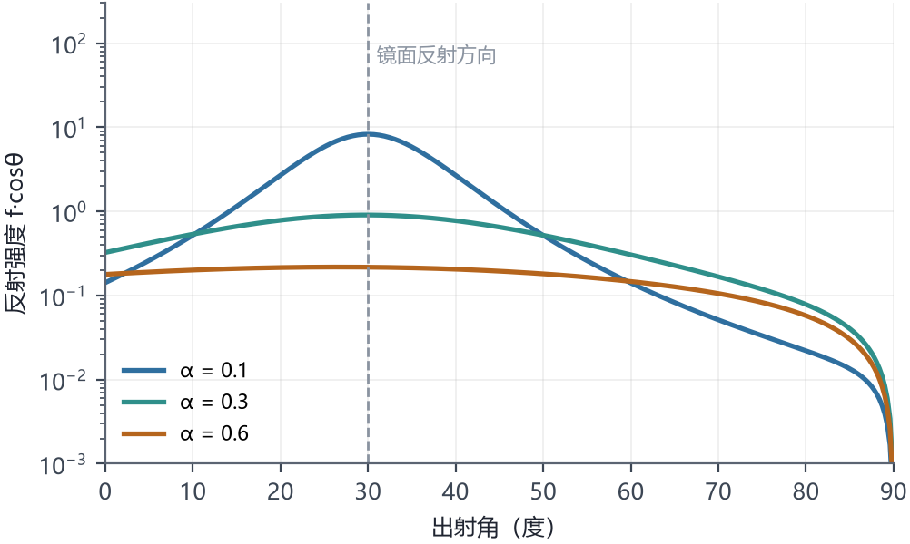
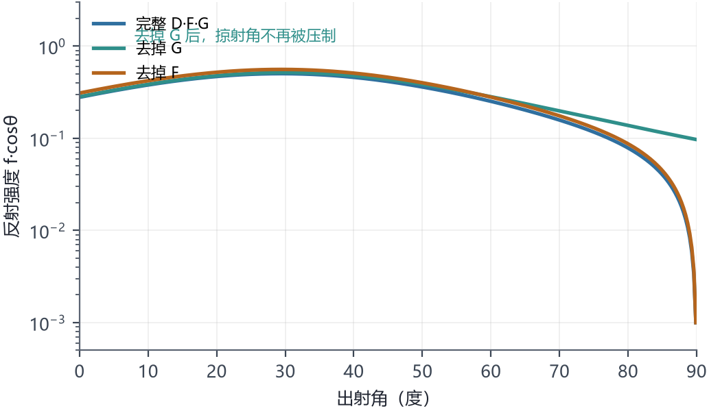

# 第 6 章 微表面理论（三）：Cook–Torrance 完整形式

## 6.1 三个部件与一个分母

前两章准备了两个部件：法线分布 $D$ 决定有哪些朝向的微面，遮蔽函数 $G$ 决定哪些微面能被看见。还差一个：每个微面自己的反射率，也就是 Fresnel 项 $F$。

把三者拼起来，得到微表面的 BRDF：

$$f_r(\omega_i,\omega_o)=\frac{F(\omega_i,\omega_o)\,D(h)\,G(\omega_i,\omega_o)}{4\cos\theta_i\cos\theta_o} , \tag{6.1}$$

其中 $h=\dfrac{\omega_i+\omega_o}{\|\omega_i+\omega_o\|}$ 是半程向量。

这个式子是 Cook 和 Torrance 在 1982 年给出的，至今仍是绝大多数渲染器的核心。三个部件的作用很清楚，唯独分母 $4\cos\theta_i\cos\theta_o$ 常常被当成一个固定的系数照抄。这一章的主要任务就是把这个 4 推出来。

## 6.2 推导：从一块微面的功率出发

设宏观表面上有一小块面积 $dA$，入射方向 $\omega_i$，入射辐亮度 $L_i$，入射立体角 $d\omega_i$。宏观辐照度是

$$E_i=L_i\cos\theta_i\,d\omega_i . \tag{6.2}$$

**第一步，找出参与反射的微面。** 法线落在 $h$ 附近 $d\omega_h$ 范围内的微面，其投影到宏观平面的面积占 $dA$ 的比例是 $D(h)(n\cdot h)\,d\omega_h$。这些微面的实际面积是

$$dA_h=D(h)\,d\omega_h\,dA . \tag{6.3}$$

这里用了"投影面积等于实际面积乘 $n\cdot h$"这个关系，第 4 章的归一化条件就是从这里来的。

**第二步，算这些微面接收到的功率。** 入射光斜着照到这些微面上，有效截面是实际面积乘 $\omega_i\cdot h$。再乘上可见概率 $G_1(\omega_i)$：

$$d\Phi_i=L_i\,(\omega_i\cdot h)\,D(h)\,d\omega_h\,dA\;G_1(\omega_i)\,d\omega_i . \tag{6.4}$$

**第三步，反射。** 每个微面按 Fresnel 反射，反射功率是 $F$ 倍。反射之后，光只可能出现在一个方向上，就是关于 $h$ 的镜面方向，它恰好是 $\omega_o$。

**第四步，把微面立体角换成出射立体角。** 这一步是全章的关键。给定 $\omega_i$，法线 $h$ 与出射方向 $\omega_o$ 一一对应：

$$\omega_o=2(\omega_i\cdot h)h-\omega_i . \tag{6.5}$$

对上式求导可以得到立体角的映射关系

$$d\omega_o=4(\omega_i\cdot h)\,d\omega_h . \tag{6.6}$$

这个 4 来自球面反射映射的雅可比行列式，与粗糙度无关，与材质无关，纯粹是几何。

**第五步，算出射辐亮度。** 出射功率分布在一个立体角 $d\omega_o$ 里，对应的宏观辐亮度是

$$L_o=\frac{d\Phi_i\,F\,G_2}{dA\,\cos\theta_o\,d\omega_o} . \tag{6.7}$$

把 (6.4)、(6.6) 代进去：

$$L_o=\frac{L_i\,(\omega_i\cdot h)\,D(h)\,d\omega_h\,dA\,G_1\,d\omega_i\,F\,G_2}{dA\,\cos\theta_o\cdot 4(\omega_i\cdot h)\,d\omega_h} . \tag{6.8}$$

$dA$、$d\omega_h$、$(\omega_i\cdot h)$ 全部约掉，剩下

$$L_o=\frac{F\,D(h)\,G_1G_2\,L_i\,d\omega_i}{4\cos\theta_o} . \tag{6.9}$$

**第六步，除以入射辐照度。** 按 (2.3) 的定义，

$$f_r=\frac{L_o}{L_i\cos\theta_i\,d\omega_i}=\frac{F\,D(h)\,G}{4\cos\theta_i\cos\theta_o} , \tag{6.10}$$

其中 $G=G_1G_2$ 合并成了总的遮蔽项。

推导完成。回头看那个 4 的来历：它来自立体角映射的雅可比 (6.6)，而 (6.6) 里的 $(\omega_i\cdot h)$ 又正好和 (6.4) 里的 $(\omega_i\cdot h)$ 约掉，于是公式里只剩下两个宏观余弦。

这个"约掉"是有代价的。如果实现时把 (6.4) 里的 $(\omega_i\cdot h)$ 写成 $\cos\theta_i$，约分就不成立，结果会差一个因子 $(\omega_i\cdot h)/\cos\theta_i$，在掠射角和高粗糙度下非常明显。

## 6.3 为什么 D 的参数是半程向量

一个常见的困惑是：$D(h)$ 里的 $h$ 是半程向量，不是入射方向也不是出射方向，为什么？

答案在推导里。第三步说微面把 $\omega_i$ 反射到 $\omega_o$，能完成这件事的微面法线必须满足反射定律，也就是 $h$。所以"参与这次反射的微面"就是"法线等于 $h$ 的那些微面"，$D$ 自然要在这点上取值。

这也解释了一个现象：光源和视线夹角越大，$h$ 就越偏离法线，$D(h)$ 越小，高光越暗。真实材质确实如此，斜着看高光比正对着看暗。



## 6.4 三个部件的角色

把公式拆开看，每一项各管一件事，这有助于调试。

**$D$ 管形状。** 它决定高光的宽窄和尾部的长短。把 $D$ 从 Beckmann 换成 GGX，高光核心几乎不变，边缘的辉光变长。

**$F$ 管颜色和角度。** 电介质的 $F$ 是灰白的，金属的 $F$ 带颜色。$F$ 随角度增大，这决定了掠射时高光变强。要注意 $F$ 的自变量是 $\omega_i\cdot h$ 或者 $\omega_o\cdot h$，两者相等，因为反射的入射角等于出射角。

**$G$ 管压制。** 它在掠射角和高粗糙度时把值压下来，防止高光在边缘爆掉。去掉 $G$ 之后，球体的轮廓处会出现一圈不该有的亮边。



## 6.5 极限行为

用几个极限检查公式是否正确，是很好的习惯。

**镜面极限。** $\alpha\to 0$ 时 $D$ 趋于 delta 函数，只在 $h=n$ 处非零，也就是只有 $\omega_o$ 等于镜面反射方向时才有反射。这时 (6.10) 退化成理想镜面。这个极限可以用来验证实现：把粗糙度设到很小，高光应该收缩成一个点。

**掠射极限。** $\theta_i\to 90°$ 时 $\cos\theta_i\to 0$，分母趋于 0，$f_r$ 会发散。但 $G$ 也同时趋于 0，两者相消，最终 $f_r\cos\theta_i$ 保持有限。数值上要小心这个相消，直接用浮点数算会得到 $0/0$。稳妥的做法是先算 $G/\cos\theta$ 这个比值，或者限制最小角度。

**白炉极限。** 把 $F$ 设成 1，$D$ 和 $G$ 用标准形式，然后对半球积分。结果应该接近 1，但不等于 1。差的那部分就是第 7 章要处理的问题。

## 6.6 实现清单

一段可以直接用的 GGX 微表面 BRDF，写成函数：

```python
def brdf_ggx(wi, wo, alpha, f0):
    h = normalize(wi + wo)
    ci = max(wi[2], 0.0)
    co = max(wo[2], 0.0)
    if ci <= 0 or co <= 0:
        return 0.0
    ch = max(h[2], 0.0)
    vh = max(wi @ h, 0.0)
    F = f0 + (1 - f0) * (1 - vh) ** 5
    D = alpha ** 2 / (np.pi * ((ch ** 2) * (alpha ** 2 - 1) + 1) ** 2)
    G = g2_smith(ci, co, alpha)
    return F * D * G / (4 * ci * co)
```

几个要点。`normalize` 里要对零向量做保护。`ci`、`co` 为 0 时直接返回 0，避免除零。`ch` 夹到 0 以上，防止半程向量在切线平面附近时出现负值。

如果 $F$ 要三个通道，$f_0$ 传三元组，函数返回三元组，其余部分逐通道相同。这时候 $D$、$G$ 只算一次，省一半计算量。

## 6.7 与实测的差距

GGX 微表面模型在大多数金属和塑料上都能给出接近实测的结果，但有两类情况会明显偏离。

**高粗糙度的掠射角。** 实测的反射比模型预测的更亮，因为模型丢掉了多次散射的能量，掠射时丢得最多。第 7 章会处理。

**很光滑的表面。** 极低粗糙度时，实测的高光形状受衍射限制，不再是 GGX 的形状，会出现一圈环状的衍射条纹。这是波动光学的范畴，几何光学模型在任何粗糙度下都预测不出这个环。

---

这一章得到了完整的微表面 BRDF，也弄清了每个因子的来历和量纲。

有一个遗留问题：把 $F$ 设成 1 做白炉测试，积分结果小于 1，粗糙度越高差得越多。这是单次散射模型的固有缺陷，下一章处理。
