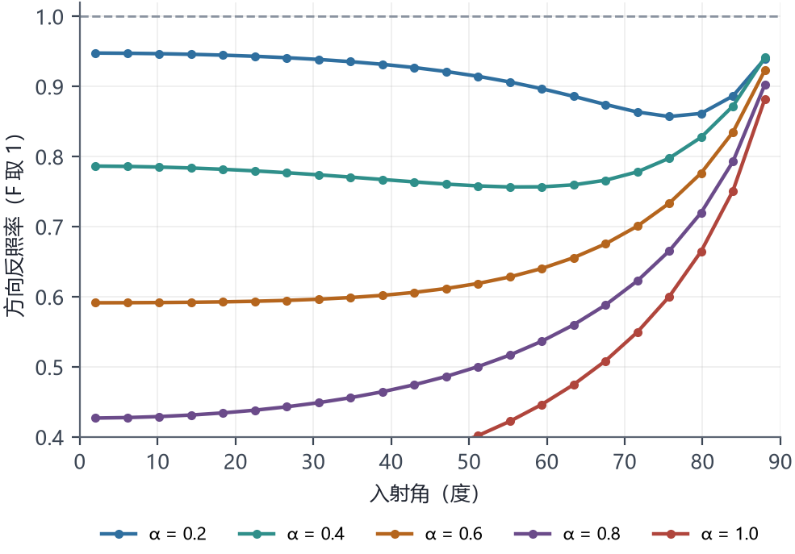
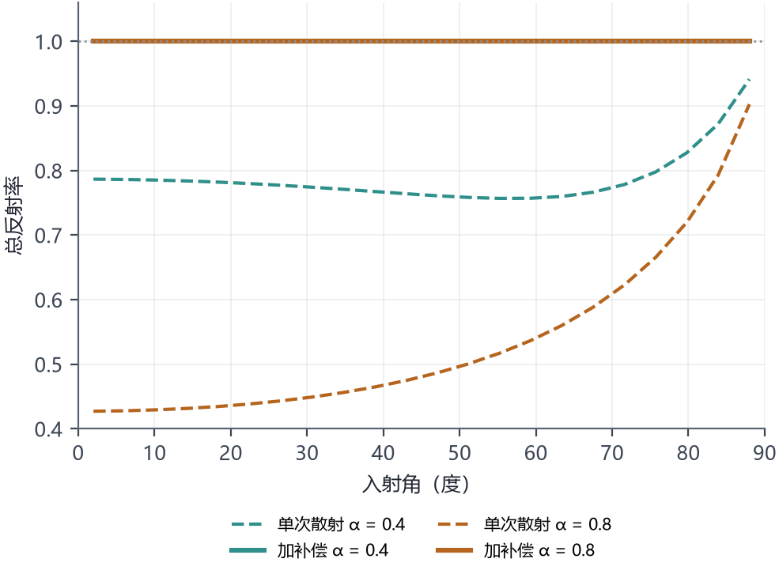
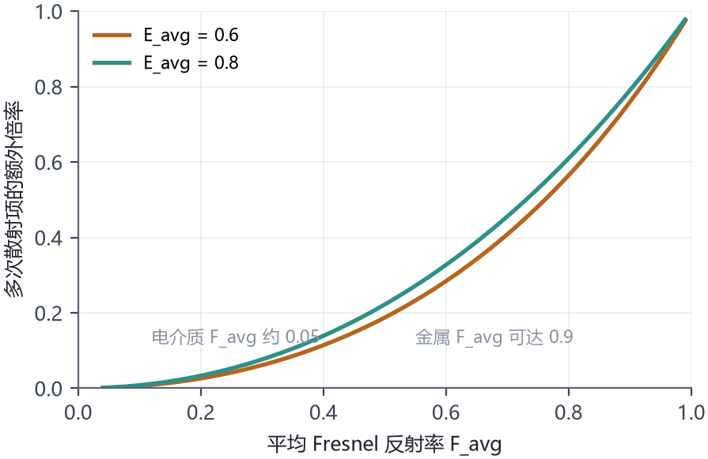

# 第 7 章 掉下去的能量：多重散射微表面

## 7.1 白炉测试暴露的问题

有一个很简单的检验方法。把材质的反射率设成 1，也就是假设表面完全不吸收，然后用一个均匀的白色环境照亮它。如果模型正确，物体渲染出来应该和环境一样亮，因为进来的能量全部反射回去了。

这个检验叫白炉测试。拿第 6 章的 GGX 微表面模型做这个测试，把 $F$ 设成 1，在半球上积分 (6.10)：

$$R(\omega_i)=\int_\Omega\frac{D(h)\,G}{4\cos\theta_i\cos\theta_o}\cos\theta_o\,d\omega_o . \tag{7.1}$$

结果是 $R<1$，而且粗糙度越高，差得越多。$\alpha=0.2$ 时大约 0.95，$\alpha=0.5$ 时掉到 0.85 左右，$\alpha=1$ 时只剩 0.6 上下。

这意味着一个粗糙度为 1 的白色物体，渲染出来只有 60% 的亮度，看上去是灰色的。这在布料、粗糙金属、混凝土上非常明显，实际项目里经常需要手动把 albedo 调高来补偿，但补偿量随角度变化，调不准。

## 7.2 能量去了哪里

能量没有消失。它被挡住了，但挡住不等于吸收：被挡住的光会在微面之间继续反弹，弹几次之后总有一个方向能出来。

单次散射模型只算了一次反射，凡是第一次反射就被挡住的路径全部丢掉。粗糙度越高，微面的坡度越大，互相遮挡的机会越多，丢掉的能量就越多。掠射角下光要穿过更长的水平距离，遮挡更严重，所以损失也更大。

这是一个模型缺陷，不是物理事实。修复的办法有两种思路：把多次反弹的路径显式追出来（太贵），或者用一个解析项近似它的平均效果（可行）。

## 7.3 方向反照率

Kulla 和 Conty 在 2017 年给出的做法建立在一个量上：方向反照率

$$E(\mu)=\int_\Omega f_{\text{ss}}(\mu,\omega_o)\cos\theta_o\,d\omega_o , \tag{7.2}$$

其中 $\mu=\cos\theta_i$，$f_{\text{ss}}$ 是单次散射的微表面 BRDF，$F$ 取 1。这个函数只与粗糙度和入射角有关，与材质无关，因为它已经把 Fresnel 去掉了。

$E(\mu)$ 有几个性质值得记住。垂直入射时它最接近 1，因为遮挡最少。掠射时它最小。粗糙度越大，整条曲线越低。它可以用数值积分预先算好，存成一张一维表，运行时插值。

$E$ 的平均值也有用：

$$E_{\text{avg}}=2\int_0^1E(\mu)\,\mu\,d\mu . \tag{7.3}$$

这个量是 $E$ 在半球上的余弦加权平均，衡量的是"整体丢了多少"。

## 7.4 Kulla–Conty 补偿项

观察到一个关键事实：丢失的能量在方向上分布得很均匀。多次反弹之后，光已经在微面之间被打散了很多次，出射方向的记忆基本消失。所以可以用一个漫反射形状的项来近似这部分能量：

$$f_{\text{ms}}(\omega_i,\omega_o)=\frac{\big(1-E(\mu_i)\big)\big(1-E(\mu_o)\big)}{\pi\big(1-E_{\text{avg}}\big)} . \tag{7.4}$$

分子是两端的损失量：入射时丢了 $1-E(\mu_i)$，出射时又丢了 $1-E(\mu_o)$，两者相乘是这条路径被丢两次的概率。分母的 $1-E_{\text{avg}}$ 是归一化因子，保证这个项在半球上积分出来的总量恰好等于丢失的能量。

验证一下归一化。对 (7.4) 积分：

$$\int_\Omega f_{\text{ms}}\cos\theta_o\,d\omega_o=\frac{1-E(\mu_i)}{1-E_{\text{avg}}}\cdot 2\int_0^1\big(1-E(\mu)\big)\mu\,d\mu=\frac{1-E(\mu_i)}{1-E_{\text{avg}}}\big(1-E_{\text{avg}}\big)=1-E(\mu_i) . \tag{7.5}$$

正好等于入射方向上丢的那部分。把 $f_{\text{ss}}+f_{\text{ms}}$ 合起来再做白炉测试，结果就回到 1 附近。

## 7.5 带颜色的补偿

上面的推导假设 $F=1$，也就是没有吸收。真实的材质有 Fresnel 反射，每次反弹只有一部分能量被反射，剩下的进入材料被吸收或者透射。

处理办法是引入平均 Fresnel：

$$F_{\text{avg}}=\frac{\int_\Omega F(\omega\cdot h)\cos\theta\,d\omega}{\int_\Omega\cos\theta\,d\omega} , \tag{7.6}$$

然后多次散射项乘以一个几何级数求和的结果：

$$f_{\text{ms}}\leftarrow f_{\text{ms}}\cdot\frac{F_{\text{avg}}^2\,E_{\text{avg}}}{1-F_{\text{avg}}(1-E_{\text{avg}})} . \tag{7.7}$$

这个式子的来历是把反弹次数展开：第一次反弹的能量是 $F_{\text{avg}}$，第二次是 $F_{\text{avg}}(1-E_{\text{avg}})F_{\text{avg}}$，依此类推，求和就是等比级数。

对于电介质，$F_{\text{avg}}$ 大约是 0.05 到 0.1，级数很快收敛，补偿量很小。对于金属，$F_{\text{avg}}$ 可以到 0.9，级数收敛慢，补偿量大，这也是为什么粗糙金属的多次散射补偿特别重要。

## 7.6 更省的做法

Kulla–Conty 需要一张 $E(\mu)$ 表和一次 $E_{\text{avg}}$ 的积分。在实时渲染里，这两样都做成小尺寸的纹理，按粗糙度索引，插值读取。

Turquin 在 2019 年给了一个纯解析的近似，用几个多项式拟合 $E$，不需要查表。它的误差比查表大一些，但在移动端很有价值。

Fdez-Agüera 在 2019 年给出了另一个形式，把补偿项直接写成一个缩放后的 GGX 项加一个漫反射项，省掉了 $E(\mu_o)$ 的查表，代价是精度略低。

三条路线在视觉上都能把白炉测试修到 0.95 以上，选哪条取决于性能预算。

## 7.7 什么时候可以不做

补偿不是必须的。以下几种情况可以跳过。

**粗糙度很低。** $\alpha<0.2$ 时损失小于 5%，肉眼几乎看不出。

**电介质。** $F_{\text{avg}}$ 很小，多次散射携带的能量本来就少，补偿前后的差别不明显。

**场景整体偏暗。** 如果画面里没有大面积的高亮粗糙表面，损失看不出来。但要注意，一旦有白色的粗糙物体和白色背景同框，差别就会显现。

反过来，以下几种情况必须做：粗糙金属（尤其是铝、银这类高反射率材料）、白色或浅色的粗糙塑料、布料、混凝土、雪。

## 7.8 一个附带的好处

加上多次散射项之后，还有一个副作用是好的：粗糙表面的高光会带上一层淡淡的颜色。这是因为多次反弹会在微面之间来回，每次反弹都经过一次 Fresnel，金属的颜色被放大了。

真实世界里粗糙的铜和粗糙的金确实比光滑的更"浓"，颜色饱和度更高。单次散射模型预测不出这一点，加上补偿之后就自然出现了。

---

这一章补上了微表面模型的最后一块。$D$ 管形状，$G$ 管压制，$F$ 管颜色，补偿项管丢失的能量。

到这里，粗糙表面的反射部分就完整了。接下来处理光穿过界面的情况：折射、透射，以及把两层材质叠起来的做法。
