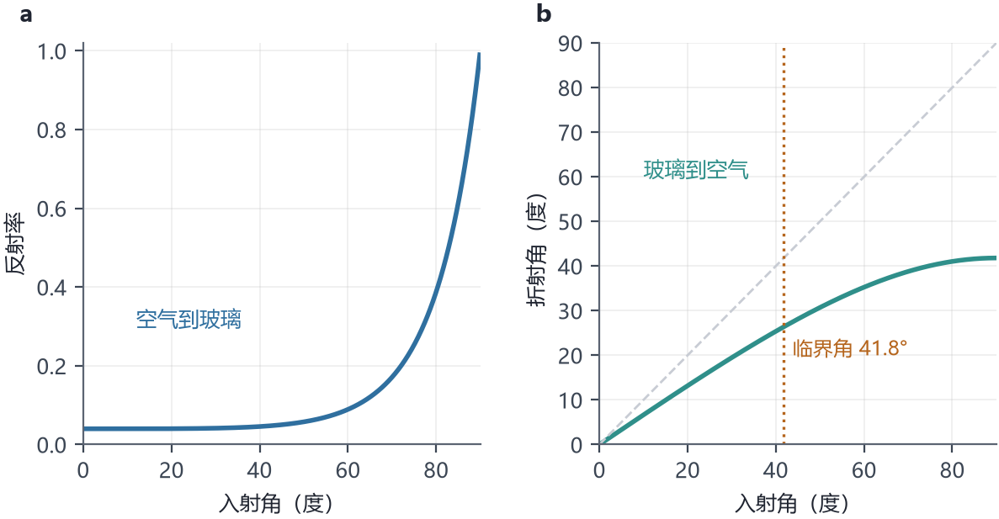
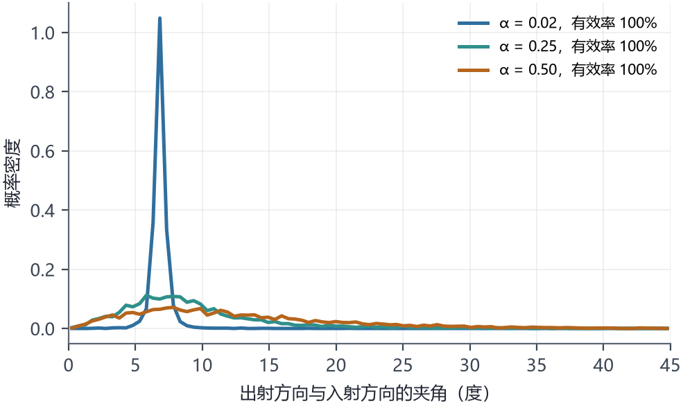

# 第 8 章 折射、透射与粗糙界面

## 8.1 玻璃球上的两处细节

找一个玻璃球放在桌上，对着窗户看。

第一处细节在球的轮廓附近。那里不是透明的，而是一圈亮的、略带颜色的环。这一圈是光线在球内壁发生了全反射，绕了很远的路才出来。它的颜色来自玻璃本身的吸收，路径越长颜色越深。

第二处细节在球的正中心偏下的位置。透过球看过去的东西是倒立的，而且有些模糊。倒立是因为球相当于一个凸透镜，模糊是因为玻璃表面不是绝对光滑，折射方向有微小扰动。

这两处细节分别对应本章的两个主题：折射的几何，以及粗糙度对透射的影响。前一个已经有精确公式，后一个需要把微表面理论搬到透射侧。

## 8.2 折射的几何

Snell 定律已经出现过一次：

$$n_1\sin\theta_i=n_2\sin\theta_t . \tag{8.1}$$

在渲染器里需要的是折射方向的向量形式。约定 $\omega_i$ 是表面指向光源的单位向量，法线 $n$ 朝外，$\eta=n_1/n_2$ 是入射侧与出射侧的折射率之比。折射方向为

$$\omega_t=-\eta\,\omega_i+\left(\eta\cos\theta_i-\cos\theta_t\right)n . \tag{8.2}$$

其中

$$\cos\theta_t=\sqrt{1-\frac{1-\cos^2\theta_i}{\eta^2}} . \tag{8.3}$$

如果根号里的量为负，说明发生了全反射，没有折射方向。这个判断要放在计算之前，否则会得到 NaN。

注意 $\omega_i$ 在 (8.2) 里取了负号。代入验算一下，空气到玻璃 $\eta=1/1.5$，入射角 20 度时 $\cos\theta_t=0.970$，得到 $\omega_t$ 与法线夹角 13.2 度，与 Snell 定律一致。

这个式子里有两处容易写反。一处是 $\eta$ 的朝向，从玻璃出到空气时它是 1.5，从空气进玻璃时是 1/1.5。另一处是 $\omega_i$ 的符号，如果实现里约定 $\omega_i$ 指向表面内侧，那么 (8.2) 里的系数要相应取倒数。两种约定都有人用，混用会让折射方向朝着入射侧。

## 8.3 透射的 BRDF 不是对称的

反射的 BRDF 满足互易性，透射的 BTDF 不满足，原因是辐亮度在穿过界面时会被压缩或拉伸。

考虑一束光从空气进入玻璃。界面两侧的辐亮度关系是

$$\frac{L_t}{L_i}=\frac{1}{\eta^2} , \tag{8.4}$$

其中 $\eta=n_1/n_2$。从空气到玻璃，$\eta=1/1.5$，$L_t=2.25L_i$。辐亮度变大了，这看起来违反能量守恒，其实不是：立体角被压缩了，总功率没有增加。

所以在写 BTDF 的时候，需要显式带上这个因子：

$$f_t(\omega_i,\omega_o)=\frac{1}{\eta^2}\cdot\frac{(1-F)\,D(h_t)\,G}{4\cos\theta_i\cos\theta_o} , \tag{8.5}$$

其中 $h_t$ 是透射侧的半程向量。这个 $1/\eta^2$ 常常被忘掉，后果是透过玻璃看到的物体亮度不对，而且从两边看亮度比不满足物理关系。

## 8.4 透射的微表面：半程向量怎么定义

反射的半程向量是 $\omega_i+\omega_o$ 归一化，因为它平分两个方向。透射的情况不一样，两个方向在界面两侧，需要用 Snell 定律加权的和：

$$h_t=\frac{\eta_i\,\omega_i+\eta_o\,\omega_o}{\left\|\eta_i\,\omega_i+\eta_o\,\omega_o\right\|} , \tag{8.6}$$

其中 $\eta_i,\eta_o$ 分别是入射侧和出射侧的折射率。当 $\eta_i=\eta_o$ 时它退化成普通半程向量。

这个定义来自 Walter 等人 2007 年的那篇粗糙玻璃论文。它的作用是保证 $h_t$ 确实是"能把 $\omega_i$ 折射到 $\omega_o$ 的那个微面法线"。用反射的半程向量去算透射，得到的方向对不上，表现为透射模糊的方向错了。

透射侧也有对应的立体角映射，雅可比是

$$d\omega_o=\frac{\eta_o^2}{\eta_i^2}\cdot\frac{(\omega_i\cdot h_t)}{(\omega_o\cdot h_t)^2}\,d\omega_h , \tag{8.7}$$

它比反射的 $4(\omega_i\cdot h)$ 复杂得多。实际实现里，这个 Jacobian 一般不出现在 BRDF 里，而是出现在采样和 pdf 里。第 10 章会把它写出来。



## 8.5 粗糙度对透射的影响

把玻璃的粗糙度从 0 调到 0.5，会发生三件事。

透过玻璃看到的图像变模糊。这来自折射方向的扰动：每个微面的法线不同，折射方向就不同，图像被卷积了一次模糊核。

玻璃的边缘变亮。粗糙表面上有更多微面接近掠射，全反射的比例上升，边缘那一圈更明显。

整体的透射率下降。因为一部分光被微面之间的遮挡挡住，走了多次反射的路径，这部分能量最终要么从反射侧出来，要么在内部被吸收。

第三点需要能量补偿，道理和第 7 章一样：单次散射的透射模型也会丢能量。做法是把反射侧的补偿项也复制一份到透射侧，按 $(1-F)$ 加权。



## 8.6 薄壁近似

有一类物体，厚度远小于像素尺寸：窗户玻璃、肥皂泡、树叶、纸。对这些物体逐层追踪折射没有意义，因为光线在里面走了几次之后就超出了像素覆盖的尺度。

处理办法是假设光在内部走了很短的一段，直接穿过去，只留下两次界面的 Fresnel 效应。这个近似叫薄壁近似，写法是

$$f_{\text{thin}}=(1-F(\omega_i\cdot n))\,(1-F(\omega_o\cdot n))\cdot\delta(\omega_o=-\omega_i) , \tag{8.8}$$

也就是说，方向不变，只是衰减了两次。两次的 Fresnel 都按同一侧计算，因为光进出的是同一层薄膜。

这个近似在窗户上几乎看不出问题，在厚玻璃上就错得明显，因为它丢掉了折射偏移和内部吸收。判断标准是物体的厚度相对于它到相机的距离，以及像素覆盖的物理尺寸。

## 8.7 能量怎么对

反射和透射合起来必须守恒。对于无吸收的电介质界面：

$$R(\omega_i)+T(\omega_i)=1 , \tag{8.9}$$

其中

$$T(\omega_i)=\int_\Omega f_t(\omega_i,\omega_o)\cos\theta_o\,d\omega_o . \tag{8.10}$$

很多实现里 $R+T$ 会略小于 1，原因是微表面的单次散射假设（和第 7 章同一个问题），也有时会略大于 1，原因是 $1/\eta^2$ 因子用错。

一个实用的检查方法是：把 $F$ 设成 0.5 的常数，折射率设成 1（两侧相同），这时 $f_t$ 应该退化成 $0.5$ 倍的漫反射形状，积分结果是 0.5。如果算出来不是，说明 $1/\eta^2$ 或者余弦因子有问题。

## 8.8 一个能跑的透射采样

采样透射方向的步骤，按 Walter 2007 的框架：

```python
def sample_transmission(wi, eta, alpha, u1, u2):
    # 在微表面分布上采半程向量
    h = sample_ggx_vndf(wi, u1, u2, alpha)
    # 判断这次透射是否有效
    cos_i = wi @ h
    sin2_t = eta ** 2 * (1 - cos_i ** 2)
    if sin2_t >= 1.0:
        return None          # 全反射，改走反射分支
    cos_t = np.sqrt(1 - sin2_t)
    wo = -eta * wi + (eta * cos_i - cos_t) * h
    return normalize(wo)
```

三个地方要留意。`eta` 是入射侧折射率除以出射侧折射率，从玻璃出到空气时它是 1.5，从空气进玻璃时是 1/1.5；传入的 `wi` 指向光源一侧。全反射的判断要在采样之后做，因为不同的微面朝向会导致不同的结果，不能提前用宏观角度判断。返回的方向要重新归一化，浮点误差累积之后会有偏差。

---

这一章处理了光穿过界面的情况。两个要点：透射的 BTDF 带 $1/\eta^2$ 因子，透射的半程向量要用 Snell 加权。

有了反射和透射，就可以把两层材质叠起来，做涂层和清漆。这是下一章的内容。
