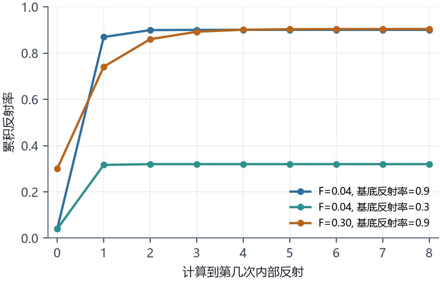
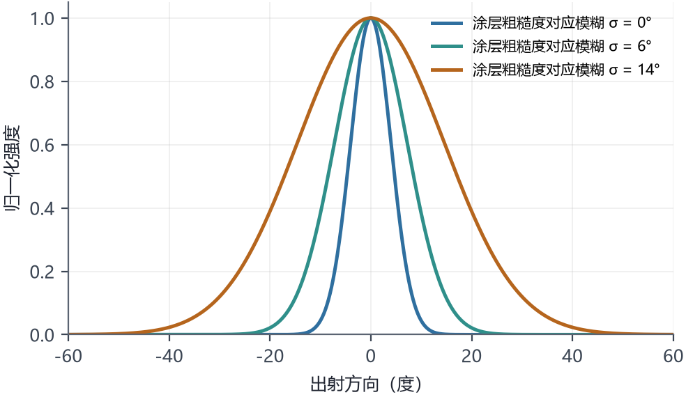

# 第 9 章 分层材质：涂层、清漆与薄膜

## 9.1 木地板上的两层反射

打过蜡的木地板，反光有两层。

凑近看，最上面是一层薄薄的清漆，反射锐利，能看清灯的形状，颜色是中性的。这层反射在斜着看的时候会明显变强，因为清漆是电介质，Fresnel 在掠射时接近 1。

把视线挪开一点，清漆的反射淡下去，下面木纹的反射显现出来。它更宽、更暗，带木头的颜色，边缘有点模糊。

两层反射同时存在，强度此消彼长，这就是分层材质的典型外观。油漆、车漆、指甲油、覆膜的纸张、上釉的陶瓷，都是这个结构。

## 9.2 分层的能量账

把结构抽象成两层：上面是厚度为 $d$、折射率为 $n_c$ 的涂层，下面是基底。

一束光到达上表面，分成两支。反射的一支直接离开，比例是 $F(\theta)$。进入涂层的一支，比例是 $1-F(\theta)$，它继续向下，到达基底。

在基底上又分一次：一部分反射回上方，比例是 $f_{\text{base}}$；一部分进入基底被吸收或者散射。

反射回上方的那部分到达上表面，再次分成两支：透出去的比例是 $1-F$，剩下的 $F$ 又被反射回下方，开始第二轮。

把所有轮加起来：

$$f_{\text{layer}}=F+(1-F)^2f_{\text{base}}\sum_{k=0}^{\infty}\big(F\,f_{\text{base}}\big)^k=\frac{F+(1-F)^2f_{\text{base}}}{1-F\,f_{\text{base}}} . \tag{9.1}$$

这个式子是分层材质的核心。分母的 $1-Ff_{\text{base}}$ 是无穷级数的和，当 $F$ 和 $f_{\text{base}}$ 都不大时，它接近 1，此时 $f\approx F+(1-F)^2f_{\text{base}}$，也就是常见的"两层相加"近似。

对于清漆这种 $F\approx 0.04$ 的情况，$Ff_{\text{base}}<0.04$，级数第一项之后就可以忽略，误差小于 0.2%。对于高反射基底加高折射率涂层，这个级数就不能截断。



## 9.3 厚涂层与薄涂层

上面的推导假设涂层很厚，两次反射之间光走了足够长的距离，相位完全随机。这个假设成立时，两次反射的强度直接相加，不需要考虑干涉。

如果涂层很薄，比如肥皂膜、镀膜镜片，情况就不同了。光在上下表面反射的两支会发生干涉，某些波长增强，某些抵消，产生彩虹色。这是薄膜干涉，需要相位信息，不能用 (9.1)。

判断标准是涂层的厚度与相干长度的比较。相干长度大约是波长的几十倍，对于可见光约 10 微米。涂层厚度超过这个量级，干涉效应被平均掉，用 (9.1)。低于这个量级，需要用 Airy 公式或者传输矩阵，在波动光学那一册处理。

## 9.4 涂层的粗糙度

真实涂层不是绝对光滑的。涂层表面有微小起伏，这带来两个效应。

第一个是涂层自己的反射被模糊。这个直接在涂层那一层用粗糙度大于 0 的微表面 BRDF 就能处理。

第二个更麻烦：透过涂层的光在穿过时也被扰动，导致基底的像变模糊。这个效应在车漆上很明显，清漆的橘皮纹会让底下的金属漆看起来不够锐利。

处理这个效应需要在两层之间插入一个"模糊"操作，本质是把基底 BSDF 与一个模糊核做卷积。实时渲染里的近似做法是给基底一个额外的粗糙度，或者用预积分的环境贴图按粗糙度分级采样。离线渲染里可以用方向分布卷积，代价较高。



## 9.5 能量分配与 Fresnel 的方向性

(9.1) 里的 $F$ 是方向的函数。这意味着涂层反射的比例随角度变化，进入基底的比例也随角度变化。

在垂直看的时候，$F=0.04$，96% 的光进入基底，基底主导外观。掠射的时候，$F$ 接近 1，几乎所有的光都被涂层反射掉，基底看不见。这就是为什么斜着看木地板只能看到清漆的反光。

实现时有一个容易犯的错误：把 $F$ 当成常数，用垂直入射的 $F_0$ 代替。后果是掠射时基底的贡献过大，画面会出现不该有的亮边。

正确的做法是把 $F$ 作为 $\omega_i$ 和 $\omega_o$ 的函数，每次求值都重算。如果性能吃紧，可以用 Schlick 近似，代价很小。

## 9.6 采样与 pdf

分层 BSDF 的采样不能简单地"两个分支各采一半"，因为两支的能量差别很大。垂直看的时候，涂层反射只占 4%，用一半的样本去采它，浪费严重。

合理的做法是按 $F$ 加权选择分支：

$$p_{\text{top}}=F(\omega_i),\qquad p_{\text{base}}=1-F(\omega_i) . \tag{9.2}$$

采样时先按这个概率选分支，再在选中的分支里采样方向。pdf 是两部分的加权和：

$$p(\omega_o)=p_{\text{top}}\,p_{\text{top}}(\omega_o)+p_{\text{base}}\,p_{\text{base}}(\omega_o) . \tag{9.3}$$

这里要注意，权重用的是 $F$ 而不是 $F$ 的某种近似。如果用常数权重而 pdf 用 $F$，估计量会有偏。

## 9.7 实现结构

一个分层 BSDF 的接口大致是这样：

```python
class Layered:
    def __init__(self, coat, base):
        self.coat = coat      # 上层的微表面 BSDF
        self.base = base      # 下层的任意 BSDF

    def eval(self, wi, wo):
        F = self.coat.fresnel(wi)
        num = F * self.coat.eval(wi, wo) \
            + (1 - F) ** 2 * self.base.eval(wi, wo)
        den = 1 - F * self.base.albedo(wi)
        return num / den
```

这段代码是简化版，真实的实现还要处理涂层自身的微表面分布、基底的方向反照率、以及两支之间的方向耦合。但结构是对的：上层提供 Fresnel 权重和自身的反射，下层提供基底的响应，分母做级数归一化。

## 9.8 什么时候分层会失效

分层模型假设界面是平面且无限薄，各层之间平行。以下几种情况不成立。

**涂层厚度不均匀。** 比如橘皮纹、刷痕，实际的光路会在不同位置走不同的距离，平均之后的效果不能用一个平面模型描述。

**基底有强散射。** 如果基底是次表面散射材质，光进入之后可能从别的位置出来，这时"同一个点上下分层"的假设就碎了，需要 BSSRDF 参与。

**层间有多次折射。** 比如多层膜、光学胶合，每层都有自己的 Fresnel，简单的两项级数不够用。

**涂层有吸收。** 有些清漆带一点颜色，光穿过时要按 Beer–Lambert 衰减。这个可以在 $1-F$ 的路径上加一个透射率因子，但要注意路径长度与角度的关系。

---

这一章把两层材质叠起来了。核心是 (9.1) 那个几何级数，以及"按 $F$ 分配能量"这个原则。

到这里，材质本身的公式基本齐了。接下来的三章处理怎么把它算出来：采样、参数、验证。
