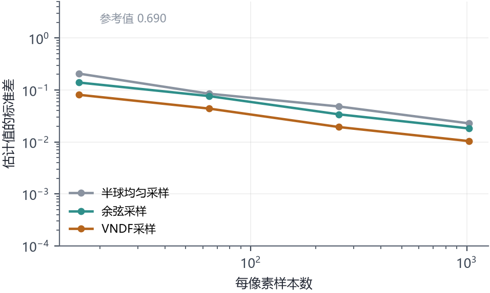
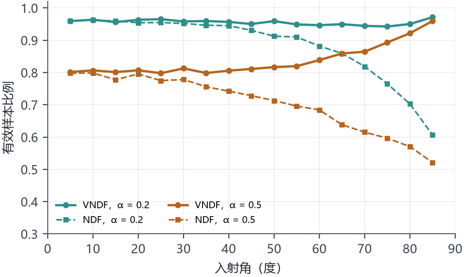
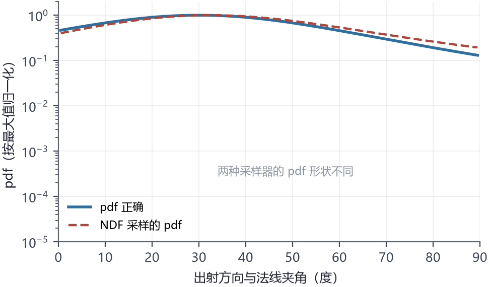

# 第 10 章 采样 BSDF：把积分变成代码

## 10.1 从公式到估计量

渲染方程是一个积分。渲染器不会真的做积分，它做的是估计：

$$L_o\approx\frac{1}{N}\sum_{k=1}^{N}\frac{f_r(\omega_i^{(k)},\omega_o)\,L_i(\omega_i^{(k)})\,\cos\theta_i^{(k)}}{p(\omega_i^{(k)})} . \tag{10.1}$$

这里 $p$ 是采样方向时用的概率密度。式子的结构决定了三件事必须同时正确：$f_r$ 的值、$\cos\theta$ 因子、$p$ 的值。前两个是材质公式本身，第三个是采样器。

一个只写对公式、写错 $p$ 的渲染器不会报错。图像仍然是"能看"的，只是会有系统性的亮度偏差，或者在某些角度下噪声特别大。这类错误很难靠肉眼发现，所以这一章值得细看。

## 10.2 pdf 必须与变换对应

采样方向的常见做法是先在一个方便的坐标系里采样，再变换到方向空间。变换会改变密度，必须乘上 Jacobian。

举个最简单的例子。在半球上做均匀采样：先在 $[0,1]^2$ 上均匀取 $(u_1,u_2)$，然后令

$$\phi=2\pi u_1,\qquad \cos\theta=u_2 , \tag{10.2}$$

得到的方向在半球上是均匀分布的，密度是常数 $1/(2\pi)$。

如果换成"按余弦加权"，做法是

$$\phi=2\pi u_1,\qquad \cos\theta=\sqrt{u_2} , \tag{10.3}$$

此时密度不再是常数。算一下：$u_2=\cos^2\theta$，$du_2=2\cos\theta\sin\theta\,d\theta$，而 $d\omega=\sin\theta\,d\theta\,d\phi$，于是

$$p(\omega)=\frac{1}{2\pi}\cdot\frac{1}{2\cos\theta}=\frac{\cos\theta}{\pi} . \tag{10.4}$$

这个 $\cos\theta/\pi$ 就是余弦加权采样的 pdf。它正好和渲染方程里的 $\cos\theta$ 抵消，所以用余弦采样估计漫反射时，估计量里的余弦因子消失了，只剩下 $f_r L_i/p$ 三项。

这个抵消不是巧合，是"重要性采样"的典型效果：分布形状贴近被积函数，估计量的方差就小。



## 10.3 按法线分布采样

镜面反射的贡献集中在 $h$ 附近，所以要按 $D$ 采样半程向量，再反射得到出射方向。

第一步，按 $D(h)(n\cdot h)$ 采样 $h$。注意权重是 $D$ 乘余弦，不是 $D$ 本身，理由和第 4 章的归一化条件一致。

对 GGX，这一步有闭式解。令 $u_1,u_2$ 为两个均匀随机数：

$$\theta_h=\arctan\left(\frac{\alpha\sqrt{u_1}}{\sqrt{1-u_1}}\right),\qquad \phi_h=2\pi u_2 . \tag{10.5}$$

第二步，把 $h$ 转成出射方向：$\omega_o=2(\omega_i\cdot h)h-\omega_i$。

第三步，算 pdf。这里最容易出错。$h$ 的密度是 $D(h)(n\cdot h)$，但从 $h$ 到 $\omega_o$ 有 Jacobian $1/(4\,|\omega_i\cdot h|)$，所以

$$p(\omega_o)=\frac{D(h)\,(n\cdot h)}{4\,|\omega_i\cdot h|} . \tag{10.6}$$

少了这个 $4\,|\omega_i\cdot h|$，pdf 会偏大，估计结果偏暗，而且偏差随角度变化。这是实现里最常见的错误之一。

## 10.4 可见法线分布采样

按 (10.6) 采样有一个问题：在掠射角下效率很低。原因是大部分被采到的微面朝向背面，看不见，反射出来的方向落到表面以下，被丢弃。

Heitz 在 2018 年给出的解法是按可见法线分布采样。步骤是把视线变换到一个"半球"坐标系里采样，再变换回来：

```python
def sample_ggx_vndf(wi, u1, u2, alpha):
    vh = normalize([alpha * wi[0], alpha * wi[1], wi[2]])
    lensq = vh[0] ** 2 + vh[1] ** 2
    t1 = np.array([1.0, 0, 0]) if lensq < 1e-12 else \
         np.array([-vh[1], vh[0], 0]) / np.sqrt(lensq)
    t2 = np.cross(vh, t1)

    r = np.sqrt(u1)
    phi = 2 * np.pi * u2
    p1 = r * np.cos(phi)
    p2 = r * np.sin(phi)
    s = 0.5 * (1 + vh[2])
    p2 = (1 - s) * np.sqrt(max(0.0, 1 - p1 ** 2)) + s * p2

    nh = p1 * t1 + p2 * t2 + np.sqrt(max(0.0, 1 - p1 ** 2 - p2 ** 2)) * vh
    h = normalize([alpha * nh[0], alpha * nh[1], max(nh[2], 0.0)])
    return h
```

对应的 pdf 是

$$p(\omega_o)=\frac{G_1(\omega_i)\;|\omega_i\cdot h|\;D(h)}{4\,\cos\theta_i\,|\omega_i\cdot h|}=\frac{G_1(\omega_i)\,D(h)}{4\cos\theta_i} . \tag{10.7}$$

注意 $|\omega_i\cdot h|$ 又约掉了，pdf 变得很简洁。这个简洁形式是 VNDF 采样好用的原因之一。

效率上的差别有多大？在 $\theta_i=80°$、$\alpha=0.5$ 时，普通 NDF 采样约有 60% 的样本被浪费，VNDF 只有 5% 左右。方差差三到四倍。



## 10.5 透射的采样

透射的 pdf 复杂一些，因为半程向量的定义带了折射率，Jacobian 也不同。按 Walter 2007 的结果：

$$p(\omega_o)=\frac{D(h_t)\,G_1(\omega_i)\;\left|\omega_i\cdot h_t\right|}{\cos\theta_i}\cdot\left|\frac{\eta_o^2\,(\omega_o\cdot h_t)}{\eta_i^2\,(\omega_i\cdot h_t)^2}\right| . \tag{10.8}$$

中间那一项是前面 (8.7) 的 Jacobian。它在实现里经常被漏掉，症状是透过粗糙玻璃看到的亮度不对，而且是随粗糙度变化的偏差。

采样步骤：先按 $D$ 采 $h_t$，再算 $\omega_o$，再判断是否全反射。如果全反射，这次采样无效，退回反射分支。有效样本的比例随粗糙度上升而下降，这会影响性能，但不影响正确性。

## 10.6 多个部件怎么分样本

一个材质常常由几个部件组成：漫反射底、镜面高光、清漆层。每个部件都有自己的最优采样分布，样本预算怎么分？

有两种做法。第一种是按能量分：用一个粗估的权重 $w_k$ 决定各部件分到多少样本，$w_k$ 正比于该部件在这个方向上的贡献。第二种是每个部件都采一次，然后用多重重要性采样（MIS）合并。

第二种更稳，代价是每个样本要做多次求值。它的权重形式是

$$w_k(\omega)=\frac{p_k(\omega)}{\sum_j p_j(\omega)} , \tag{10.9}$$

这是平衡启发式，简单而且方差可控。

无论用哪种，pdf 必须是各部件 pdf 的加权和，不能只报其中一个。这一点在多部件材质里最容易出问题，因为每个部件单独看都"对"，合起来就错了。

## 10.7 一份检查清单

写采样器时按这个顺序检查，能覆盖绝大多数错误。

**分布是否归一化。** 数值积分 $p(\omega)$ 在整个半球上，应该得到 1。如果得到 0.8 或者 2，说明 pdf 漏了因子。

**采出来的方向是否都在上半球。** 落到表面以下的样本必须丢弃，而且要保证丢弃之后 pdf 仍然正确。丢弃会导致 pdf 的归一化常数变化，需要重新归一化。

**pdf 与分布是否一致。** 最直接的检验是直方图：采一万个方向，统计落在各个角度区间里的比例，与 pdf 的积分比较，两者应该吻合。

**期望值是否正确。** 用一个已知解析解的积分测试，比如常数 BSDF 的半球积分，看估计值是否收敛到正确值。

**方差是否合理。** 同一场景换不同随机种子渲染两次，差异应该只有噪声。如果两次的均值明显不同，说明有偏。



## 10.8 一个完整的采样函数

把上面拼起来，一个 GGX 微表面材质的采样函数：

```python
def sample(wi, alpha, f0, u1, u2, u3):
    # 按 Fresnel 分给镜面与漫反射
    F = fresnel_schlick(max(wi[2], 0.0), f0)
    if u3 < F:
        h = sample_ggx_vndf(wi, u1, u2, alpha)
        wo = 2 * (wi @ h) * h - wi
        if wo[2] <= 0:
            return None, 0.0
        pdf = g1_smith(wi[2], alpha) * d_ggx(h[2], alpha) / (4 * wi[2])
        return wo, F * pdf
    else:
        wo = cosine_sample(u1, u2)
        pdf = wo[2] / np.pi
        return wo, (1 - F) * pdf
```

这段代码里，`u3` 用来选分支，`pdf` 是两支的加权和。返回的权重里已经包含了分支概率，调用方只需要算 $f_r L_i/p$。

要注意 `if wo[2] <= 0` 这个判断。它丢弃了无效样本，但返回的 pdf 是 0，调用方会当作"这次没采到"，这等价于在该点少算一个样本，统计上仍然无偏，只是方差略增。

---

这一章把公式变成了可执行的采样器。三个要点：pdf 必须包含变换的 Jacobian，VNDF 采样在掠射角明显更好，多部件材质的 pdf 是各部分之和。

下一章处理一个更隐蔽的问题：参数。同一套公式，参数取错，结果会整体偏，而且很难发现。
