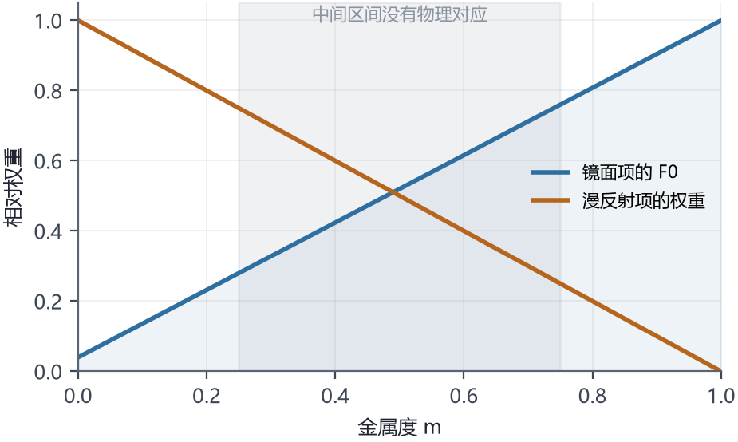
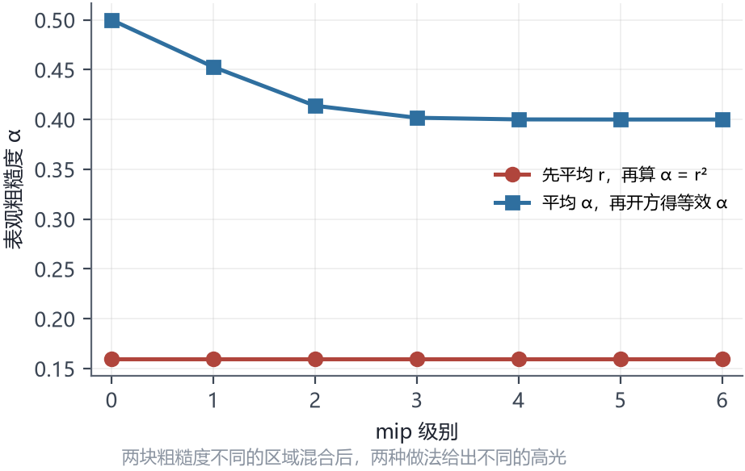

# 第 11 章 参数化：从美术旋钮到物理量

## 11.1 一个滑块后面藏着什么

材质面板上通常只有几个滑块：颜色、粗糙度、金属度、法线强度。每个滑块背后都对应公式里的一个或多个量，但对应关系不是显然的。

举个具体的例子。粗糙度滑块的值是 0.4，它可能对应 $\alpha=0.4$，也可能对应 $\alpha=0.16$（平方映射），还可能对应 $\alpha=0.0256$（四次方映射）。三种情况下高光的宽度差好几倍。如果材质是在一套管线里做的，在另一套管线里加载，参数没有一起转换，外观就会错。

这一章把常见的参数化问题列出来，说明每个参数的物理含义，以及取错值会有什么后果。

## 11.2 颜色不是反射率

美术给的贴图通常是 sRGB 编码的 8 位图。它表示的是"屏幕上应该显示什么颜色"，不是"表面反射多少比例的光"。

两者之间隔着两步转换。第一步是 sRGB 解码，把 0 到 255 的数值转成 0 到 1 的线性值：

$$c_{\text{lin}}=\begin{cases}c/12.92, & c\le 0.04045\\ \left(\dfrac{c+0.055}{1.055}\right)^{2.4}, & c>0.04045\end{cases} \tag{11.1}$$

第二步是把线性值当成反射率用。这一步经常被跳过，结果是所有材质的暗部都偏亮，整体发灰。

还有一层问题：贴图里的颜色是"在某个光源下看到的颜色"，包含光源的影响，而反射率是材质属性。一张白纸的照片，白色部分可能只有 0.7 的反射率，因为相机曝光和白平衡把亮度拉到了 1。直接用照片当 albedo，会让材质偏亮。

实践中的做法是：贴图按 sRGB 解码，然后把整体亮度乘一个系数，让材质的平均反射率落在合理区间。常见材料的反射率可以参考公开的测量数据，比如煤约 0.04，白纸约 0.6，雪约 0.9。

## 11.3 金属度这个参数

金属度 $m$ 是一个 0 到 1 的数，用来在电介质和金属之间插值。常见写法是

$$f_0=m\cdot c_{\text{base}}+(1-m)\cdot 0.04,\qquad f_{\text{diffuse}}=(1-m)\cdot c_{\text{base}} . \tag{11.2}$$

这个式子的含义是：金属没有漫反射，颜色全部进入 $f_0$；电介质有漫反射，$f_0$ 固定在 0.04。

它的问题在于 $m$ 的中间值没有物理对应。真实材料要么是金属，要么不是，不存在"40% 金属"。$m=0.5$ 会得到一个既不金属也不像塑料的东西，反射率还特别高。

中间值在实践中有两个用途。一是贴图的过渡区域，比如金属表面的污渍、磨损的漆面。二是风格化。但如果一个材质的主要区域是中间值，说明参数用错了，应该检查是金属还是非金属。

## 11.4 粗糙度的两个来源

粗糙度可以来自常数，也可以来自贴图。来自贴图时有两个问题。

第一个是纹理压缩。粗糙度贴图常被存进法线贴图的 alpha 通道或者单独的一张灰度图，压缩格式（BC1、BC7）会带来块状伪影。粗糙度对块状伪影特别敏感，因为高光的形状直接由它决定，一点点阶跃就能看出来。

第二个是 mip 映射。粗糙度贴图做 mip 时，平均值会趋向中间值，导致远处的高光变宽变暗。正确的做法是对粗糙度做"平方平均再开方"，或者对 $\alpha$ 做平均，而不是对 $r$ 做平均。这是因为高光的宽度与 $\alpha$ 成正比，与 $r$ 不成正比。

法线贴图也有类似问题。法线做 mip 时，方向被平均，起伏被抹平，远处表面的高光会变弱。工业上的做法是在 mip 链里同时提升粗糙度，补偿被抹平的部分。这个补偿量可以用法线分布的方差估计出来。

## 11.5 三个容易越界的量

**反射率超过 1。** 把 albedo 设成 $(1,1,1)$ 再乘以一个光照颜色，某些像素的反射率就超过 1 了。物理上不可能，视觉上表现为高光区域"烧白"，失去层次。

**$f_0$ 过大。** 电介质的 $f_0$ 应该在 0.02 到 0.08 之间。设成 0.2 会得到一个像金属的塑料，设成 1 会得到一面镜子。

**法线强度过大。** 法线贴图的强度系数经常被调到 2 以上，导致法线偏离真实方向，光照出现错误的暗部。物理上法线强度不应该超过 1，超过就是在伪造几何。

## 11.6 参数之间不独立

这是参数化最麻烦的地方。反射率、粗糙度、法线强度三者会互相影响。

提高粗糙度会让高光变宽，同时降低峰值。如果为了补偿峰值而提高反射率，白炉测试就会失败。加大法线强度会让表面的有效粗糙度上升，等效于提高了粗糙度，如果两个参数一起调，很难判断是哪个在起作用。

一个实用的做法是固定一个参数，调另外两个，调完再换。另一个做法是用参考图对比，把参数调到外观接近，然后检查能量是否守恒。第 12 章会给出一套流程。

## 11.7 一份参数定义表

给团队用的材质参数应该有明确的定义。下面是一份最小可用的表。

| 参数 | 物理含义 | 取值范围 | 常见错误 |
| --- | --- | --- | --- |
| base color | 线性空间的反射率 | 0–0.9 | 直接用 sRGB 数值 |
| metallic | 金属 vs 电介质 | 0 或 1 | 大量使用中间值 |
| roughness | 斜率统计量 | 0.02–1 | 忘记平方映射 |
| $f_0$ | 垂直入射反射率 | 0.02–0.08 | 设得过大 |
| normal scale | 法线扰动强度 | 0–1 | 超过 1 |
| specular | 高光强度倍率 | 0–1 | 与 albedo 重复计算 |

这张表的价值不在数值，而在"每个参数只控制一件事"。如果两个参数控制同一件事，材质就会变得难以调节，也难以跨管线迁移。

---

这一章讲的是参数的语义。这些内容不涉及新公式，但实际项目里一半以上的材质问题出在这里。

下一章给出一套验证流程，用来确认公式和参数都对了。
