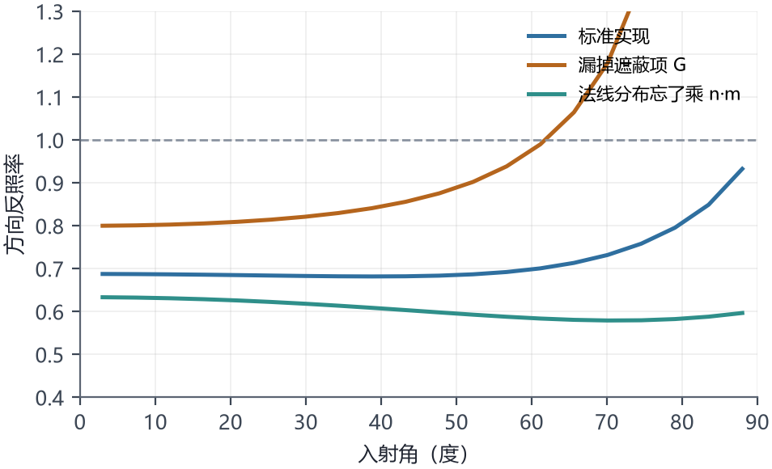
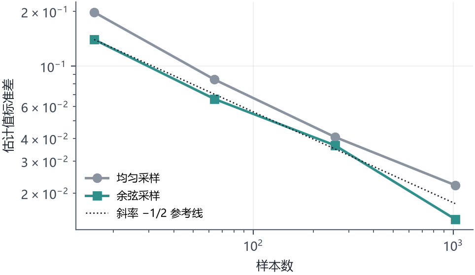

# 第 12 章 验证：白炉、互易性与参考对比

## 12.1 错误不会自己报警

渲染器里写错一个公式，最常见的症状是"看起来还行"。因为渲染结果没有真值可比，人眼对亮度、色彩、高光形状的宽容度很高，除非有明显的不合理，很难判断对错。

但错误会以两种方式暴露。一种是换一个场景就露馅，比如从光滑球换成粗糙布，从正面光换成背光。另一种是换一个渲染器对比，两个实现同一材质，结果差一截。

与其等到那时才发现，不如在写的时候就做几项检验。这一章给出一套流程，每一项都能在几分钟内做完。

## 12.2 白炉测试

做法很简单。把材质的吸收设为零，也就是反射率设为 1，然后用一个亮度处处相同的环境光照亮它。正确的结果是物体和背景一样亮，完全看不出物体的轮廓。

数值上，这就是检验

$$\int_\Omega f_r(\omega_i,\omega_o)\cos\theta_o\,d\omega_o=1 \tag{12.1}$$

是否成立。对于带有 Fresnel 的材质，$F$ 不为 1，这个积分应该等于 $F$ 的方向反照率，不一定是 1，所以白炉测试时要临时把 $F$ 替换成 1。



不合格的常见原因有三个。漏了多次散射补偿，曲线整体偏低，粗糙度越大越低。遮蔽函数写错（比如用了 $\cos\theta$ 而不是 $|m\cdot\omega|$），曲线在掠射时下坠。归一化条件写错（用了 $\int D\,d\omega=1$ 而不是 $\int D(n\cdot m)d\omega=1$），曲线在中等角度出现波动。

## 12.3 互易性测试

随机取一千对方向，计算 $f_r(\omega_i,\omega_o)$ 和 $f_r(\omega_o,\omega_i)$，比较两者。理想情况下完全相等，实际上会因为浮点误差差一点点，相对误差应该在 $10^{-6}$ 以内。

```python
rng = np.random.default_rng(0)
err = 0.0
for _ in range(1000):
    wi = cosine_sample(*rng.random(2))
    wo = cosine_sample(*rng.random(2))
    a = brdf(wi, wo)
    b = brdf(wo, wi)
    err = max(err, abs(a - b) / max(abs(a), 1e-9))
print(err)
```

这个测试能抓到的错误包括：$\cos\theta_i$ 和 $\cos\theta_o$ 弄混、半程向量算错、透射侧的折射率方向搞反。

要注意哪些材质本来就不互易。带方向性的 sheen 项、某些布料模型、把多次散射近似成沿视线补能量的写法，都会不互易。这类材质做这个测试会"失败"，但不是 bug，需要在文档里注明。

## 12.4 与解析解对比

有些情况的积分有闭式解，可以直接比。

漫反射的 BRDF 是 $f_r=\rho/\pi$，半球积分是 $\rho$。菲涅尔反射率有精确公式，可以逐角度比。两个 Lambert 面之间的形状因子有解析式，可以用来检验采样和积分。

最有用的一项是对"常数 BSDF"的检验：把 $f_r$ 设成常数 $c$，渲染方程的解应该是一个解析表达式。如果渲染器算出来的和解析解差一个常数因子，多半是 pdf 或者余弦因子的问题。

## 12.5 与参考渲染器对比

有条件的团队应该准备一个可信的参考实现，比如 Mitsuba 或者 PBRT，用同样的材质参数渲染同一个场景，然后做差异图。

差异图要按相对误差看，不能看绝对差。暗部的绝对差很小但相对误差可能很大，亮部反过来。合理的判据是：90% 的像素相对误差小于 2%，最大误差小于 10%。超过这个量级，说明两个实现的模型不一致，或者参数映射不同。

对比时要注意三件事。光照要一致，包括光源的大小和形状。采样数要足够高，让噪声低于阈值。材质的参数映射要确认一致，尤其是粗糙度的平方映射。

## 12.6 收敛与噪声

蒙特卡洛估计的误差按 $1/\sqrt{N}$ 下降。这意味着样本数增加到 4 倍，噪声才减半。



用这条规律可以判断渲染器是否有问题。如果样本数增加 4 倍，噪声没有减半，说明采样器有 bug，比如样本之间不独立，或者 pdf 计算有问题。

另一个判据是不同随机种子之间的差异。同一场景用两个种子渲染，两张图的差异应该只有噪声，均值应该一致。如果均值差超过噪声水平，说明有偏。

## 12.7 一份检查清单

下面这些是实际项目里最常出现的问题，按出现的频率排序。

| 现象 | 可能原因 |
| --- | --- |
| 整体偏暗 | pdf 多乘了因子，或漏了 $1/\eta^2$ |
| 掠射角偏亮 | Fresnel 用了 $\omega\cdot n$ 而不是 $\omega\cdot h$ |
| 粗糙表面偏亮 | 没有遮蔽项，或 $G$ 恒为 1 |
| 掠射角边缘发灰 | 遮蔽项用了 $\cos\theta$ 而不是 $|m\cdot\omega|$ |
| 白炉测试不收敛到 1 | 缺多次散射补偿 |
| 高光边缘有硬边 | 法线分布尾部被截断，或粗糙度贴图压缩过度 |
| 透射物体亮度不对 | 透射的 Jacobian 漏了 |
| 不同角度亮度跳变 | 分支选择的 pdf 没有加权求和 |

## 12.8 把检验写成测试

最省事的做法是把上面几项写成脚本，每次改动材质代码就跑一遍。理想情况下，这些检验应该在几秒内完成，不依赖渲染，只算数值积分。

一个最小测试集包含四项：白炉测试在五个角度上通过、互易性误差小于 $10^{-5}$、pdf 数值积分等于 1、常数 BSDF 的估计值等于解析解。四项都过，材质的基本正确性就有保障。

---

这一章给了一套可以自己执行的检验。它们不保证材质好看，但能保证材质没有系统性错误。

到这里，材质的公式、采样、参数、验证都齐了。剩下两章处理边界：光谱与偏振这两个维度，以及怎么把这些东西组织成一个系统。
