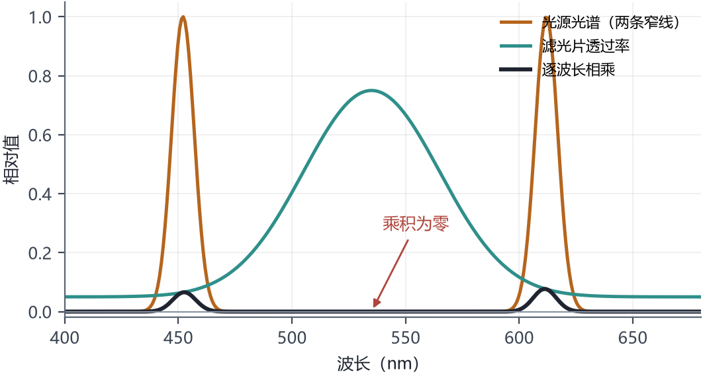
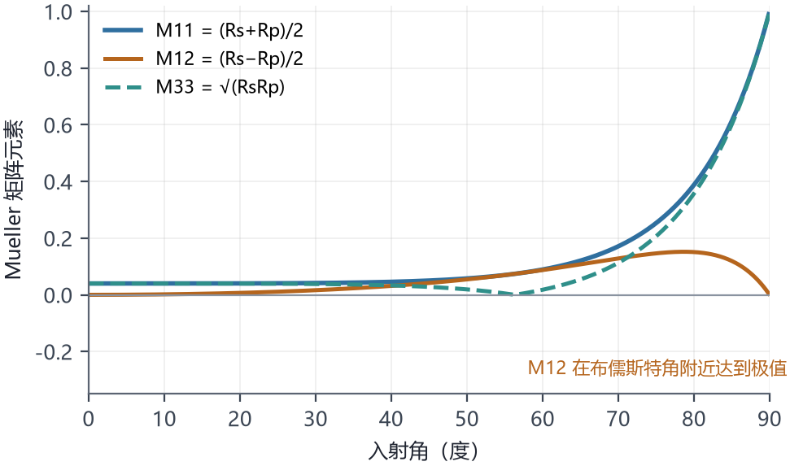

# 第 13 章 光谱与偏振：材质的另外两个维度

## 13.1 三个 RGB 渲染器答错的场景

第一个场景。一盏由两条窄谱线组成的灯，一条在 452 纳米，一条在 612 纳米。它看起来是洋红色。用一张黄绿色的滤光片挡在灯前面，滤光片透过 535 纳米附近的光，两条谱线都被挡住，结果应该是黑的。RGB 渲染器会算出"洋红乘黄绿等于暗黄"，中间还亮着。

第二个场景。一块肥皂膜，在阳光下呈现彩色条纹。颜色随厚度变化，转过一个角度，颜色从紫变绿再变红。RGB 渲染器没有厚度这个变量，也没有相位，做不出这个效果。

第三个场景。一件荧光橙色的安全背心，在紫外灯下发出橙光。入射的是不可见的紫外，出射的是可见的橙。RGB 渲染器的能量账上，入射是零，出射却有能量。

三个错误的共同点是把连续的光谱压成了三个数。压的过程丢掉了谱线结构、丢掉了相位、丢掉了波长变换。这三个损失分别对应光谱渲染、薄膜干涉、荧光三个专题。

## 13.2 RGB 假设到底假设了什么

RGB 渲染器的核心假设是：材质对光的响应可以分解成三个通道，每个通道独立。数学上写成

$$f_r^{\text{RGB}}=\big(f_r^R,\;f_r^G,\;f_r^B\big) , \tag{13.1}$$

每个分量是标量，三个分量之间没有耦合。

这个假设在大多数情况下够用，因为它等价于"光源、材质、相机三者的光谱响应都是三个窄带"，只要三者的窄带对齐，乘起来的结果与积分结果一致。问题出在不对齐的时候，比如窄谱线光源、宽光谱材质、有荧光或干涉的材料。

判断一个场景是否需要光谱渲染，可以看三条。光源的谱宽是否远窄于材质的特征宽度。材质是否有波长变换（荧光、拉曼）。是否有干涉或衍射。三条里有任意一条，RGB 就会出错。



## 13.3 光谱 BSDF 的接口

把 BSDF 从三通道改成光谱，接口变成

```python
def eval(self, wi, wo, lam):
    """lam 是波长（纳米），返回该波长下的 BSDF 值。"""
```

采样的时候，波长也要作为一个随机变量参与，这就带出了波长采样的问题：一次追踪采几个波长，怎么让方差最小。这部分内容在光谱渲染那一册，第 6 到 8 章。

对于本书的骨架，只需要记住一件事：微表面的三个部件都可以写成波长的函数。$D$ 与波长无关，$G$ 与波长无关，$F$ 与波长强相关（折射率随波长变）。所以光谱化的工作量主要在 $F$ 上。

## 13.4 偏振

第 3 章提过，Fresnel 的 s 分量和 p 分量不相等。这意味着反射会改变偏振状态。

完整的描述需要 Stokes 向量和 Mueller 矩阵。Stokes 向量 $\mathbf{S}=(I,Q,U,V)$ 描述光的偏振状态，$I$ 是总强度，$Q$ 是线偏振的水平垂直差，$U$ 是 45 度方向的差，$V$ 是圆偏振的差。

材质对偏振的作用是一个 $4\times4$ 的 Mueller 矩阵：

$$\mathbf{S}_{\text{out}}=M(\omega_i,\omega_o)\,\mathbf{S}_{\text{in}} . \tag{13.2}$$

对于一个理想的镜面反射，$M$ 是对角矩阵，对角元由 $R_s$ 和 $R_p$ 组合而成：

$$M=\frac{1}{2}\begin{pmatrix}R_s+R_p & R_s-R_p & 0 & 0\\ R_s-R_p & R_s+R_p & 0 & 0\\ 0&0&2\sqrt{R_sR_p}&0\\ 0&0&0&2\sqrt{R_sR_p}\end{pmatrix} . \tag{13.3}$$



## 13.5 什么时候需要偏振

大多数渲染不需要。原因有两个：光源本身不偏振，多次反弹之后偏振状态被打乱。

需要的情况有三种。一是明确的偏振效果，比如偏振镜、液晶、应力双折射。二是强偏振光源，比如激光、某些 LED 的反射光。三是高精度物理仿真，比如光学设计。

代价是计算量翻四倍（标量变矩阵），采样也要在偏振空间里做，方差上升。所以实际项目里通常是"默认关闭，需要时打开"。

## 13.6 与专题册的衔接

这本书的骨架到 RGB 为止。两个额外的维度各自有专门的一册。

光谱那一册从 RGB 的错误讲起，讲光谱表示、波长采样、上采样、色散、荧光，最后给出一个完整的实现。

波动光学那一册从衍射讲起，讲薄膜干涉、多层膜、结构色、偏振与 Mueller 矩阵，最后讨论怎么和路径追踪结合。

两册都建立在本书的 BSDF 接口上。光谱化是给每个函数加一个波长参数，偏振化是把标量换成矩阵，结构不变。

---

这一章指出了骨架的边界。RGB 假设在窄谱线、干涉、荧光三种情况下会碎，偏振在特定光源和光学元件下才需要。

下一章把这些内容收进一个材质系统的设计里。
