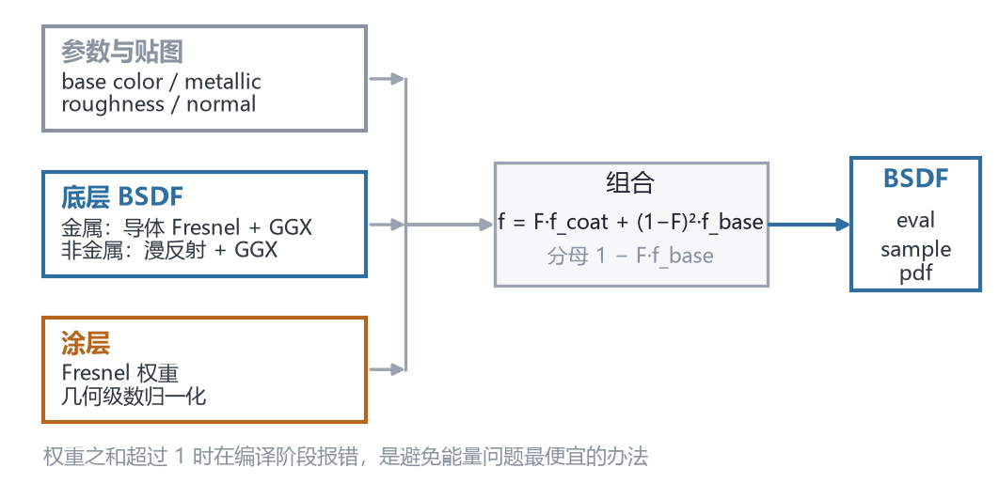

# 第 14 章 材质系统：把公式组织起来

## 14.1 从公式到系统

前面的章节各给了一个公式。真实项目里，一个物体表面可能同时有：一层清漆、一层带划痕的金属漆、底下的塑料基底、边缘的磨损。这不是一个公式能描述的，需要把多个 BSDF 组合起来。

组合方式看起来是工程问题，其实会影响正确性。组合的顺序、权重的归一化、pdf 的合并方式，每一样都会改变结果的能量和方差。这一章讲怎么组织。

## 14.2 接口

一个 BSDF 至少需要四个函数：

```python
class BSDF:
    def eval(self, wi, wo):
        """返回 f(wi, wo)，不含余弦。"""

    def sample(self, wi, u):
        """返回 (wo, pdf, weight)。"""

    def pdf(self, wi, wo):
        """返回 sample 会产生的 pdf。"""

    def albedo(self, wi):
        """返回方向反照率，用于能量检验与分层。"""
```

四个函数必须互相一致。`pdf` 必须等于 `sample` 实际使用的密度，`albedo` 必须等于 `eval` 在半球上的积分。这种一致性无法由类型系统保证，只能靠测试。

`sample` 返回三个值而不是两个，是因为采样常常有分支：采到的方向可能无效（落到表面以下），也可能需要按分支概率加权。把权重显式返回，调用方不必重复计算。

## 14.3 三种组合方式

**混合。** 两个 BSDF 按权重相加：

$$f=w_1f_1+w_2f_2 . \tag{14.1}$$

采样时按 $w$ 选分支，pdf 是加权和。这种方式用于"同一层的不同成分"，比如漫反射加高光。

**分层。** 一个 BSDF 盖在另一个上面，用第 9 章的级数公式。用于清漆、涂层。

**遮罩。** 按空间位置在多个 BSDF 之间切换，比如贴图控制的磨损区域。它本质上是混合的权重随位置变化。

三种方式可以嵌套。一个典型材质是：底层是分层（金属漆 + 清漆），中层是按遮罩混合（磨损与完好），顶层再加一层污渍。

## 14.4 权重与能量

混合的权重必须满足 $\sum w_i\le 1$。如果两个材质各自能量守恒，权重和又不超过 1，混合后仍然守恒。

这一条看起来显然，实际项目中经常被破坏。常见的原因是权重来自贴图，贴图的数值没有归一化，两个通道加起来是 1.2。另一个原因是多层嵌套时，每层的权重都乘了一遍，累积超过 1。

一个防御性的做法是在材质编译阶段检查权重和，超过 1 就报错。这个检查很便宜，能避免很多隐蔽的问题。

## 14.5 节点图与分层结构

商业渲染器大多用节点图组织材质。节点图的优点是灵活，缺点是容易做出物理上不成立的组合，比如把两个不同空间的法线相加、把反射率乘两次。

另一种做法是固定的分层结构：基底、涂层、污渍，每层有固定的参数集。这种结构限制了自由度，但保证了能量行为。

两种做法各有适用场景。影视离线渲染倾向节点图，因为需要极端的灵活性。实时渲染倾向固定结构，因为要控制指令数和带宽。

折中的做法是"受约束的节点图"：节点类型有限，每个节点有明确的物理语义，连线时做类型检查。这样既保留灵活性，又避免明显错误。



## 14.6 实时与离线

实时渲染对材质系统有额外约束：指令数、寄存器、纹理采样次数。这些约束导致实时实现必须做近似。

常见的近似有三类。把多次散射补偿预计算成表，运行时查表。把环境光照预积分成不同粗糙度的 mip，用 split-sum 近似。把 BRDF 的重要部分烘焙成 LUT，按 $(\cos\theta,\alpha)$ 索引。

这些近似的代价是精度和灵活性。查表会有插值误差，split-sum 会漏掉环境光的细节，LUT 不支持任意参数。理解这些近似的前提，才能判断什么时候会失效。

离线渲染没有这些约束，可以老老实实算积分。但离线也有自己的问题：方差。复杂材质的分层结构会让采样变得困难，样本效率下降。

## 14.7 材质库与资产

一个项目做到后期，材质数量会到几百个。管理这些材质需要一套规范：命名、参数范围、贴图规格、版本控制。

几条实用的规则。参数只允许在物理范围内。贴图统一分辨率和色彩空间。每个材质带一张参考渲染图，用于回归测试。材质文件用文本格式，便于 diff。

这些规则不涉及渲染理论，但决定了项目后期能不能维护。一个参数混乱的材质库，在换渲染器或者升级管线时会产生大量返工。

## 14.8 这本书到这里

回顾一下走过的路。

第 1 章说明材质是一个关于方向的函数，不是一个颜色。第 2 章把这个函数定义清楚，给出量纲、能量守恒和互易性。第 3 章处理所有材质共用的 Fresnel 界面。

第 4 到 6 章是微表面理论，从法线分布到遮蔽函数再到完整公式，中间把那个 4 的来历推了一遍。第 7 章补上单次散射丢失的能量。

第 8 章处理透射，第 9 章把两层叠起来。第 10 章讲采样，第 11 章讲参数，第 12 章讲验证。

第 13 章指出光谱与偏振两个维度，第 14 章把内容组织成系统。

剩下的工作，是把这套骨架套到具体材料上。布料要从纤维的圆柱散射出发，毛发要从纤维的同心结构出发，皮肤要从辐射传输方程出发，金属要把复折射率接进 Fresnel，体素要把几何换成离散格子。材料不同，语言是同一套：微表面三段式、能量守恒的检验、采样与 pdf 的配对。

读到这里，应该能做到三件事。看到一个材质公式，能说出每一项的物理来源。写一个 BSDF，能保证它能量守恒、能被正确采样。拿到一个渲染结果，能判断它是公式错了还是参数错了。

剩下的，是具体材料的细节。
