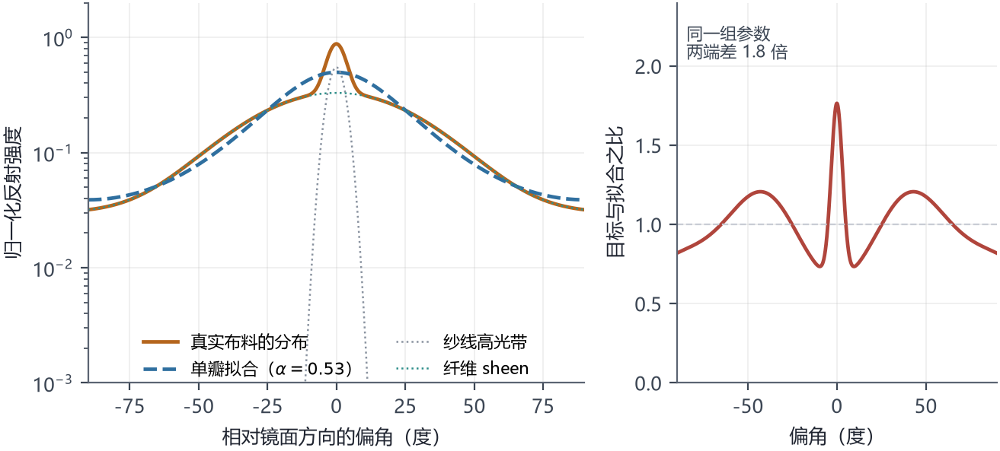
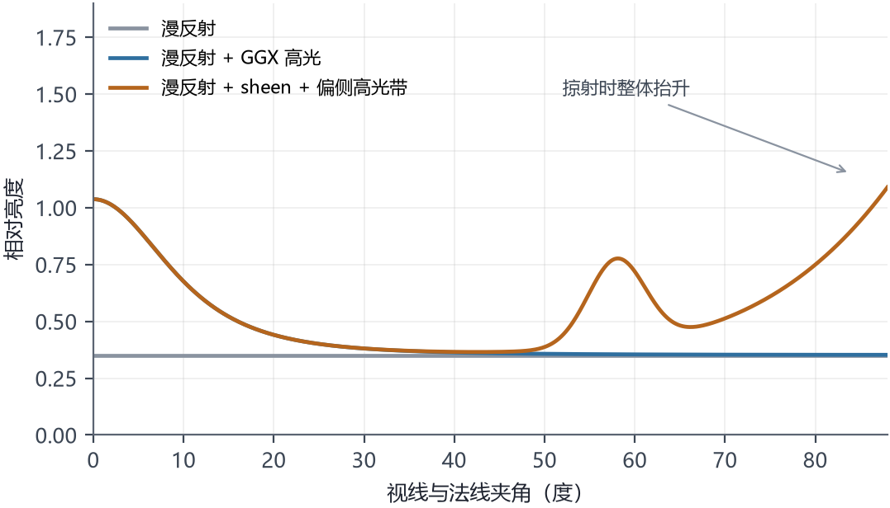

# 第 1 章 一块布为什么不能用一个 BRDF

## 1.1 高光是一片，不是一点

把一块黑丝绒放在桌上，用一盏台灯斜着照它。灯在布上留下的不是一个亮点。整个被照亮的区域都在发亮，亮得均匀、发闷，像蒙了一层细粉。把布转一个角度，亮度不怎么变，但布与桌面的交界处突然出现一条亮边，比布面亮好几倍。

换成一块真丝，情况反过来。高光很亮，但形状不是圆的，而是一条沿着布纹方向拉长的细带。灯不动，把布慢慢转，这条带子会在布面上移动，走到某个角度分成两条，再走一段又合成一条。

再换成粗麻布。高光几乎没有，布面发干，颜色比染料样本深一档，逆着窗户看过去，整块布亮起来，能看见经纬交织的格子。

这三种表现，用同一个公式是写不出来的。原因不在参数，而在结构：三种布的高光宽度差了十几倍，位置也不一样，有的偏在镜面方向一侧，有的干脆分裂成两条。一个只带一个粗糙度参数的 BRDF，形状被固定成单峰，你把宽度调对，峰值位置就错；把峰值位置调对，宽带的那部分又没了。

图 1-1 把这个矛盾画了出来。真实布料的反射分布在截面内至少有两个尺度：一个很窄的峰，半宽四五度，来自纱线表面排列整齐的那部分纤维；一个很宽的底，半宽三十多度，来自伸出来的毛羽和纤维内部的多次散射。用单个 GGX 瓣去拟合，最优点会把峰压平、把肩部抬高，峰顶低了一倍多，两侧反而过亮。差异不算巨大，但人眼对高光的形状极其敏感，一眼就能看出"这不是布"。

## 1.2 三个尺度

布料的结构可以分成三级，每一级的尺寸差一个到两个数量级。

**纤维。** 棉纤维是扁平的带状，宽度 12 到 20 微米；羊毛是带鳞片的圆柱，直径 15 到 40 微米；蚕丝截面接近三角形，边长 10 到 15 微米；涤纶长丝是光滑圆柱，10 到 25 微米。它们都有一个共同点：横向尺寸在十微米量级，长度远大于直径。

**纱线。** 几十到几百根纤维加捻在一起，形成直径 0.1 到 0.4 毫米的纱线。加捻让纤维沿螺旋线排列，螺旋角叫捻角，通常 10 到 30 度。纱线表面还有一层伸出来的纤维末端，叫毛羽（fuzz），长度几十到几百微米。

**织物。** 两根纱线一组，经纬交织，形成周期 0.3 到 2 毫米的编织结构。织物的厚度 0.2 到 1 毫米，经纬密度 20 到 60 根每厘米。

三个尺度的比值是

$$\frac{d_f}{d_y}\approx\frac{1}{20},\qquad \frac{d_y}{D_w}\approx\frac{1}{5}, \tag{1.1}$$

其中 $d_f$ 是纤维直径，$d_y$ 是纱线直径，$D_w$ 是编织周期。这个 1:20:100 的阶梯不是偶然，它决定了三个尺度各自把光散到多宽的角度范围里。

一个半径为 $r$ 的圆柱，表面法线在垂直于轴的截面内均匀覆盖整个半圆。光打到这样的表面上，反射方向跟着法线走，所以在这个截面内，反射能量的角展宽是 180 度。但沿轴方向，圆柱没有曲率，反射方向不变。于是反射能量落在一个平面内，在球面上是一条弧，不是一团。这条弧在垂直于它的方向上极窄，宽度由纤维自身的表面粗糙度决定。

把许多这样的圆柱捻成纱线，纤维的轴不再平行，而是围绕纱线轴有一个分布。这个分布把上面那条弧"抹开"，抹开的宽度就是捻角的散布加上毛羽的倾斜。再往上，纱线在织物里不是直的，它上下起伏，浮在表面的那段形成朝上的弧面，弧面的曲率半径是毫米量级，远大于纱线半径，于是它只让反射方向整体偏转几度。

三个尺度，三种作用：纤维决定"带"的存在，纱线决定带的宽度和方向，织物决定带的位置。这句话是本书后面所有模型的组织原则。

### 1.2.1 像素尺度上的平均

还有第四个尺度，不在物体上，在屏幕上：一个像素覆盖多少面积。

站在一米外看一块平纹棉布，一个像素大约覆盖 2 毫米见方，正好是一个编织周期。这时候能看见经纬的起伏，高光是一条条断开的短线。退到五米外，一个像素覆盖一厘米见方，包含五六个周期，双瓣结构在像素内被平均，高光变成一片模糊的亮，偏侧的特征消失。

这个平均不是渲染器的错，是积分本身的结果。但它带来一个实际后果：同一个材质参数，在近景和远景的有效外观不同。用单瓣模型渲染远景，误差被平均掉了，看起来还行；一旦镜头推近，误差全部暴露。反过来，用一个为近景设计的高精度模型去渲染远景，多出来的细节被抗锯齿吃掉，白花计算量。

第 10 章会讲怎么用一层粗糙度的混合来近似这个平均，代价是偏侧高光在远景里丢失。这里先记住：布料的"宽度"不仅取决于结构，还取决于你离它多远。

## 1.3 一个 NDF 能表达多少

微表面理论把表面写成一组小面片的统计。法线分布函数 $D(h)$ 描述这些面片的朝向，一个各向同性分布只有一个宽度参数。布料需要的是至少两个宽度、一个方向偏好、外加一个不属于表面反射的透射分量。

用 $D$ 的矩来看这件事更清楚。反射分布的形状由 $D$ 的宽度决定，而布料的对数亮度曲线在峰顶附近像一个窄高斯，在翼部像一个宽高斯，两个高斯的宽度差一个数量级。单个 $D$ 无论取 GGX 还是 Beckmann，翼部的衰减都是幂律，形状固定。你能把峰调宽，翼部就跟着塌；把翼部撑起来，峰就被削平。

数量上可以估一下。GGX 的 $D$ 在 $\alpha$ 较小时近似为

$$D(\theta_h)\approx\frac{\alpha^2}{\pi\left(\alpha^2+\theta_h^2\right)^2}, \tag{1.2}$$

半高全宽满足 $\theta_h\approx\alpha$。所以一个 $\alpha=0.08$ 的 GGX 给出约 4.6 度的半宽，一个 $\alpha=0.6$ 的给出约 34 度。要让同一个 $D$ 同时覆盖两个宽度，只能取中间值，结果两头都不对，这正是图 1-1 里的情形。

更麻烦的是峰值位置。微表面模型的反射峰永远落在半程向量与法线平行的地方，也就是镜面方向。真实布料不是这样：纤维是倾斜的圆柱，反射条件变成"半程向量垂直于纤维轴"，这个条件解出来的方向一般不在镜面方向上，而且随入射角移动。第 4 章会把这个偏移算出来，这里只需要记住结论——峰的位置信息不在 $D$ 里，$D$ 只能控制宽度。

## 1.4 掠射变亮

第二个单瓣模型表达不了的现象是掠射变亮。

从几乎垂直于表面的方向看一块布，看到的是纱线顶端的一小片；从接近掠射的方向看，看到的是纱线侧面的大量纤维，视线在表层里穿行的路径也变长。两件事都让亮度上升。前面那件事是几何遮蔽的反面，后面那件事是体积效应。

图 1-2 里三条曲线的差别很直观。漫反射与视角无关，是一条水平线。加了 GGX 高光之后，只在镜面方向附近鼓一个包，掠射端仍然回到基线。真实布料的曲线在 70 度之后持续上升，到 85 度已经翻了一倍多，而且中间 58 度附近还有一个不属于镜面反射的鼓包。

这个持续上升的部分叫 sheen。它在物理上来自两处：纤维表面的 Fresnel 在掠射时趋向 1，以及光线在毛羽层里走的路更长、散射次数更多。严格的推导在第 6 章，这里先指出它的一个性质——sheen 是一个与视线强相关、与光源方向弱相关的项。单瓣微表面模型的 Fresnel 也随角度上升，但它乘在 $D$ 上，只在镜面方向附近起作用，掠射方向上的 $D$ 已经接近零，抬不起来。

## 1.5 三条路

面对这种多尺度结构，有三条可走的路，代价和适用范围完全不同。

**把几何显式建出来。** Sadeghi 等（2013）的做法是把针织物的线圈（loop）参数化，在每个线圈上撒几千根纤维，然后对每根纤维做圆柱散射的解析积分，再用微表面理论把纤维集合的贡献合成一个 BRDF。这个模型能自然产生图 1-1 里的双瓣、偏侧高光和透光，代价是每个材质要存储与线圈几何相关的参数表，计算量也大。它适合做离线参考，或者为实时模型生成查找表。

**在纱线级写解析模型。** Irawan 与 Marschner（2012）把纱线表面看成一组沿纱线轴排列的纤维片段，用改进的微表面分布描述它们的朝向，并显式加入"纱线互相遮挡"的项。这个模型参数少、能实时，能复现平纹、斜纹、缎纹的差别。Karis（2013）给出的实时着色框架里，布料走的是更轻的路线：一个粗糙的 GGX 底加一个 sheen 项，参数靠美术调，物理上不严格，但在实时管线里够用。Unreal 之后的布料模型沿用的就是这条思路。

**把布料当体积。** Schröder 等（2011）把织物看成一个由纤维和空气混合的薄层，用体积散射的语言描述光在里面的传输，参数从纤维的光学常数和填充率推出来。这条路最适合薄织物、绒面和高密度针织，因为透射和多次散射是它的天然输出。

三条路不是互斥的。工业管线里常见的组合是：用体积模型算出方向反照率和透射率，拟合成纱线级模型的参数，再用实时近似去跑。第 10 章会详细讲这个流程。

## 1.6 本书的组织

接下来的十一章按尺度往上走。

第 2 章讲织物的几何，把平纹、斜纹、缎纹的交织规则、纱线的捻度和毛羽说清楚，并说明宏观各向异性从哪里来。第 3 章处理最底层的圆柱散射，从 Maxwell 方程的圆柱解讲到 Kajiya–Kay 模型，把那些 sin 和 cos 的幂次推导出来。

第二篇换成纱线的语言。第 4 章把 Marschner 的毛发模型搬过来，逐条对照 R、TT、TRT 三条路径在织物里的对应物。第 5 章用微面片重建纱线散射，处理法线分布和能量归一化。第 6 章写 sheen，给出一个可以积分的闭合形式。

第三篇处理厚度。第 7 章的绒面靠多次散射，第 8 章的薄织物透射靠两条路径，第 9 章的染色靠 Kubelka–Munk 两流近似。第四篇回到实现，第 10 章讲实时近似，第 11 章讲参数标定，第 12 章讲验证。

有一条线索贯穿全书：每个模型都在回答"这一级结构把光散到多宽"。纤维给出最宽的那一层，纱线给出中间那一层，织物给出最窄的峰。任何时候你发现渲染出来的布"宽度不对"，先判断错的是哪一层，再去改对应的参数。这比盲调粗糙度有效得多。

---

一块布的高光是一片而不是一个点，因为它是三个尺度上的散射叠加的结果。纤维决定反射呈带状，纱线决定带的宽度和方向，织物决定带的位置和整体倾斜。单个法线分布只有一个宽度和一个峰位，这两件事它都表达不了。掠射变亮来自纤维层的 Fresnel 和体积路径，属于第三个自由度。

下一章先把几何说清楚。
