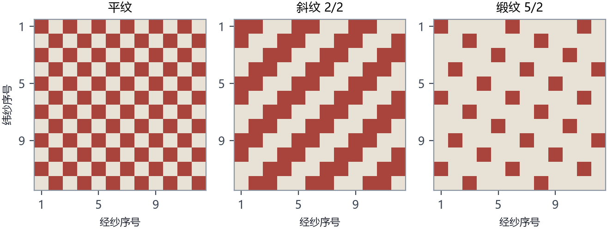
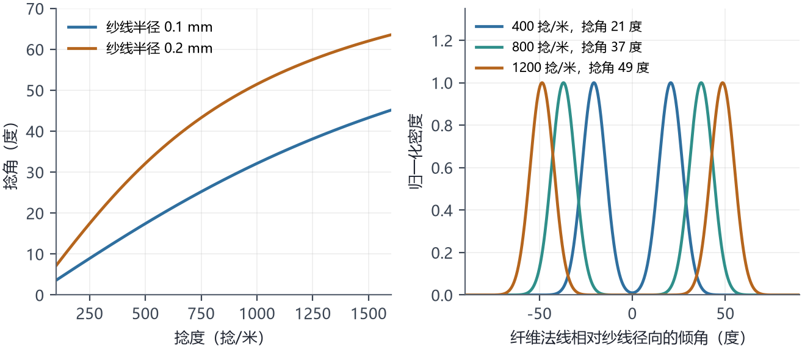
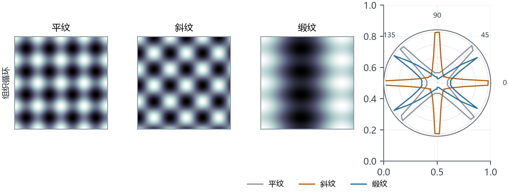

# 第 2 章 织物的几何

## 2.1 把一块麻布放大

拿一个十倍放大镜看麻布，第一眼看到的是经纬两族纱线像粗绳子一样上下交错。经纱（warp）沿布长方向，纬纱（weft）横穿布宽，两者隔一根压一根。压在上面的那段纱线鼓起来，被压在下面的那段陷下去，交织点处纱线被压扁，截面从圆变成椭圆。

再放大到一百倍，纱线本身散开了。它不是一个光滑的圆柱，而是几十根纤维扭在一起，表面有明显的螺旋纹路，像拧过的绳子。螺旋的方向叫捻向，相邻两根纱线的捻向相同，所以整块布的表面有一层统一的斜纹。

再放大到一千倍，纤维本身有形状：麻纤维是多边形的棱柱，表面有节；棉纤维是扁带，带天然转曲；羊毛表面有鳞片，像瓦片一样一层压一层。这些形状影响单根纤维的散射，但在这个尺度上已经超出几何的范畴，进入第 3 章的圆柱散射。

这一章停在中间那个尺度，把纱线怎么排布、怎么加捻、怎么起伏说清楚。它是后面所有解析模型的几何基础。

## 2.2 三种基本组织

纱线的交织规则叫组织（weave）。规则可以写成一个矩阵，行是纬纱序号，列是经纱序号，格子里记"经纱浮在上面"还是"纬纱浮在上面"。这个矩阵叫组织图。图 2-1 是三种基本组织的组织图，深色格子表示经纱浮在表面。

平纹是最简单的一种，经纱与纬纱一上一下交替，组织图是棋盘格。它的交织点最密，每根纱线在一个循环里要上下两次，纱线被压得很弯，布面平整、挺括、耐磨。棉布、麻布、大部分衬衣面料都是平纹。

斜纹是两根上两根下，交替位置每行错开一格，组织图呈现对角线。斜纹的交织点比平纹少，纱线可以浮得长一些，布面柔软，表面有一层沿对角线方向的斜纹。牛仔布是典型的斜纹。

缎纹把交织点摊到最少，五根纱线里只有一根压在上面，其余四根连续浮在表面。组织图上看，浮点稀疏地散布，形成一条陡峭的斜线。缎纹的浮长最长，表面几乎全是纱线中段，光泽最强，手感最滑。丝绸和床品里的"缎条"是这种组织。

组织方式决定了两个几何量：浮长和交织点密度。

浮长是一段纱线连续浮在表面的长度，等于浮过的纱线根数乘以纱线间距：

$$L_f=n\,p_t, \tag{2.1}$$

其中 $n$ 是浮过的根数，$p_t$ 是相邻纱线的中心间距。平纹的 $n=1$，缎纹五枚的 $n=4$。浮长越长，这段纱线越接近直的一段圆柱，中间不被压弯，表面越光滑。

交织点密度决定纱线被压弯的程度。交织点越密，纱线在交织处弯得越急，表面的起伏越大，宏观法线越分散。平纹的交织点密度最高，所以平纹布的宏观起伏最大，缎纹最小。这一点在渲染里对应粗糙度的宏观部分，也就是后面要讲的 $D$ 的宽度。

## 2.3 捻度与捻角

单根纤维只有十几微米粗，单独一根几乎没有强度，也没法直接织。要把它们捻成纱线：一边拉伸一边旋转，纤维沿螺旋线缠绕，互相压紧，靠摩擦力抱在一起。

单位长度上的捻回数叫捻度 $T$，单位是捻每米。棉纱常见的捻度是 600 到 1200 捻每米，精纺毛纱低一些，300 到 800。

捻度决定纤维相对纱线轴倾斜多少。把纱线展开成一个平面，纤维是一条斜线，绕纱线表面一周前进的距离是 $1/T$，绕行的周长是 $2\pi r_y$，于是捻角满足

$$\tan\beta=\frac{2\pi r_y}{1/T}=2\pi r_y T, \tag{2.2}$$

其中 $r_y$ 是纱线半径。这个关系是几何的，不需要任何近似。

图 2-2 左边把这层关系画了出来。半径 0.2 毫米的纱线，1200 捻每米对应 56 度捻角；半径 0.1 毫米的纱线，同样的捻度只有 37 度。这解释了一件事：粗纱线不需要很高的捻度就能获得足够的抱合力，细纱线要靠高捻才能站住。高支棉纱手感滑、光泽好，原因之一就是捻角大，纤维排列更接近纱线表面。

右边是渲染里更直接关心的量。纤维的方向是螺旋线，纤维表面的法线垂直于纤维轴，于是法线相对纱线径向也偏了一个 $\beta$。捻度越高，这个偏转越大，法线分布的两个峰离中心越远。

这个偏转带来两个后果。第一，纱线表面的反射不再关于纱线轴对称，高光会偏到一侧。第二，两个捻向不同的纱线（Z 捻和 S 捻）混用时，偏转方向相反，高光分裂成两条。真实的提花布、强捻绉布上能看到这种分裂。

捻向用字母表示：Z 捻是右手螺旋，S 捻是左手螺旋。同一个织物里通常经纬用相反的捻向，这样布面平整，不会因为捻回退扭而起皱。渲染时如果只用一个各向同性的法线分布，捻向这个信息就丢了，高光不会分叉。

## 2.4 毛羽

纱线表面不是干净的一层。纺纱时总有一些纤维末端没有完全卷进去，伸在外面，形成毛羽。毛羽的长度从几十微米到一两毫米，密度与纺纱工艺有关：精梳纱毛羽少，普梳纱和气流纺毛羽多。

毛羽在渲染里的作用被低估过。它做三件事。

一是把表面法线的分布拓宽。毛羽的朝向基本随机，投影到表面上看，相当于在原有的法线分布上叠加一个各向同性的宽分布。这个宽分布就是第 1 章图 1-1 里那个半宽三十多度的底瓣。

二是产生掠射变亮。视线接近掠射时，穿过毛羽层的路径变长，散射次数增加，出射能量上升。这个效应在第 6 章的 sheen 里会被定量处理。

三是让轮廓变软。毛羽伸出表面几十微米，在轮廓处形成一层半透明的边，这是布料区别于塑料薄片的最直观特征之一。用纯表面模型渲染，轮廓是硬的；加上毛羽的体积层，轮廓才有那种毛茸茸的过渡。

毛羽的方向不是完全随机的。纺纱时纤维被拉伸，毛羽倾向于沿纱线轴向倒下，所以毛羽层的法线分布是各向异性的，沿轴向宽、沿横向窄。这个各向异性在高光里表现为"带"而不是"点"，第 5 章会用到。

## 2.5 宏观各向异性从哪里来

到这里可以回答一个常见的问题：为什么缎纹的高光是一条带，而平纹的高光是一团？

把三种组织的表面近似成高度场。平纹是两个正交方向的正弦叠加，斜纹是两组斜向的正弦，缎纹是沿经向拉长的缓波。

图 2-3 最右边的极坐标图是这件事的量化。平纹的法线方位角分布接近四重对称，0 度和 90 度方向各有一个峰，45 度方向有次峰。斜纹的分布转到 45 度，而且峰更尖，因为它的起伏沿对角线排列。缎纹的分布几乎只有一个方向，法线主要朝经向倾斜，横向的分量很小。

方位角分布的形状直接决定高光的形状。法线集中在一条线上，反射方向也集中在一条线上，高光就是一条带；法线散布在整个平面上，高光就是一团。

这里有一个容易混淆的地方。各向异性有两个来源，一个是宏观的编织方向，一个是微观的纤维方向。宏观的由组织决定，周期是毫米量级，只影响高光的整体形状和位置。微观的由捻度和毛羽决定，周期是微米量级，影响高光的宽度和边缘。两者都要建模，但它们的参数不该混在一个 $\alpha_x,\alpha_y$ 里。

实用的分法是：宏观各向异性用一个沿经纬方向拉伸的法线分布表示，微观各向异性用切线方向上的纤维分布表示。第 5 章会把这两层合成一个公式。

## 2.6 从几何到参数

几何量要变成渲染参数，需要一个映射。常用的几个量是：

纱线直径 $d_y$ 和间距 $p_t$，它们的比值是覆盖系数

$$c=\frac{d_y}{p_t}, \tag{2.3}$$

表示纱线在布面上占的比例。经纬两个方向的覆盖系数分别是 $c_w$ 和 $c_f$，总覆盖率近似为

$$C=c_w+c_f-c_wc_f. \tag{2.4}$$

覆盖率决定了"能看到多少纱线、多少空隙"。$C$ 接近 1 的布几乎不透光，$C$ 小于 0.7 的布（稀疏的夏布、纱罗）透光明显。第 8 章讲透射时，空隙的面积比就是 $1-C$。

起伏幅度 $A$ 和周期 $p$ 决定了宏观法线的倾角：

$$\sigma_m\approx\arctan\frac{2\pi A}{p}. \tag{2.5}$$

平纹的 $A$ 约等于纱线半径，$p$ 约等于两倍纱线直径，代入得 $\sigma_m$ 在 30 度上下。缎纹的 $A$ 小得多，$\sigma_m$ 只有十几度。这个估算与图 2-3 的分布宽度对得上。

剩下的量是捻角 $\beta$ 和毛羽密度。它们不改变宏观形状，只改变微观的分布宽度，所以在渲染里通常合并成一个"纱线粗糙度"参数。合并会丢掉捻向导致的分叉，但对大多数布料够用。第 4 章会讲怎么在不增加太多成本的前提下把分叉找回来。

## 2.7 支数与直径

纺织行业不用直径描述纱线，用支数。特数（tex）是 1000 米纱线的克数；英制棉支数 $N_e$ 是一磅棉纱有多少个 840 码的长度。两者的换算关系是

$$\mathrm{tex}=\frac{590.5}{N_e}. \tag{2.6}$$

40 支棉纱的 $N_e=40$，对应 14.8 tex，直径约 0.14 毫米。这个换算是渲染里唯一必须用到的行业单位，其余量都可以用米和弧度。

从特数反推直径需要知道纤维的密度和纱线的填充率。棉的密度约 $1.52\,\mathrm{g/cm^3}$，纱线的填充率 $\mu$ 在 0.5 到 0.7 之间，捻度越高填充越紧。体积等于质量除以密度，截面积等于体积除以长度，于是

$$A=\frac{\mathrm{tex}\times10^{-6}}{\rho},\qquad d_y=2\sqrt{\frac{A}{\pi\mu}}. \tag{2.7}$$

把棉的数值代进去，得到 $d_y\approx0.029\sqrt{\mathrm{tex}/\mu}$ 毫米。这个式子在参数标定时很有用：美术给的往往是支数，模型要的是直径，中间差一次开方。

织物密度用每 10 厘米的纱线根数表示。常见的平纹棉布经密 130、纬密 70，换算成间距是 0.77 毫米和 1.43 毫米。间距与直径的比值就是覆盖系数 (2.3)。经密远大于纬密时，织物在两个方向上的几何不对称，这会直接体现在高光的形状上：沿经向的高光带更窄，沿纬向的更宽。第 11 章讲参数标定时，会用到这个不对称性来判断哪个方向的参数需要单独标。

---

织物的几何可以压缩成四个量：组织决定浮长与交织点密度，捻度决定纤维相对纱线轴的倾角，毛羽决定法线分布的宽度，覆盖率决定透光比例。宏观各向异性来自纱线起伏的方位角分布，微观各向异性来自纤维的螺旋排列，两者要分开建模。

几何说清楚了，下一章处理最底层的那个散射体：一根圆柱。
