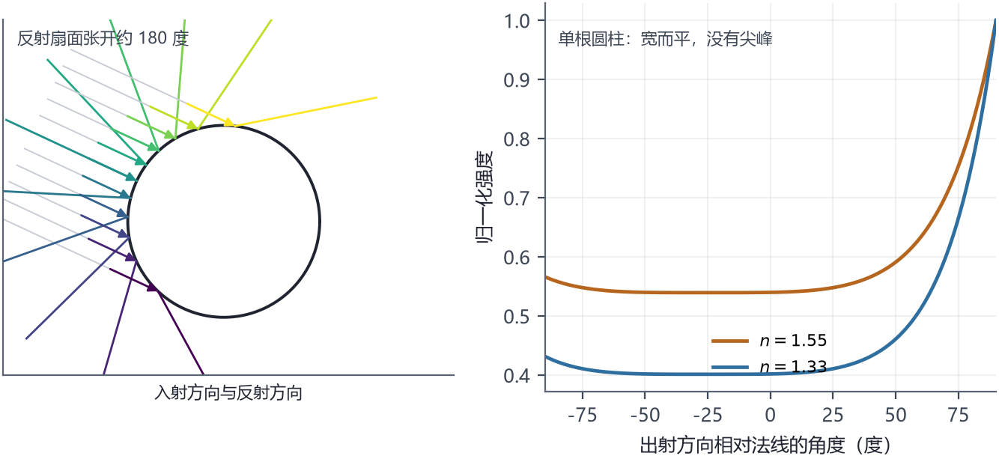
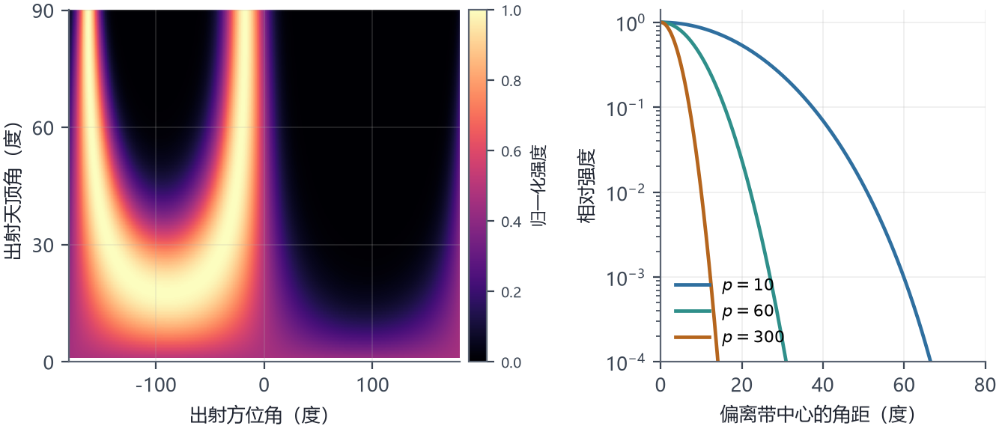
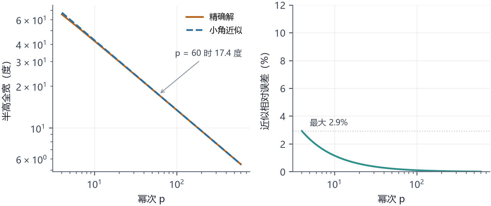

# 第 3 章 圆柱散射与 Kajiya–Kay 模型

## 3.1 一根纤维亮起来的样子

把一根头发放在桌上，用台灯照它。头发上会有一条亮线，沿着头发的长度方向延伸，宽度只有零点几毫米。把头发转一个角度，亮线的位置会在头发的截面上移动，但线本身始终是线。

这个现象说明两件事。第一，圆柱的反射被约束在一个方向上，能量不会像球面那样散成一片。第二，亮线的位置由入射方向决定，跟观察方向关系不大——你把头偏一下，亮线几乎不动。

布料里每一根可见的纤维都是这样一根圆柱。纱线表面有几百根这样的圆柱并排，它们的亮线加在一起，形成我们在第 1 章看到的那条高光带。这一章把单根圆柱的散射写下来，它是后面所有布料模型的原子。

先估一下几何光学够不够用。纤维直径 15 微米，可见光波长 0.5 微米，两者之比 30。按单缝衍射的粗略估计，衍射造成的角展宽约为 $\lambda/d\approx0.5/15\approx0.03$ 弧度，也就是 2 度。这个宽度比高光带本身的 10 到 20 度小一个量级，所以用几何光学处理纤维是合理的，衍射只需要在很细的纤维（比如 3 微米以下的超细涤纶）上才需要考虑。这个估算也说明了为什么布料模型几乎从不做波动光学：几何光学的误差被结构本身的不规则性淹没了。

## 3.2 圆柱的坐标

设圆柱的轴沿单位向量 $t$ 方向。圆柱表面上任意一点的法线都垂直于 $t$，可以写成

$$n(\psi)=\cos\psi\,e_1+\sin\psi\,e_2, \tag{3.1}$$

其中 $e_1,e_2$ 是垂直于 $t$ 的两个正交单位向量，$\psi$ 是绕轴的角度。

入射方向 $l$ 和出射方向 $v$ 各有两个自由度。用圆柱的对称性可以把它们分开：一个角度描述方向与轴的夹角，叫纵向角 $\theta$；另一个描述绕轴的方位，叫方位角 $\phi$。这个分离不是近似的，是圆柱几何的严格性质，也是后面 Marschner 模型的基础。

$$\cos\theta_l=t\cdot l,\qquad \cos\theta_v=t\cdot v. \tag{3.2}$$

注意这里的 $\theta$ 是从圆柱轴量起的，不是从法线量起的。布料里这两种约定都存在，混淆是常见错误。本章的 $\theta$ 一律相对轴，第 4 章换成相对法线。

## 3.3 反射往哪里去

光打到圆柱上的某一点，按镜面反射定律走：

$$r=2(n\cdot l)\,n-l. \tag{3.3}$$

在垂直于轴的截面内看，这是一个二维问题。把 $l$ 投影到截面内，投影方向与法线的夹角为 $\psi_l$，反射方向与法线的夹角就是 $-\psi_l$，于是反射方向在截面内的角度是

$$\alpha=2\psi-\psi_l. \tag{3.4}$$

这个式子是线性的：表面上一点转多少，反射方向就转两倍。



图 3-1 左边把这件事画了出来。平行的入射光打在圆柱的半个圆周上，反射光线向各个方向散开，覆盖了大半个平面。这个扇面的张角接近 180 度，和入射角无关。

所以一根理想的圆柱并不产生高光。它把入射能量均匀地散到一个 180 度的范围里，看上去是一层很宽、很平的亮。图 3-1 右边是它的强度分布，形状接近矩形，只在两端因为 Fresnel 反射率上升而略微翘起。

真实纤维的亮线是窄的，原因不在圆柱本身，而在三维。三维中，反射方向不分布在平面里，而是分布在一条曲线上：把 $l$ 固定，让 $\psi$ 从 $-90$ 度转到 90 度，反射方向画出的是一条闭合曲线。能量全部落在这条曲线上，曲线两侧为零。用一个二维的方向图去看，这条曲线就是一条带，带宽由纤维表面的粗糙度和纤维之间的倾斜决定。

这个区别值得强调：圆柱的散射在二维截面里是宽的，在三维球面上是窄的。第一章说"纤维决定带的存在"，讲的就是这件事。

## 3.4 Fresnel 权重

反射的强度由 Fresnel 系数给出，它的角度是入射方向与法线的夹角。在截面内，法线角度为 $\psi$，入射方向的角度为 $\psi_l$，于是入射角为

$$\cos\theta_i=n\cdot l=\cos(\psi-\psi_l)\,\sin\theta_l, \tag{3.5}$$

其中 $\sin\theta_l$ 来自入射方向与轴的夹角——如果光沿轴方向来，它打在圆柱上的入射角始终是 90 度，反射率接近 1，但投影面积趋近零。

这一项解释了图 3-1 右边两端的翘起，也解释了为什么纤维在掠射时更亮。电容率越高，翘起越明显。

## 3.5 Kajiya–Kay 的漫反射项

1989 年，Kajiya 与 Kay 在渲染毛发的论文里给了一个极简的模型。他们把一根纤维当作圆柱，分别写出漫反射和高光两项：

$$I=K_d\sin(T,L)+K_s\sin(T,H)^{p}, \tag{3.6}$$

其中 $T$ 是切线（也就是 $t$），$L$ 是入射方向，$H$ 是半程向量，$K_d,K_s$ 是两个系数。

漫反射项为什么是 $\sin(T,L)$？把一根 Lambertian 圆柱的贡献积出来就明白了。设圆柱半径为 $r$，长度为 $dl$，光从与轴成 $\theta_l$ 的方向照来。表面上角度为 $\psi$ 的一小段，法线与光的夹角余弦为 $\cos\psi\sin\theta_l$。被照亮的只有 $\psi\in[-\pi/2,\pi/2]$ 那半边，于是这段圆柱接收的总功率为

$$d\Phi=\int_{-\pi/2}^{\pi/2}\left(\cos\psi\sin\theta_l\right)r\,d\psi\,dl
=2r\sin\theta_l\,dl. \tag{3.7}$$

这段圆柱在垂直于光的平面上投影的面积是 $2r\,dl$，所以单位投影面积接收的功率正比于 $\sin\theta_l$。Lambertian 表面把接收的功率均匀散到整个半球，出射辐亮度就正比于这个量。这就是 $\sin(T,L)$ 的来源，没有任何经验成分。

它的含义很直观：光沿轴方向照（$\theta_l$ 接近 0），圆柱的投影面积最大，但每个面元的入射角接近 90 度，余弦因子接近零，两者抵消，总亮度为零；光垂直于轴照（$\theta_l$ 接近 90 度），亮度最大。纤维看起来像一条亮线，也是这个原因——沿着轴看，它不亮。

## 3.6 高光项为什么是 sin 的幂

高光项 $\sin(T,H)^p$ 需要多解释几句。

镜面反射的条件是法线与半程向量平行，$n\parallel H$。而圆柱的法线全都垂直于轴，所以这个条件可以改写成

$$H\cdot T=0. \tag{3.8}$$

也就是说，高光出现在半程向量与轴垂直的地方。$\sin(T,H)=|T\times H|$ 正好度量这个条件满足得多好：当 $H\perp T$ 时它等于 1，当 $H\parallel T$ 时它等于 0。

把 $\sin(T,H)^p$ 当作高光项，等价于围绕"$H\perp T$"这个条件放一个宽度可控的峰。$p$ 越大，峰越窄。这个写法不是从电磁理论推出来的，它是把严格的 delta 函数条件用一个连续的幂函数磨圆，磨圆的物理理由是纤维表面有粗糙度、纤维之间有倾斜，所以条件不会被严格满足。

磨圆到什么程度？把 $\sin(T,H)$ 在峰值附近展开：设 $H$ 偏离垂直条件一个小角度 $\delta$，则 $\sin(T,H)\approx\cos\delta$，于是

$$\cos^p\delta\approx\exp\left(-\frac{p\delta^2}{2}\right). \tag{3.9}$$

半高全宽满足 $\exp(-p\delta^2/2)=1/2$，解出

$$\delta_{1/2}=\sqrt{\frac{2\ln 2}{p}},\qquad \mathrm{FWHM}=2\sqrt{\frac{2\ln 2}{p}}. \tag{3.10}$$





图 3-2 左边把这个分布在球面上画了出来。亮带是一条 U 形的曲线，不是一团。$p$ 越大，这条带越细。图 3-3 给出宽度与幂次的定量关系：$p=60$ 对应 17.4 度，$p=300$ 对应 7.8 度，$p=10$ 对应 43 度。布料的高光带通常落在 $p=40$ 到 $p=200$ 之间，对应 10 到 25 度。

小角近似在 $p\ge 20$ 时误差小于 1%，在 $p=4$ 时也只有 3%，所以实际实现里可以放心用 $\sqrt{8\ln 2/p}$。

## 3.7 模型的边界

Kajiya–Kay 模型能用，是因为它抓住了两件事：圆柱的漫反射是 $\sin(T,L)$，高光是 $\sin(T,H)^p$。它不能用的地方有四处。

第一，它没有能量守恒。$K_d$ 和 $K_s$ 是两个可以任意大的系数，模型本身不检查两项加起来是否超过入射能量。用它做实时渲染没有问题，用它做物理检验会立刻失败。

第二，它没有颜色机制。真实的纤维有折射率，光进入纤维内部会被染料吸收，吸收量与路径长度有关。KK 的 $K_d$ 只是一个颜色系数，无法表达"厚的地方更暗"。

第三，它假设纤维是孤立的光滑圆柱。纱线里纤维挤在一起，互相遮挡，伸出来的毛羽会挡住下面的纤维。KK 没有遮蔽项，所以它渲染稀疏的毛发还行，渲染紧密的织物会偏亮。

第四，它的高光位置永远在 $H\perp T$ 的地方，缺少 Marschner 模型里 R、TRT 那几条路径带来的偏移和分离。布料的高光常常是两条，KK 只能给一条。

这四点里，第三和第四是布料特有的问题。第 5 章会补上遮蔽和法线分布，第 4 章会补上多路径。

## 3.8 实现上的三个坑

模型只有几行，写错的方式却不少。

```python
def kk(wi, wo, tangent, kd, ks, p):
    """Kajiya–Kay：kd 与 ks 是三元组，p 是幂次。"""
    s_d = np.sqrt(max(0.0, 1.0 - np.dot(tangent, wi) ** 2))
    h = wi + wo
    h /= max(np.linalg.norm(h), 1e-8)
    s_s = np.sqrt(max(0.0, 1.0 - np.dot(tangent, h) ** 2))
    return kd * s_d + ks * s_s ** p
```

第一个坑是把 $\sin(T,H)$ 写成 $1-(T\cdot H)^2$。这不是错误，但如果后面又对结果开方一次，就变成了 $\cos$ 而不是 $\sin$，高光会跑到底部去。差一个开方，图像上表现为亮带出现在纤维的暗侧，而且随视角移动的方向完全相反。

第二个坑是把幂次当粗糙度用。粗糙度越大越糊，幂次越大越锐，方向是反的。从美术面板的"粗糙度"换到 $p$ 需要取倒数再平方，中间还差一个常数 $\sqrt{8\ln 2}$。第 11 章会给出换算表，这里只需要记住 $p$ 与带宽成平方反比。

第三个坑是切线插值。切线是逐顶点给的，光栅化时在两个顶点之间做线性插值，插值后的向量长度小于 1。如果直接拿它算 $\sin(T,H)$，结果会偏大，高光变宽。正确做法是插值后重新归一化，并且用切线所在的平面而不是法线所在的平面来做正交化，否则在弯曲的纱线上会出现翻转。

## 3.9 从纤维到纱线

单根纤维的散射写完了，接下来要把它组合成纱线。组合的方式有两种。

一种是平均：把纱线表面看成许多根朝向不同的纤维，对每根纤维的 KK 响应做加权平均。权重是纤维在该朝向上的密度，朝向分布由捻度和毛羽决定（第 2 章的图 2-2）。这个方法直接、可解释，代价是要算一个二维积分。

另一种是等效：不显式表示纤维，直接把纱线表面当成一个微表面，法线分布取纤维朝向分布的"包络"。这个方法的成本低，但会丢掉方向信息——纤维的散射是关于切线轴对称的，微表面的法线分布是关于法线轴对称的，两者不是一回事。

第 5 章会用第一种方法推出一个可计算的闭式，再说明它和第二种方法的差别在哪里。在那之前，第 4 章先看一个已经成熟的多路径模型：Marschner 的毛发散射模型，以及把它搬到布料上要做哪些改动。

---

一根圆柱的散射有两个特征。在截面内它很宽，几乎覆盖 180 度；在三维中能量集中在一条曲线上，所以看起来是一条带。Kajiya–Kay 用 $\sin(T,L)$ 描述前者的积分结果，用 $\sin(T,H)^p$ 描述后者的磨圆，幂次与带宽的关系是 $\mathrm{FWHM}=2\sqrt{2\ln 2/p}$。

这个模型缺少多路径、遮蔽和颜色，正好是三件布料最需要的东西。
