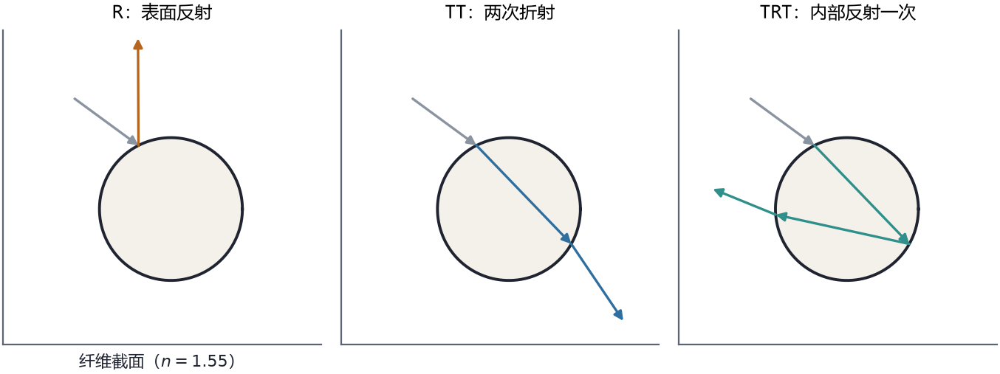
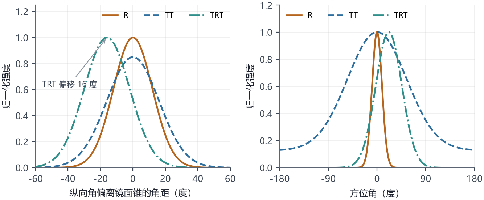
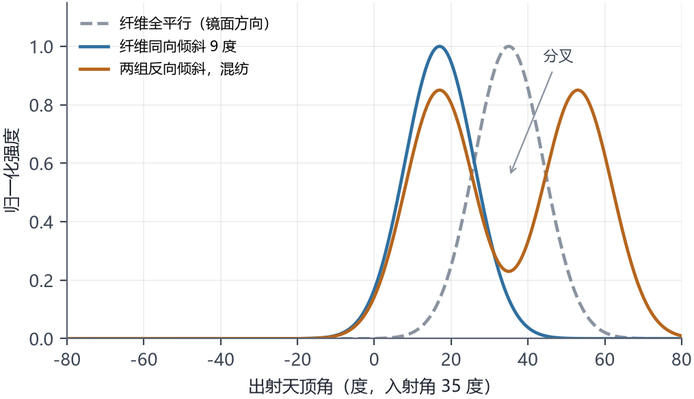

# 第 4 章 Marschner 模型搬到布料上

## 4.1 从头发到纱线

2003 年，Marschner 等人在渲染人类头发的论文里提出了一个散射模型。它的出发点很朴素：一根头发是一根透明的圆柱，光打上去之后，一部分直接从表面反射，一部分穿进去、从另一侧穿出来，还有一部分穿进去、在内部反射一次再穿出来。这三条路径分别记为 R、TT、TRT。

这个模型和布料的关系，比表面上看起来近得多。纱线是纤维的集合，每根纤维都是圆柱，光在纤维里走的也是这三条路径。差别在于纤维的排布方式和尺寸：头发的直径 50 到 100 微米，棉纤维 12 到 20 微米；头发是一根一根分开的，纤维是捻在一起的；头发有鳞片，棉纤维有天然转曲。

图 4-1 把三条路径画在纤维截面上，折射率取 1.55，接近角蛋白和棉纤维的值。三条路径的出射方向差别很大，这是布料高光分成几层的根本原因。

## 4.2 分离纵向与方位

圆柱的对称性允许把散射函数写成两个一元函数的乘积。这一点是 Marschner 模型的核心，值得把它的来源说清楚。

设纤维轴为 $t$，入射方向的天顶角 $\theta_i$ 从法平面量起，方位角 $\varphi_i$ 绕轴。出射方向同理。散射函数写作

$$S(\theta_i,\varphi_i,\theta_r,\varphi_r)=\frac{M_p(\theta_i,\theta_r)\,N_p(\varphi_i,\varphi_r)}{\cos^2\theta_d}, \tag{4.1}$$

其中 $p\in\{\mathrm{R},\mathrm{TT},\mathrm{TRT}\}$ 是路径编号，$\theta_d=(\theta_r-\theta_i)/2$ 是半角。

$M_p$ 描述纵向：出射方向与轴的夹角该怎么分布。$N_p$ 描述方位：绕轴转一圈，能量怎么分布。分母的 $\cos^2\theta_d$ 不是凑出来的，它来自角度坐标到立体角的换算。

推导如下。立体角元在纤维坐标系里是 $d\omega=\cos\theta\,d\theta\,d\varphi$，这里的 $\cos\theta$ 是因为 $\theta$ 从法平面量起，方向与法平面的夹角余弦正好是 $\cos\theta$。如果 $M$ 和 $N$ 被定义成"每单位 $\theta$"和"每单位 $\varphi$"的密度，那么把 $M\,N$ 换成每单位立体角的密度，要除以 $\cos\theta_i\cos\theta_r$。在镜面锥附近，$\theta_i$ 和 $\theta_r$ 都接近 $\theta_d$，于是分母变成 $\cos^2\theta_d$。

这个因子在实际实现里经常被漏掉。漏掉之后的症状是：掠射角下高光过亮，因为 $\cos^2\theta_d$ 变小，本该被压低的能量没有被压低。第 12 章会把这个错误列进检查清单。

分离的一个直接后果是成本可控。$M$ 是四个角度的函数，但只需要存成两张一维表（分别是宽度和偏移随角度的变化）；$N$ 是方位角的函数，存成三条一维曲线。运行时真正算的是两次插值和一次乘法，比全折叠的二维表便宜得多。这也是 Marschner 模型能在实时里跑起来的原因。

分离本身是近似的。严格来说，圆柱散射的纵向和方位是耦合的，因为光线在内部走的路程同时依赖两个角。Marschner 的做法是假设耦合很弱，可以在每个方位角上独立地算一次纵向分布。这个假设在纤维接近圆柱时成立，在扁平纤维（比如棉）上会带来误差。

## 4.3 三条路径各自的纵向分布

纵向分布描述的是"出射方向与轴的夹角"。对每条路径，它由三样东西决定：Fresnel 反射率、内部传播的衰减、以及几何上的偏移。

R 路径的纵向分布是一个以镜面角为中心的窄峰：

$$M_{\mathrm{R}}(\theta_i,\theta_r)=F(\eta,\theta_d)\exp\left(-\frac{(\theta_r+\theta_i)^2}{2\sigma_{\mathrm{R}}^2}\right), \tag{4.2}$$

注意指数里是 $\theta_r+\theta_i$，因为 $\theta$ 从法平面量起，镜面反射的条件是 $\theta_r=-\theta_i$。这就是很多实现里符号搞反的地方：如果写成 $\theta_r-\theta_i$，高光会跑到背面去。

TT 路径的峰也在 $\theta_r=-\theta_i$ 附近，但宽得多，因为光在纤维内部走了一段，出射位置和方向都被圆柱的折射打散了。它的强度乘上了两次透射的 Fresnel 系数和内部衰减 $\exp(-\mu_a L)$。

TRT 路径的峰偏移到一侧，偏移量由纤维的倾角和内部反射的位置决定。在 Marschner 的原始模型里，这个偏移用一个角度参数 $\alpha_{\mathrm{TRT}}$ 表示，大约在 10 到 20 度之间。

图 4-2 左边把三条曲线画在一起。R 最窄，半宽 12 度；TT 宽一些，半宽 16 度且强度低；TRT 中心偏了 16 度。三条曲线叠在一起，就是一块布在纵向上的高光结构：一条锐的亮线，外面包着一层更宽的亮，亮线旁边还有一条偏移的带。

### 4.3.1 内部路径与衰减

TT 和 TRT 都要在纤维内部走一段，这段路程决定了染色的深浅。

设纤维半径为 $r$，光进入后的折射角为 $\theta_t$，弦长由几何给出：

$$L=2r\cos\theta_t. \tag{4.3}$$

纤维直径 15 微米时，垂直入射的弦长约 12 微米（$\theta_t$ 约 40 度）。染料浓度低的浅色布，吸收系数 $\sigma_a$ 在 $10^3\,\mathrm{m^{-1}}$ 量级，$\exp(-\sigma_a L)$ 约 0.988，几乎没有衰减。深色布的 $\sigma_a$ 可以到 $2\times10^4\,\mathrm{m^{-1}}$，同样的弦长下透射只剩 0.79。

这个数字看着不惊人，但它作用在 TT 路径上，而 TT 在薄织物里占的分量很大。一块深红色的薄棉布逆光看会偏暗、偏褐，就是高吸收把 TT 压下去，剩下的只有 R 的表面反射。浅色布没有这个问题，因为衰减因子接近 1。

还需要注意，弦长依赖 $\theta_t$，而 $\theta_t$ 依赖入射角。掠射时弦长变长，衰减变强，所以深色布的边缘比正面更暗。这个效应在照片上很容易观察到：深色衬衫的褶皱处往往比平展处暗一到两档，不只是因为遮蔽。

## 4.4 方位角分布

方位角分布描述绕轴一圈的能量。三条路径的差别比纵向更大。

R 路径的方位分布极窄。原因是表面反射的方向严格由法线决定，而圆柱的法线只在一个平面内转，所以反射方向也锁在一个平面附近。这个"极窄"是圆柱散射在三维中表现为一条带的数学表述。

TT 路径的方位分布很宽，接近均匀。光穿过纤维时，入射点的方位角和出射点的方位角之间只有一个弱的约束，所以能量铺满整个圆周。这解释了为什么布料的透射光是漫的：逆光看窗帘，亮是整体的亮，不是某个方向的亮斑。

TRT 路径介于两者之间，而且偏离中心。内部反射一次之后，出射方位相对于入射方位偏了一个角度，偏多少取决于折射率和内部反射的位置。这个偏移在图像上表现为高光带的第二条，位置与第一条分开，分开的距离随视角变化。

## 4.5 布料上要做哪些改动

直接把头发模型套到布料上会出三个问题。

第一，纤维不是孤立的圆柱。纱线里纤维挤在一起，一根纤维的出射光很可能被旁边的纤维挡住。Marschner 的模型没有遮蔽项，用在布料上会整体偏亮，尤其是掠射角。补救的办法是乘一个遮蔽因子，或者干脆用第 5 章的微面片语言重新组织。

第二，纤维的截面不是圆。棉是扁带，麻是多边形，羊毛有鳞片。这些形状改变了 Fresnel 的角度分布和内部路径长度。工程上的处理是把折射率调低（模拟形状带来的等效效果），或者给每条路径加一个额外的宽度参数。

第三，织物的纱线本身是弯曲的。纤维的轴不是直线，而是绕纱线轴的螺旋线，捻角 10 到 30 度。这个螺旋让同一根纱线上的纤维朝向连续变化，于是三条路径的峰在空间上被抹开，形成我们在第 2 章看到的那个宽度。

第三点带来一个有用的简化。既然纤维朝向连续变化，就不必逐根追三条路径，可以直接把三条路径的贡献按朝向分布卷积，得到一个等效的、关于纱线轴的多路径模型。这个等效模型只需要三个参数：捻角散布、R 的宽度、TRT 的偏移。

## 4.6 偏侧高光与分叉

布料高光最容易被认出来的特征是偏侧和分叉。

偏侧来自两个原因。一个是 TRT 路径本身的偏移，上面已经说了。另一个是纤维的倾斜：纤维相对表面倾斜 $\beta$，法线也跟着倾斜 $\beta$，镜面反射方向就偏转 $2\beta$：

$$\theta_r=\theta_i-2\beta. \tag{4.4}$$

这个关系是镜面反射定律在小角度下的直接结果：法线转 $\beta$，反射方向转 $2\beta$，方向相反。

图 4-3 把偏侧和分叉画在一起。纤维同向倾斜 9 度，高光峰从 35 度移到 17 度，偏移 18 度，正好是 $2\beta$。两组纤维反向倾斜，峰分裂成两条，中间凹下去。

真实的布上，这种分叉有三种来源。强捻纱的纤维绕轴螺旋，纱线两侧的纤维倾斜方向相反，天然形成两组。混纺时两种捻向的纱线交替排列，形成宏观的分叉。缎纹的长浮长让纱线中段的纤维朝向一致，分叉最明显；平纹的交织点密集，朝向被打乱，分叉被抹平。

这解释了一个常见的美术抱怨：用同一个布料着色器，缎纹总是渲染得像塑料，平纹还算像。原因是单峰模型能勉强描述平纹的平均效果，但描述不了缎纹的方向性。

另一个现象也能用这个框架解释：把一块斜纹布沿一个方向拉伸，高光会跟着变窄或变宽。原因是纱线被拉直之后，纤维的螺旋解开，朝向分布从各向异性变成各向同性，$2\beta$ 的偏移消失。真实布料上这种“拉伸变色”在编织物的折痕处很明显，也是判断一块布是真织还是针织的一个简单方法。

## 4.7 保留几条路径

三条路径全算，成本是三倍的三角函数和三次查表。实时管线里通常只保留两条。

R 必留，它给出最锐的那条高光带，是布料"有光泽"的来源。TT 在正面观察时贡献很小，只在逆光时重要，如果场景里没有逆光，可以省掉。TRT 给出偏侧的第二条带，是布料区别于塑料的关键，建议保留。

一个常见的折中是：把 R 和 TRT 合成一个双峰分布，用两个高斯加一个权重参数表示，省掉各自的 Fresnel 计算。代价是颜色随角度的变化被抹平，深色布在掠射时会偏亮。第 10 章会讨论怎么用查找表把这个代价补回来一部分。

还有一个容易被忽略的成本：`M` 和 `N` 都对方向敏感，但 `N` 的三条曲线形状固定，只随材质变宽度，所以可以预先归一化成三条一维表。真正需要实时算的只有 `M` 上的指数和 Fresnel，以及切线坐标系到世界坐标系的变换。在移动端，这个变换占了大头——每像素一次正交基构造，比三条路径的指数还贵。所以很多实现预先把切线基烘到顶点属性里，代价是网格内存增加一倍。

---

三条路径把一根纤维的散射拆成三块。R 给出锐的镜面高光，TT 给出宽的透射亮，TRT 给出偏侧的第二条带。纵向和方位角可以分离，分离的分母是 $\cos^2\theta_d$。纤维倾斜 $\beta$，高光偏 $2\beta$，两组反向倾斜的纤维让高光分叉。

下一章换一种语言：不再逐条追路径，而是把纱线表面看成一堆朝向不同的小面片。
