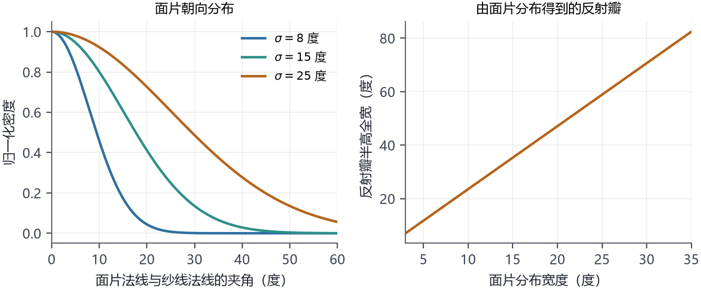
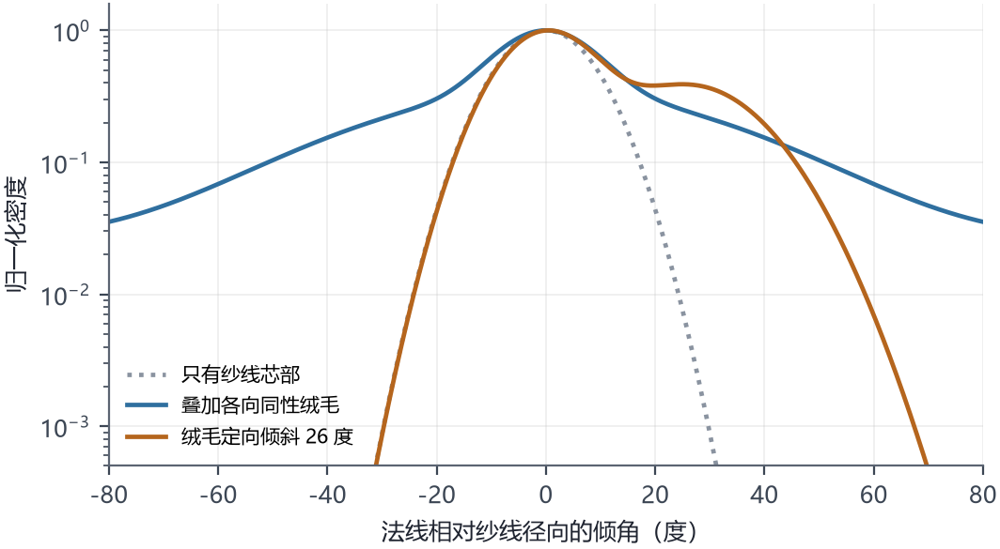
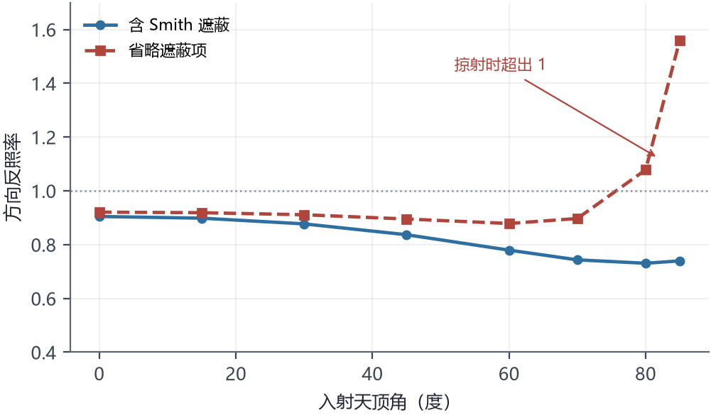

# 第 5 章 纱线级散射与 micro-flake

## 5.1 纱线表面是什么

把一根纱线放在显微镜下，它的表面不是光滑的圆柱。看得见的是几百根纤维的侧面，一根挨一根，沿着捻角方向斜着排。有的纤维末端翘起来，形成一层长短不一的绒毛。纱线中段被捻紧的地方，纤维排列整齐，像梳理过的头发；两端和捻度松的地方，纤维散开，朝向杂乱。

这个差别在渲染里很重要。整齐的那部分给出窄而亮的高光，杂乱的那部分给出宽而暗的底。一个只描述"整齐"的模型会把布渲染得像塑料绳，一个只描述"杂乱"的模型会把布渲染得像毛毡。

两部分的比值不是固定的。同一根纱线上，捻得紧的中段整齐，靠近布边的末端松散；同一块布上，交织点处被压紧，浮长处松散。所以整齐度应该是一个随位置变化的量，而不是一个全局常数。这就是为什么真实的布在近景下能看到亮度的高低起伏，而不是均匀的一片。

微面片（micro-flake）模型的做法是把纱线表面看成一大堆很小的平面片，每片有自己的朝向，朝向按某种分布排列。这个语言和第 3 章的圆柱散射是等价的两种描述：圆柱的切线方向对应面片的朝向，面片法线垂直于切线。换成面片的好处是可以直接借用微表面理论的三件套——法线分布、遮蔽、Fresnel——而不必为每条路径单独写公式。

## 5.2 法线分布怎么构造

纱线表面的面片朝向由两个成分叠成。

第一个成分是纱线芯部。纤维被捻紧，朝向集中，面片法线集中在纱线表面的法线附近。这个成分用一个窄的球面高斯描述：

$$D_{\mathrm{core}}(h)=\frac{1}{2\pi\sigma_c^2}\exp\left(-\frac{\theta_h^2}{2\sigma_c^2}\right), \tag{5.1}$$

其中 $\theta_h$ 是面片法线与纱线法线的夹角，$\sigma_c$ 是宽度，棉纱大约 6 到 10 度，精纺毛纱 10 到 15 度。

这个系数是怎么来的？要求 $\int D\cos\theta\,d\omega=1$，在球坐标里写成

$$\int_0^{\pi/2}\int_0^{2\pi}\frac{1}{2\pi\sigma^2}e^{-\theta^2/2\sigma^2}\cos\theta\,\sin\theta\,d\theta\,d\phi
=\frac{1}{\sigma^2}\int_0^{\pi/2}e^{-\theta^2/2\sigma^2}\theta\,d\theta, \tag{5.2}$$

这里用了小角近似 $\sin\theta\cos\theta\approx\theta$。积分上限推到无穷，结果是 $\frac{1}{\sigma^2}\cdot\sigma^2=1$。所以 $1/(2\pi\sigma^2)$ 是正确的归一化系数，代价是当 $\sigma$ 大于 20 度时小角近似开始失准，归一化会偏大百分之几。

第二个成分是毛羽。绒毛的朝向基本随机，只有沿纱线轴向的弱偏好。这个成分用一个宽的球面高斯，或者干脆用一个各向同性的常数：

$$D_{\mathrm{fuzz}}(h)=\frac{w}{\pi}+(1-w)D_{\mathrm{wide}}(h). \tag{5.3}$$

小角近似在 $\sigma$ 大于 20 度时误差开始明显。把 (5.2) 的积分上限保留为 $\pi/2$，用数值积分可以算出真实归一化系数与 $1/(2\pi\sigma^2)$ 的比值：$\sigma=10$ 度时是 1.003，20 度时是 1.012，30 度时是 1.032。换毛羽这种 30 度以上的宽分布时，偏 3% 的能量在掠射角下会被放大，所以宽成分最好用各向同性的常数 $1/\pi$，它的归一化是严格的。

两个成分按比例混合：

$$D(h)=\alpha D_{\mathrm{core}}(h)+(1-\alpha)D_{\mathrm{fuzz}}(h), \tag{5.4}$$

$\alpha$ 是"整齐度"，精梳棉 0.7 到 0.8，普梳棉 0.5 到 0.6，起绒织物 0.3 以下。

图 5-1 左边画出了三种宽度的分布。右边是宽度换算：面片分布的标准差 $\sigma$ 与反射瓣的半高全宽近似成 $2.35\sigma$ 的关系，因为两者都是高斯的宽度，只差一个常数。这个换算在参数标定时很有用：你从照片上量出高光的半宽，除以 2.35 就得到面片分布的 $\sigma$，不用反解积分。

## 5.3 绒毛方向怎么进入公式

绒毛不是完全随机的。纺纱时纤维被拉伸，伸出来的末端倾向于沿纱线轴向倒下，倒下的角度有一个分布。这个方向性让分布从各向同性变成各向异性，也让高光从一团变成一条带。

处理的办法是给分布一个偏移。设绒毛的主要倾斜方向在切平面内与经向成 $\varphi_f$ 角，倾角为 $\beta_f$，则绒毛成分写成

$$D_{\mathrm{fuzz}}(h)=\frac{1}{2\pi\sigma_f^2}\exp\left(-\frac{(\theta_h\cos(\varphi_h-\varphi_f)-\beta_f)^2+(\theta_h\sin(\varphi_h-\varphi_f))^2}{2\sigma_f^2}\right). \tag{5.5}$$

这个式子的意思是：在切平面上，分布的中心不在原点，而在 $(\beta_f,\varphi_f)$ 这个位置；沿着 $\varphi_f$ 方向的宽度和垂直方向的宽度可以不同。

图 5-2 里的橙线就是这个偏移的效果。分布的主峰还在 0 度，但在 26 度附近多出一个肩（shoulder）。这个肩在图像上的表现是一条与主高光平行、亮度较低的副带，宽度更大、边缘更软。

真实织物上这种副带很常见，尤其是斜纹和起绒织物。用单一的高斯拟合不出来，用"主峰 + 偏移肩"的两段式可以。代价是多两个参数，而且这两个参数与捻角高度相关，标定时容易互相抵消（第 11 章会讲这个陷阱）。

### 5.3.1 三个容易混淆的宽度

面片分布宽度 $\sigma$、反射瓣宽度、高光带宽度是三个不同的量，标定时经常被混用。

面片分布宽度是几何量，单位是角度，描述纱线表面法线的散布。反射瓣宽度是光学量，描述给定入射方向下出射能量的角分布，它由面片分布卷积上 Fresnel 和遮蔽得到。高光带宽度是图像上的量，还要再卷积上像素覆盖面积和镜头模糊。

三者从小到大的顺序通常是：面片分布 < 反射瓣 < 高光带。在 $\sigma=10$ 度时，反射瓣的半宽约 23 度，高光带在近景下再宽 3 到 5 度。用照片量高光带宽度再反推 $\sigma$，会系统性偏大，需要减掉后面两项。第 11 章给出一张换算表。

## 5.4 拼成 BRDF

有了法线分布，剩下的就是标准的微表面三段式：

$$f(\omega_i,\omega_o)=\frac{F(\omega_i\cdot h)\,D(h)\,G(\omega_i,\omega_o)}{4\cos\theta_i\cos\theta_o}, \tag{5.6}$$

其中 $h$ 是半程向量，$F$ 用 Schlick 近似，$G$ 用 Smith 遮蔽。这个式子在第 3 章的圆柱模型里没有对应的项，因为 KK 模型假设纤维是孤立的；纱线级模型必须补上，否则掠射时会造能量。

遮蔽项不能省，这一点可以用数值实验确认。取 $\sigma=14$ 度，$F_0=1$（把面片当成理想反射体，便于看清能量上限），在半球上积分方向反照率：

$$R(\theta_i)=\int_\Omega f(\omega_i,\omega_o)\cos\theta_o\,d\omega_o. \tag{5.7}$$

图 5-3 给出了结果。含遮蔽时，反照率从 0.9 缓慢下降到 0.75，下降的部分是单次散射假设丢掉的那一块（第 6 章会补）。省略遮蔽时，反照率在 80 度之后越过 1，到 85 度达到 1.55。多出来的能量不是小误差，它会让掠射角下的布亮得不自然，像涂了一层油。

这个实验也说明了为什么布料模型里遮蔽项的形式比金属更重要。金属的高光集中在镜面方向，遮蔽只影响峰的高度；布料的分布宽，遮蔽在整个半球上都起作用，形式选错会改变 lobe 的整体形状。

### 5.4.1 遮蔽用哪个形式

常见的写法有两种。一种假设两个方向的遮蔽不相关，把单方向的 $G_1$ 直接相乘；另一种用高度相关的 Smith 形式，把两个方向的 $\Lambda$ 加起来：

$$G_2=\frac{1}{1+\Lambda(\omega_i)+\Lambda(\omega_o)}. \tag{5.8}$$

两者在垂直入射时几乎相同，在掠射时差得多。以 $\alpha=0.25$ 为例，入射角 80 度、出射角 60 度时，相关形式比不相关形式高约 9%。布料的高光带正好落在掠射区，这 9% 直接变成了亮度差。用不相关形式会让布的边缘偏暗，看起来比实际“硬”一点。

另一个容易被忽略的点是：$D$ 很窄时（$\sigma$ 小于 5 度），峰值处的 $D$ 可以到几千，此时单片采样会产生 firefly。解决办法不是把 $D$ 截断（那会改能量），而是用可见法线分布采样（第 10 章），让采样密度跟着 $D$ 走。

## 5.6 单次散射的缺口

图 5-3 里蓝线下降的那 15% 不是实现错误。单次散射的微表面模型有一个内在的缺口：它假设光打到一个小面片上，反射一次就离开，不考虑被另一个面片挡住之后再反射一次的可能。粗糙度越大，这种多次反弹越多，缺口越大。

这个缺口在金属上表现为"粗糙金属偏暗"，在布料上表现得更明显，因为布料的分布宽，小面片之间的遮挡频繁。第 6 章的 sheen 项有一半的作用就是补这个缺口，另一半是描述毛羽层的体积散射。

有一个简单的判据可以估计缺口的大小。把方向反照率写成 $R=1-\Delta$，在 $\sigma$ 从 5 度增到 25 度的过程中，$\Delta$ 从 3% 增到 25% 左右。这个数字可以用第 12 章的数值积分复现，不需要任何拟合。

## 5.7 参数与成本

纱线级模型需要五个参数：$\sigma_c$、$\sigma_f$、$\alpha$、$\beta_f$、$F_0$。前四个是几何的，第五个是光学的。它们与第 2 章的几何量的对应关系是：

- $\sigma_c$ 对应捻角的散布，捻度越高、纤维越整齐，$\sigma_c$ 越小；
- $\sigma_f$ 对应毛羽的长度与弯曲程度，毛羽越长越弯，$\sigma_f$ 越大；
- $\alpha$ 对应精梳程度；
- $\beta_f$ 对应毛羽的倒伏方向，通常接近捻角；
- $F_0$ 对应纤维的折射率，棉约 0.03，羊毛约 0.04，涤纶约 0.036。

成本上，一次 BRDF 求值需要一次半程向量、一次球面高斯的指数、一次 Smith 的平方根、一次 Schlick 的五次幂。比 KK 模型的两次点积贵三倍左右，但换来的是可归一化的能量和可控的各向异性。

这五个参数不能全从照片上直接读出来，但可以从织物的行业参数估一个初值。捻度每提高 100 捻/米，$\sigma_c$ 大致降低 0.5 度；精梳纱的 $\alpha$ 取 0.75，普梳取 0.55；毛羽长的起绒布取 0.35 以下。这些数不是物理定律，是从图 2-2 的捻角分布和常见纱线的显微照片里归纳的经验值，用作标定的起点，不当作真值。

各向异性版本的实现只需要多一个参数。把切平面内的两个方向分别取宽度 $\sigma_x$ 和 $\sigma_y$，把 (5.5) 里的径向距离拆成两个分量，指数的分子变成两项之和。这样多一次乘法和一次加法，换来的是高光带的长度方向可控。典型值：平纹 $\sigma_x/\sigma_y$ 在 1.5 到 2 之间，斜纹在 2.5 左右，绸缎可以到 4。

如果只需要渲染远景，可以把 $\alpha$ 和 $\sigma$ 合并成一个等效宽度，把各向异性去掉，退化成各向同性的 GGX。误差在远景的像素平均里被吃掉，这正是第 1 章 1.2.1 节说的那个平均。

退化的换算关系可以推出来。球面高斯在峰值附近的二阶展开是 $1-\theta^2/(2\sigma^2)$，GGX 的小角形式是 $1-2\theta^2/\alpha^2$，两者相等给出

$$\alpha=\sqrt{2}\,\sigma. \tag{5.9}$$

$\sigma=10$ 度（0.175 弧度）对应 $\alpha=0.247$。这个数在常见布料的粗糙度范围内，所以直接用 GGX 加 sheen 能凑出不错的远景效果。近景下差别就出来了：GGX 的尾部是 $\theta^{-4}$，球面高斯是指数衰减，前者拖得更长，会在高光周围多出一圈灰雾。

---

纱线级散射把第 3 章的圆柱换成一堆朝向按分布排列的小面片。分布由一个窄的芯部和一个宽的绒毛成分混合而成，混合比例叫整齐度。绒毛的倾斜让分布在切平面上偏移，产生副带。BRDF 用标准的三段式，遮蔽项不可省，否则掠射时能量超过 1。单次散射本身还有 15% 左右的缺口，留给下一章的 sheen 去补。
