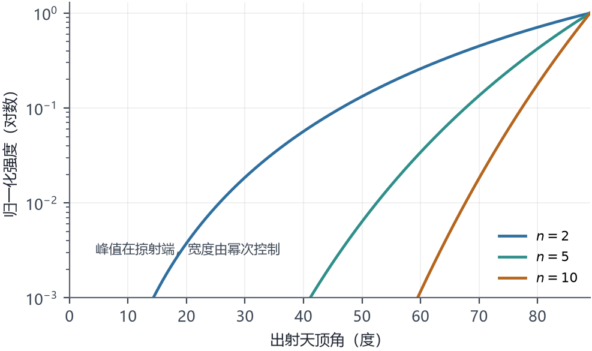
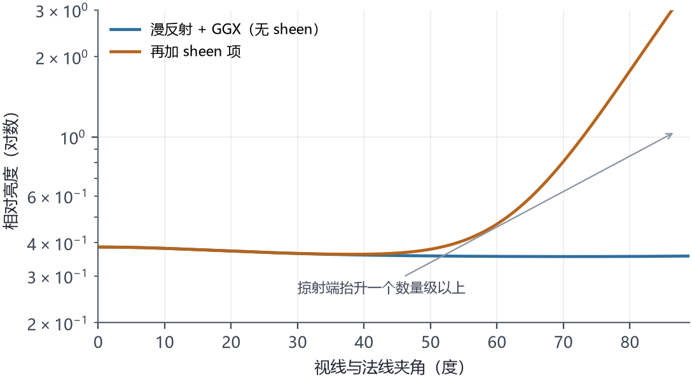
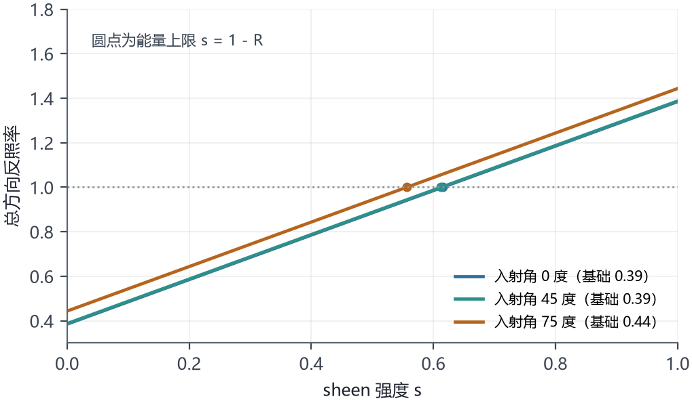

# 第 6 章 编织感知的 BRDF 与 sheen

## 6.1 边缘为什么发白

一件黑色棉衬衫，正面看是深灰，几乎不透光。侧过来看，衣服的边缘发白，像蒙了一层霜。翻过来对着窗户，边缘更亮，能看见纤维的轮廓。

这个亮度不是来自高光。高光在镜面方向，边缘不在那个方向上。它也不来自漫反射，因为漫反射随角度是平的。它是布料独有的一层亮度，叫 sheen（光泽、绒光）。

sheen 有三个可观察的性质。它集中在掠射方向，正对表面时几乎没有。它对光源方向不敏感，把灯从左边移到右边，边缘的亮度分布基本不变。它带颜色，但不一定是纤维的颜色——黑色天鹅绒的 sheen 偏灰蓝，深红丝绒的 sheen 偏粉。

一个只由漫反射和微表面高光组成的模型，三个性质都给不出来。漫反射没有角度依赖，高光锁在镜面方向。要描述 sheen，必须加一个新的项。

三个性质里，对光源不敏感这一条最容易被忽略。它意味着 sheen 不参与“光从哪边来”的计算，只参与“从哪边看”。这对采样有直接影响：sheen 不能作为光源采样的依据，只能作为相机侧的重要性采样。双向路径追踪里，这一点让 sheen 只能走一半的光路。

## 6.2 两个物理来源

sheen 有两个来源，量级不同。

第一个是 Fresnel。掠射时界面反射率趋近 1，即使垂直入射只有 4%。用 Schlick 近似算一下：$F_0=0.04$，$\theta=85$ 度时 $\cos\theta=0.087$，

$$F=F_0+(1-F_0)(1-\cos\theta)^5=0.04+0.96\times0.633=0.65. \tag{6.1}$$

从 0.04 涨到 0.65，十六倍。这个倍率足以解释大部分的边缘变亮。

第二个是体积路径。视线接近掠射时，光在毛羽层里穿行的路径变长。设毛羽层厚度为 $d$，视线与表面夹角为 $\theta$，路径长度为 $d/\cos\theta$。散射介质的光学厚度按同样的比例增加，多次散射的概率上升，出射能量跟着上升。这个效应在 $\theta$ 超过 70 度之后才开始明显，因为 $1/\cos\theta$ 在那里才快速增大。

两个来源加起来，边缘的亮度可以是正面的三到五倍。图 6-2 给出了一条这样的曲线：正面 0.39，85 度时 1.05，接近三倍。

### 6.2.1 体积路径的量级

体积路径的贡献可以用一个简单的单次散射公式估。设毛羽层的光学厚度为 $\tau_0=\sigma_t d$，斜看时光学厚度变成

$$\tau(\theta)=\frac{\tau_0}{\cos\theta}, \tag{6.2}$$

被散射一次以上的能量比例是 $1-e^{-\tau}$。取 $\tau_0=0.4$，垂直看时比例 33%，80 度时 $\tau=2.3$，比例升到 90%。两倍多的能量从“只穿过去”变成“散射一次再出来”，这就是掠射变亮里除去 Fresnel 之外的那一部分。

$\tau_0$ 这个数可以直接从覆盖率估。一块中等厚度的平纹布，纤维体积占比约 0.4，单根纤维的散射截面约等于它的几何截面，所以 $\sigma_t$ 的量级是 $1/(\text{纤维直径})\times0.4$，$\tau_0$ 通常在 0.3 到 0.8 之间。灌满填充的毯子和天鹅绒可以到 2 以上，那时单次散射近似已经不成立，必须用第 7 章的多重散射公式。

## 6.3 为什么不能直接用 GGX 的 Fresnel

微表面模型里也有 Fresnel，为什么它给不出 sheen？

因为 Fresnel 在微表面模型里乘在法线分布上：$f=F\,D\,G/(4\cos\theta_i\cos\theta_o)$。掠射时 $F$ 确实变大，但同一时刻 $D$ 要求半程向量接近法线，而掠射时半程向量远离法线，$D$ 已经衰减到接近零。两个因子一个涨一个落，乘积不涨。

具体地，设 $\theta_o=85$ 度，$\theta_i=45$ 度，则半程向量与法线的夹角约 65 度。$\alpha=0.3$ 的 GGX 在 65 度处的 $D$ 比峰值小三个数量级。$F$ 涨了 16 倍，补不回来。

把数算出来更清楚。$\alpha=0.3$ 时 $D(0)\approx3.5$，$D(65^\circ)\approx2.4\times10^{-3}$，比值 1/1400。$F$ 从 0.04 涨到 0.65，比值 16。两者相乘，$85$ 度处的微表面高光只有峰值的百分之一。就算漫反射项在那里不变，总亮度也几乎完全由漫反射决定。这与观察到的“边缘发白”完全相反，所以 sheen 必须是外加的一项。

这就是为什么 sheen 必须是一个独立的项，而不是微表面公式的一个参数。它描述的是另一条路径：不是"表面上的小面片反射"，而是"纤维层内部的散射加上界面反射的叠加"。

图 6-1 是这个瓣的形状。三条曲线的峰值都在掠射端，幂次越大，靠近正面的部分衰减得越快。实际布料落在 $n=3$ 到 $n=6$ 之间，棉布偏小、丝绸偏大。

## 6.4 一个可归一化的 sheen 项

工程上最省事的写法是把 sheen 写成一个只依赖出射角的瓣：

$$f_s(\theta_o)=s\,N_n\,(1-\cos\theta_o)^n, \tag{6.3}$$

其中 $s$ 是强度，$n$ 控制宽度，$N_n$ 是归一化系数。

归一化系数可以解析地算出来。要求这一项单独在白炉里的方向反照率等于 $s$：

$$\int_\Omega f_s\cos\theta_o\,d\omega_o
=sN_n\cdot2\pi\int_0^{\pi/2}(1-\cos\theta_o)^n\cos\theta_o\sin\theta_o\,d\theta_o. \tag{6.4}$$

换元 $c=\cos\theta_o$，$dc=-\sin\theta_o\,d\theta_o$，积分变成

$$\int_0^1(1-c)^n c\,dc=\frac{1}{(n+1)(n+2)}, \tag{6.5}$$

这个结果可以用 Beta 函数得到，也可以直接分部积分。代回去，

$$N_n=\frac{(n+1)(n+2)}{2\pi}. \tag{6.6}$$

$n=5$ 时 $N_5=42/(2\pi)\approx6.68$。这个数字看着大，是因为 $(1-c)^5$ 在大部分角度上很小，要靠系数把总能量提上来。

这样的 sheen 项有三个好处。它严格可归一化，$s$ 就是它的方向反照率，不会凭空造能量。它的形状连续，不会在某个角度突然出现。它的计算只有一次幂运算，比任何微表面公式都便宜。

代价是它不互易。$f_s$ 只依赖 $\theta_o$，交换入射和出射之后值会变，违反第 2 章的互易性。这个代价在双向路径追踪里是实打实的：不能用她做光源侧的采样，只能单向走。第 12 章会讨论怎么检测和接受这个代价。

## 6.5 能量补偿

sheen 项加进 BRDF 之后，必须检查总和。

第 5 章说过，单次散射的微表面在 $\sigma=14$ 度时丢掉约 10% 到 15% 的能量。sheen 的一部分作用正是补这个缺口，所以它的强度不能随便给，要满足

$$R_{\mathrm{base}}(\theta_i)+s\le1, \tag{6.7}$$

其中 $R_{\mathrm{base}}$ 是漫反射与微表面高光的方向反照率之和。

图 6-3 把这个约束画了出来。入射角 0 度时基础反照率 0.39，sheen 最多可以给 0.61；入射角 75 度时基础已经到 0.44，余量只剩 0.56。如果美术把 sheen 调到 0.8，按 0 度算就超了 19%，按 75 度算超了 24%。

这里有一个容易被忽略的细节：$R_{\mathrm{base}}$ 本身随入射角变化。金属的 GGX 反照率在掠射时会掉（单次散射损失），布料的基础层因为有漫反射垫底，下降得没那么厉害。所以能量上限不是一条水平线，而是随角度缓慢变化的曲线。实现时要么在着色器里算，要么把 $R_{\mathrm{base}}(\theta_i)$ 烘成一张一维表。

## 6.6 生产实现里的两种写法

工业上有两种常见写法，一种基于物理，一种基于经验。

基于物理的写法用 Charlie 法线分布（Estevez 与 Kulla，2017）：

$$D_c(h)=\frac{2+1/\alpha}{2\pi}\left(1-\cos^2\theta_h\right)^{-\frac{1}{2\alpha}}, \tag{6.8}$$

把它代进标准的微表面公式，就得到一个宽尾的 sheen 瓣。Charlie 分布的尾部是幂律而不是高斯的，正好对应毛羽层里长程的散射。这个写法的好处是 sheen 也能参与微表面的遮蔽和 Fresnel，能量行为可控；坏处是 $\alpha$ 很小时分布接近奇异，数值上要小心。

基于经验的写法出现在 Karis（2013）给出的实时着色框架里，Unreal 引擎的布料着色模型沿用了它：给布料单独一个着色模型，在漫反射和高光之外加一个 sheen 项，形状借用 Fresnel 曲线的尾部：

$$f_{\mathrm{sheen}}=c_{\mathrm{sheen}}\,F,\qquad F=F_0+(1-F_0)(1-\cos\theta_o)^5. \tag{6.9}$$

这个写法没有严格归一化，参数靠美术调。它的优点是便宜、直观、和引擎的其他部分接口一致；缺点是 $c_{\mathrm{sheen}}$ 调大之后能量会超，而且没有物理含义，换一个光照环境就要重调。

两种写法都能出图。选择的标准不是"哪个更正确"，而是"要不要做能量检验"。做离线渲染或者需要和其他材质混在一起时，用 Charlie 或者第 6.4 节的归一化瓣；做实时、美术主导、不在乎白炉测试时，用经验式更省事。

两种写法的参数含义也不同。Charlie 的 $\alpha$ 越大，瓣越宽，高光越散；经验式的 $c_{\mathrm{sheen}}$ 不影响形状，只影响强度，形状由那个五次幂定死。所以用经验式的美术会抱怨"边缘的亮太集中"，却没有旋钮可调。把五次幂换成一个可调幂次 $n$，再乘上第 6.4 节的归一化系数，代价很小，效果提升明显。

还有一个生产上的细节：Charlie 在 $\alpha$ 较小时需要更细的采样。因为它的尾部是幂律，大角度的值也不小，余弦采样会在那里欠采样，表现为轮廓周围的一圈疏密不均的噪点。解决办法是用可见法线分布采样，或者把 $\alpha$ 钳到一个下限（通常 0.3）。钳位会牺牲一点宽度，但能消除噪点。

### 6.6.1 尾部形状的差别

两种写法的差别在尾部。经验式的形状是 $(1-\cos\theta)^5$，靠近掠射时趋于零的阶数是五次；Charlie 在 $\alpha$ 较小时按幂律拖尾，靠近掠射时反而上升。把两条曲线画到 89 度会看到：经验式在 85 度之后迅速掉回零，Charlie 一直升到 90 度。

这个差别在图像上表现为轮廓的亮边。用经验式，亮边集中在一个窄带，边界锋利；用 Charlie，亮边从 70 度就开始漫开，边界模糊。真实的布接近后者，因为毛羽的散射是长程的。代价是 Charlie 在掠射端的数值很大，需要把采样和 PDF 配对好，否则会在轮廓上出现一圈噪点。

## 6.7 颜色从哪里来

sheen 的颜色和布料的颜色可以不同。

染色布的漫反射颜色来自染料吸收，是纤维内部的事。sheen 来自表面反射和浅层散射，光走的路短，被染料吸收的机会少，所以 sheen 的颜色更接近纤维本身的颜色，或者更白。

这解释了两个现象。黑色棉布的 sheen 是灰白的，因为纤维本身是半透明的白，染料只作用在内部。深红丝绒的 sheen 偏粉，因为丝纤维的折射率高，表面反射强，红色染料对表层的影响小。

实现上，sheen 的颜色要单独给一个参数，不能直接用基础色。用基础色会让黑色布没有 sheen，因为黑色乘任何数还是黑；用白色会让所有布的 sheen 一样，失去材质差别。

一个实用的做法是把 sheen 颜色写成基础色与白色的混和：

$$c_{\mathrm{sheen}}=\mathrm{mix}(c_{\mathrm{fiber}},\,c_{\mathrm{base}},\,k), \tag{6.10}$$

其中 $c_{\mathrm{fiber}}$ 是纤维本身的白，$k$ 是一个 0 到 1 的参数，表示表层散射里有多少光经过了染料。棉布的 $k$ 大约 0.3，丝绒的 $k$ 在 0.5 以上，涤纶的 $k$ 接近 0（染料主要在内部）。

这个混和不是物理推导，而是把一个二维的自由度压缩成一个参数。它的好处是美术只需要调一个“表层染色程度”，而且这个参数有直观含义；坏处是它无法表达“不同波长的穿透深度不同”这种真实效应，比如深红布在强光下的 sheen 会偏橙而不是偏粉。要表达后者，需要把 $k$ 弄成三元组，或者回到第 9 章的 Kubelka–Munk。

---

sheen 是布料区别于其他材质的那一层亮度。它来自掠射时 Fresnel 上升和毛羽层路径变长两件事，集中在掠射方向，对光源方向不敏感。它不能由微表面的 Fresnel 代替，因为 $D$ 在掠射时已经衰减。一个可归一化的写法是 $s(n+1)(n+2)(1-\cos\theta_o)^n/(2\pi)$，归一化系数由 Beta 积分给出，$s$ 就是它的反照率。它的代价是不互易。

下一章把这层亮度推到极致：当纤维密度高到光要在里面散射很多次，布料就变成了天鹅绒。
