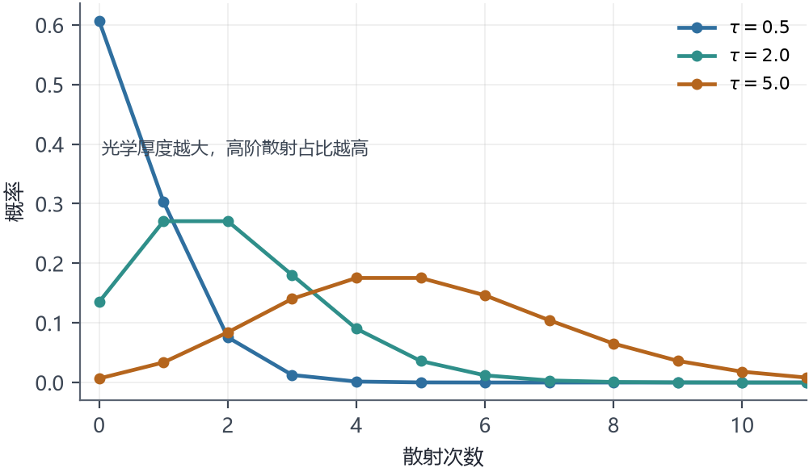
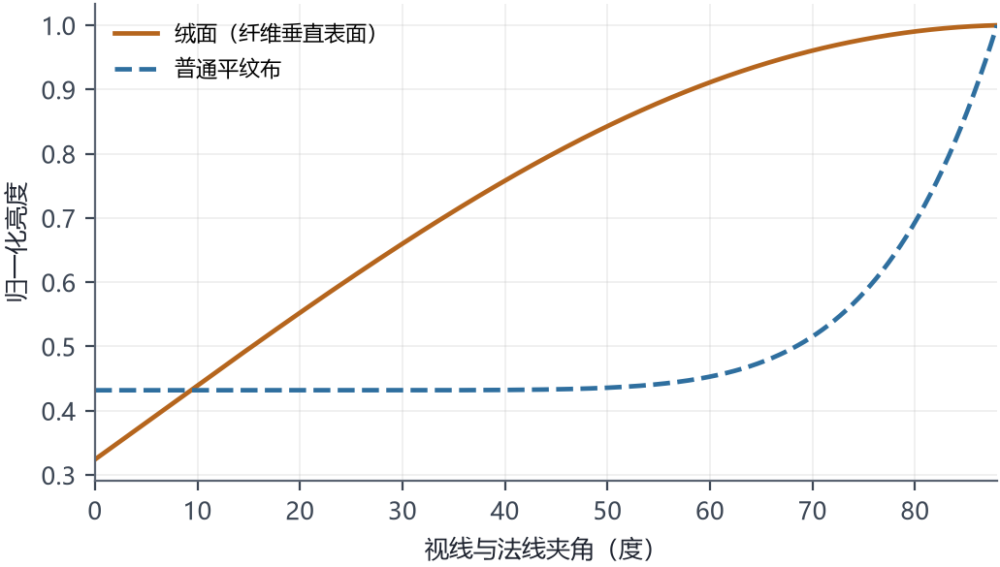
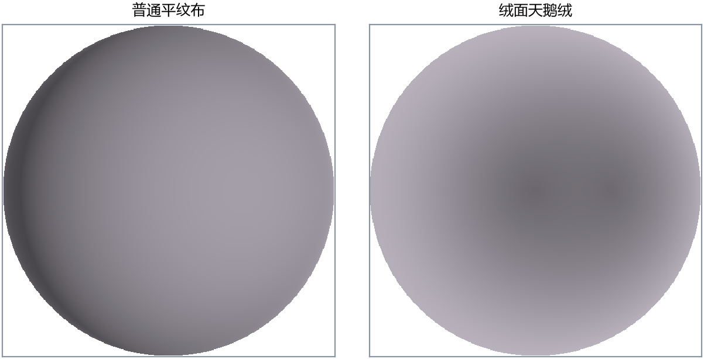

# 第 7 章 绒面与天鹅绒

## 7.1 一块天鹅绒的正面

把一块深红色的天鹅绒平放在桌上，从正上方看。红是暗红，接近砖色，中间几乎没有高光，只有一层很淡的亮。把布慢慢倾斜，红色开始变亮，到接近掠射时，整块布像烧起来一样，边缘泛出偏粉的光，逆着灯看，绒毛的边缘几乎是白的。

这个亮度变化的方向和普通布相反。普通棉布正面最亮，越到边缘越暗（如果不算 sheen 的话）；天鹅绒正面最暗，边缘最亮。用第 6 章的 sheen 可以解释一部分边缘变亮，但解释不了正面的凹陷。正面的亮度比按 Lambert 算出来的还低，好像有一层东西在吃光。

这一章说明这层"吃光的东西"是什么，以及怎么把它写进公式。

## 7.2 绒面的几何

天鹅绒、丝绒、长毛绒的组织和普通平纹布不同。它们在地组织之上织入一层绒经（pile warp），绒经在表面形成一个个小圈或者被割断的绒毛，竖立在布面上。绒毛的长度 0.5 到 2 毫米，直径几十微米，密度每平方厘米几千到几万根。

渲染上，这个结构可以抽象成一层"竖立的纤维"。纤维的轴大致垂直于布面，略有倾斜和弯曲。这层纤维有两个几何参数：厚度 $d$（绒毛长度）和填充率 $\phi$（纤维占的体积比例），后者典型值 0.05 到 0.15。

从这两个量可以算出光学厚度。设纤维直径为 $d_f$，单位体积内有 $n$ 根纤维，则 $\phi=n\pi d_f^2/4$。光沿任意方向穿过单位体积时，被纤维挡住的截面是

$$\sigma_t=n\cdot 2r_f=\frac{4\phi}{\pi d_f}, \tag{7.1}$$

这里用了圆柱在垂直于自身方向上的投影宽度 $2r_f$。把 $\phi=0.1$，$d_f=15$ 微米代进去，$\sigma_t\approx8500\,\mathrm{m^{-1}}$，也就是每毫米衰减 8.5。长度为 1 毫米的绒层，光学厚度 $\tau\approx8.5$。这个数很大，意味着光在里面平均散射八次以上才出来。

## 7.3 多次散射的阶数

光学厚度大，散射次数就多。在均匀介质里，散射次数服从泊松分布：

$$P(n)=e^{-\tau}\frac{\tau^n}{n!}. \tag{7.2}$$

图 7-1 画出了三种厚度。薄布（$\tau=0.5$）的能量几乎全部集中在零次和一次散射，两次以上可以忽略，这就是第 5 章的单次散射模型够用的原因。厚绒（$\tau=5$）反过来，三次以上的占到七成，单次散射模型完全失效。

多次散射带来两个后果，方向相反。

第一个是能量被摊平。每一次散射都把方向的记忆打乱一点，散射八次之后，出射方向与入射方向几乎无关。这会让绒面的反射趋于各向同性，也就是看起来"发闷"，没有清晰的高光。

第二个是吸收被放大。每次散射都伴随一次吸收，路径越长，被吃掉的越多。对于染色的绒面，吸收系数不小，八次散射累积的吸收很可观。深红色的天鹅绒正面看起来偏暗偏浊，主要就是这个原因。

两个后果叠加，绒面的正面亮度低于同样颜色的平纹布。这就是 7.1 节说的"有一层东西在吃光"。

多次散射还有一个容易被忽略的效应：它把颜色往灰里拉。每一次散射都是一次随机的波长无关的方向改变，但吸收是波长相关的，所以经过多次之后，颜色会向吸收少的那一端偏。深红色的天鹅绒在强光下往往能看到一丝橙，不是染色不均，是多次散射之后剩余光子的分布偏向了长波。

## 7.4 为什么正面还有一个凹陷

吸收只能解释"整体偏暗"，解释不了"正面比 45 度还暗"这个形状。这个形状来自纤维的方向。

绒面的纤维竖立，轴垂直于布面。第 3 章推导过，一根圆柱的散射强度正比于 $\sin(T,L)\sin(T,V)$，其中 $T$ 是纤维轴，$L$ 是入射方向，$V$ 是视线方向。两个因子分别表示"光能打到多少纤维侧面"和"从侧面出来的光有多少进入眼睛"。

正上方看，$L$ 和 $V$ 都接近法线方向，与纤维轴 $T$ 平行，两个正弦都接近零。纤维的侧面没有朝向观察者，光打上去也只沿着轴的方向掠过去。结果就是几乎没有散射光进入眼睛。

45 度看，$L$ 与 $T$ 的夹角 45 度，$V$ 也是，两个正弦都是 0.707，乘积 0.5。接近掠射时，两个正弦都到 1，乘积到 1。所以亮度从 0 涨到 1，涨了两倍多。

图 7-2 把两种布的曲线画在一起。绒面（橙线）从 0.32 单调上升到 1.0，在 0 到 30 度区间有明显的凹陷。普通布（蓝虚线）在 0 到 60 度几乎平，只在末端抬起。

这个凹陷是天鹅绒最容易辨认的特征。渲染时如果漏掉它，天鹅绒会看起来像一块染深的棉布，正面太亮。

值得把两个正弦的物理含义再说一遍。$\sin(T,L)$ 描述的是“光能照亮多少纤维侧面”。当光线与纤维轴平行时，光只能照到纤维的端面，端面的面积趋近于零，所以亮度趋近于零。这不是遮蔽，而是投影面积的结果，和第 3 章推导漫反射项时用的是同一个积分。$\sin(T,V)$ 描述的是“纤维侧面有多少光能进入眼睛”，道理相同。两个因子相乘，就有了一个四次的各向异性：绒面在四个“正对”方向上暗，在四个斜向上亮。

这也解释了一个实验现象：把天鹅绒转 90 度，它的亮度分布几乎不变，因为纤维是轴对称的；但如果把绒毛压歪（比如用手抹一下），亮度会明显变化，因为 $T$ 不再是法线方向。压歪的地方会变亮，形成一个亮斑，这就是天鹅绒上“抹痕”的成因。

## 7.5 体积式近似

把每一根绒毛都建出来是不现实的。可行的做法是把绒层当成一个体积，用两个量描述：单次散射反照率 $\omega=\sigma_s/\sigma_t$ 和光学厚度 $\tau$。

单次散射反照率决定"每次散射后光还剩多少"。白色的丝绒 $\omega$ 接近 0.99，黑色的 $\omega$ 只有 0.2 到 0.4。光学厚度决定"平均散射几次"。

一个能用的近似是把反射率写成

$$R(\theta_i,\theta_v)=\omega\left(1-e^{-\tau/\cos\theta_v}\right)\cdot\frac{1}{1-\omega(1-e^{-\tau/\cos\theta_v})}, \tag{7.3}$$

第一项是“至少散射一次”的比例乘上反照率，第二项是一个几何级数，把多次散射的贡献加起来。这个式子在 $\tau$ 很大时分母趋于 1，结果趋于 $\omega$，全部能量由反照率决定；在 $\tau$ 很小时分母也趋于 1，分子趋于 $\omega\tau$，与单次散射一致。

这个近似不严格，它假设每次散射后的方向分布都是均匀的。真实的绒层里，散射有很强的前向性，靠近表面的纤维会把光直接反射回去。要修正这一点，可以把 $\tau$ 换成有效厚度，或者在公式里乘一个方向因子。

方向因子就用第 3 章的 $\sin(T,L)\sin(T,V)$：

$$B(\theta_i,\theta_v)=\sin(T,L)\sin(T,V), \tag{7.4}$$

它把体积近似的均匀分布修正成绒面实际的方向分布。两个式子相乘，就得到一个既能对上能量、又能给出正面凹陷的模型。

图 7-3 是这两个模型渲染的结果，用的就是这个体积近似加上方向因子。右图的中心暗、边缘亮，和真实天鹅绒的照片对得上。左图的亮度分布是普通的 Lambert 加 sheen，中心亮、边缘略微抬升，是棉布的样子。

## 7.6 颜色的处理

绒面的颜色不能只用一个反射率。

因为光在里面散射很多次，每一次都会经过纤维内部的染料，累积的吸收量远大于平纹布。同样是深红色，天鹅绒的红色饱和度更高，明度更低。用同一个 $K/S$ 去染平纹布和天鹅绒，天鹅绒看起来会深两档。

处理办法是把吸收系数乘上一个路径放大因子。平均路径长度约为 $\tau\cdot d_f$ 的量级，比平纹布的纤维直径大几倍。第 9 章的 Kubelka–Munk 会给一个更系统的做法：把绒层当成一个厚度为 $d$、吸收系数为 $2\sigma_a$ 的层，用两流近似算反射率。

绒面还有一个颜色现象：边缘的 sheen 偏白，中心偏深。原因是边缘的光走的路径短（在表层就散射出来了），被染料吸收少；中心的光走得深，吸收多。这个效应用单一的反射率表达不出来，需要把"表层散射"和"深层散射"分开，各给一个颜色，再用视角做混合。第 10 章的多层近似会给一个实现方案。

## 7.7 实现与资产

绒面的实现在工程上有三档。

最轻的一档是把绒面当成一个高 sheen 的布料：基础层用漫反射加微表面，sheen 的强度调到 0.8 以上，幂次降到 2。这档能出“边缘亮”的效果，但出不了“正面凹陷”，因为漫反射在正面是满的。用这档渲染的天鹅绒看起来像一块很软的棉布，近看就露馅。

中间一档是把绒面当成两层：一层是地组织（平纹或者斜纹），一层是竖立的绒毛。绒毛层用第 7.5 节的体积近似，地组织用第 5 章的微面片。两层的反射相加，透射相乘。这档能同时出正面凹陷和边缘亮，成本是两倍的着色。

最重的一档是把绒毛当几何：用 strand 表示每一簇绒毛，用第 3 章的圆柱散射着色。这档能出单根绒毛的轮廓、绒毛之间的相互遮蔽、以及掠射时绒毛层内部的多次反射。成本是几何量，一平方米的天鹅绒可能需要几十万根 strand，只适合特写。

资产层面，绒面需要两张额外的贴图：绒毛方向（grooming）和绒毛长度。方向贴图用两个通道存切平面内的投影，长度用一个通道。方向贴图的意义在于表达“抹痕”和“倒伏”：真实的天鹅绒在加工和运输过程中绒毛会被压向某个方向，形成一片片亮暗不一的区域，这是它看起来高级的原因之一。没有方向贴图，绒面会均匀得像一块地毯。

还有一个容易漏的参数：绒毛的弯曲。真实的绒毛不是直立的，而是向一侧弯，末端卷曲。弯曲让方向因子从 $\sin(T,L)\sin(T,V)$ 变成对 $T$ 的一个积分，效果是凹陷变浅、边缘变宽。如果不想做积分，可以把 $T$ 取成一个有效方向，倾斜 10 到 20 度，效果接近。

这层绒毛的存在还解释了另一个现象：天鹅绒不能被压平。压平之后，绒毛的 $T$ 从法线方向变成切平面方向，方向因子从近零变成近一，表面会突然变亮。真实的布在被手压过的地方会留下一片亮斑，过一段时间绒毛慢慢立起来，亮斑随之消失。这个时间尺度与纤维的回弹性有关，渲染里通常不做，但做布料动画时可以用一个“绒毛复位”的参数模拟。

---

绒面与普通布的区别在于纤维的方向和密度。纤维竖立、密度高、光学厚度大，光在里面散射很多次，能量被摊平、吸收被放大，正面因此偏暗。方向因子 $\sin(T,L)\sin(T,V)$ 给出正面的凹陷，体积近似给出能量的量级，两者相乘就能复现天鹅绒的主要特征。

还有一种结构介于绒面和平纹之间：薄到光可以直接穿过去的布。下一章处理它。
