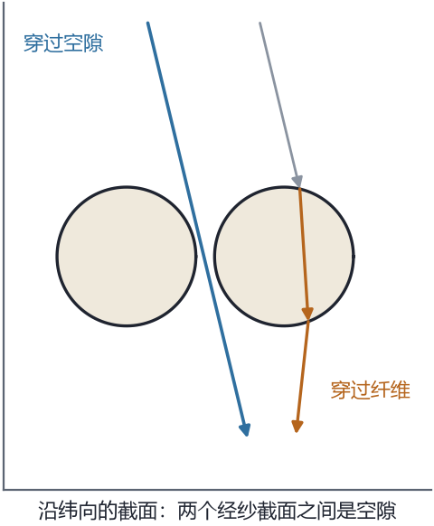
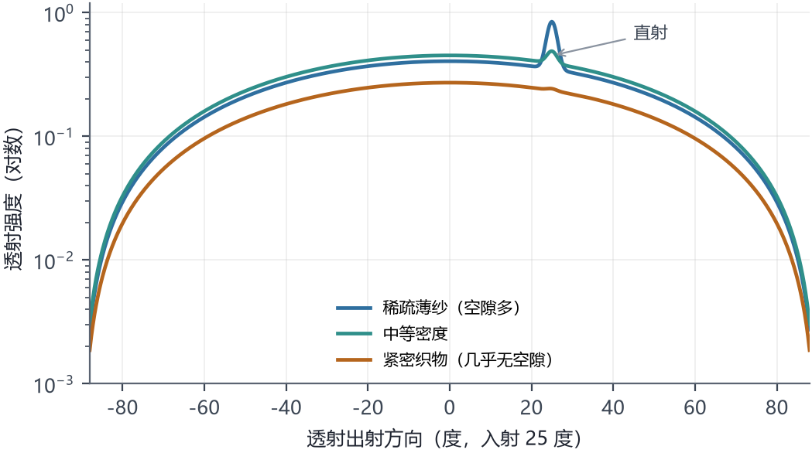
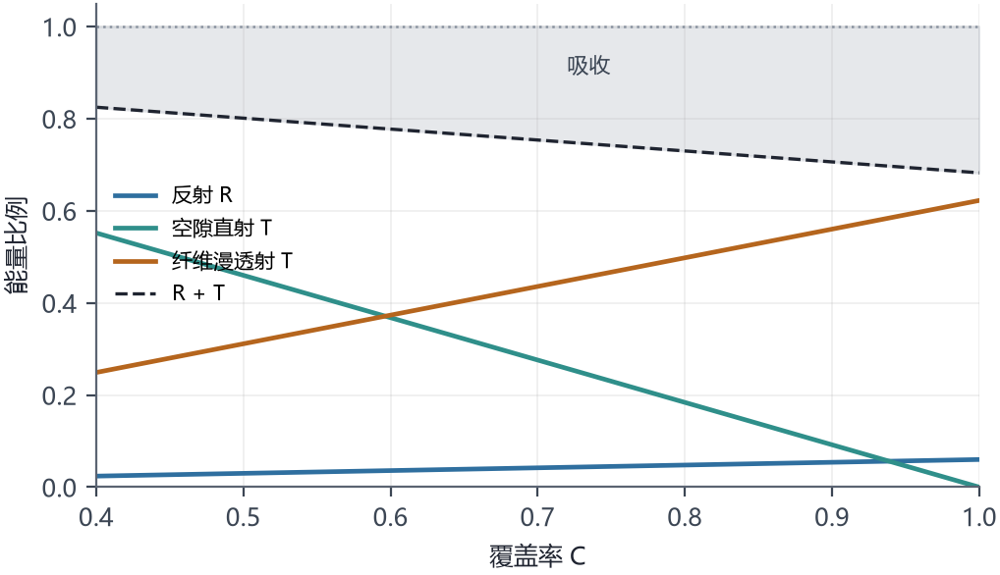

# 第 8 章 薄织物透射

## 8.1 窗帘逆光

把一块白色的棉布窗帘挂起来，白天从室内看它。布是亮的，比墙亮得多，但不是均匀的亮：能看见经纬交织的格子，格子的交叉点暗一点，格子中间亮一点。颜色也比正着看时淡，白布几乎变成浅灰白，深色布的颜色被冲淡。

把窗帘拉近，贴近眼睛看，格子的结构更清楚，亮的地方能看见针孔一样的小点。退后两米再看，格子糊成一片均匀的亮，只剩整体的半透明感。

这块布没有光源，它只是把窗外的光透过来。透射让布变成一个面光源，而透射的方式有两种，对应两种不同的视觉效果：穿过纱线之间空隙的光保留方向，形成针孔和格子；穿过纤维内部的光被打散，形成整体的柔光。

## 8.2 两条路径

图 8-1 把两条路径画了出来。

第一条穿过空隙。空隙的尺寸是纱线间距减去纱线直径，典型值 0.05 到 0.3 毫米。光穿过这样大小的孔，只受几何限制，方向基本不变（衍射的角展宽约 $\lambda/d\approx0.005$ 弧度，可以忽略）。这条路径的透射是"直射"（direct transmission），在图像上表现为针孔、格子和清晰的逆光剪影。

第二条穿过纤维。光进入纤维时折射，走一段，从另一侧折射出来。因为纤维是圆柱，出射方向被散到一个很宽的范围，这就是"漫透射"（diffuse transmission）。这条路径的透射是柔和的，让整块布发亮。

两条路径的比例由覆盖率决定。第 2 章定义过覆盖率

$$C=c_w+c_f-c_wc_f, \tag{8.1}$$

空隙的面积比是 $1-C$。平纹棉布 $C$ 在 0.85 到 0.95 之间，空隙只有 5% 到 15%，直射很弱；稀疏的纱罗或者夏布 $C$ 可以低到 0.6，空隙占四成，直射明显。

## 8.3 直射分量

直射分量的强度等于空隙面积比乘上纤维内的衰减（如果光在穿过空隙前后不被遮挡）。写成方向函数，它是一个 delta 分布：

$$f_{\mathrm{dir}}(\omega_i\to\omega_o)=(1-C)\,e^{-\sigma_a d/|\cos\theta_i|}\,\delta\!\left(\omega_o-T\omega_i\right), \tag{8.2}$$

其中 $T$ 是把入射方向平移到出射方向的映射（对平板就是恒等映射），$d$ 是织物厚度，$\sigma_a$ 是纤维的吸收系数。

这个式子里有两个容易写错的地方。

第一是 delta 的归一化。delta 在球面上的权重要除以 $\cos\theta_o$，因为立体角元是 $\cos\theta\,d\omega$。如果漏掉这个因子，直射分量的能量会随视角变化而错，掠射时偏大。

第二是衰减项。光穿过空隙时其实不经过纤维，不该有 $\sigma_a$；但空隙是斜的，光在进入空隙之前和出来之后要穿过相邻纱线的边缘，所以有效路径长度是 $d/|\cos\theta_i|$ 的一部分。工程上通常保留这个因子，把 $\sigma_a$ 调小来补偿。

以上的写法把空隙当成了一个干净的孔。真实的空隙不干净：纱线表面的毛羽会伸进空隙，把有效开口缩小。缩小多少取决于毛羽长度与空隙尺寸的比值，这个比值小于 0.5 时影响很小，超过 1 时空隙基本被堵上。夏季的稀薄麻布能透光，除了空隙大，毛羽短也是原因。

空隙的形状也不是直上直下的。织物有厚度，纱线截面是圆的，所以空隙是一个喉管：入口宽、中间窄、出口又宽。这个形状对直射光没有影响（几何光学下直线传播），对衍射有影响，但在可见光的尺度下衍射本就忽略，所以可以不建。

## 8.4 漫透射分量

漫透射来自纤维内部。第 4 章的 TT 路径已经给出了它的角分布：方位角接近均匀，纵向很宽但有前向偏好。为了能直接进入渲染器，通常把它写成一个前向的余弦瓣：

$$f_{\mathrm{dif}}(\omega_i\to\omega_o)=C\cdot\frac{\omega}{\pi}\left|\cos\theta_o\right|^{k}, \tag{8.3}$$

其中 $\omega$ 是单次散射反照率，$k$ 控制前向性，$k=0$ 是朗伯透射，$k=1$ 到 2 是常见布料的值。

这个形式不严格。严格的漫透射应该由纤维的相位函数积分得到，形状在 $\theta_o$ 接近 $-\theta_i$ 时有峰。用余弦瓣是一种简化，代价是逆光时的高光方向不准。要更准可以把第 4 章的 TT 纵向分布直接搬过来。

图 8-2 把两种分量画在一起。稀疏薄纱（蓝线）的直射峰明显，宽度只有一两度；紧密织物（橙线）的直射峰几乎没有，整条曲线是一个宽的余弦瓣。中间那条是常见的棉布。

这个图也解释了 8.1 节的现象。贴近看时，眼睛分辨得出直射峰对应的那些像素，看到针孔；退远之后，像素平均把峰和瓣混在一起，只剩整体的亮。

两种分量的频域特征不同，这一点在 mipmap 里很重要。直射分量包含高频（针孔的边缘分明），漫透射只有低频。当一张透射贴图被 mip 到很小的时候，直射分量的能量不能简单地平均掉，而应该乘上一个“合起来的覆盖率”，否则远处的布会偏暗。正确的做法是把直射分量的权重随 mip 层级下降，降到零时全部归到漫透射。没有做这一步的实现，远处窗帘会出现一层淡淡的灰。

## 8.5 能量怎么分

反射、透射、吸收三者加起来等于入射：

$$R(\theta_i)+T(\theta_i)+A(\theta_i)=1. \tag{8.4}$$

对薄织物，$T$ 不能忽略，这打破了"不透明表面"的假设。第 2 章的渲染方程只积分上半球，对薄织物要改成整个球面：

$$L_o(x,\omega_o)=\int_{\Omega^+}f_r L_i\cos\theta_i\,d\omega_i+\int_{\Omega^-}f_t L_i\left|\cos\theta_i\right|\,d\omega_i. \tag{8.5}$$

注意第二个积分的余弦取绝对值，因为光线从背面来，$\cos\theta_i$ 是负的。

图 8-3 给出了一个典型的分配。覆盖率从 0.4 增到 1.0，空隙直射从 0.55 降到 0，纤维漫透射从 0.25 升到 0.62，反射几乎不变。总和始终低于 1，缺口是吸收。对白色布料，缺口很小（$\omega$ 接近 1）；对深色布料，缺口可以到 0.4 以上。

这个分配有一个反直觉的地方：覆盖率增加时，总透射先降后升。因为空隙消失了，但纱线变粗、纤维变多，漫透射的路径也变多。真实的紧密织物（比如高支高密的府绸）透光很少，是因为纱线被压扁、纤维填充率极高，$\omega$ 也低，不是因为覆盖率高。

## 8.6 逆光为什么特别亮

把布放在光源和眼睛之间，亮度会比同样照度的正面反射高好几倍。原因有三层。

第一层是几何。逆光时，眼睛接收的是透射光，透射的立体角是整个下半球，而反射只占上半球的一部分。同样功率的光，透射摊到更大的角度上，单位立体角的亮度不一定高，但积分之后的总量可能更大。

第二层是前向性。漫透射的瓣在 $\theta_o\approx-\theta_i$ 附近有峰，逆光时视线正好落在这个峰上，亮度被放大。

第三层是对比。逆光时布挡住了背后的亮背景，布的亮度虽然绝对值不高，但和周围的暗背景比，显得很亮。渲染里这一点体现为色调映射和曝光的相互作用，不是材质本身的性质。

三层里只有第二层是材质参数能控制的。$k$ 越大，前向峰越尖，逆光越亮；$k$ 越小，透射越漫，逆光时整块布均匀发亮。用照片标定 $k$ 时要注意，照片里的亮度已经被色调映射压过，直接拟合会得到偏小的 $k$。

还有一个容易被漏掉的物理：逆光时布的两面都在工作。光从背面进来，穿过一部分被散射回背面（反射），另一部分从正面出来（透射）。从正面看，你看到的是透射光加上正面自己的反射光（那部分很弱）。如果场景里的光源在布后面且距离很近，背面的反射光会再次被布遮挡，形成一个微弱的多次弹射。这个效应在密集的布上可以忽略，在稀疏的纱上能到几个百分点。

## 8.7 采样与实现

直射分量是 delta，采样要特殊处理。

一种做法是显式采样：以概率 $p_{\mathrm{dir}}$ 选择直射路径，直接把方向设成透射方向，pdf 乘以 $p_{\mathrm{dir}}$，权重除以它。剩下的概率给漫透射，按余弦分布采样。这个做法的方差小，但要求两条路径的权重估计正确。

另一种做法是把 delta 磨圆，用一个极窄的瓣代替，比如宽度 0.5 度的高斯。这样可以用同一个采样流程，代价是针孔会变糊，而且窄瓣需要很多样本才能收敛。

前一种做法在离线渲染里更常见，后一种在实时里更常见，因为实时管线不能分支。

一个常见的错误是把直射分量当成普通的方向函数，用余弦采样去积它。结果是绝大部分样本落在 delta 外面，权重为零，偶尔一个样本落在里面，权重巨大，图像上出现零星的白点。这类白点在动画里会闪烁，很难降噪，因为它不是方差问题，而是估计量写错了。

## 8.8 四档近似

把薄织物的模型按精度分成四档，方便按场景选。

第一档是不透明。把布当成一个不透明的漫反射面，透射完全忽略。适合厚布、深色布、光源在同一侧的场景。误差是逆光时布会变成黑块。

第二档是标量透射。用一张透射率贴图，把背面来的光乘上透射率，方向不变。适合这类场景：隔着一层布看到模糊的背景，没有强光源。误差是透射的方向分布被抹成了直射。

第三档是双瓣模型。把直射和漫透射分开，直射用 delta（或者极窄的瓣），漫透射用余弦瓣，权重由覆盖率算。这本的 8.3 和 8.4 就是这一档。它能出针孔、能出逆光的前向峰，成本只有两次查表加一次乘法。

第四档是完整体积。把织物当成一层参与介质，用第 7 章的多次散射加第 9 章的吸收，光在里面走真正的随机游走。这档能出透射颜色的细节（同一块布在透射和反射下颜色不同），代价是噪声和计算量。它只在特写和需要精确颜色的场合用。

四档之间的跳变不是突兀的。第一档到第二档只是加一个乘数，第二档到第三档加一个方向函数，第三档到第四档把解析积分换成数值。每一档都可以作为一个开关存在同一个着色器里，用 LOD 或者材质标签切换。

透射解释了布为什么会亮，但还没解释布为什么会有颜色。下一章处理染料。

---

薄织物有两条透射路径：穿过空隙的直射和穿过纤维的漫透射，比例由覆盖率决定。直射是 delta，采样要显式处理；漫透射是宽瓣，用余弦或者第 4 章的 TT 分布。总能量满足 $R+T+A=1$，覆盖率增加时总透射先降后升。
