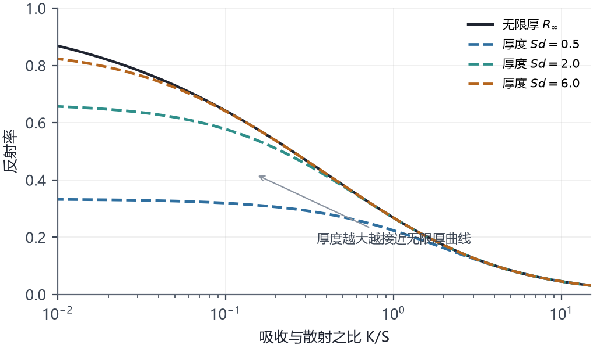
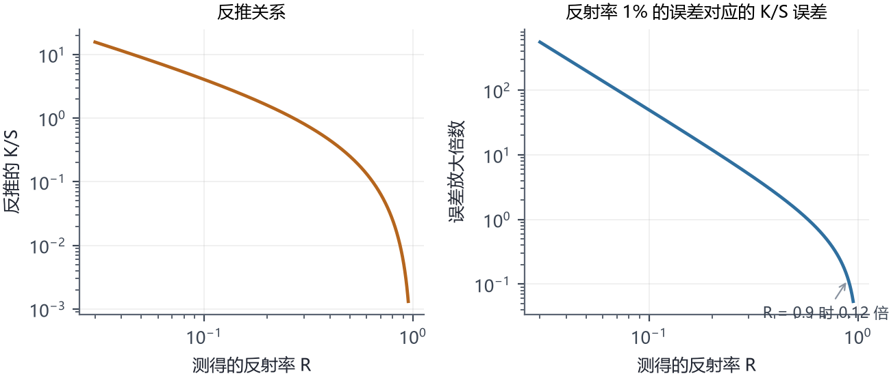
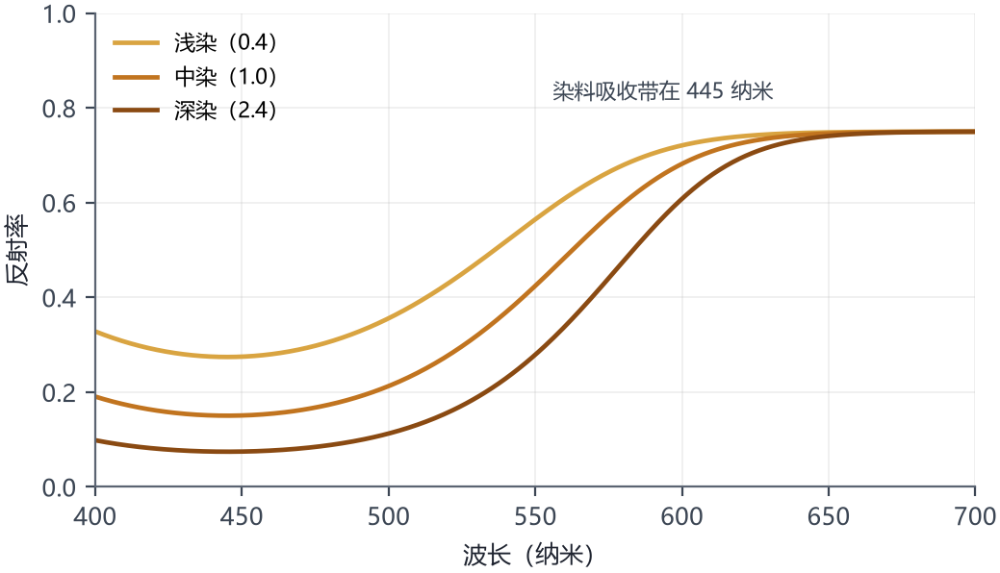

# 第 9 章 染色与 Kubelka–Munk

## 9.1 同一染料，两块布，两个颜色

拿一块染好的棉布，剪下一小块叠在原来的布上。叠了两层的地方，颜色比单层深，而且不是简单地深一档，是往另一个色相偏：浅蓝叠起来变成偏紫的深蓝，浅红叠起来变成偏褐的深红。

这个现象在纺织厂里是常识，染厂打样时要控制"叠层色差"。在渲染里它意味着一个麻烦：颜色不能只由染料浓度决定，还由光在布里走了多远决定。同一缸染料，薄布和厚布是两个颜色；同一块布，正面看和斜着看（路径变长）也是两个颜色。

第 8 章处理了透射，但透射的公式里 $\omega$ 和 $\sigma_a$ 还是给定的常数。这一章说明它们从哪里来，以及颜色为什么随厚度变化。

## 9.2 两个系数

光在纤维内部同时发生两件事：被染料吸收，被纤维结构散射。

吸收来自染料分子对特定波长的选择吸收。吸收系数 $\sigma_a$ 与染料浓度成正比，与波长有关：

$$\sigma_a(\lambda)=c\,k(\lambda), \tag{9.1}$$

其中 $c$ 是浓度，$k(\lambda)$ 是染料的吸收谱，由分子结构决定。染料的吸收带通常很宽，几十到一百纳米，这是为什么染色布的颜色看起来比颜料柔和。

散射来自纤维与空气的折射率差、纤维内部的微结构、以及纤维表面的粗糙。散射系数 $\sigma_s$ 与染料无关，只与纤维的物理结构有关。它的作用是把光的方向打乱，让光在布里走更长的路，从而增加被吸收的机会。

这两件事合起来，可以写出一个只关于深度的方程。Kubelka 与 Munk 在 1931 年给出的做法是把光分成两束：向下的通量 $I$ 和向上的通量 $J$，假设它们在每个深度上都是各向同性的。经过厚度为 $dz$ 的一层，$I$ 因为吸收和散射而减弱，同时从 $J$ 的后向散射中得到补充：

$$\frac{dI}{dz}=-(K+S)I+SJ,\qquad \frac{dJ}{dz}=(K+S)J-SI, \tag{9.2}$$

其中 $K$ 是吸收系数，$S$ 是散射系数，两者的单位都是长度的倒数。这个方程假设了两个通量在方向上完全漫射，忽略了大角度的前向散射，也没有考虑界面的镜面反射。

## 9.3 无限厚的解

先看一块无限厚的布，也就是光无论如何也穿不过去。这时候没有透射，只有反射。

解 (9.2) 需要两个边界条件。在表面，向上的通量等于反射率乘向下的通量。在无穷深处，向上的通量为零。把解写成指数形式，得到

$$R_\infty=1+\frac{K}{S}-\sqrt{\left(\frac{K}{S}\right)^2+2\frac{K}{S}}. \tag{9.3}$$

这个式子是整章的核心，值得看一眼它的形状。$K/S$ 很小时，$R_\infty$ 接近 1，也就是散射远强于吸收，布是白的。$K/S$ 很大时，$R_\infty$ 接近 $\sqrt{S/(2K)}$，随吸收系数按平方根衰减，所以深色布不会因为染料加倍就黑一倍，它会饱和。

反过来，如果测到了 $R_\infty$，可以解出

$$\frac{K}{S}=\frac{(1-R_\infty)^2}{2R_\infty}. \tag{9.4}$$

这个式子被染厂用了几十年，叫 Kubelka–Munk 变换。给定一块厚到不透光的布，测它的反射率，就能算出 $K/S$，再按浓度线性外推到别的浓度。

## 9.4 厚度的影响

有限的厚度需要另一个解。设布的厚度为 $d$，背后的背景反射率为 $R_g$，则

$$R(d)=\frac{(1-R_g)(a-b\coth(bSd))}{a-R_g+b\coth(bSd)}, \tag{9.5}$$

其中 $a=1+K/S$，$b=\sqrt{a^2-1}$。这个式子在 $d\to\infty$ 时回到 (9.3)，在 $d\to0$ 时回到 $R_g$。

图 9-1 把这层关系画了出来。浅色区域（$K/S<0.1$）三条虚线和黑线分得很开，厚度差一倍，反射率能差 0.3。深色区域（$K/S>2$）所有曲线挤在一起，厚度几乎不起作用。这解释了一个经验：浅色布最难染匀，因为厚度的小波动会直接变成颜色的波动；深色布反过来，厚度不敏感，但浓度敏感。

厚度还有一个隐藏作用：它决定“哪种观察方式看到的是哪个颜色”。厚布的反射光主要来自表层，因为深层的光出不来；薄布的光能穿进去再出来，所以反射光带上了深层的颜色。同一块布把两层叠在一起，反射光的路径被截短，颜色会向表层偏。这就是 9.1 节开头那个“叠层色差”的物理原因。

对渲染来说，这个效应意味着厚度不能只是一个几何量，它得参与着色。把它当几何量处理的实现，叠层后会得到同样的颜色，和真实布对不上。

对渲染来说，这个图给了一个实用的判断：如果材质的 $K/S$ 大于 1，可以用无限厚模型，不必管厚度；如果小于 0.2，必须把厚度作为参数，而且要考虑透射。

## 9.5 反推的陷阱

(9.4) 看起来只是一个代数变换，但它的误差行为很差。

把 $K/S$ 对 $R_\infty$ 求导：

$$\frac{d(K/S)}{dR_\infty}=-\frac{1-R_\infty^2}{2R_\infty^2}. \tag{9.6}$$

图 9-2 右边画出了这个放大倍数。$R=0.9$ 时，反射率 1% 的测量误差只造成 $K/S$ 0.12% 的误差；$R=0.1$ 时，同样的 1% 变成 10%；$R=0.03$ 时变成 180%。

这意味着深色布的参数标定极其困难。照片上的深色区域往往只有 8 位量化，一个灰阶就是 0.4% 的反射率，换算成 $K/S$ 是 200% 以上的误差。用这种数据去拟合，得到的吸收系数基本是噪声。

实际的做法是反过来：不去拟合 $K/S$，而是拟合浓度和厚度的组合，并且优先用中间调的像素。中间调的反射率在 0.3 到 0.7 之间，误差放大倍数在 2 以下，数据可靠。深色和浅色的边界靠外推，不靠直接拟合。

## 9.6 光谱与 RGB

到这里所有的量都还是标量的。真实的颜色需要光谱。

染料的吸收谱 $k(\lambda)$ 通常是一个或几个宽峰。图 9-3 是一个黄色染料的例子：吸收峰在 445 纳米，蓝光被吃掉，红绿留下，所以布是黄的。浓度增加时，吸收峰变深，蓝光被吃得更干净，黄变得更饱和；但同时整个谱线下降，亮度也降。

渲染器通常只在 RGB 三个通道上工作。做法是把 $K/S$ 也变成三元组：分别在 650、550、450 纳米处取值，或者在 CIE 色度坐标下积分后转成 RGB。

这个近似在大多数情况下够用，因为布料的反射谱很宽，没有窄带结构。它会在两种情况下失效。一种是荧光染料，吸收的能量在另一个波长重新发射，RGB 模型完全表达不了。另一种是极饱和的颜色，比如纯黑或纯品红，三通道采样会把光谱的细节抹掉，导致不同染料在 RGB 里看起来一样，但换一个光源就不一样了。

第 12 章会给出一个检验：把材质放到两个不同色温的光源下渲染，如果颜色偏移不符合预期，说明 RGB 参数化丢掉了光谱信息。

## 9.7 怎么放进渲染器

染色布料的完整参数是：每通道的 $K/S$、厚度 $d$、散射系数 $S$、以及第 6 章的 sheen 颜色。

$S$ 通常不单独标定，而是与 $d$ 合成一个量 $Sd$，因为 (9.5) 里它们总是以乘积出现。这样参数减少一个，标定容易一些。代价是改变了 $S$ 就无法单独改变厚度，两者绑定。

计算流程是：给定 $K/S$ 和 $Sd$，用 (9.5) 算反射率，用透射率 $T=1-R-A$ 算透射，再把反射率分配给漫反射项，透射率分配给第 8 章的 BTDF。sheen 用第 6 章的公式单独加，颜色取纤维色与基础色的混合。

这个流程有一个隐含假设：布是均匀的。真实的布有织纹、有厚薄不均、有染色的色差。这些不均匀性在近距离看很明显，是布料"真实感"的重要来源。工业上的处理是给 $K/S$ 加一张噪声纹理，或者用顶点色调制厚度。第 11 章会给出一个从照片提取这种不均匀性的方法。

还有一个实用细节：$K/S$ 的三个通道不能单独归一化。如果为了调色方便，把三个通道各自拉伸到 0 到 1，能量关系就碎了——原本吸收少的通道被拉高，反射率会超过 1（在白炉里表现为超过入射）。正确做法是保持 $K/S$ 的绝对值，只在基础色上做归一化。这个错误在自制材质里很常见，症状是白色部分发灰、彩色部分过艳。

## 9.8 染料的非线性

Kubelka–Munk 假设 $K$ 与浓度成正比。这个假设在低浓度下成立，高浓度下会碎。

原因是纤维上的染座是有限的。染料分子吸附在纤维的活性位置上，浓度低时几乎全部上染，$K$ 随浓度线性上升；浓度高时染座快满了，再多加染料也上不去，$K$ 趋于饱和。吸附等温线通常用 Langmuir 形式描述，$K$ 随浓度的关系变成

$$K(c)=K_{\max}\frac{c}{c+c_0}, \tag{9.7}$$

其中 $c_0$ 是半饱和浓度。对棉用活性染料，$c_0$ 对应的染料对纤维重量比在 2% 到 4% 之间。超过这个浓度，再加染料只加深一点点，而且浮色增多，水洗牢度下降。

这个非线性对渲染有两个影响。一是参数标定时不能假设"浓度加倍、颜色加深一倍"，必须用实际的上染曲线。二是同一种染料在不同纤维上的饱和浓度不同，所以同一个色号在棉和涤纶上是两个颜色，不能直接复用 $K$。

还有一个更细的效应：染料分子进入纤维后会把纤维的折射率抬高一点。对棉，$n$ 从 1.53 升到 1.56 的量级，Fresnel 反射率从 0.044 升到 0.048。这个小变化在深色布上能看出来，因为深色布的表面反射占比相对高，反射率升 10% 会让颜色看起来淡一点。几乎所有的渲染器都忽略这个效应，但它在高端面料展示里是能对上的一个细节。

## 9.9 混色

一块布往往不止一种染料。两种染料混在一起，吸收系数相加：

$$K(\lambda)=K_1(\lambda)+K_2(\lambda), \tag{9.8}$$

这是 Beer–Lambert 定律的直接结果：吸收是分子层面的独立事件，不互相影响。散射系数不叠加，因为它来自纤维结构而不是染料。

这个可加性让配色变得简单：给定目标反射率，反推 $K$，再分解成几种染料的组合。实际配方还要考虑染料之间的相互作用（有些染料共上染时会抢染座），但作为渲染模型，可加已经够用。

对渲染来说，这条式子给了一个与 RGB 不同的参数化方式：不给最终的 $K$ 三元组，而是给几个染料的浓度，运行时再合成。好处是换一个染料不必重新标定整张图，坏处是多一层计算，而且浓度与 $K$ 的关系需要额外的表。

---

染色布料的颜色由两个系数决定：吸收 $K$ 来自染料，散射 $S$ 来自纤维结构。两流近似把这两个系数变成一个可解的方程，无限厚的反射率是 $1+K/S-\sqrt{(K/S)^2+2K/S}$。厚度的影响在浅色区最大，在深色区可以忽略。从反射率反推 $K/S$ 在深色端误差放大上千倍，所以标定要用中间调。

下一章把这些模型压进实时管线，看看每一步近似省掉了什么。
