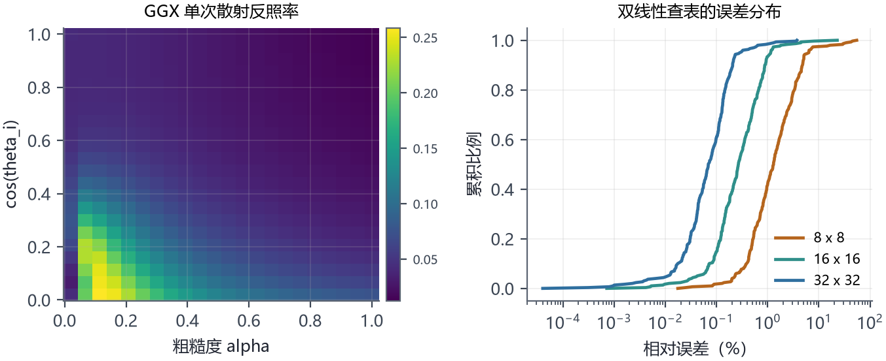
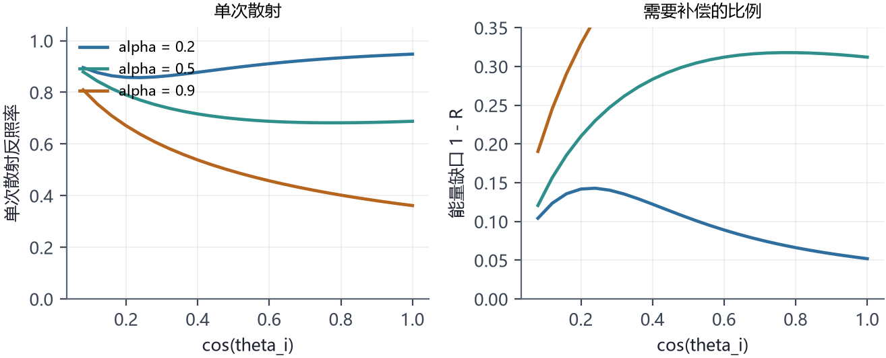
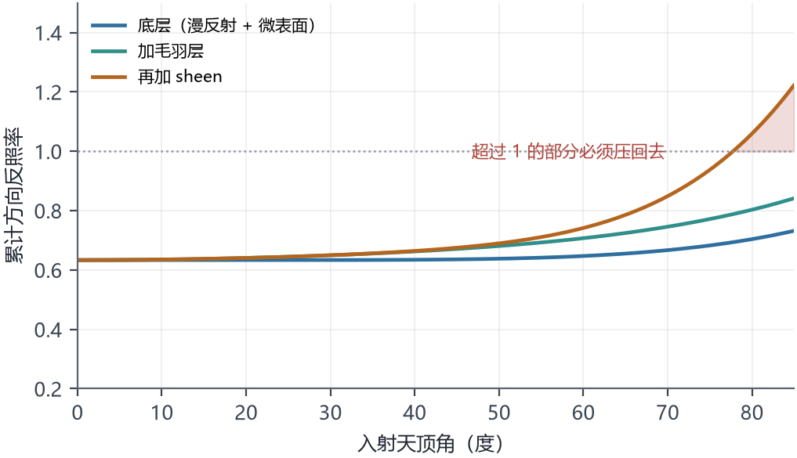

# 第 10 章 实时近似与能量补偿

## 10.1 一帧十六毫秒

一个 60 帧的实时管线，每帧 16.6 毫秒。几何、阴影、后处理占掉大半，留给材质着色的可能只有两三毫秒。在这个预算里，第 5 章的五个参数、第 4 章的三条路径、第 8 章的两条透射路径，都跑不完。

于是每一处都要近似。近似本身不是问题，问题是不知道省掉了什么。这一章把布料实时管线里最常见的几种近似列出来，说明每一种省掉了哪一项、误差有多大、在什么情况下会露馅。

## 10.2 能预积分的部分

着色器里最贵的是积分。凡是只依赖两个参数的量，都可以预先算成一张表，运行时查表。

布料的 BRDF 里，这样一个量是方向反照率 $R(\theta_i,\alpha)$。它只依赖入射角和粗糙度，与光源方向、与织物结构都无关。把它算成一张 $32\times32$ 的表，运行时用双线性插值查出来，就能做能量补偿、做环境光的近似。

图 10-1 左图是这张表的内容。它的形状很有特点：在粗糙度小、入射角大的角落，反照率反而最高，因为 Fresnel 在那里接近 1。右图是分辨率与误差的关系，$8\times8$ 的表在 10% 的样本上误差超过 1%，$32\times32$ 的表降到 0.1% 以下。布料用 $16\times16$ 就够，因为布料的反照率曲线比金属平缓。

表的参数化也有讲究。用 $(\cos\theta_i,\alpha)$ 做坐标比用 $(\theta_i,\alpha)$ 好，因为 $\cos\theta_i$ 在掠射区的变化更均匀，插值误差小。有些实现用 $(\theta_i,\alpha)$，在 80 度到 90 度之间只有两个采样点，插出来的结果会错到 5% 以上。这是一个便宜的改进：只改坐标，表的大小不变。

环境光的镜面反射用的是另一套预积分，叫 split-sum：把 $\int f\,L_i\cos\theta\,d\omega$ 拆成"滤波后的环境图"和"BRDF 的积分表"两部分相乘。这个拆分是近似的，因为两者其实耦合；误差在粗糙度 0.3 到 0.6 之间最大，能到 10%。布料的高光宽，正好落在这个区间，所以用 split-sum 渲染的缎纹在环境光下会偏亮。

## 10.3 多层叠加

布料的结构天然是分层的：底层织物、毛羽层、sheen。实时管线里通常逐层算，然后把结果加起来。

图 10-2 显示了问题的规模。粗糙度 0.9 时，掠射角的单次散射只剩 36%，缺口 64%。这不是小数目，如果不补，粗糙布料在掠射时会明显偏暗，而且暗得不均匀——因为缺口随角度变化。

补的办法是加一个多次散射项。Kulla 与 Conty 在 2017 年给出的形式是

$$f_{\mathrm{ms}}(\omega_i,\omega_o)=\frac{\bigl(1-R(\omega_i)\bigr)\bigl(1-R(\omega_o)\bigr)}{\pi\bigl(1-R_{\mathrm{avg}}\bigr)}, \tag{10.1}$$

其中 $R_{\mathrm{avg}}$ 是反照率在半球上的平均。这个项的结构值得看：分子是两个方向的缺口之积，分母是平均缺口。把它在半球上积分，得到

$$\int f_{\mathrm{ms}}\cos\theta_o\,d\omega_o=1-R(\omega_i), \tag{10.2}$$

正好等于缺口。也就是说，$R+f_{\mathrm{ms}}$ 的反照率严格等于 1。

这个推导只用到了 $R$ 的定义和 $R_{\mathrm{avg}}$ 的定义，没有引入任何拟合参数。代价是它假设多次散射的方向分布是各向同性的，实际上会偏向前向。对金属这个假设误差不大，对布料（分布宽、散射次数多）也够用。

## 10.4 逐层叠加的能量

三层各自归一化，加起来就超了。

图 10-3 是一个白色棉布的例子。底层 0.63，加毛羽层到 0.65 到 0.83，再加 sheen 在掠射时到 1.22。超出的 22% 不是小误差，它会让布在强逆光下亮得发白，细节全部丢失。

两种处理方式。一种是按比例压回去：把三层乘一个公共因子，让总和不超过 1。这个做法保住了颜色的相对关系，但会把正面的亮度也压下去，因为因子是按最坏情况定的。另一种是只在超标的部分压：给 sheen 项加一个上限 $\min(s, 1-R_{\mathrm{base}})$，逐像素算。后一种更准，代价是多一次查表和一次比较。

实时管线里还有一种做法是把 sheen 预先乘进基础色，让它随基础色一起被色调映射压住。这个做法在 HDR 管线里有效，在 LDR 管线里会让 sheen 失去独立性（第 6 章 6.7 节说过，sheen 的颜色不该等于基础色）。

## 10.5 几种常见的取巧

**用 GGX 加 sheen 代替整个布料模型。** 这是最常见的做法，也是性价比最高的。它是把第 5 章的球面高斯退化成一个各向同性的 GGX，宽度用 $\alpha=\sqrt{2}\sigma$ 换算，再加第 6 章的 sheen。误差主要在三处：偏侧高光丢失（缎纹会看起来像塑料）、各向异性丢失（斜纹的方向感消失）、透射完全没有（薄布逆光变黑）。在远景、漫射光、不需要透光的场景里，这三处都不明显。

**用厚度贴图代替透射。** 把透射率烘成一张贴图，运行时按视线与光源的夹角查表。这个做法能出窗帘的效果，但代价是透射的方向分布被压成了一个标量，逆光时的前向峰和针孔效果都没有了。如果场景里有强逆光，这个方法会露馅。

厚度贴图的另一个问题是它不能处理"光从背面来但视线在正面"以外的情况。当布被折叠成两层、三层时，透射率应该按层数相乘；而贴图只存了一层。解决方案是让厚度贴图存光学厚度而不是透射率，运行时按层数累加再取指数。多一层乘法，但能把折叠处的变暗做对。

**用顶点色近似编织。** 把经纬的起伏、捻度的变化烘到顶点色里，用一张低频的图调制法线。这个做法在近距离会失效，因为编织的周期只有一两毫米，顶点密度跟不上。它适合远景和中景，近景必须用真实的法线贴图或者显式的编织几何。

**把能量 clamp 到 1。** 这是兜底的一道保险，几乎每个管线都有。它的代价是把超标的能量变成了"平顶"，在高光区域形成一块死白的斑，色调映射之后会显得脏。正确做法是在源头归一化，clamp 只作为兜底。

**用预乘的颜色代替 sheen。** 把 sheen 颜色乘进基础色，一次着色就能出两层。代价是 sheen 与基础色绑死，深色布的 sheen 跟着变黑（第 6 章 6.7 说过为什么）。在漫反射主导的场景里看不出来，一放到逆光里就显形。

**用固定幂次代替可调。** 把第 6 章的 $n$ 写死成 5，省一个参数。代价是所有布料的边缘宽度一样，丝绸和棉布在掠射时无法区分。这个代价很小，很多管线就这么做；但在同一帧里有多种布料时，观众会觉得"都一样"。

## 10.6 代价与收益

把这几种做法的误差和成本列在一起，能看出一个规律：省掉的每一个自由度，都会在某个特定的观察条件下变成可见的错误。

| 近似 | 省掉的项 | 成本 | 露馅条件 |
| --- | --- | --- | --- |
| GGX 加 sheen | 偏侧高光、各向异性、透射 | 最低 | 缎纹近景、逆光 |
| 预积分 LUT | 随光源变化的细节 | 低 | 大面积柔光 |
| 厚度贴图透射 | 透射的方向分布 | 低 | 强逆光、近景 |
| 顶点色编织 | 高频编织结构 | 低 | 近距离 |
| 能量 clamp | 超标的能量 | 零 | HDR 高光 |

这张表的意义不是让你选一个，而是让你知道每个选择的边界。产品里最常见的情况是：远景用第一行，近景切到完整模型。切换的阈值由像素覆盖面积决定，而不是由镜头距离决定，因为决定因素是"一个像素里有多少个编织周期"。

把阈值量化一下。平纹的周期约 0.4 毫米，一个像素覆盖 2 个周期时，编织结构还有 50% 的对比度；覆盖 8 个周期时只剩 10%。所以切换点大约在每像素 2 到 4 个周期。把这个数除以屏幕分辨率和视场角，就能算出切换距离。一个 1080p 屏、水平视场 60 度，一米宽的布在 3 米外就达到了这个阈值，这就是为什么中远景的布料可以用很便宜的近似。

## 10.7 什么时候不该取巧

有三种情况，取巧的代价大于收益。

第一种是产品需要在近景展示布料细节，比如服装电商的细节图、家具面料的特写。这时候编织结构是卖点，简化会把卖点抹掉。

第二种是场景里存在强烈的逆光或者透光，比如窗帘、薄纱、舞台幕布。透射的方向分布决定了画面的氛围，用标量近似会把氛围做平。

第三种是需要和其他材质混在一起做能量检验，比如同一帧里有金属、玻璃、布料。这时候布料如果能量不对，色调映射会把整个画面的曝光拉偏。

## 10.8 预积分与采样的配合

预积分表解决的是积分，不解决采样。两者弄混会得到奇怪的错误。

一个典型的误解是：既然反照率已经从表里查出来了，采样就可以随便选。实际上查表只是把“对半球积分”这一步预先算完，如果采样分布与 BRDF 不匹配，单样本的方差依然很大。对于布料的窄高光（$\sigma$ 小于 10 度），余弦采样的方差是 VNDF 采样的几十倍，即使乘上了正确的反照率也一样。

sheen 项的重要性采样有现成的形式。它的分布是 $(1-\cos\theta)^n$，对它积分并求反函数，能得到一个闭式的采样公式：

$$\cos\theta=1-u^{1/(n+1)}, \tag{10.3}$$

其中 $u$ 是均匀随机数。这个公式和余弦采样的形式几乎一样，只多一个指数。用它的方差比余弦采样低一个数量级，代价是多一次幂运算。

真正的坑在两层的叠加。基础层用 VNDF 采样，sheen 用上面的公式采样，两层各自的 pdf 不同。如果按一个固定的比例选路径（比如 70% 给基础层），那么混合 pdf 必须写成两者的加权和，而不是只用被选中那一个的 pdf。写成后者会让权重偏小，图像偏暗，而且偏的程度随角度变化。这类错误在白炉测试里表现为一条缓慢下降的曲线，很容易被当成归一化问题。

层数再多一层（毛羽）、这个问题就更明显。一个实用的经验是：每层的采样分布单独写、单独测，合成的时候把 pdf 写成加权和，并且用一个断言检查它们加起来积分是否为 1。这一步在代码里只多几行，但能省掉后面很久的排查。。预积分表换掉积分，多层叠加换掉体积散射，GGX 加 sheen 换掉整条纤维链。每一种近似都有明确的失效条件，把源码里的三层拆开分别做白炉，能得到四条曲线：底层、底层加毛羽、三层全开、以及最终的归一化版本。四条曲线分叉的地方，就是哪一层开始不守恒的地方。这个做法比画一个球看半天有效得多。

下一章处理另一件事：这些模型需要参数，参数从哪里来。
