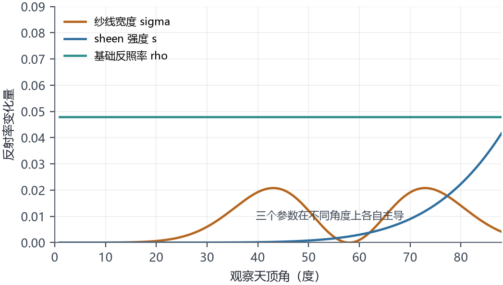
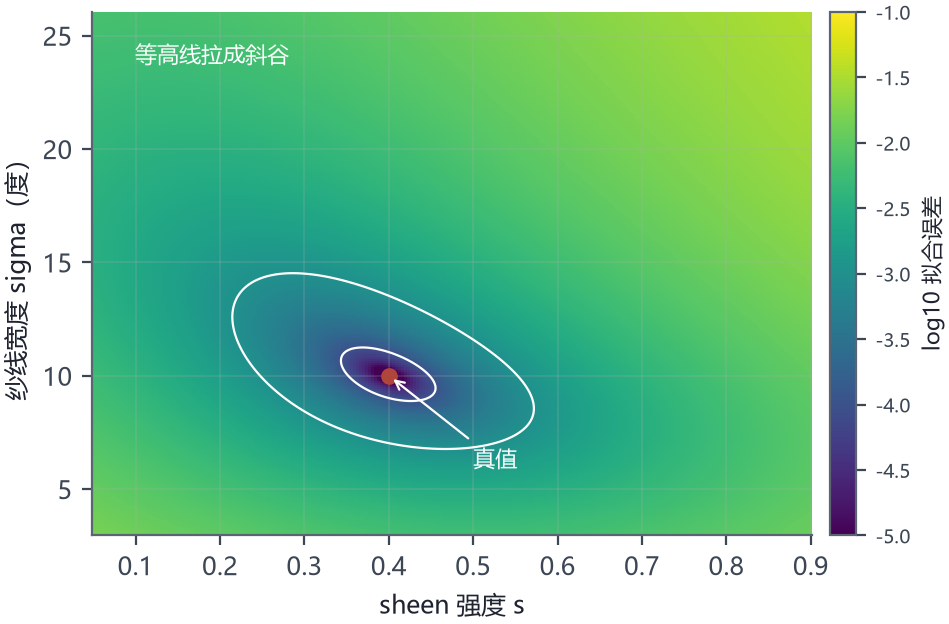
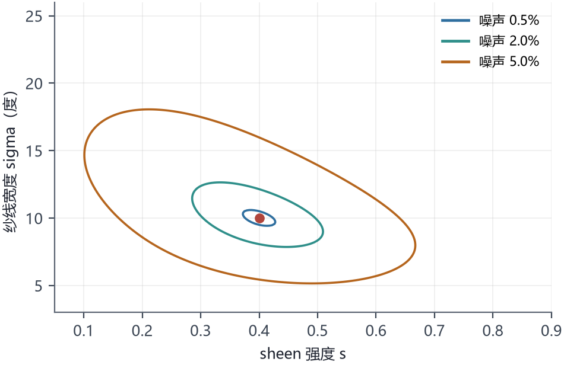

# 第 11 章 参数标定与资产

## 11.1 一张照片能告诉你什么

美术给了一张面料照片：平铺在桌上，室内灯光，手机拍的，JPEG。要求是把这个材质的参数填对。

这张照片里包含的信息比想象的多，也比想象的不确定。它包含了颜色、高光的宽度、掠射时的亮度变化、编织的纹理方向。它不包含光照条件、白平衡、曝光、镜头的响应曲线、以及表面的绝对反射率。同一块布在阴天和正午拍，颜色能差一档。

标定的第一步不是拟合，是判断"哪些参数可以定，哪些定不了"。这一章给出一套流程，以及流程里必须知道的几个陷阱。

## 11.2 照片先要变成线性数据

渲染器里的颜色是线性的，照片不是。手机的 JPEG 经过了色调映射、伽马编码、锐化、降噪，还有自动白平衡。直接拿像素值去拟合，拟合出来的是"这张照片的参数"，不是布料的参数。

做法是：用 RAW 或者关闭自动处理的模式拍摄，读取线性数据；如果只有 JPEG，就做一次反向的 sRGB 解码，接受残余误差。然后选一个已知反射率的标准板（灰卡或者白卡）放在画面里，用它把像素值换算成反射率。这一步做完，照片才变成可以比较的数据。

还需要记录光源的方向。至少要有两个方向：正面和侧后方。不同方向下的高光形状不同，能提供互补的信息。只有一张正面照，很多参数是定不住的。

## 11.3 哪个参数在哪个角度上起作用

参数标定的本质是"在什么条件下，某个参数对观测量的影响最大"。这个关系叫灵敏度。

图 11-1 画出了这个关系。三条曲线各自占据不同的角度区间，这给了标定一个可行的顺序：

基础反照率在全程都有影响，所以用中间的、高光以外的像素去定它，误差最小。纱线宽度只在 40 到 75 度有影响，所以要用那个角度区间的亮度剖面去定它。sheen 强度只在 60 度以后有影响，所以要用掠射的照片去定它。

这个顺序不能反。如果先用掠射照片定宽度，会因为 sheen 的干扰而偏大；如果先用正面照片定 sheen，会因为 sheen 在那里几乎为零而完全定不住，只能靠猜。

## 11.4 参数之间的相关性

单独看每个参数的灵敏度还不够，因为参数会互相补偿。

图 11-2 是这件事的直观表现。误差面不是一个点状的坑，而是一条斜的谷。谷的斜率是负的：宽度大一点、sheen 小一点，或者宽度小一点、sheen 大一点，拟合误差都可以很小。红点是真值，它在谷底，但谷底上每一点都同样"正确"。

这种相关性来自两个参数的角分布重叠。宽度控制的高光带尾部延伸到掠射区，sheen 在那里也上升，两者在同一个角度区间里争夺同一份亮度。用这个区间的数据去拟合，无法区分是谁贡献的。

解决办法有两个。一是用多角度的数据，尤其是 30 到 50 度的中间角度，那里只有宽度有影响，sheen 几乎为零，可以先定住宽度。二是利用颜色的差异：sheen 的颜色通常比基础色更白，用彩色光源或者分通道拟合能把两者分开。

## 11.5 噪声与可辨识性

即使没有相关性，噪声也会限制精度。

图 11-3 把三个噪声水平的等误差轮廓画在一起。噪声越大，轮廓越大，而且沿着谷的方向拉长。这意味着：噪声大的时候，宽度和 sheen 的各自数值都定不准，只能定住它们的组合。

这个结论对资产制作有直接影响。用手机照片标定的材质，参数的不确定度可能有 20% 到 30%，但"组合"是可靠的。所以资产里应该存组合量（比如"这个角度区间的总亮度"），而不是分别存两个参数再让人去调——否则美术一改就会破坏组合，外观立刻变。

还有一个更隐蔽的噪声来源：编织纹理。照片上的每一个像素落在经纱上还是纬纱上，亮度差很多。如果拟合时把纹理当成噪声，会得到偏大的宽度；如果当成信号，会得到偏小的宽度。正确的做法是先用低通滤波把编织的周期抹掉，再去拟合宏观的参数，编织的细节单独用纹理表达。

## 11.6 一套可执行的流程

把上面几节合起来，标定的流程是这样的。

准备阶段：拍三张照片，正面、45 度、75 度，都带灰卡；记录光源方向；如果是深色布，额外拍一张逆光的，用来定透射。

预处理：解码成线性，用灰卡归一化，裁掉阴影和褶皱，做一次低通把编织周期抹掉。

第一步拟合基础反照率：取高光以外的区域，用漫反射模型拟合三个通道。这一步的误差主要来自白平衡，如果三个通道的比例明显偏离中性，说明白平衡没对。

第二步拟合宽度：取 40 到 75 度的亮度剖面，固定基础反照率，只调宽度。这时候 sheen 的干扰较小，可以先给它一个初值。

第三步拟合 sheen：取 75 度以上的数据，固定前两步的结果，调 sheen 的强度和幂次。

第四步联合优化：用全部数据做一次非线性最小二乘，让三个参数同时微调。这一步的目的是把前面分步拟合的偏差摊平，而不是重新定参数。

第五步验证：用拟合出的参数渲染同样三个角度的图，和照片做差。如果残差集中在某个角度区间，说明那个区间还有没建模的效应，回到第 2 章查是哪一级结构漏了。

这一步有一个实用的判据：残差的空间分布比残差的幅度更有信息。如果残差在整张图上均匀，说明颜色或反照率偏了；如果残差集中在布褶的暗部，说明遮蔽项或多次散射不对；如果残差集中在边缘，说明 sheen 或透视边缘不对。把残差图当成一张诊断图看，比盯着数值误差有用。

## 11.7 参数怎么进资产

确定参数之后，还有打包的问题。

布料通常需要四张贴图：基础色、法线、粗糙度（或者宽度）、sheen 强度。四张图如果各占一个通道，显存是四倍。常见的打包是把粗糙度放进基础色的 alpha，把 sheen 放进法线的某个通道（法线只用两个分量就够重建第三个）。这样降到两张图。

分辨率取决于使用距离。编织的周期是毫米量级，一个 1 米的布料平铺需要 1000 像素才能分辨编织，也就是 1 毫米每像素。超过这个分辨率没有意义，因为再细的细节是纤维，而纤维的散射已经被 BRDF 平均掉了。

参数要有物理范围。宽度不该超过 40 度（那已经不是纱线而是毛毡），sheen 强度不该超过 1 减去基础反照率。在导入时加一个检查，比在渲染时 clamp 要好，因为前者能提示美术"这个参数不可能"，后者只会默默地把图做坏。

## 11.8 一组起始参数

下面这张表是从前面各章的几何关系推出来的起始值，不是实测数据。用它的方式是：选一行最接近的面料，把参数填进去，然后按 11.6 的流程微调。

| 面料 | 宽度 sigma（度） | 整齐度 alpha | sheen 强度 | 备注 |
| --- | --- | --- | --- | --- |
| 棉平纹 | 8 到 12 | 0.6 | 0.30 | 最典型的基准 |
| 亚麻平纹 | 12 到 16 | 0.5 | 0.25 | 纤维粗、毛羽多 |
| 真丝缎纹 | 4 到 6 | 0.85 | 0.55 | 窄高光、强 sheen |
| 精纺羊毛 | 10 到 14 | 0.7 | 0.45 | 鳞片导致宽尾 |
| 涤纶长丝 | 5 到 8 | 0.9 | 0.35 | 表面光滑、高光锐 |
| 天鹅绒 | 15 到 25 | 0.4 | 0.85 | 需配合 7.5 节体积模型 |

这张表里最容易填错的是 sheen。很多美术会把它调到 1 以上，觉得“更亮一点”，结果是能量超标。正确的上限是 $1-R_{\mathrm{base}}$，棉布大约 0.6，深色布可以更高（因为基础反照率低），白色布反而更低。

宽度那一列要配合几何单位看。表中的值是面片分布的 $\sigma$，对应的反射瓣半宽约为 $2.35\sigma$，比如 10 度对应 23.5 度。如果从照片上量到的高光半宽是 30 度，减去像素平均带来的 3 到 5 度，再除以 2.35，得到的 $\sigma$ 大约 11 度——和表里的值对得上。

## 11.9 一个具体的案例

把流程跑一遍，看看会遇到什么。

拍的是一块深蓝色斜纹牛仔布。正面照里测到基础色是 (0.06, 0.09, 0.18)，线性化之后偏暗。45 度照里高光峰在 32 度左右，半宽 18 度。掠射照里边缘亮得很明显，但边缘的像素已经开始模糊，手机镜头的分辨能力不够。

第一步定基础色：用高光以外的区域，得到 (0.055, 0.085, 0.17)。这个值比 JPEG 直接读出来的暗 20%，因为反向 sRGB 解码去掉了一个伽马。如果跳过这一步，后面的参数都会偏亮，而且偏得不是常数，在暗部偏得更多。

第二步定宽度：18 度半宽减去 4 度的像素平均，再除以 2.35，得 6 度。但 6 度对于牛仔布来说太小，斜纹的纤维排列不该这么整齐。回头查照片，发现对焦点在布面以外，画面整体偏软。修正对焦后重拍，半宽变成 26 度，对应 $\sigma=9.4$ 度，就合理了。

第三步定 sheen：掠射照的数据质量不够，先用表里的默认值 0.35，等联合优化时再调。

第四步联合优化：三张照片一起拟合，得到 $\sigma=9.8$、$s=0.41$、基础色 (0.058, 0.088, 0.172)。第二轮加上彩色光源下的一张照，sheen 的强度从 0.41 降到 0.36——因为彩色光源把 sheen 与基础色的颜色差异暴露了出来。

第五步验证：残差在布褶的暗部偏大，最大 8%。查过去发现褶皱处的法线贴图没有脏化处理，平坦区域和褶皱区域用了同一张，遮蔽项在那里偏亮。这不是 BRDF 的问题，是几何和纹理的问题。

这个案例里有两个教训。一个是照片的质量比模型精度重要：对焦不准让宽度差了 3 度，比任何模型误差都大。另一个是残差图能指向错误的位置，但它不告诉你是哪一层错了；要结合场景结构（褶皱、接缝、边缘）判断。

---

标定的难点不在拟合，而在判断哪些参数定得住。基础反照率在全程起作用，宽度在中间角度起作用，sheen 在掠射起作用。宽度和 sheen 在掠射区高度相关，噪声会把这个相关性放大成不可辨识。用多角度、多通道的数据，可以部分解开；解不开的部分，就在资产里存组合量，不要存互相抵消的两个参数。

下一章处理的是证明：怎么知道自己写对了。
