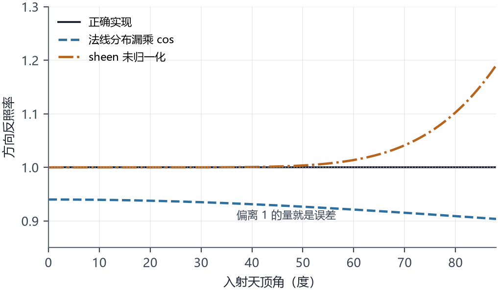
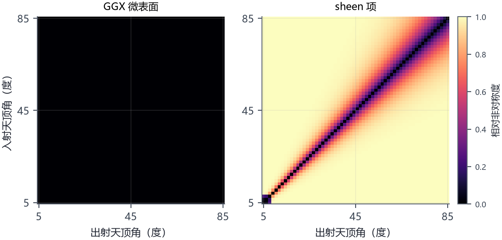
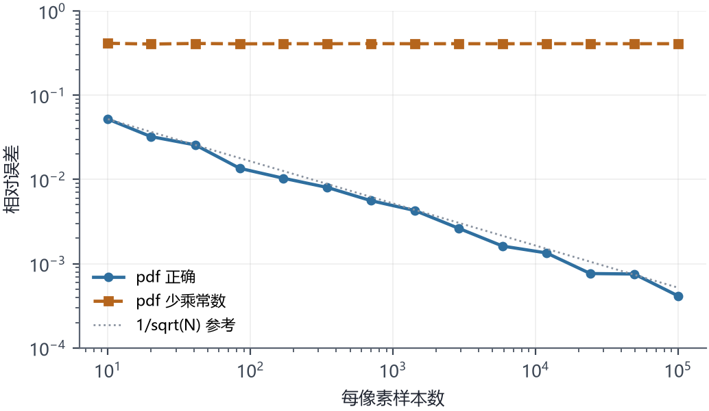

# 第 12 章 验证与对比

## 12.1 看起来还行

一块渲染出来的布，摆在场景里，有布褶、有阴影、有环境光，看起来像布。这时候很难判断它是对的还是碰巧对。

渲染的错误有两类。一类是明显错误：黑斑、噪点、能量爆掉、颜色翻转。这类错误一眼就能看出来。另一类是系统性偏差：整体偏亮 20%、掠射角偏暗、某个角度的高光位置错了 3 度。这类错误在单张图里几乎看不出来，因为人眼没有绝对的光度参考，也没有真实的布在旁边对比。

难判断的另一个原因：人眼对亮度的绝对值不敏感。同一个场景，曝光抬高半档，大部分人会觉得“更亮了”而不是“错了”。而对布料来说，亮度高了 10% 往往就是能量守恒出了问题——sheen 多给了，或者微表面少减了。这类偏差不会自己消失，还会在合成、调色、HDR 显示等环节被放大。

这一章给出几种能把第二类错误暴露出来的检验。它们不需要参考照片，不需要另一个渲染器，只需要自己的 BSDF 函数。

为什么这些检验有效？因为它们把图像里耦合在一起的东西拆开了。图像上的亮度同时受光源、几何、材质、色调映射影响，出了错很难归因。而这些检验只让一个因素变化：白炉只留材质，互易性只比较两个方向，解析对比只看积分是否成立。一次只动一个变量，错误就无处躲。

## 12.2 白炉测试

白炉测试（white furnace test）的做法是：假设整个环境是一个亮度为 1 的均匀光源，表面不吸收，那么任何方向的出射亮度都应该等于 1。

对布料的 BRDF，这意味着

$$L_o=\int_\Omega f(\omega_i,\omega_o)\,L_i\cos\theta_o\,d\omega_o=R(\theta_i)=1. \tag{12.1}$$

如果实现正确、能量守恒、没有吸收，$R$ 应该恒等于 1，与入射角无关。



图 12-1 画出了三种典型结果。正确实现是一条水平线。漏乘 cos 的实现整体偏低，而且随角度略有变化，这个变化就是误差的形状——它告诉你错在哪里：偏低且随角度增大而加剧，通常是归一化的问题。sheen 未归一化的实现只在掠射超标，说明错误集中在 sheen 那一项。

白炉测试的判读要点是看曲线的形状，而不只是看它离 1 多远。一条恒为 0.94 的线说明有一个常数因子错了（通常是忘了除以 $\pi$ 或者漏了一个归一化系数）。一条随角度下降的线说明角度依赖错了（通常是漏了 cos 或者 Jacobian）。一条只在某段凸起的线说明某一项没有归一化。

对有吸收的材质，白炉测试要改成"已知反照率"测试：把材质的吸收设成已知值，检查 $R$ 是否等于预期。这个做法比白炉更严格，因为它同时检验了吸收项。

## 12.3 互易性

第 2 章说过，物理的 BRDF 应该满足 $f(\omega_i,\omega_o)=f(\omega_o,\omega_i)$。

检验的方法是随机取几百对方向，计算两个方向的函数值，比较相对差异：

$$\epsilon=\frac{\left|f(\omega_i,\omega_o)-f(\omega_o,\omega_i)\right|}{\max\left(f(\omega_i,\omega_o),f(\omega_o,\omega_i)\right)}. \tag{12.2}$$



图 12-2 左边是 GGX，偏差接近零；右边是第 6 章的 sheen 项，除对角线（入射等于出射）以外偏差极大。这正是 6.4 节说过的代价：可归一化的 sheen 项牺牲了互易性。

这个结果不是"实现错了"，而是"模型的选择有代价"。要用在双向路径追踪里，就必须知道这个代价：光源侧的采样不能用 sheen，只能从相机侧单向走。如果强行双向，会出现能量不对称的噪声，而且不会随样本数收敛。

对布料，互易性还有一个更细的用处：检验法线分布的构造。如果分布的偏移方向（第 5 章的 $\beta_f$）在入射和出射两侧不一致，会破坏互易性，而这种不一致在图像上表现为高光带的轻微错位，很难用眼睛看出来。

## 12.4 与参考对比

最可靠的检验是和一个独立的实现对比。这个实现可以是：

用蒙特卡洛直接积分同一个 BSDF，和着色器里的解析结果比。这检验的是"解析实现和定义是否一致"，能抓出代数错误。

用另一个模型渲染同一个材质，比较外观。这检验的是"模型的选择是否合理"，能抓出结构性的缺失（比如漏了透射）。

用实测数据比较。这检验的是"参数是否标定对了"，能抓出参数错误。

三种对比的目的不同，不能互相替代。第一种必须做，因为它有唯一正确答案。第二种看情况，如果两个模型都是近似，差异可能来自任何一方。第三种最难，因为实测数据的条件（光照、白平衡）很难完全复原。

拿布料举例。第一种对比可以抓出“第 5 章的球面高斯系数写成了 $1/(\pi\sigma^2)$”这种错，因为解析积分会直接对不上。第二种对比可以抓出“漏了透射”这种结构缺失，因为它和参考模型在逆光处的差异是整块区域的，而不是某个角度的。第三种对比可以抓出“捻度参数填反了”这种数据错，因为实测的高光宽度就在那里摆着。

还有一个间接的对比手段：看渲染结果对参数的变化敏感不敏感。如果改一个参数，图像几乎不变，要么这个参数在当前场景里不起作用，要么它被另一个参数抵消了。前一种是浪费，后一种是陷阱。两种都值得查。

## 12.5 五个常见错误的症状

第一个，pdf 少乘 Jacobian。症状是图像整体偏亮或偏暗，而且偏的程度随粗糙度变化。原因是采样密度和实际分布不匹配，估计量的期望偏了。这类错误不会随样本增加而消失，只会越来越精确地收敛到错误的值。

第二个，cos 因子用两次或者漏一次。症状是掠射角明显偏亮或偏暗，正面几乎正确。原因是 $\cos\theta$ 只在积分里出现一次，多乘一次会让亮度按 $\cos$ 衰减，漏一次会让它按 $1/\cos$ 增长。

第三个，sheen 破坏能量守恒。症状是强光下的边缘过曝，色调映射之后出现一块发白的死区，纹理全部丢失。原因是 sheen 的强度没有和基础反照率挂钩，掠射时总和超过 1。

第四个，delta 分量的采样错误。症状是零星的白点，在动画里闪烁。原因是直射透射被当成普通方向函数采样，绝大多数样本落在 delta 外面。

第五个，Fresnel 用了 $\omega\cdot n$ 而不是 $\omega\cdot h$。症状是粗糙表面的边缘过亮，粗糙度越大越明显。这个错误在第 3 章已经说过，它在布料上格外难发现，因为布料本来就边缘亮，错误的亮和 sheen 的亮混在一起。

## 12.6 收敛与偏差

还要区分误差是随机的还是系统的。



图 12-3 把两种误差画在一起。正确的估计按 $1/\sqrt{N}$ 下降，从 10 个样本的 5% 降到十万个样本的 0.05%。错误的估计无论多少样本都停在 18%，因为误差来自期望本身，不是方差。

这个区别在调试时非常有用。渲染一张图，样本数翻四倍，噪声减半，这是方差；噪声不变，这是偏差。偏差必须回去改公式，加样本没有用。

写成公式，均方误差分解为

$$\mathrm{MSE}=\mathrm{bias}^2+\mathrm{var}. \tag{12.3}$$

偏差项与 $N$ 无关，方差项按 $1/N$ 下降。当 $N$ 足够大时，MSE 收敛到 $\mathrm{bias}^2$，这就是图 12-3 里橙线的那条水平线。

## 12.7 检查清单

把这章的内容压成一份可以照着做的清单。

数值层面：$R(\theta_i)$ 在白炉里恒为 1，误差小于 0.5%；$f(\omega_i,\omega_o)$ 与 $f(\omega_o,\omega_i)$ 的相对差异小于 $10^{-4}$（对互易模型）；采样估计量和解析积分在 $10^5$ 样本下一致到 1% 以内。

角度层面：正面、45 度、75 度三个角度的亮度剖面和解析值一致；高光峰的位置误差小于 1 度；掠射端的亮度不随视角抖变。

图像层面：把材质放在球上渲染，球的轮廓没有亮边或者暗边；把材质放在平面上，不同距离（1 米和 10 米）的平均亮度一致；把材质放在彩色光源下，颜色的变化符合 Fresnel 和吸收的预期。

参数层面：每个参数都在物理范围内；参数之间的相关性已经检查过，没有两个参数可以互相替代；资产的贴图分辨率和编织周期匹配。

清单跑完，如果全部通过，这个布料实现就可以认为是"对"的。剩下的差别是模型层面的选择，不是实现的错误。

## 12.8 一个最小的验证脚本

把前面的检验写成代码，不到一百行，只依赖 NumPy。把它放在 CI 里，每次改动 BRDF 都跑一遍。

```python
import numpy as np

def hemisphere(n_theta=200, n_phi=400):
    th = (np.arange(n_theta) + 0.5) * (np.pi / 2) / n_theta
    ph = (np.arange(n_phi) + 0.5) * 2 * np.pi / n_phi
    T, P = np.meshgrid(th, ph, indexing="ij")
    W = np.stack([np.sin(T) * np.cos(P), np.sin(T) * np.sin(P), np.cos(T)], -1)
    dw = np.sin(T) * (np.pi / 2 / n_theta) * (2 * np.pi / n_phi)
    return W, T, dw

W, T, DW = hemisphere()

def furnace(brdf, thetas=np.deg2rad([0, 30, 55, 75, 85]), tol=0.02):
    worst = 0.0
    for t in thetas:
        wi = np.array([np.sin(t), 0.0, np.cos(t)])
        R = np.sum(brdf(wi, W) * np.cos(T) * DW)
        worst = max(worst, abs(R - 1.0))
    assert worst < tol, f"white furnace: max deviation {worst:.4f}"
    return worst

def reciprocity(brdf, n=400, seed=0, tol=1e-4):
    rng = np.random.default_rng(seed)
    worst = 0.0
    for _ in range(n):
        a = rng.normal(size=3); a /= np.linalg.norm(a); a[2] = abs(a[2])
        b = rng.normal(size=3); b /= np.linalg.norm(b); b[2] = abs(b[2])
        fa, fb = brdf(a, b), brdf(b, a)
        d = abs(fa - fb) / max(abs(fa), abs(fb), 1e-12)
        worst = max(worst, d)
    assert worst < tol, f"reciprocity: max deviation {worst:.2e}"
    return worst
```

两个函数分别对应 12.2 和 12.3 的检验。注意几个细节：半球积分用中点法则，不要在掠射端少采样；互易性检验用随机方向，不要只测对称面；容差要按模型定，互易模型取 $10^{-4}$，带 sheen 的模型根本过不了这一关，应该把那个检验关掉，并在材质元数据里标注“不互易”。

第三个可以加进去的是参数范围检查：宽度不超过 40 度、sheen 不超过 $1-R$、吸收系数非负。这些是数据错误，不先拦下来，后面的图像错误很难定位。

一个真实的 CI 里，这组检查跑一次大约半秒。半秒换来的是一整类错误的早期发现，性价比很高。

需要注意的是容差要随模型调，而不是统一定一个数。物理模型（微表面、Kubelka–Munk）可以要求 1% 以内；带经验近似的模型（sheen、布料实时模型）5% 已经很好；带透射的薄织物如果用了标量近似，10% 也acceptable。把容差写死在代码里，会让后面的人把合格的实现当成错的，或者反过来放过了真问题。

---

验证布料实现的顺序是：先白炉，再互易，再和参考对比。白炉看曲线形状，互易看偏差分布，参考对比看模型层的缺失。五个常见错误各有固定的症状，认得症状就能快速定位。误差要区分偏差和方差，方差加样本能降，偏差必须改公式。

这本书到这里结束。附录里有符号表、参数速查和参考文献。
