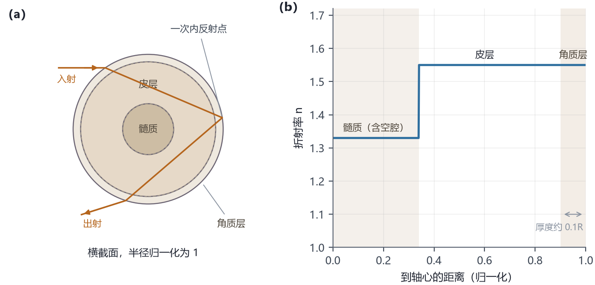
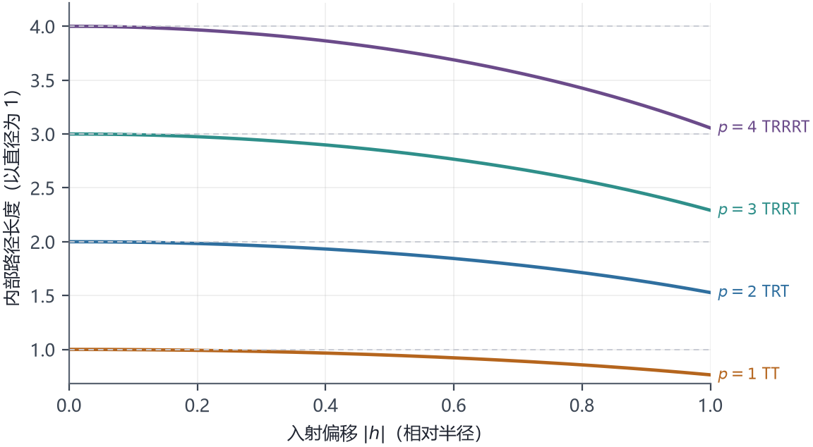
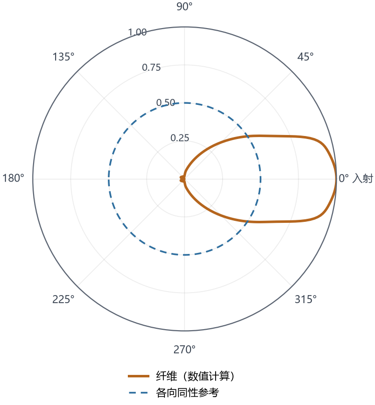

# 第 1 章 毛发的结构与光学

## 1.1 逆光里的发丝

把相机对着太阳，让一个人的侧脸挡住太阳，你会看到轮廓边缘的头发亮起来，每一根都镶着一圈细亮线，亮度远超它在正常光照下的颜色。换成顺光，同一头头发变得很暗，只有一条柔和的带子横在头顶上，那一块的颜色取决于它的颜色本身：黑发是白的，金发是金白的。

同一个物体，两种看法，亮度相差一个数量级以上。这件事用"表面反射"解释不了，因为表面的反射率是按角度连续变化的，没有哪个角度能突然把亮度抬高十倍。它说明光不是只在表面弹一下，而是钻进了纤维内部，走了一段路，从别的地方出来。逆光时从侧面看到的亮线，是光从纤维里透出来的结果。

一根头发的直径大约 60 到 100 微米，混血人群中偏细，亚洲人偏粗，最粗的可以到 120 微米。它比可见光的波长大两个数量级，所以几何光学够用，不需要解麦克斯韦方程。但它又不是一个简单的圆柱。把一根头发横切开，在高倍显微镜下看，会看到三层同心结构，每层的折射率和表面形态都不一样。光在里面的行为由这三层的排列决定。

这一章要建立的，是后面九章共用的那个几何图像：一根纤维是一个半径为 R 的圆柱，光以某个偏移量打进来，折射、在内壁反射、再折射出去，走的是一条可以算出来的折线。所有毛发模型，包括 Kajiya–Kay 的近似、Marschner 的三条路径、以及生产里用的双散射，都是在这个图像上做加减。

## 1.2 三层同心结构

最外层是角质层（cuticle），由 6 到 10 层扁平的鳞片叠成，每一片厚约 0.3 到 0.5 微米，沿着纤维轴向排列，边缘朝上，像屋瓦。它占半径最外面的十分之一左右。鳞片的朝向不统一，越靠外倾斜角越大，这是"毛发有方向感"的物质基础：顺着鳞片摸是滑的，逆着摸是涩的。

中间是皮层（cortex），占体积的绝大部分，由沿轴向排列的纺锤形细胞构成，细胞之间是细胞膜复合体。色素颗粒（黑色素）就在这一层里，它决定了头发是黑的、棕的还是金的。皮层里还有微原纤维的螺旋排列，这就是头发被拉长后能弹回去的原因，也是它成为双折射介质的原因。

最里层是髓质（medulla），在粗发里连续，在细发里断裂甚至完全没有。它是一串含空气的疏松结构，折射率低于周围，所以在显微镜下看起来是暗的。髓质对光学的影响在文献里争议很大，多数渲染模型直接忽略它，因为它的体积分数小，而且位置在轴心，光要走得很深才能碰到。

图 1-1 的右图画出了折射率沿半径的分布。角质层和皮层的折射率都在 1.55 附近，两者差别很小，在可见光范围内大约 0.005 量级，所以渲染时通常当成同一个介质。髓质因为含空气，有效折射率会低到 1.3 左右，但它的边界不规则，实际散射更接近漫射而不是镜面。

这个"外层致密、内层疏松"的排列有两个后果。光从空气进来时，先在角质层表面折射一次，进入一个折射率 1.55 的介质；如果它一直走到髓质，会遇到一个从 1.55 到 1.3 的界面，这里会有一部分光被反射回来。后一个界面在多数模型里被省略，理由是它贡献的能量小，而且位置深，容易被吸收掉。

真正重要的是第一个界面，因为它决定了有多少光能进来。垂直入射时，空气到 1.55 的反射率约 4.6%，剩下 95% 进入纤维。这个数字和玻璃差不多，所以一根头发在光学上更像一根玻璃丝，而不是一个不透明的柱子。

## 1.3 横截面里的折射

把三维问题压到二维。取一个垂直于纤维轴的截面，纤维是半径 1 的圆，光沿 $+x$ 方向射进来，入射点相对于轴心的偏移记作 $h$，取值范围 $[-1,1]$，单位是半径。这个 $h$ 在后面每一章都会出现，它叫入射偏移或者冲击参数。

入射点的外法线指向圆外，入射角满足

$$\sin\theta_i=|h| . \tag{1.1}$$

这个关系不需要推导：圆心到入射光线的距离就是 $|h|$，而这个距离等于半径乘 $\sin\theta_i$。

进入纤维之后，光走一条弦。折射角由 Snell 定律给出：

$$\sin\theta_t=\frac{\sin\theta_i}{\eta}=\frac{|h|}{\eta} , \tag{1.2}$$

其中 $\eta\approx1.55$ 是角质层相对空气的折射率。因为 $\eta>1$，$\theta_t<\theta_i$，光向法线靠拢。光在弦的末端打到内壁，那里又要做一次判断：反射还是折射出去。

这里出现一个对整本书都很关键的事实。光线与内壁的夹角，在每一段弦上都等于同一个 $\theta_t$。原因是圆的对称性：一条弦与两端法线的夹角相等，所以光在纤维内部无论反弹多少次，入射角始终是 $\theta_t$，不会因为走了几段而变大或变小。

由此得到两个直接推论。第一，内壁的反射率 $F(\theta_t)$ 对同一条光线是一个常数，不随反弹次数变化。第二，每段弦的长度也是常数：

$$\ell=2\cos\theta_t . \tag{1.3}$$

把半径归一化为 1 之后，弦长就是 $2\cos\theta_t$；在 $h=0$ 时光线穿过圆心，弦长正好是直径 2。

## 1.4 光在纤维里走多远

一条光线在纤维内部走了 $p$ 段弦之后射出，它走过的总长度是

$$L_p=2p\cos\theta_t=2p\sqrt{1-\frac{h^2}{\eta^2}} . \tag{1.4}$$

$p=0$ 表示光根本没进去，只在表面反射，这条路径叫 R。$p=1$ 表示进去、走一段、直接透出去，叫 TT。$p=2$ 表示进去、在内壁反射一次、再透出去，叫 TRT。这套命名来自 Marschner 等人 2003 年的论文，后面一直沿用。

图 1-2 把 (1.4) 画了出来。在 $h=0$ 处，$p=2$ 的路径长度正好是两个直径，也就是 120 到 200 微米。这个长度相对于吸收尺度来说不小：色素浓度高的头发，吸收系数可以到每微米百分之几的量级，走 200 微米足以把大部分可见光吃掉。这就是黑发的第二次高光几乎看不见的原因，第 3 章会算这笔账。

有一点容易被忽略。$h$ 增大时路径变短，看起来"边缘的光走得少"，但边缘的光进入纤维的比例也更小，因为入射角接近 90 度，反射率趋近 1。两个效应方向相反，谁占上风要看具体角度，第 4 章会把它们合成一个分布。

## 1.5 为什么不是不透明圆柱

如果头发是不透明的，光打上去只能在表面反射，出射方向由表面法线决定，那么一根圆柱的亮度分布应该正比于 $\cos$ 入射角，正面亮、两侧暗，和一根塑料管一样。

实际不是这样。把 (1.4) 的路径长度和每个界面的 Fresnel 系数合起来，把所有 $p$ 加起来，可以得到一根纤维在方位角上的散射强度。图 1-3 是这个计算的结果。

图 1-3 里有三件事。

第一，绝大部分能量集中在入射方向两侧约 40 度的锥内。这是 TT 路径造成的：光进去、拐一个不大的角、出来，方向基本朝前。这是毛发最重要的光学特征，也是"逆光时头发会发光"的直接原因——光穿过纤维后继续向前走，进入相机。

第二，在 90 度附近强度掉到很低。侧面看一根头发，看到的是几乎没有光出来的方向，所以单根头发在侧光下显得细而暗。

第三，180 度附近有一个小瓣，那是 R 路径，表面直接反射回来的光。它比前向的峰弱一个数量级左右，但它是唯一不进入纤维的路径，所以颜色是白的——不受色素影响。

这三个特征合起来说明，一根头发既不是不透明圆柱，也不是均匀散射的漫射体。它是一个强烈前向散射的细介质，同时带一个弱的、白的表面反射。后面所有的模型都在试图用尽可能少的参数重现这三件事，以及它们随波长和角度的变化。

## 1.6 颜色从哪里来

到这里还没提颜色。纤维的几何是灰度的，所有方向性都跟波长无关（折射率随波长有微小变化，可以忽略）。颜色只来自一个地方：光在纤维内部走过的路上被吸收。

吸收用 Beer–Lambert 定律描述。设吸收系数为 $\sigma_a$（单位长度的倒数），走过多长 $L$，透射率是

$$T(\lambda)=\exp\left(-\sigma_a(\lambda)L\right) . \tag{1.5}$$

把它和 (1.4) 合起来，第 $p$ 阶路径的透射率是

$$T_p(\lambda)=\exp\left(-2p\cos\theta_t\,\sigma_a(\lambda)\right) . \tag{1.6}$$

这个式子解释了毛发颜色的三个基本现象。

黑发的 $\sigma_a$ 大，指数衰减得快，所以只有 $p=0$ 的 R 路径能原样出来，颜色是白的；$p\ge1$ 的路径全被吃掉，所以整体发黑。金发的 $\sigma_a$ 小，$p=1$ 和 $p=2$ 的路径都能出来，于是有颜色，而且是暖色，因为 $\sigma_a$ 在短波端更大（蓝光被吃掉得多）。

第三件事不明显，但很重要：$T_p$ 对 $p$ 是指数的，而 $p$ 每增加 1，路径长度增加 $2\cos\theta_t$。这意味着"多反弹一次"和"多走一段路"是同一件事，吸收会成倍累积。深色头发的多次散射几乎可以完全忽略，浅色头发不能，第 5 章会把这条界线算出来。

## 1.7 这一册的路线

第 2 章从最简单的模型开始：Kajiya 和 Kay 在 1989 年把纤维当成一根细圆柱，用切线空间里的两个 $\sin$ 幂次来近似高光。它的代价很小，问题也很明显——它给出的两根高光是同一个物理机制的两个偏移，而不是两条不同的路径。

第 3 章换成 Marschner 的模型，把 R、TT、TRT 三条路径分开算，方位角和纵向各给一个分布。这一章是全册的核心，也是后面所有内容的地基。

第 4 章把方位角和纵向两个分布拆开，讲清楚归一化、吸收项、倾斜角这几件事怎么进公式。第 5 章处理单次散射丢掉的能量，也就是双散射和多次散射。第 6 章讲采样，重点是 pdf 的配对。

第 7 章换一个视角，把一束头发看成各向异性的参与介质，讲体积化和远距离 LOD。第 8 章把这些东西实现成一个能跑的系统。第 9 章讲参数怎么从参考照片里定出来。第 10 章给出验证手段。

读这一册之前，最好已经写过一次路径追踪器，知道渲染方程的形式和重要性采样的写法。微表面的那套语言（法线分布、遮蔽函数、pdf 配对）在入门篇里讲过，这里会直接用，不再重复。

---

这一章建立的图像只有一句话：一根纤维是一个折射率 1.55 的圆柱，光以偏移 $h$ 打进去，内部每段弦长 $2\cos\theta_t$，与内壁的夹角恒为 $\theta_t$，所以内壁的 Fresnel 系数对同一条光线是常数，而路径长度随阶数线性增长。

由这个图像得到三个可以验证的推论：光强烈前向散射，这是逆光发亮的来源；表面反射是白的，因为它不进入纤维；颜色来自路径长度上的吸收，指数形式决定了浅色头发需要多次散射而深色不需要。

下一章看一个只用了其中一小部分的模型，Kajiya–Kay。
