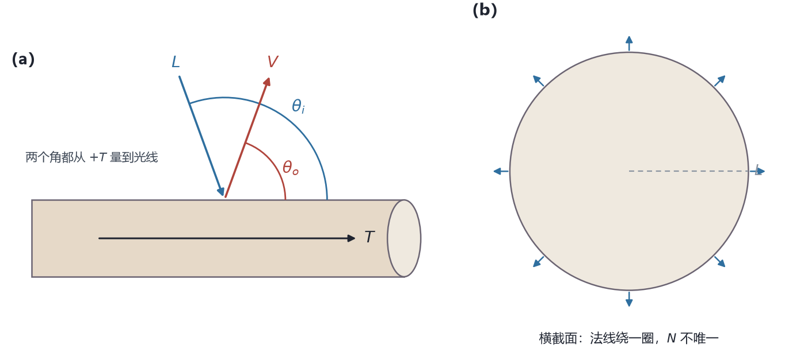
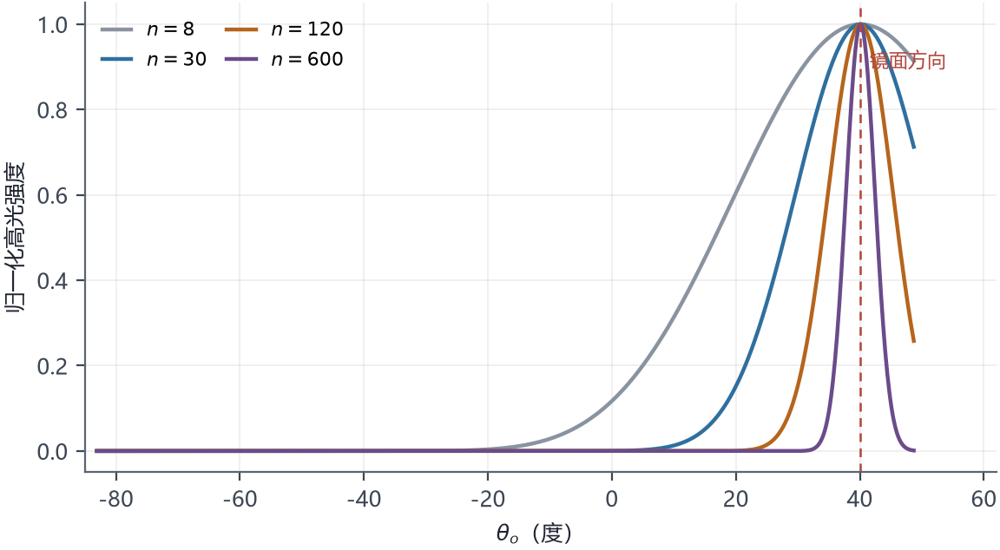
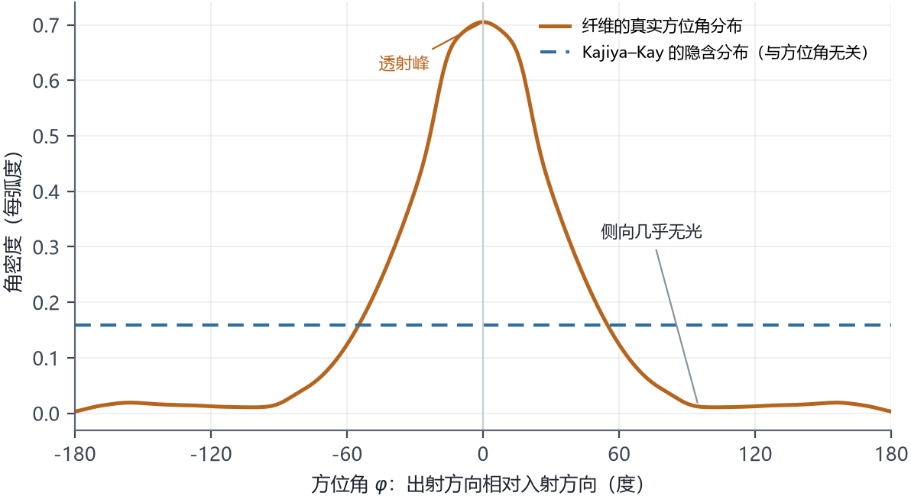

# 第 2 章 Kajiya–Kay：把纤维当一根细圆柱

## 2.1 一条不会动的亮线

早期的三维毛发用的是普通 Phong 着色。一根根细长的圆柱，法线取圆柱表面的法线，高光用 Blinn-Phong。渲染出来的东西一眼就能看出是假的，而且假的方式很奇怪：头顶有一片亮的区域，但当镜头绕着模型转的时候，那片亮光几乎不动。

真实的头发不是这样。绕着一个站着的人走一圈，头顶那条亮带会跟着移动，位置变化很大，而且形状会从一条细带变成一片宽的亮区。更明显的是，真实头发在逆光时整体会亮起来，Phong 着色下永远是暗的，因为它的高光只在光源和视线关于法线对称的那些点上出现。

问题出在法线的定义上。一个球面上的点，法线是唯一的。一根圆柱上的点不是。给定一个位置，圆柱表面有一条沿轴向的线，这条线上每个点的法线都不同，它们绕轴转了一整圈。用 Phong 模型，你需要给每个着色点一个确定的法线；而在一根直径为几十微米的纤维上，你根本不知道光打在圆周的哪一侧。

Kajiya 和 Kay 在 1989 年的论文《Rendering Fur with Three Dimensional Textures》里给了一个答案：不要用法线，用切线。

## 2.2 切线空间

纤维的走向是明确的，所以切线 $T$ 是明确的。围绕 $T$ 可以建立一套坐标，把方向用它和 $T$ 的夹角描述出来。图 2-1 是这两个角度。

设入射方向为 $\omega_i$，视线为 $\omega_o$，$\theta_i$ 是 $\omega_i$ 与 $T$ 的夹角，$\theta_o$ 是 $\omega_o$ 与 $T$ 的夹角。这两个角定义在 $[0,\pi]$ 上，因为 $T$ 是一条线而不是一个箭头。

圆柱的对称性在这里发挥作用：绕轴转一圈，几何完全不变。所以着色函数不能依赖绕轴的方位，只能依赖这两个角。这就是为什么 Kajiya–Kay 的模型里没有 $\varphi$。

在切线空间里，纤维看起来像什么？把它想成一条一维的线，光线沿线方向有一个分量，垂直方向有一个分量。沿 $T$ 的夹角小，说明光几乎顺着纤维走；夹角接近 90 度，说明光从侧面打上来。

## 2.3 两个 sin 幂

先用一个和圆柱类似的东西做参照：一根一维的细线，光打在它上面，散射强度应该正比于什么？

直觉上，光照到线的侧面越多，散射越强。侧面的大小正比于 $\sin\theta_i$：光垂直打在线上（$\theta_i=90°$）时看到的是完整的一维截面，光沿着线走（$\theta_i=0$）时几乎碰不到东西。所以漫反射项写成

$$f_d=K_d\sin\theta_i . \tag{2.1}$$

这一项在 $\theta_i=0$ 处为零，在 90 度处最大。和 Lambert 的 $\cos\theta$ 正好互补，这是"纤维是一维物体"的直接结果。

高光项要做的是"什么时候看到镜面反射"。判断的依据是：如果把纤维看成一根光滑的细杆，镜面反射发生在入射光和视线关于局部切平面（而不是法线）对称的时候。局部切平面由 $T$ 和垂直于 $T$ 的那条方向张成，关于它对称意味着两者的纵向分量相等、横向分量相反。用角度写出来就是

$$\theta_i+\theta_o=\pi . \tag{2.2}$$

把它做成一个可以调宽度的峰，最省事的写法是余弦的幂：

$$f_s=K_s\left[-\cos(\theta_i+\theta_o)\right]^{n} . \tag{2.3}$$

方括号在 $\theta_i+\theta_o=\pi$ 时等于 1，偏离时迅速下降，$n$ 越大降得越快。式 (2.3) 也可以写成 $\sin\theta_i\sin\theta_o-\cos\theta_i\cos\theta_o$ 的幂，两个形式完全等价，Kajiya 和 Kay 的原文用的是后一种写法。用 $\sin$ 和 $\cos$ 的乘积写，好处是直接看得出"纵向与横向各出一个因子"，坏处是看不出它其实就是一个余弦。

图 2-2 画出了指数的效果。$n=8$ 时峰宽三十多度，像一片柔和的光晕；$n=600$ 时峰宽三度多，像一根亮线。真实头发的第一道高光介于两者之间，宽度由角质层的粗糙度决定，第 4 章会把这个对应关系写出来。在这里 $n$ 只是一个美术参数，没有物理含义。

把两项加起来，就是 Kajiya–Kay 的完整模型：

$$f=K_d\sin\theta_i+K_s\left[-\cos(\theta_i+\theta_o)\right]^{n} . \tag{2.4}$$

注意这里没有 $\pi$ 的归一化因子，也没有 $1/(4\cos\theta_i\cos\theta_o)$ 这样的几何项。这是一个纯经验的着色模型，它的参数直接对应美术想要的效果，不对应任何可测量的物理量。

这种写法带来一个具体的麻烦：指数一变，总能量就变。把 (2.3) 对 $\theta_o$ 在整圈上积分，$n=8$ 时得到约 0.86，$n=600$ 时只剩约 0.10，相差八倍多。也就是说，美术把高光调锐之后，亮度会自己降下去，必须同时把 $K_s$ 抬上来。做工具的人通常会在面板上把这两个参数绑在一起，或者干脆给一个"高光强度"的滑块，内部乘上积分值。物理模型不需要这一步，因为它的归一化是公式自带的。

## 2.4 两根高光是怎么凑出来的

真实的头发有两道高光，一道是白的，一道带颜色。式 (2.4) 只给出一道，因为式 (2.2) 只有一个解。

工程上的处理很直接：把切线偏一下，再算一次。取纤维表面的法线方向 $N$（垂直于 $T$ 的那条），构造两条辅助切线

$$T_1=\mathrm{normalize}(T+\delta N),\qquad T_2=\mathrm{normalize}(T-\delta N), \tag{2.5}$$

然后用 $T_1$ 和 $T_2$ 分别算式 (2.3)，得到两个峰，位置相差约 $2\delta$。

这个做法在实时渲染里非常普遍，代价也低——两次点积，一次幂运算。它能出效果，因为人眼对"两道高光"这件事的判据很弱：只要在亮带旁边看到一条颜色不同的带子，就会认为这是头发。

问题在于这两道高光没有任何物理区别。它们的宽度由同一个 $n$ 控制，颜色由同一个 $K_s$ 控制，位置差 $\delta$ 是手调的，跟折射率、跟纤维的粗细都没有关系。真实的第二道高光比第一道宽、比第一道暗、比第一道偏得多，而且颜色是暖的。用两个 $\delta$ 调不出这些差别，只能靠给第二项单独一套参数，于是参数从三个变成六个，每个都要手动配对。

## 2.5 缺的那一半

真正致命的地方是方位角。

一根纤维是圆的，绕轴转一圈，散射强度变化很大：正对入射方向有强透射，侧向几乎没有光。图 2-3 把这件事画了出来，橙线是由第 1 章那个圆截面几何算出的真实分布，蓝虚线是 Kajiya–Kay 隐含的分布。

Kajiya–Kay 的分布是一条水平线。这不是画图时的简化，而是模型的直接推论：式 (2.4) 里没有 $\varphi$，所以绕轴一圈亮度不变。真实的分布有一个位于 0 度的尖峰，峰值是平均值的四倍多，而在 90 度附近几乎为零。

差别带来的后果可以算出来。逆光拍摄时，相机大致在入射方向的正对面，也就是 $\varphi\approx0$ 的位置。真实纤维在这个方向的亮度是平均值的四倍，Kajiya–Kay 给出的是一倍。这一块能量差了一个数量级，而它正是"逆光发丝发亮"的全部来源。

同样的道理，侧向看向一缕头发时，真实情况是几乎看不到散射光，只能看到表面反射；Kajiya–Kay 会给出一份平均的亮度。两处都错，且错的方向相反，所以调参调不平。

漫反射项也有同样的问题。式 (2.1) 认为纤维的散射正比于 $\sin\theta_i$，理由是"看到的截面大小"。这个理由在整根纤维上成立，在单个着色点上不成立：$\sin\theta_i$ 是投影面积的因子，它描述的是有多少光被截住，而不是被截住之后往哪里去。真实的纤维把截住的光大部分送到前向，所以从背面看是亮的；式 (2.1) 把它平均送到各个方向，从背面看跟正面一样。这一项在功能上相当于给纤维刷了一层哑光漆。

## 2.6 它还有用的地方

说这些不是说 Kajiya–Kay 没用。它有三个明显的优点。

第一，它极便宜。一个点积、一个幂、两个三角函数，不需要追踪任何路径，不需要知道纤维的粗细和折射率。在没有几何着色器的年代，一撮毛发用几千根线段画出来，这个成本是可以承受的；今天在移动端和远处的 LOD 上，它依然划算。

第二，它的参数是美术友好的。$n$ 大了高光锐，$\delta$ 大了两道高光分得开，$K_s$ 管亮度。没有哪个参数需要查表，也不会因为参数取到边界而炸掉。

第三，它可微、可求导、可做成查找表。做风格化渲染、做 NPR 头发、做远处的模糊替代品，它比任何物理模型都好控制。

需要避免的是把它当成物理模型来解释。如果给 $n$ 赋予"粗糙度"的含义，给 $\delta$ 赋予"角质层倾角"的含义，那么一旦换了光照条件，参数就必须重调，因为它们本来就不是在描述同一件事。

## 2.7 该往哪里补

把缺口列出来，就是 Marschner 那篇论文要做的事。

方位角上要有结构，所以模型必须显式地依赖 $\varphi$，而且这个依赖要来自几何——光在圆截面里走了一条什么样的折线，决定了它从哪个角度出来。

两道高光要有不同的颜色，所以模型里必须出现吸收，而吸收只能发生在光进入纤维之后。Kajiya–Kay 的高光完全发生在表面，没有路径长度这个概念，所以它永远调不出"第二道高光偏红"。

纵向要有正确的宽度，所以纵向分布不能是一个随手取的幂次，而应该和角质层的倾角、表面的粗糙度对应起来。

这三件事正好对应 Marschner 模型的三条路径、方位角分布和纵向分布。

---

这一章的内容可以用三句话概括。纤维上法线不唯一，所以 Kajiya–Kay 把着色函数建立在切线空间里，只用入射与视线同切线的两个夹角。式 (2.4) 用两个正弦和余弦的幂给出了一道便宜的高光，工程上再通过偏移切线凑出第二道。这个模型对绕轴的角度完全没有分辨能力，因此无法产生逆光透光，也无法让两道高光有不同的颜色。

下一章把这三条缺失逐条补上。
