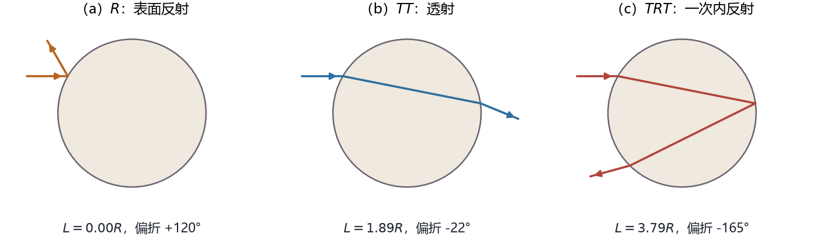
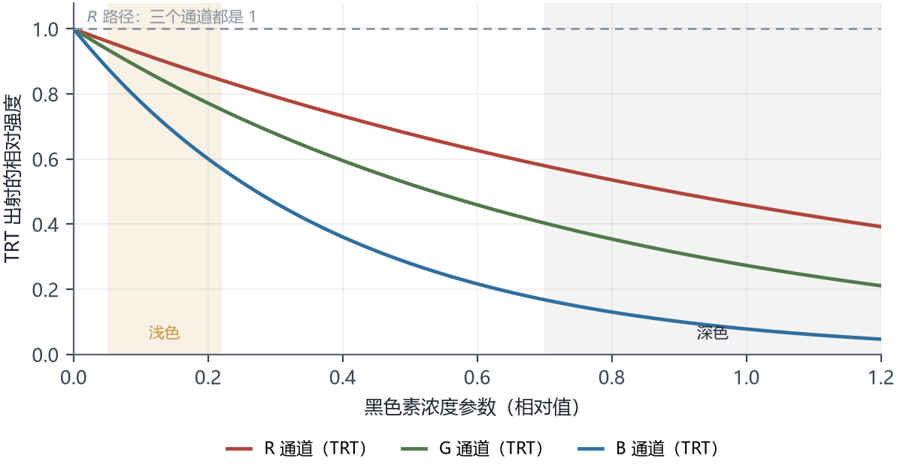

# 第 3 章 Marschner 的 R、TT、TRT

## 3.1 两道高光

一张浅色头发的照片，光源在左上，相机在正前方。头顶上能看到两条亮带：上边一条很窄，颜色接近纯白；下边一条宽一些，颜色偏金黄，位置比上一条更靠近发梢一侧。两条带子之间是暗的。

换成纯黑的头发，同一个角度，只剩一条白带，第二条看不见或者只剩一点极窄的暖色边缘。

这个差别没法用"高光强度"解释，因为两条带子的颜色不同，而颜色在这类问题里只可能来自吸收。吸收只发生在光进入介质之后。所以一定存在至少两条不同的路径，一条进入纤维，一条不进入，而进入的那条被染了色。

第 1 章的几何已经给出了候选：R 不进入，TT 进入走一段，TRT 进入并在里面反射一次走两段。Marschner、Jensen、Worley 等人在 2003 年的论文《Light Scattering from Human Hair Fibers》里把这三条路径写成了第一个能实用的毛发散射模型。这一章把它拆开。

## 3.2 转向的账本

光在圆截面里的每一次接触界面，方向都会转一个角度。把三种接触的转角算清楚，整条路径的出射方向就是这些角度的和。图 3-1 把三条路径画在同一个截面里，可以看到它们从同一个入射点出发，分别向三个方向离开。

折射进入纤维时，方向从与法线成 $\theta_i$ 转到与法线成 $\theta_t$，转过 $\theta_i-\theta_t$。从内部折射出去时，同样的角度差转回来，方向再转 $\theta_i-\theta_t$，但方向相反，因为此时光是从法线另一侧离开的。

在内壁反射时，光的方向关于法线对称，与法线的夹角保持 $\theta_t$，方向转过 $\pi-2\theta_t$。

三条路径的转角分别是：

$$\varphi_R=\pi-2\theta_i , \tag{3.1}$$

$$\varphi_{TT}=-2(\theta_i-\theta_t) , \tag{3.2}$$

$$\varphi_{TRT}=-\left[(\pi-2\theta_t)+2(\theta_i-\theta_t)\right]=-(\pi+2\theta_i-4\theta_t) . \tag{3.3}$$

这三个式子里的负号来自约定：以入射方向为 0，向一侧转为正。式 (3.1) 是镜面反射，$h=0$ 时 $\varphi_R=\pi$，光原路返回。

式 (3.2) 说明 TT 的出射方向离开前向只有 $2(\theta_i-\theta_t)$，$h$ 越大偏得越多，$h\to1$ 时偏到 $-100$ 度左右，那就是擦着表面掠出去。

式 (3.3) 值得多看一眼，因为它的导数会变号：

$$\frac{d\varphi_{TRT}}{dh}=-\left(\frac{2}{\sqrt{1-h^2}}-\frac{4}{\eta\sqrt{1-h^2/\eta^2}}\right) . \tag{3.4}$$

令它为零，解出

$$h^\ast=\sqrt{\frac{4-\eta^2}{3}} . \tag{3.5}$$

$\eta=1.55$ 时 $h^\ast\approx0.73$，代入 (3.3) 得 $\varphi_{TRT}\approx18.6°$。

这个 $h^\ast$ 是一个折返点。$h<h^\ast$ 时 $\varphi_{TRT}$ 从 0 单调增加到 18.6 度，$h>h^\ast$ 时它掉头减小，$h\to1$ 时回到 $-19°$ 附近。图 3-2 的左边画出了这个折返。

折返点在光学上意味着焦散：一段范围内的 $h$ 都被压到同一个角度上，那里的能量密度会出现尖峰。这就是 TRT 为什么会形成一条可辨认的亮带，而不是均匀地糊在镜面方向附近。

![图 3-2　左图是三条路径的出射偏折随入射偏移的变化，横轴 $h$ 取 $[0,1]$（另一半关于轴对称）；红点在 $h^\ast=0.73$ 处，是 TRT 曲线的折返点。右图是三条路径的方位角分布，纵轴取对数，曲线已按各自携带的能量加权，所以曲线的面积直接反映相对亮度](../images/03/fig3-2-phi.png)

## 3.3 从几何到方位角分布

给定一条路径，$h$ 与出射角 $\varphi$ 是一一对应的（折返点两侧各一段）。光线在 $[h,h+dh]$ 内的能量是 $A_p(h)\,dh$，落在 $[\varphi,\varphi+d\varphi]$ 内。把变量换掉，就得到方位角密度

$$M_p(\varphi)=\sum_{h:\,\varphi_p(h)=\varphi}\frac{A_p(h)}{\left|d\varphi_p/dh\right|} . \tag{3.6}$$

求和是因为折返点两侧的 $h$ 可能映到同一个 $\varphi$。$A_p$ 是这条路径的能量，包含各界面的 Fresnel 系数和内部吸收：

$$A_p(h)=\left(1-F(\theta_i)\right)F(\theta_t)^{p-1}\left(1-F(\theta_t)\right)\exp\left(-\sigma_a L_p(h)\right) , \tag{3.7}$$

其中 $L_p=2p\cos\theta_t$ 是第 1 章的路径长度，$p=0$ 时 $A_0=F(\theta_i)$。

图 3-2 的右图是 (3.6) 的数值结果，三条曲线按各自的总能量 $E_p=\int A_p\,dh$ 加权。可以读出三件事。

$M_{TT}$ 是三者中唯一的宽瓣，峰值在 0 度，向两侧衰减到 100 度附近消失，携带的能量 $E_{TT}\approx0.88$。它占绝对多数，这正是第 1 章那个前向散射峰的来源。

$M_{TRT}$ 在 $\pm18$ 度处有两个窄峰，中间有一个浅谷，能量只有 $E_{TRT}\approx0.044$。两个峰是因为 $h$ 和 $-h$ 对称，折返点在一侧各出现一次。

$M_R$ 几乎是平的，能量 $E_R\approx0.075$，在 0 度附近略高，在 $\pm160$ 度附近又被抬起来一次。这个形状和第 2 章的直觉相反：一根光滑圆柱的表面反射并不集中在镜面方向，因为圆周上每个点的法线都不同，镜面条件被摊到整圈上。抬起来的那一段是掠射，那里反射率趋近 1。真实头发上的"剪影亮边"就是这一段，第 7 章讲逆光时会再遇到它。

## 3.4 纵向分布

方位角讲完，还有另一个方向：沿着纤维的纵向。同一个 $\varphi$ 下，出射角 $\theta_o$ 可以取很多值。

纵向的条件比方位角简单。R 的镜面条件在纵向上是 $\theta_o=-\theta_i$（关于法线对称），TT 是 $\theta_o=\theta_i$（穿过），TRT 也在 $\theta_o=-\theta_i$ 附近，因为两次折射抵消、一次反射对称。真实纤维的角质层鳞片有倾角，把它当作一个均值 0、标准差约 0.2 弧度的分布，每个路径的纵向条件就变成一个以理想方向为中心、被鳞片倾角和高光粗糙度共同展宽的峰：

$$N_p(\theta_i,\theta_o)=\int g(\beta,\ \theta_o-\theta_i^{\mathrm{ideal},p}-2\alpha)\,p(\alpha)\,d\alpha . \tag{3.8}$$

$\alpha$ 是鳞片倾角，$p(\alpha)$ 是它的分布，$g(\beta,\cdot)$ 是标准差 $\beta$ 的塔尖分布。第 4 章会把 (3.8) 展开，这里只需要记住一件事：三条路径的纵向峰几乎在同一个位置，宽度不同。R 被鳞片倾角展宽得最厉害，TRT 次之，TT 因为两次折射抵消而最窄。

这也解释了为什么两条高光的分离主要发生在方位角上而不是纵向上。第 2 章用偏移切线凑出来的两根高光是纵向错开的，方向反了。

## 3.5 颜色只由路径长度决定

回到开头那道有颜色的高光。

把 (3.7) 的能量和 (3.6) 的密度合起来看，第 $p$ 条路径的颜色是

$$C_p(\lambda)=\exp\left(-2p\cos\theta_t\,\sigma_a(\lambda)\right) . \tag{3.9}$$

三条路径的长度差一个整数倍：R 是 0，TT 是 $2\cos\theta_t$，TRT 是 $4\cos\theta_t$。直径 80 微米时，$2\cos\theta_t$ 约 1.9 个直径，也就是 150 微米左右；TRT 是 300 微米。

图 3-3 画出了这件事。横轴走一遍，TRT 的三个通道从同一起点分开，蓝通道掉得最快。在浅色区间（图上左边那条窄带），三个通道都还有相当的值，混出来的颜色偏暖但还亮；浓度再往上，蓝通道接近零，只剩红和一点绿，TRT 变成暗红色；浓度更高，三个通道都快到零，TRT 消失，只剩 R 的白高光。

这解释了开头那个观察：黑发只有一道白高光，因为它把第二道吃掉了；金发能看到两道，因为它的色素浓度刚好在 TRT 还活着、但已经被染色的区间里。

同一个式子还解释了另一个常见现象：同一头头发，发梢比发根浅。发梢经历的时间长、日晒多，色素被分解了一部分，$\sigma_a$ 小，TRT 就更容易透出来。渲染时把 $\sigma_a$ 沿纤维长度做一个梯度，就能重现这个效果，第 9 章会给参数。

需要说明的是，(3.9) 里用的是 RGB 三个系数，不是连续光谱。这是工程上的妥协：真实的吸收曲线是连续的，用三个数拟合只能在三个位置对上，中间的颜色（比如某些红发的高饱和橙）会偏。要做准确的光谱渲染，得把 $\sigma_a(\lambda)$ 换成采样表，本书不展开。

## 3.6 完整的模型

把三部分拼起来，一根纤维的散射函数是

$$S(\theta_i,\theta_o,\varphi)=\sum_{p=0}^{2}M_p(\varphi)\,N_p(\theta_i,\theta_o)\,A_p , \tag{3.10}$$

$A_p$ 在这里取路径总能量的平均值（或者直接并入 $M_p$ 的归一化），$\varphi=\varphi_o-\varphi_i$ 是两个方向的方位角之差。

式 (3.10) 是 Marschner 模型的核心。它的结构和微表面 BRDF 很像：一个方位角分布、一个纵向分布、一个能量系数。区别在于这里的两个分布来自圆柱内的具体路径，而不是来自法线分布；能量系数来自 Fresnel 和 Beer–Lambert，而不是来自遮蔽函数。

实现上有几个地方容易出错，第 4 章和第 10 章会分别处理：$M_p$ 的归一化必须严格为 1；$N_p$ 在倾斜角上的积分要归一；$A_p$ 里的 Fresnel 用的是 $\theta_t$ 而不是 $\theta_i$；采样时 pdf 要把两个分布和路径选择概率乘起来。

这个模型有一个明显的缺口：只有三条路径。第 1 章说过，$p\ge3$ 的路径是存在的，只是能量小。对黑发这个缺口可以忽略，对金发不行。第 5 章处理它。

## 3.7 一个算例

把数代进去走一遍，能看出这套东西的实际行为。取 $h=0.5$，$\eta=1.55$，黑色素浓度 0.3。

先算角度。$\theta_i=\arcsin0.5=30°$，$\theta_t=\arcsin(0.5/1.55)=18.8°$，弦长 $2\cos\theta_t=1.893$，以半径为 1 计。

三条路径分别是：R 的偏折 $\pi-2\theta_i=120°$，内部长度 0；TT 的偏折 $-2(30-18.8)=-22.4°$，内部长度 1.893；TRT 的偏折 $-(\pi+60-75.2)=-164.8°$，内部长度 3.786。

换成直径为单位，TT 走 0.95 个直径，TRT 走 1.89 个直径。直径 80 微米，两者分别是 76 微米和 151 微米。

再算颜色。把长度和系数代进 (3.9)：

$$C_{TT}=(0.888,\ 0.821,\ 0.678),\qquad C_{TRT}=(0.788,\ 0.673,\ 0.459) . \tag{3.11}$$

TT 的三个通道都接近 1，颜色偏暖但很淡；TRT 的蓝通道掉到 0.46，红通道还有 0.79，混出来是明显的金色。两条路径的颜色差就是第二道高光能被看见的原因。

最后看能量。同一个 $h$ 上，TT 的 Fresnel 权重是 0.909，TRT 是 0.044，差了二十倍。所以第二道高光虽然颜色好看，亮度只有第一道的二十分之一。这解释了为什么在柔光下很难看到它：环境光的亮度不足以把它推到可见的水平。要用硬光，或者逆光。

---

这一章的内容可以压成一张表：三条路径、三个偏折公式、三个能量。

R 不进入纤维，偏折 $\pi-2\theta_i$，颜色是白的，能量约 7%；TT 穿过，偏折 $-2(\theta_i-\theta_t)$，颜色被染一次，能量约 88%；TRT 反射一次，偏折 $-(\pi+2\theta_i-4\theta_t)$，颜色被染两次，能量约 4%。

TRT 的偏折在 $h^\ast=0.73$ 处折返，折返点把能量压成两个峰，位置在镜面方向两侧各 18 度。这就是第二道高光的位置，也是它为什么窄。

下一章把 (3.6) 和 (3.8) 拆得更细，重点讲两件事：归一化，以及怎么从这两个分布里采样。
