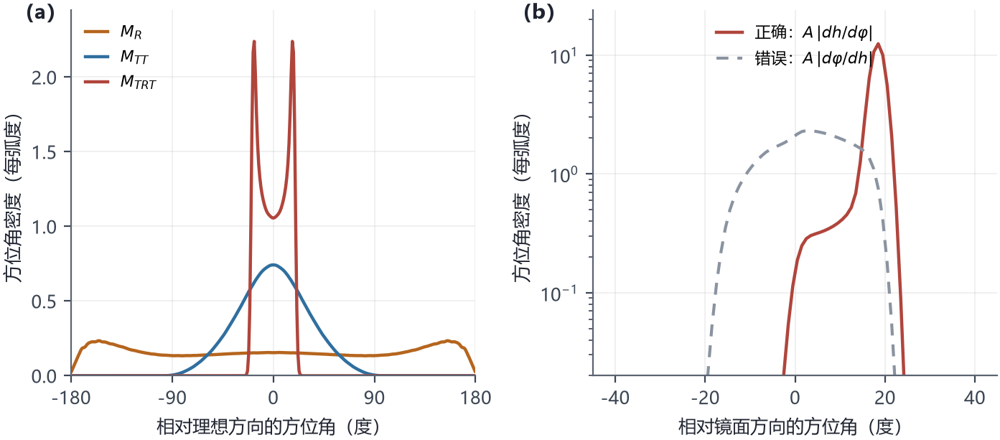
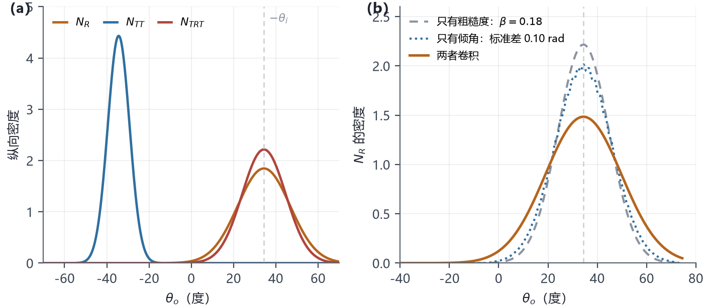
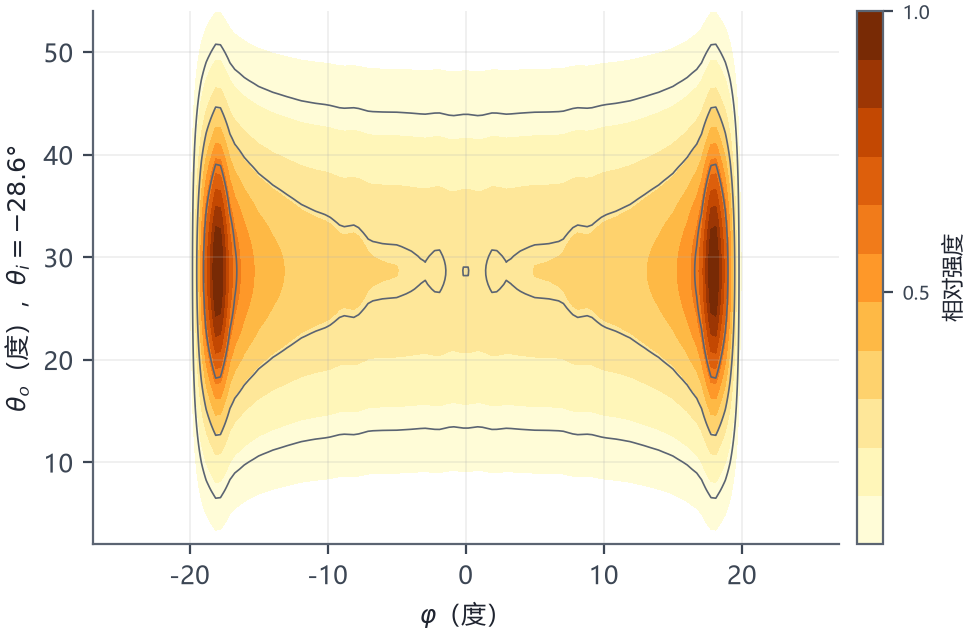

# 第 4 章 方位角分布与纵向粗糙度

## 4.1 一道高光的形状

把一根头发单独放在光源下，从侧面看它的高光。你会发现这条亮带是横着的——它沿着垂直于纤维轴的方向铺开，宽度只有几度；而在沿着纤维轴的方向上，它可以延伸很长，甚至一直亮到视野外。

这件事说明散射函数在两个方向上的宽度差了一个数量级。第 3 章把这两个方向分成了方位角 $\varphi$（绕轴）与纵向角 $\theta$（沿轴），但没有说明这两个分布长什么样、怎么归一、能不能乘起来用。这一章处理这三件事。

它们看起来是记账问题，实际上决定了实现能不能对上。一个模型如果 $M_p$ 少乘一个雅可比，图像不会报错，只会让第二道高光消失、第一道高光变宽；如果 $N_p$ 没归一，白炉测试会给出 0.7 这样的能量。两者都不容易靠眼睛发现。

## 4.2 方位角密度和它的雅可比

第 3 章的 (3.6) 给出了 $M_p$ 的定义。把它写成可以计算的形式：

$$M_p(\varphi)=\sum_{h:\,\varphi_p(h)=\varphi}\frac{A_p(h)}{\left|d\varphi_p/dh\right|} . \tag{4.1}$$

这个式子里的关键是分母。$A_p(h)\,dh$ 是落在区间 $[h,h+dh]$ 内的能量，把它塞进 $[\varphi,\varphi+d\varphi]$ 里，密度的定义要求除以区间宽度，而宽度是 $|d\varphi/dh|\,dh$。所以 $|d\varphi/dh|$ 出现在分母上。

写成分子就得到一条完全不同的曲线。图 4-1 的右图把两种写法画在一起，同一份能量，一个在 18 度处有一个尖峰，另一个在 0 度附近有一个平缓的鼓包。

左图还暴露了一个容易被忽略的事实：三条曲线的面积相同，形状差别极大。$M_{TT}$ 的峰值约 0.75，宽度接近 180 度；$M_{TRT}$ 在 $\pm18$ 度处到 2.3，中间 0 度处只有 1.05；$M_R$ 最平，0 度附近 0.16，$\pm165$ 度附近抬到 0.25。

面积相同而形状不同，意味着归一化必须逐条做，不能用一个统一的因子。实现时通常把 (4.1) 预先积成一张表，采样时查表反演，表里的值在生成阶段就除以总和。这一步做错的话，误差不会以"图不对"的形式出现，而是以"能量少了一半"的形式出现。

折返点处 $d\varphi/dh=0$，(4.1) 在那个角度上是奇异的。真实的头发不会真的有无限大的密度，因为角质层的粗糙度会把折返点附近的 $h$ 抹开一点。数值上处理的办法有两个：一是在生成表的时候对 $\varphi$ 做一次小宽度的高斯平滑，宽度取粗糙度对应的角宽；二是直接把 $h$ 的采样当随机变量，用直方图统计，平滑自然发生在分箱里。两种做法给出同样的结果，前提是平滑宽度不能大于粗糙度对应的宽度，否则第二道高光会被抹平。

## 4.3 吸收项放在哪里

$A_p$ 里包含两部分：各界面的 Fresnel 系数，和内部吸收 $\exp(-\sigma_a L_p)$。Fresnel 部分只跟 $h$ 有关，必须留在 (4.1) 的分子里；吸收部分也跟 $h$ 有关，但关系很弱——$L_p=2p\cos\theta_t$ 在 $h\in[0,0.9]$ 上只变化 10% 左右。

工程上有两种放法。一种是把吸收整体并进 $A_p$，$M_p$ 随颜色变化，每种发色一张表。另一种是把 $M_p$ 做成与颜色无关的纯几何表，吸收单独作为一个乘在路径上的因子，取值用 $\theta_t$ 的平均值。第二种省内存，代价是每个 $h$ 上的吸收误差有 10% 量级。

做单一发色时两种没区别。做头发渐变（发根到发梢颜色不同）时，第一种要为每个采样点重算表，第二种只需要改一个标量。多数生产实现选第二种，然后在验证阶段接受那 10% 的偏差，因为发梢的颜色本来就靠美术调。

第三种做法介于两者之间：把 $\cos\theta_t$ 这一项留在表里，吸收系数提出来。这样 $M_p$ 与颜色无关，吸收仍然按每个方向的实际路径长度算，误差只剩 Fresnel 与吸收的耦合项，可以忽略。

## 4.4 纵向分布

方位角定完了，还有 $\theta_o$。

从几何上看，纵向的条件比方位角简单得多。R 的镜面条件在纵向上是 $\theta_o=-\theta_i$，TT 是 $\theta_o=\theta_i$，TRT 也在 $\theta_o=-\theta_i$ 附近。三个条件都是关于 $\theta_o$ 的线性方程。

真实的纤维不会严格满足这些条件，原因有两个。角质层的鳞片是斜的，显微镜下量出来倾角在 2 到 5 度之间，这个倾角把反射方向整体推偏，推开的角度是倾角的两倍。鳞片之间的缝隙和表面的微观起伏让满足条件的角度有一个分布，宽度用 $\beta$ 描述。

把这两件事都当成角度上的卷积，就得到 (3.8)。图 4-2 的左边画出了三条路径的纵向分布，右边把 R 的分布拆成两个来源。

左图里有三件事值得说。

TT 最窄，峰值在 $\theta_o=\theta_i=-34$ 度处，高度约 4.4。窄是因为它折射两次，每次折射都把微面的角偏差压缩到 $1/\eta$，两次下来约一半。这个"一半"是从 Snell 定律直接来的：$\delta\theta_t=\delta\theta_i/\eta$，$\eta=1.55$ 时约 0.65，两次近似 0.4 到 0.5。实现里通常直接给 TT 一个 $\beta/2$ 的粗糙度，不再逐次推导。

R 和 TRT 的峰都在 $-\theta_i=+34$ 度处，高度分别约 1.9 和 2.2。R 稍宽一些，因为它的方向被鳞片倾角推了两倍，而 TRT 的两次折射把这个推力抵掉了一部分。两者几乎重合，这印证了第 3 章的说法：两条高光的分离主要发生在方位角上。

右图把 R 的展宽拆开。粗糙度单独给出一条标准差 0.18 弧度的曲线，峰值 2.2；倾角单独给出标准差 0.2 弧度的曲线，峰值 2.0；两者的卷积峰值降到 1.5，宽度按平方和开方相加。这说明纵向宽度不能被当作一个参数来调，它至少由两个物理量决定，而这两个物理量对三条路径的作用方式不同。

## 4.5 为什么可以乘起来

把两个分布相乘，$S_p=M_p(\varphi)N_p(\theta_i,\theta_o)A_p$，这个写法背后有一个假设：方位角与纵向独立。

严格来说它们不独立。同一个 $h$ 决定了 $\varphi$，也决定了路径长度和 Fresnel 系数，而后者影响能量的角度分布。但这个耦合很弱：$h$ 从 0 变到 0.9，路径长度只变 10%，Fresnel 系数变 20%；而 $\varphi$ 在这段范围里走过了几乎整圈。相比之下，$\varphi$ 对 $h$ 的依赖是剧烈的，$\theta_o$ 对 $h$ 的依赖几乎没有。两个方向的时间尺度差这么多，乘起来是一个合理的近似。

图 4-3 画出了 $M_{TRT}\cdot N_{TRT}$ 的二维形状。两个峰在 $\pm18$ 度，沿纵向从 10 度延伸到 50 度，沿横向只有十几度宽。这个形状和 4.1 节里观察到的亮带一致：横向窄，纵向长。

分离的形式还有一个好处：采样可以分开做。先按路径选一条 $p$，再从 $M_p$ 采 $\varphi$，从 $N_p$ 采 $\theta_o$，两个一维分布各自用累积分布反演，总 pdf 是三者的乘积。如果坚持用二维联合分布，就得建二维表，内存涨一个量级，收益只有几个百分点的方差。第 6 章会把这个采样流程完整写一遍。

## 4.6 参数和它们的物理含义

到这里，模型里的自由参数只有四个：折射率 $\eta$、粗糙度 $\beta$、鳞片倾角的标准差、以及黑色素吸收系数 $\sigma_a$。加上路径权重（如果不用几何算出来的 Fresnel），一共五个。

$\eta$ 基本不是自由参数。角质层的折射率在 1.55 附近，不同人种、不同含水量的差别在 0.02 以内，对角度的影响小于 1 度。把它当常数就够了。

$\beta$ 是唯一真正的形状参数。它控制高光的宽度，和光泽感直接相关。数值上，健康头发的 $\beta$ 在 0.15 到 0.3 弧度之间；受损、烫染过的头发可以到 0.5 以上，高光会糊成一片。第 9 章会给一张对照表。

鳞片倾角的标准差在 0.03 到 0.08 弧度之间。它主要影响 R 与 TRT 之间的强度比，因为倾角推偏方向时，两条路径被推的方向相反。把它调大，第一道高光会偏离镜面方向，第二道会靠近。

$\sigma_a$ 决定颜色，只影响 $p\ge1$ 的路径。它的取值在小节 3.5 和图 3-3 里讨论过，第 9 章给出从照片反推的流程。

这四个参数之外的一切——路径长度、偏折角、折返点位置、能量分配——都由几何决定，不能调。这是这个模型比 Phong 类模型可靠的地方：调参时你改的是一个有物理含义的量，改完的行为可以被预测。

## 4.7 折返点能被测出来吗

到这时手里有一个可检的预言：第二道高光偏离镜面方向的角度。它不是自由参数，而是由折射率和折返点位置共同决定的：

$$\varphi_{\max}=-\left(\pi+2\theta_i-4\theta_t\right)\Big|_{h=h^\ast} . \tag{4.7}$$

把 $h^\ast$ 代入，对不同折射率算一遍，得到一张很短的表。

| 折射率 $\eta$ | 折返点 $h^\ast$ | 第二道高光的位置 |
|---|---|---|
| 1.40 | 0.825 | 33.2° |
| 1.50 | 0.764 | 22.8° |
| 1.55 | 0.730 | 18.6° |
| 1.60 | 0.693 | 14.9° |
| 1.70 | 0.608 | 8.9° |

这张表的用法是反过来的：如果从照片上量出第二道高光在镜面方向外 19 度，就可以反推出折射率在 1.55 附近，不需要再做别的工作。反推出的值落在 1.4 或 1.7，说明哪里错了——要么第一道高光的位置没标对，要么两道高光里的某一道是错开切线凑出来的（第 2 章的做法，它的位置是手调的）。

这也是一个能用“量角度”代替“调参数”的例子。毛发模型里的多数参数需要比较复杂的测量，但折射率这一个可以从一个大角度照片里直接读出来。

---

这一章说的是三件事。

方位角密度必须除以 $|d\varphi/dh|$，除以 1 得到的是能量对 $h$ 的分布，不是对 $\varphi$ 的分布；归一化要逐条路径做，因为三条曲线的面积相同而形状差别很大。

纵向分布的宽度由粗糙度和鳞片倾角两个来源卷积而成，三条路径的宽度不同，因为折射会压缩角度偏差。

两个方向可以相乘，因为耦合弱；相乘之后采样可以分开做，pdf 是路径概率、方位角密度与纵向密度的乘积。

下一章处理这一章没有算的那部分能量：$p\ge3$ 的路径。
