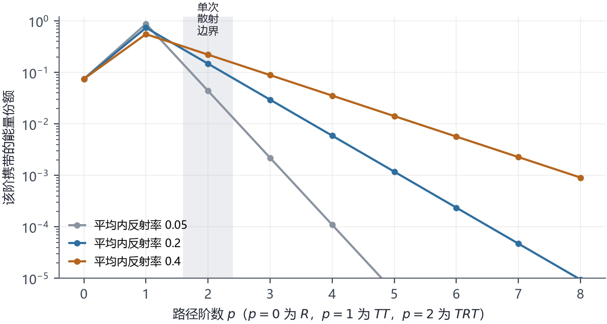
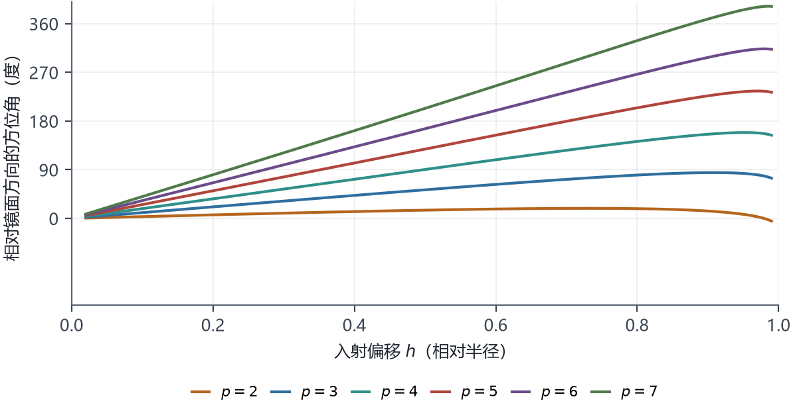
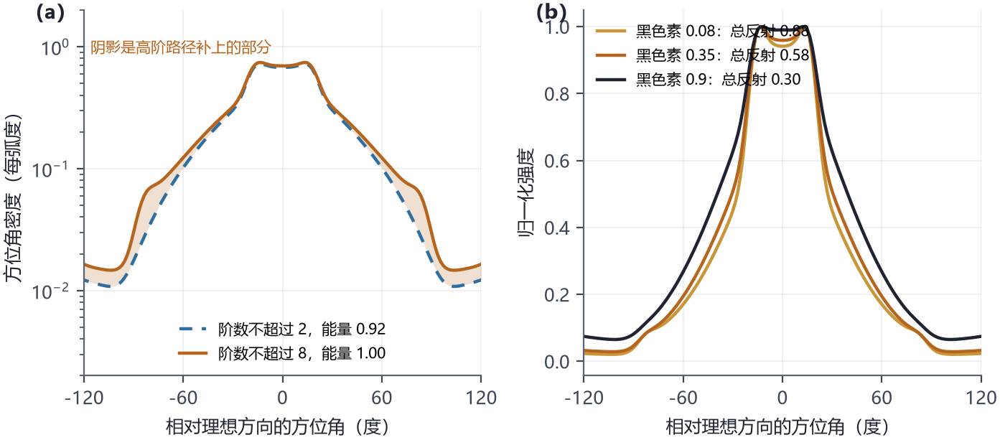

# 第 5 章 多次散射与双散射

## 5.1 白炉测试里少掉的那部分

把一根纤维放进一个各方向亮度相同的环境（白炉），积分它的散射函数，结果应该等于 1：进来的能量全部出去了。Marschner 的三条路径给出的积分是 0.92 到 0.99，取决于粗糙度和折射率。

少掉的这一部分去哪了？它没有丢，而是走进了 $p\ge3$ 的路径。光进去、反射两次、反射三次、再出来。单次散射模型只算到 TRT，把这部分完全截掉了。

图 5-1 是这本账。横轴是阶数，纵轴是这一阶占入射能量的比例，三条曲线对应三个平均内反射率 $\bar F$。$p=0$（R）和 $p=1$（TT）在所有曲线上都一样，因为这两阶不涉及内反射。$p\ge2$ 的衰减速度由 $\bar F$ 决定：$\bar F=0.05$ 时 $p=3$ 只剩 0.2%，$p\ge3$ 的总和不到 0.3%；$\bar F=0.4$ 时 $p=3$ 有 8.9%，$p\ge3$ 的总和 15%。

方程很简单。第 $p$ 阶的能量是

$$E_p=(1-F_i)\,\bar F^{\,p-1}(1-\bar F)\,\exp\left(-2p\cos\theta_t\,\sigma_a\right) , \tag{5.1}$$

它是一个几何级数，公比是 $\bar F\exp(-2\cos\theta_t\sigma_a)$。单次散射截掉的部分就是 $p\ge3$ 的和：

$$E_{\ge3}=E_3\,\frac{1}{1-\bar F e^{-2\cos\theta_t\sigma_a}} . \tag{5.2}$$

$\bar F$ 不是 0.05。光滑圆柱的 Fresnel 反射率在多数角度上只有百分之几，但真实纤维的表面是鳞片，局部法线偏离宏观法线，光在内部射到鳞片上的角度分布很宽，有一部分接近临界角，那里反射率接近 1。把这些加起来，$\bar F$ 的典型值在 0.2 到 0.4 之间。这就是为什么真实头发丢的能量比光滑圆柱多得多。

## 5.2 高阶路径的方向

能量之外还要知道方向。图 5-2 把 $p=2$ 到 $p=7$ 的方位角曲线画在一起。

这张图的结构是：每一阶的曲线都是前一阶加上一个随 $h$ 增大的转动。这个转动就是每次内反射转过的角 $\pi-2\theta_t$，$h$ 越大 $\theta_t$ 越大，转过越少，但前一阶的偏折本身随 $h$ 变化得更快，两者相减的结果是曲线张开。

具体地，给定 $h$，第 $k$ 阶的方位角是

$$\varphi_k(h)=\varphi_{k-1}(h)-\left(\pi-2\theta_t(h)\right) . \tag{5.3}$$

这个递推可以逐项验证：$h=0.3$ 时 $\theta_t=11.2°$，$\varphi_2=-170°$，$\varphi_3=\varphi_2-157.5°=32°$，$\varphi_4=32-157.5=-125.5°$，与第 3 章的追踪结果一致。

(5.3) 说明一件重要的事：高阶路径不是单次散射的模糊版本，而是单次散射在方位角上被旋转了若干次。旋转量随 $h$ 变化，所以高阶的能量分布既被转到别的方向，又被抹开。抹开之后的结果，就是把原来两个瓣之间的深谷填上一部分。

## 5.3 双散射的位置

Zinke 等人在 2008 年的论文《Dual Scattering Approximation for Fast Multiple Scattering in Hair》里提出一个折中：只补二阶项（TRT 之后再反射一次的那些），把三阶以上用一个形状相同的项近似。

这个近似的价值在于成本。完整的多次散射要对每一阶建表、对每个着色点求和；双散射只要再建一张表，成本增加不到一倍。而对浅色头发，二阶项已经占了 $p\ge3$ 总量的六成以上。

左图给出了补上之后的效果。两个主要差别：18 度附近之外的一段（40 到 60 度）抬高了 30% 左右，180 度附近的底部抬高了一个量级。前者的位置正好是第二道高光旁边，后者是背向的漫射底。

这两个位置在图像上意味着不同的东西。第二道高光旁边抬高，会让金发的高光看起来"更厚"，边缘不那么硬；背向抬高，会让头发在逆光时的暗部不黑。这两个效果都是美术一直在手动加的，双散射把它们变成了自动的。

## 5.4 为什么深色头发不需要

图 5-3 右图给出了分界线。

黑色素 0.08（浅金），总反射 0.88，高阶贡献占 12% 左右，形状上明显多出一个弥散底。
黑色素 0.35（棕），总反射 0.58，高阶贡献降到 8%，但相对单次散射仍不可忽略。
黑色素 0.9（黑），总反射只有 0.30，高阶那几阶在 (5.2) 里被吸收项压死，形状几乎不变。

从 (5.1) 能读出原因。吸收项的指数里有一个 $p$：每多一阶，路径长一倍，透射率乘一次 $e^{-2\cos\theta_t\sigma_a}$。设单程透射率为 $T$，公比就变成 $\bar FT$。$\bar F=0.3$、$T=0.1$（黑发）时公比是 0.03，$p=3$ 的能量是 $p=2$ 的 3%；$\bar F=0.3$、$T=0.9$（浅发）时公比是 0.27，$p=3$ 还有 27%。

所以分界线不是由颜色本身决定的，而是由 $\bar FT$ 决定的。这个乘积可以测量：拿一根纤维，测它的总反射率，再测它在逆光下的透射率，两个数的比值近似给出 $T$。第 10 章会把它做进验证流程。

工程上的判断标准很直接：$\bar FT<0.1$ 时只做单次散射，误差在 2% 以内；$0.1<\bar FT<0.3$ 时加双散射；$>0.3$ 时要考虑更多阶，或者干脆用下一章讲的体积化方法。

## 5.5 双散射近似的一个细节

双散射项的形状通常取 TRT 的形状再平移一次，因为多一次内反射就是多转一个角。平移量不能取常数，因为 (5.3) 里的转动量依赖 $h$。

Zinke 的处理是保留两个自由参数：一个整体能量系数，一个整体的角度偏移。这两个参数在离线阶段用完整的多次散射求解拟合出来，运行时只做一次查表和一次角度偏移。这样做的误差在浅色头发上约 5%，在深色头发上可以忽略。

更省的做法是把双散射当成一个各向同性的底部，直接加到分布上，形状用 TT 的归一化版本。这样省掉一张表，代价是逆光时的方向感变差——真实的双散射在 $\varphi\approx0$ 附近仍然比两侧强，用各向同性近似会把这部分抹平。

## 5.6 和能量守恒的关系

最后提醒一件事。补上高阶路径的目的是让积分回到 1，但补的方法必须保证不超。

如果双散射项的能量系数是独立调的，很容易调到总能量 1.1。这时图像不会明显报错，但白炉测试会露馅，而且一旦换了光照条件，误差会以"某些角度过曝"的形式出现。

正确的做法是让系数由 (5.2) 决定：先算单次散射的能量 $E_{\le2}$，再用 $1-E_{\le2}$ 作为高阶项的总量，形状按归一化的分布分配。这样无论参数怎么变，总和都是 1。

## 5.7 三个发色的账

把吸收放回几何级数里算一遍，能看出分界线在哪里。取 $\bar F=0.25$，绿通道的吸收系数，三种浓度，得到下面这张表（各阶能量，已归一化到入射能量）。

| 浓度 | $p=0$ | $p=1$ | $p=2$ | $p=3$ | $p=4$ | $p\ge3$ 占比 |
|---|---|---|---|---|---|---|
| 0.10（浅金） | 0.075 | 0.610 | 0.134 | 0.029 | 0.006 | 4.6% |
| 0.35（棕） | 0.075 | 0.441 | 0.070 | 0.011 | 0.002 | 2.3% |
| 0.90（黑） | 0.075 | 0.217 | 0.017 | 0.001 | 0.000 | 0.5% |

三行数据里有两个变化同时在发生。一是总量：从 0.86 降到 0.31，大部分能量被吸收了，这是颜色的来源。二是相对比例：高阶项占单次散射的比例从 4.6% 降到 0.5%，降了将近十倍。

后者才是“深色头发不需要双散射”的定量依据。它不是因为深色头发的散射弱，而是因为多反射一次就多走一段路，而深色头发的每段路都在扣能量。

表里还有一个细节值得注意：$p=0$ 那一列在三种浓度下都是 0.075。这是应该的，因为 R 不进入纤维，与浓度无关。如果实现里这一列随浓度变了，说明吸收被错加到了 R 上，白炉测试能看出来。

按这张表，实现策略可以分成三档。总量大于 0.7 的发色要把双散射打开，否则逆光明显偏暗；总量在 0.4 到 0.7 之间可以只补到 $p=4$；总量低于 0.4 时单次散射够用，误差远小于其他来源。

## 5.8 一个可以现场做的测量

上面所有的判断都依赖 $\bar F$ 和总量这两个数。它们可以算，也可以测，而测比算快。

做法是把一小撮头发夹在两片玻璃之间，一头用均匀光源照，另一头用相机拍。会看到两个数：透过的亮度 $T$ 和侧向看到的亮度 $R$。两者的比值近似等于

$$\frac{R}{T}\approx\bar F , \tag{5.4}$$

因为透过的那部分光至少要在内部走一段，而侧向看到的光平均要多反射一次。这个关系的推导需要假设散射各向同性，对毛发这个假设并不成立（前向散射很强），所以比值会高估 $\bar F$。实测中这个高估在两个因子以内，可以用一次标定消掉。修正的办法是用一个已知的样本标定一次，把系数吸收进一个常数。

测出来的 $\bar F$ 通常在 0.15 到 0.45 之间，跟我算出来的范围一致。这个数字比光滑圆柱的 Fresnel 系数大一个量级，原因是鳞片把局部法线的分布拉宽了，一部分光线以接近临界角的角度打在鳞片上。这个数字本身不重要，重要的是它决定了要不要开双散射：低于 0.15 时双散射的能量只有百分之几，高于 0.35 时会有百分之十几。

测 $T$ 的时候有一个陷阱：夹得太紧会把纤维压扁，压扁会提高内部反射率，$\bar F$ 会被高估。玻璃片之间垫两层薄胶带，留出一点空隙，测出来的值更接近自然状态。

这个测量还能回答另一个问题：同一头头发的不同部位，$\bar F$ 一样吗。发梢通常更粗糙（鳞片张开），内部反射率比发根高，所以同一束头发上发梢的逆光更亮。做风格化渲染时，把 $\bar F$ 沿长度加一个 20% 的梯度，就能得到那种"发梢在光里炸开"的效果，不需要额外的参数。

---

这一章的账可以合起来看。

单次散射截掉的是 $p\ge3$ 的几何级数尾巴，尾巴的长短由平均内反射率 $\bar F$ 和单程透射率 $T$ 的乘积决定。$\bar F$ 由表面粗糙度抬高，$T$ 由色素浓度压低，两者一起决定了一种头发需不需要双散射。

高阶路径的方向是单次散射在方位角上旋转若干次的结果，旋转量随 $h$ 变化，所以它们既挪位置又抹开，效果是填平两个瓣之间的谷和背向的底。

补能量时必须让系数由 $1-E_{\le2}$ 决定，不能独立调，否则白炉测试通不过。

下一章讲怎么从这个模型里采样。
