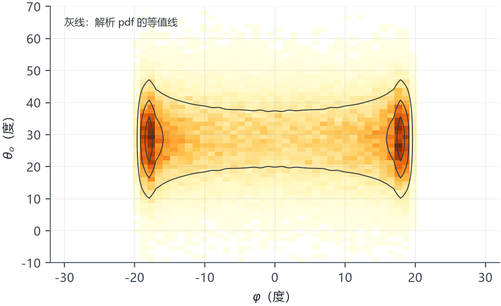
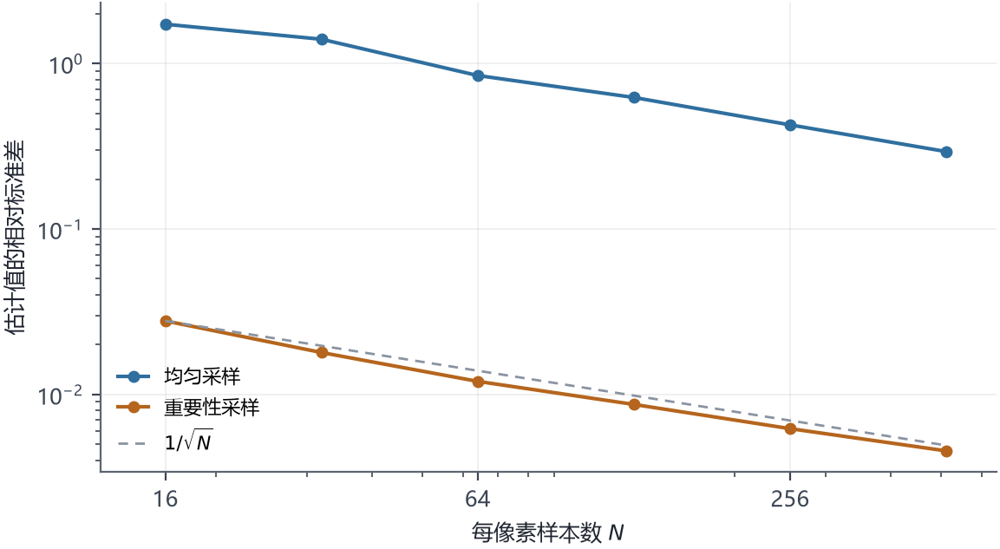

# 第 6 章 重要性采样

## 6.1 一个噪点很多的渲染

用 Marschner 模型渲染一头金发，每像素 16 个样本。图像上会出现两种噪点：一种在头发的高光带上，表现为细密的白点；另一种在头发的暗部与背景交界处，表现为大块的斑驳。

两种噪点的来源不同。高光带上的噪点来自采样的分布和函数形状不匹配：函数在 18 度处有两个尖峰，而采样是均匀的，绝大多数样本落在没有光的地方，偶尔有样本落进尖峰，就贡献一个大值。这种噪点在数学上叫方差，只能靠让样本落在该落的地方来解决。

这一章讲怎么让样本落在该落的地方，以及 pdf 怎么和函数配对。

## 6.2 把三个分布串起来

第 4 章把散射函数写成了路径、方位角、纵向角三部分的乘积。采样就按这个顺序来。

先决定走哪条路径。三条路径的能量是固定的，可以直接当成概率：

$$P(p)=\frac{E_p}{E_0+E_1+E_2} , \tag{6.1}$$

$E_p$ 由 (5.1) 给出。抽一个 $[0,1)$ 的随机数，落在累积概率的哪一段就走哪条路径。这样每个样本只处理一条路径，工作量降到三分之一。

再抽方位角。$M_p$ 没有解析的反函数，但它是闭合的曲线，可以预积成表。做法是把 $[-\pi,\pi]$ 分成 $n$ 个格子，逐格算 (4.1)，得到一张单调的累积分布表，采样时用逆变换：

$$\varphi=F_p^{-1}(u_2) , \tag{6.2}$$

$F_p$ 是表里插值出来的累积函数。表的精度取 0.5 度一格就够，再细对结果没有可见影响。

纵向角有解析的反函数。$N_p$ 是高斯与倾角分布的卷积，采样时反过来做：先按倾角的分布抽一个 $\alpha$，再从高斯里抽一个偏差 $z$，然后

$$\theta_o=\theta_i^{\mathrm{ideal},p}+2\alpha+\beta z , \tag{6.3}$$

$\theta_i^{\mathrm{ideal},p}$ 是这一阶的理想方向，$-\theta_i$ 或 $\theta_i$。这样采样得到的分布正好是 $N_p$，不需要查表，也不需要拒绝。

![图 6-1　左图是 TRT 的方位角累积分布与均匀分布（虚线）的对比，累积分布在 $[-20,20]$ 度之间从 0 走到 1，说明全部能量集中在这条窄带里。右图是按 (6.2) 采样四万个样本的直方图，与解析密度一致](../images/06/fig6-1-cdf.png)

图 6-1 的右图是验证：采样直方图与解析密度在统计误差内重合。这一步看起来是形式检查，实际上很有用——如果插值的方向搞反了，或者表的格子边界算错了半格，直方图会系统性地偏移，一眼就能看出来。

## 6.3 pdf 要配对

采样抽出来一个方向，接下来要算权重。重要性采样的估计量是 $f/\mathrm{pdf}$，这里 $f$ 是散射函数，pdf 是抽到这个方向的概率密度。

三个分布串起来，联合 pdf 是三者的乘积：

$$\mathrm{pdf}(\varphi,\theta_o)=\sum_p P(p)\,M_p(\varphi)\,N_p(\theta_o) . \tag{6.4}$$

如果实现里每个样本只处理一条路径（多数实现如此），那么对这条路径，pdf 是

$$\mathrm{pdf}_p(\varphi,\theta_o)=P(p)\,M_p(\varphi)\,N_p(\theta_o) , \tag{6.5}$$

而 $f$ 里只留这一条路径的项，$f_p=E_pM_pN_p$。两者相除，权重是

$$w_p=\frac{E_p}{P(p)}=E_0+E_1+E_2 , \tag{6.6}$$

一个与方向无关的常数。

这个结果值得停下来看一眼。它说明：如果采样分布严格正比于函数，权重就是常数，方差为零。这就是重要性采样的理想情形。实际渲染里权重不会是常数，因为还要乘上入射光、可见性、以及 $1/\cos$ 之类的几何因子，但那些乘子跟采样本身体系无关。

代价是每次都要为选中的路径单独算 $M_p$ 和 $N_p$，而不是算总和。这反而更便宜。



图 6-2 是二维情形的验证。横轴方位角，纵轴出射角，样本在 $\pm18$ 度附近分成两支，每支沿纵向拉长。解析等值线压在亮区上，形状和方向都对。

## 6.4 哪些地方会让 pdf 对不上

配对正确不等于实现正确。有四类错误在代码里很常见。

**第一类是漏掉路径概率。** 如果按 (6.1) 选路径，却用 $M_pN_p$ 作为 pdf（少了 $P(p)$），那么权重会带上 $1/P(p)$，TRT 的权重被放大二十多倍。图像上表现为第二道高光过亮，而且发色越深越亮——因为深发的 $P(TRT)$ 更小。

**第二类是坐标变换的雅可比。** 如果采样是在 $h$ 上做的（在 $h$ 上均匀采样，再映射到 $\varphi$），那么 pdf 里必须出现 $|d\varphi/dh|$。漏掉它就是第 4 章图 4-1 右图那条错误的曲线，权重在折返点附近会偏。

**第三类是立体角。** 有些实现把 $\theta$ 而不是 $\sin\theta$ 当作积分的测度。纤维的散射函数在定义时已经把立体角因子吸收进了 $M_p$（因为它是单位方位角的能量），所以再乘一次 $\sin\theta$ 就多了一个。判断方法很简单：白炉测试过不了，或者过得了但换个入射角就不过。

**第四类是拒斥采样的接受率。** 用拒斥采样时，如果拒绝之后忘了除以接受率，权重整体偏小一个常数，表现为图像整体偏暗。这类错误在白炉测试里会直接暴露。

## 6.5 方差能降多少

图 6-3 是一个直接测量。用一个固定的着色点，分别用均匀采样和重要性采样估计同一个积分，重复两百次，看估计值的相对标准差。



结果有两部分信息。

斜率相同，都是 $N^{-1/2}$。这是蒙特卡洛的固有速率，任何采样策略都改不了。重要性采样不能改变收敛速度，只能改变前面的常数。

高度差十几倍。在 256 个样本时，均匀采样的相对标准差约 0.07，重要性采样约 0.008。按 $1/\sqrt N$ 换算，要达到同样的精度，均匀采样需要大约二十倍的样本。

二十倍这个数字解释了为什么毛发渲染里几乎没有人用均匀采样。一根头发占几个像素，一个像素里可能有几十根纤维，每根纤维又要几个样本，样本预算本来就紧。省下二十倍意味着要么多渲染二十帧，要么把预算花在别的噪点上。

这个差距还有一个用法：既然三条路径的 pdf 形状差别很大，可以把它们混起来采。做法是先用一个粗的分布（比如 TT 的，它最宽）抽方向，再用三条路径各自的 $f$ 与混合 pdf 的比值作为权重，这就是多重重要性采样的思路。它在一条路径的峰正好落在另一条的谷里时特别有效——而 TRT 的两个峰正好落在 TT 的肩部。

混合 pdf 的写法是 $p_{	ext{mix}}=\sum_p w_p\,\mathrm{pdf}_p$，权重 $w_p$ 取各路径能量的平方根归一化，这是平衡启发式（balance heuristic）的一个常用近似。代价是每次采样要算三条路径的密度而不是一条，换来的是在任何视角下方差都不超过最好的单条路径的两倍。

## 6.6 采样失败时的降级

有一套情形会让重要性采样失效：函数的支撑比 pdf 的支撑更宽。

具体地说，$M_p$ 的表是在某个入射角和某个粗糙度下算的。如果着色时用的粗糙度比建表时大，真实分布会比表更宽，超出表范围的方向会被采到但权重算不对；反过来，如果粗糙度更小，采样会在一些几乎无光的方向上浪费样本。

两种情况的处理方式不同。分布变宽时，应该把表按当前粗糙度做一次卷积（相当于加一次模糊），或者退回到一个更宽的备用分布。分布变窄时不用管，只是浪费几个样本。

还有一类失败来自样本数。一个像素里几十根纤维，每根给三个样本，绝大多数样本落在几乎无光的方向上，贡献为零。自适应的做法是先用一个很粗的估计（一两根纤维、一个样本）判断这个像素有没有头发，没有就提前退出，有再分配剩下的预算。这个提前退出在轮廓密集的镜头上能省一半时间，代价是边缘的采样数比内部少，需要在后期做一次模糊把噪声抹平。

还有一类失败是数值的：$\theta_o$ 抽到了 $\pm90$ 度以外。这在物理上对应光沿纤维轴向走，模型里没有定义，应该把样本丢弃并记一次能量损失，或者把它夹到边界上。前者更安全，后者更快，但会引入偏差。

## 6.7 一个完整的采样函数

把前面的东西拼起来，一个能用的采样函数长这样。

```python
def sample_hair(T, N, B, wi, u):
    """u 是四个 [0,1) 随机数。返回 (wo, f, pdf)。"""
    theta_i, phi_i = tan_angles(T, N, B, wi)
    # 1. 选路径
    E = np.array([E0, E1, E2])          # 预计算的能量
    P = E / E.sum()
    p = np.searchsorted(np.cumsum(P), u[0])
    p = min(p, 2)
    # 2. 方位角：查表反演
    phi = np.interp(u[1], cdf_phi[p], edges_phi[p])
    # 3. 纵向角：解析反演
    alpha = inv_cdf_alpha(u[2])
    z = erfinv(2 * u[3] - 1) * np.sqrt(2)
    ideal = -theta_i if p != 1 else theta_i
    theta_o = ideal + 2 * alpha + beta_p[p] * z
    # 4. 拼出方向和权重
    wo = np.array([np.sin(theta_o) * np.cos(phi_i + phi),
                   np.sin(theta_o) * np.sin(phi_i + phi),
                   np.cos(theta_o)])
    f = E[p] * M[p](phi) * N[p](theta_i, theta_o)
    pdf = P[p] * M[p](phi) * N[p](theta_i, theta_o)
    return wo, f, pdf
```

这段代码里有三个地方值得看。

方位角用的是 `interp`，插值在累积分布上做，返回的是角度。注意累积分布的横轴是**累积概率**，不是角度；搞反了不会报错，只会把分布倒过来。

纵向角的 `ideal` 在三条路径上不同：R 和 TRT 用 $-\theta_i$，TT 用 $\theta_i$。TT 的 $\beta$ 也是其他两条的一半，因为两次折射压缩了微面的角偏差。

权重没有被显式算出来，因为 $f$ 与 $\mathrm{pdf}$ 只差一个 $E_p/P(p)$，而它是个常数。如果实现里乘上了入射光、可见性这些因子，就把它们乘到权重上，不要乘到 $f$ 里，否则 pdf 就不对了。

---

这一章的三件事可以连起来记。

采样按路径、方位角、纵向角的顺序串起来做，前两个查表，最后一个用解析反函数。pdf 是三者与路径概率的乘积，逐条路径分开算，算对了权重就是常数。

四类常见错误分别是漏路径概率、漏雅可比、多乘立体角因子、漏接受率。它们的共同特点是不会让程序崩溃，只会让能量错，所以只能靠白炉测试发现。

重要性采样把方差降了十几倍，收敛速度仍是 $1/\sqrt N$。这个比例决定了毛发渲染的样本预算，也决定了后面几章为什么要做 LOD 和预计算。

下一章换一个尺度看问题：不再看一根纤维，而是看一整束。
