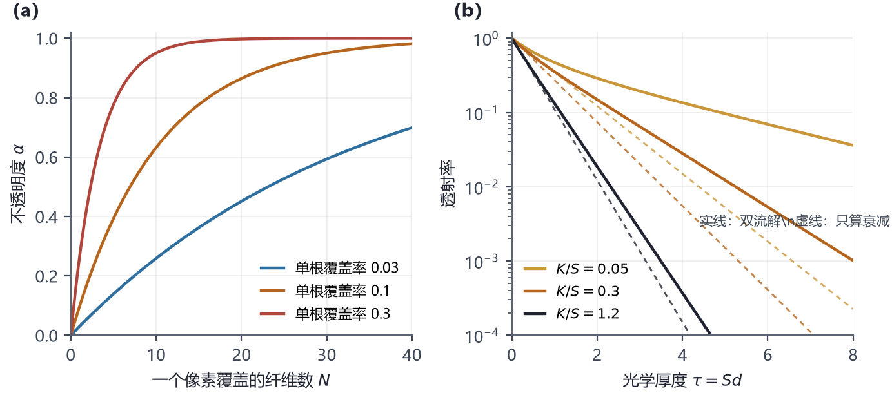
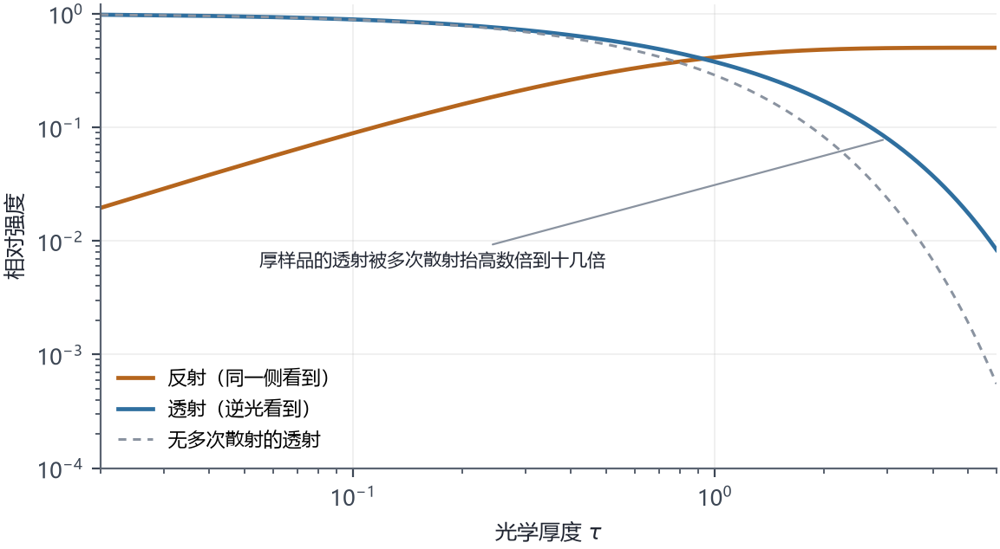
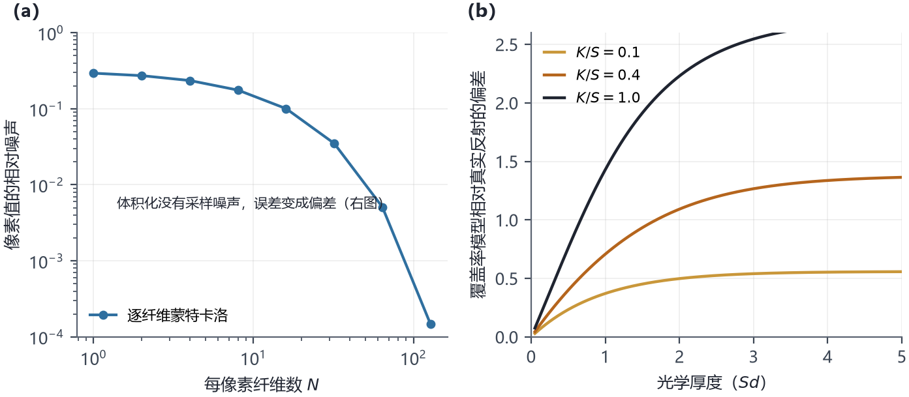

# 第 7 章 毛发作为介质

## 7.1 远处的一束头发

把相机退到十米外看一个人的头发。这个距离上一根头发只占一个像素的几十分之一，按照几何光学的算法，一个像素里要放几十根纤维，每根算一次散射，再平均。算得出来，但算不完：一头头发十万根，全景几百万像素。

而且算出来的图和眼睛看到的对不上。远处的头发不是"很多根细线"，它看起来像一片有厚度的雾：边缘柔软，逆光时整体发亮，中间有一条比周围更亮的芯。这些都不是单根纤维的行为，是很多根纤维叠在一起之后才出现的行为。

这一章把视角抬高一层：不再跟踪单根纤维，而是把一束头发当成一种介质，用体散射的语言描述它。这样做有两个好处，一是远距离的 LOD 有了物理依据，二是"深阴影里为什么发亮"这个问题终于能算。

## 7.2 覆盖率和 alpha

先从最简单的问题开始：一个像素里有多少根纤维，看起来有多不透明。

设单根纤维在这个像素内的投影面积占像素的比例为 $a$，像素里有 $N$ 根纤维，位置互相独立。这个像素被完全遮住的概率是

$$\alpha=1-\left(1-a\right)^N\approx1-e^{-Na} . \tag{7.1}$$

近似在 $a\ll1$ 时成立，而毛发正好满足这个条件：一根直径 80 微米的纤维在十米外，投影面积占一个像素的千分之一量级。

图 7-1 的左图是 (7.1)。它有一个容易被忽略的性质：$\alpha$ 增长得很快，$N=10$ 时（单根覆盖率 0.1）就到了 0.63，$N=30$ 时到 0.95。这意味着"看得见的头发"和"看不见的头发"之间只差几十根，LOD 的切换点必须落在这个区间里，否则会出现跳变。

## 7.3 把一束头发当成介质

$\alpha$ 只告诉我们"挡不挡光"，不告诉我们"挡下来的光去了哪"。要回答后者，需要给这束头发两个系数：消光系数 $\sigma_t$ 和散射系数 $\sigma_s$，以及一个描述散射方向分布的相位函数。

从单根纤维的散射函数积分出来：

$$\sigma_s=\rho\int_{4\pi}S(\omega_i,\omega_o)\,d\omega_o,\qquad \sigma_t=\sigma_s+\sigma_a^{\mathrm{eff}} , \tag{7.2}$$

$\rho$ 是单位体积内的纤维总长度。对一头头发，$\rho$ 的量级是每立方厘米几百米。$\sigma_a^{\mathrm{eff}}$ 是把纤维内部的吸收折算成体积吸收的结果，它比纤维本身的 $\sigma_a$ 小，因为只有一部分体积被纤维占据。

真正决定外观的是两个无量纲量的比值。定义单次散射反照率 $\varpi=\sigma_s/\sigma_t$，它描述一次碰撞后光还剩下多少；再定义光学厚度 $\tau=\sigma_t d$，它描述一段厚度里有几次碰撞。

毛发介质的 $\varpi$ 在 0.95 以上（浅色）到 0.3 左右（深色）之间。这个范围很宽，意味着同一套体积参数没法同时适配黑发和金发，第 9 章会说这件事。

相位函数也不能用各向同性的。单根纤维是强前向散射的（第 1 章图 1-3），一束头发继承了这个性质，用 Henyey–Greenstein 描述时各向异性因子 $g$ 在 0.6 到 0.8 之间。这个数字很重要：$g$ 大的介质，光会沿着入射方向钻得很深，逆光时的透射比各向同性介质强得多。作为对比，云和牛奶的 $g$ 都在 0.8 以上，皮肤在 0.7 左右，毛发落在同一个区间里。

## 7.4 双流近似

有了 $\sigma_t$、$\varpi$、$g$，可以解辐射传输方程。完整解很贵，毛发上用双流近似（Kubelka–Munk）就够。

双流把光分成两束：向前的 $I$ 和向后的 $J$。两束之间按散射系数交换能量，各自按消光衰减：

$$\frac{dI}{dz}=-(\sigma_a+\sigma_s)I+\sigma_s J,\qquad
\frac{dJ}{dz}=\sigma_s I-(\sigma_a+\sigma_s)J . \tag{7.3}$$

设 $K=2\sigma_a$，$S=\sigma_s$，令 $a=1+K/S$，$b=\sqrt{a^2-1}$，厚度 $d$ 的薄层的反射率与透射率是

$$R=\frac{\sinh(bSd)}{a\sinh(bSd)+b\cosh(bSd)},\qquad
T=\frac{b}{a\sinh(bSd)+b\cosh(bSd)} . \tag{7.4}$$

图 7-2 是这个解的图像。薄的时候（$\tau<0.3$）两条曲线几乎重合，因为光最多撞一两次，多次散射还没机会发生。厚的时候差得很远：$\tau=3$ 时纯衰减给出 0.024，双流解给出 0.09，差将近四倍；$\tau=6$ 时差十几倍。

这个差距就是"深阴影里的发光感"的来源。一头浓密的黑发，在侧光下本来应该是一片黑，但实际看起来是深灰，边缘还有一层暖色的光。原因是光钻进了头发内部，被纤维反复散射，一部分从原来进不去的方向出来了。纯衰减模型算不出这件事，因为它假设光一旦偏离入射方向就消失了。

## 7.5 体积化之后丢失的东西

把一束头发换成体积，会丢掉一些东西，值得列清楚。

丢掉的第一件是单根纤维的方位角结构。单根有 $\pm18$ 度的两个 TRT 峰，体积化之后方位角被平均掉，只剩下一个模糊的前向瓣。近处看会明显"少了丝"，远处看不出来。

丢掉的第二件是纤维之间的遮挡关系。真实的头发在掠射角下会看到一层层的纤维边缘，体积化之后变成光滑的衰减。

丢掉的第三件是切线方向。体积化之后没有切线这个概念，所有各向异性的高光都被抹平了。这就是为什么体积化的毛发在近处看起来"油"或者"塑料"。

丢掉的第四件更微妙：纤维在互相遮挡时产生的相互照明。近处的一束头发里，上面一根纤维会把光反射到下面几根上，下面的纤维因此比单独算出来更亮。体积化用单次散射加双流近似后能捕捉到总能量，但捕捉不到这种局部的"越靠里越亮"的梯度，结果是近处的发束看起来太平。

补救的办法是在体积化之外再保留一层壳：远离相机的那部分用体积，靠近轮廓的一层用一个薄的壳模型，壳里仍然按单根算，只是采样数降到一两个。这一层的开销不大，但它把轮廓上的高光和边缘光保住了，而这两样正是观众判断"这是不是头发"的主要依据。

所以体积化不能早切。经验的做法是：一个像素覆盖的纤维数超过 20 之后再切换到体积表示，切换时用 $\alpha$ 做过渡，同时保证两种表示在切换点的总能量一致。

## 7.6 LOD 的偏差

最后算一笔账，说明为什么"用一张 alpha 卡片代替一束头发"会出问题。

常见的做法是把体积化简化成覆盖率模型：亮度等于 $\alpha$ 乘以表面颜色。这个模型在薄的地方没问题，在厚的地方会高估。

图 7-3 的右图给出了偏差。$\tau=2$ 时，浅色头发的反射率被高估 40%，深色头发被高估 100% 以上。原因很简单：覆盖率模型认为"挡住的光都反射回去了"，而真实的介质会把大部分挡住的光吸收掉或者透过去。

这个偏差在画面上表现为：远处的一团黑发看起来比近处亮，切换点上出现一圈亮边。修的办法是在覆盖率模型里乘一个因子，因子等于 $R_{\mathrm{KM}}/(1-e^{-\tau})$，它由 (7.4) 给出，可以预先算成一张按 $\tau$ 和 $\varpi$ 索引的小表。

切换本身也要做过渡。直接按距离一刀切会在边界上出现一条环形接缝，因为两种表示在同一位置给出的亮度不同。做法是在一个距离区间内把两者按权重混合，权重随距离线性变化，同时保证两种表示的相机空间深度一致——深度不一致会让景深和运动模糊在接缝处露馅。

## 7.7 一致性

体积表示和单根表示必须在某个尺度上接得上，否则 LOD 切换会跳。

接得上的条件是三个量相等：总消光、总反照率、前向散射的比例。前两个可以从单根散射函数的积分直接算，第三个等于单根散射函数在前向半球上的积分除以总积分。

有一件事容易被忽略：单根模型的能量本来就不足（第 5 章的白炉测试只到 0.92 到 0.99），如果用这个不足的能量去对齐体积表示，体积表示也会偏暗。所以在做 LOD 之前，先把单根模型的能量补到 1。

## 7.8 从单根到体积的参数换算

实现时最常被问到的问题是：体积参数到底怎么从单根模型里算出来。

答案是把单根散射函数在球面上积分。设单位体积内纤维的总长度为 $\rho$，一根纤维的散射截面是

$$\sigma_{s}^{\mathrm{单根}}=\int_{4\pi}S(\omega_i,\omega_o)\,d\omega_o , \tag{7.5}$$

那么体积散射系数是 $\sigma_s=\rho\,\sigma_s^{\mathrm{单根}}/2$，分母的 2 是因为一根纤维被两个方向的光均匀照射，它的截面两边都要算。

这个积分里有一个容易忘的细节：$S$ 已经归一化到单位方位角能量，直接对立体角积会多乘一个 $\sin\theta_o$。正确的做法是把 $S$ 当成定义在（$\varphi,\theta_o$）上的密度，积分量是 $d\varphi\,d\theta_o$，不是 $d\omega_o$。

相位函数则用同一个积分归一化后的形状拟合一个 Henyey–Greenstein，得到 $g$。由于单根纤维是强前向的，拟合出来的 $g$ 会在 0.7 以上，比一般的布料或皮肤高很多。

这三个量算完，体积表示与单根表示就在能量上对齐了。剩下的差异只在角度分布的形状上，而那个差异正是第 7.5 节列的“丢失的东西”。

---

这一章换了一个尺度。

一束头发可以用覆盖率 $\alpha=1-e^{-Na}$ 描述"挡不挡光"，用消光系数和散射系数描述"挡下来的光去哪"。双流近似给出了厚样品的反射与透射，它比纯衰减高出一个量级，这就是深阴影发光的原因。

体积化会丢掉方位角结构、层间遮挡和切线方向，所以不能早切。切换时要注意覆盖率模型会高估反射，偏差随光学厚度和吸收增长，需要按双流解做一个修正表。

下一章把这些东西写成可以运行的代码。
