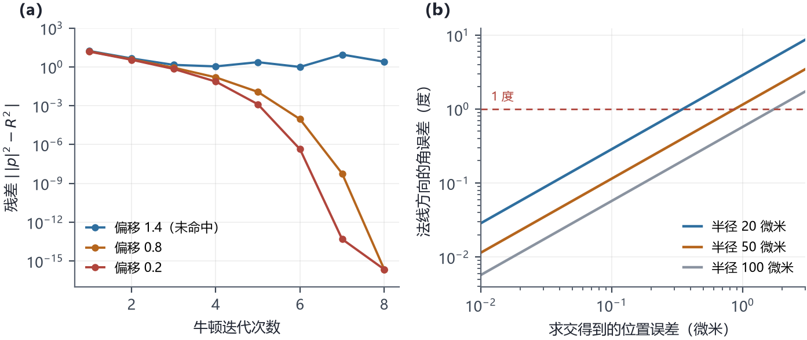
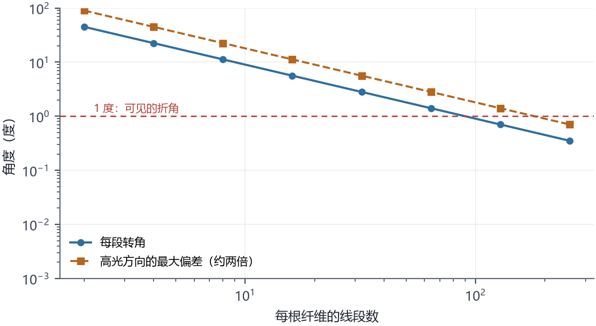
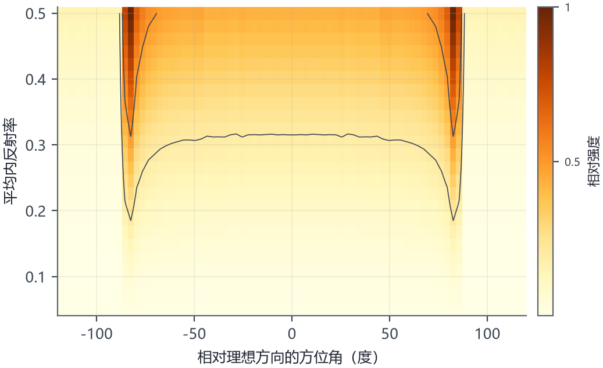

# 第 8 章 路径追踪实现

## 8.1 从公式到代码的距离

模型在纸上写完了，实现出来却对不上。最常见的情形是：单根纤维单独渲染，高光的位置对；放进场景里，头发整体发暗；加一根光源，暗部出现条带；换成相机拉远，边缘出现硬边。

这些问题里很少有一条是公式写错的。多数来自公式之外的东西：求交的精度、切线的插值方式、阴影光线的处理、查找表的插值方式。

这一章按渲染器执行的顺序走一遍：求交、定切线、着色、阴影、LOD，每一段指出容易出错的地方和判断标准。

## 8.2 求交：位置误差就是法线误差

头发的几何通常表示成一串控制点连成的曲线（Catmull-Rom 或 B 样条），或者一串线段。光线与它求交，等价于求光线与一系列半径 $R$ 的圆柱的交。

圆柱求交有解析解，但实现里常用两个替代方案：一是把曲线细分成线段，与线段扫出的圆锥求交；二是用距离场，对参数 $t$ 做牛顿迭代。

第二种的收敛很快。设当前参数为 $t$，定义残差 $f(t)=|P(t)|^2-R^2$，其中 $P$ 是光线上的点到轴的距离向量，牛顿更新是

$$t\leftarrow t-\frac{f(t)}{f'(t)} . \tag{8.1}$$



图 8-1 的左图给出了收敛速度：命中时残差每步下降 2 到 3 个数量级，5 次以内足够；未命中时残差保持在初始量级，可以直接判定为不相交，二分终止。

右图是更有用的信息。法线的角误差约等于位置误差除以曲率半径：

$$\delta\theta\approx\frac{\delta s}{R} . \tag{8.2}$$

半径 20 微米时，0.35 微米的位置误差就给出 1 度的法线误差。1 度听起来很小，但高光的角宽度只有几度，1 度的法线误差会让高光的位置偏出可见范围，表现为高光闪烁。这就是毛发渲染里"焦散闪点"的主要来源。

所以要保证位置误差小于 $R/50$，也就是 0.4 微米量级。用浮点数时这个要求不高，但如果用了把整根纤维归一化到单位长度的参数化，$R$ 会变得很小，精度立刻不够。

## 8.3 细分：折角会把高光切断

一根弯曲的头发如果用折线表示，每个折点都是一个法线不连续的位置。光打到折点上，法线有两个可能值，高光会在这里断开。



图 8-2 是这笔账。一根总转角 90 度的头发，分成 8 段时每段转 11 度，高光方向偏差约 22 度，明显可见；分成 64 段时每段 1.4 度，偏差 2.8 度，勉强可以；要到 128 段以上才低于 1 度。

这个数字决定了细分量。一帧里十万根头发，每根 128 段，就是一千多万段，求交成本会占满整个预算。实际的做法是按屏幕导数决定细分：远景下高光的宽度本来就被像素覆盖掉了，折角看不见，可以少分几段。

切线本身也要插值。相邻两段之间的切线如果直接取线段方向，角度会在折点处跳变；如果按参数插值，就要保证插出来的切线落在两个端点切线之间且长度归一。线性插值后归一已经够用，因为两端切线夹角通常小于 30 度，线性插值与球面插值的方向差在 1 度以内。

## 8.4 着色：切线空间的构造

到了着色这一步，需要的量只有四个：位置、切线 $T$、入射方向、视线方向。法线不需要，因为模型里用的角度都是相对切线的。

从切线构造一个正交基，把入射光和视线投影进去，算两个夹角：

```python
import numpy as np

def hair_frame(T):
    T = T / np.linalg.norm(T)
    # 任取一个与 T 不平行的向量，构造正交基
    a = np.array([0.0, 0.0, 1.0])
    if abs(np.dot(a, T)) > 0.9:
        a = np.array([1.0, 0.0, 0.0])
    N = np.cross(T, a)
    N /= np.linalg.norm(N)
    B = np.cross(T, N)
    return T, N, B

def tan_angles(T, N, B, w):
    """返回 (与切线的夹角, 绕轴的方位角)。"""
    tc = np.clip(np.dot(w, T), -1.0, 1.0)
    theta = np.arccos(tc)
    phi = np.arctan2(np.dot(w, B), np.dot(w, N))
    return theta, phi
```

基向量的选择影响方位角的零点，但不影响物理结果，因为模型只依赖两个方位角之差。实现时要保证入射和出射用同一套基，否则差值会差一个常数。

角度算出来之后按 (3.6)、(3.8) 求三个路径的贡献，按 (6.5) 求 pdf，乘上入射光和透射率。

在 GPU 上，这段代码的第一个问题是分支。三条路径的工作量不同，如果按路径分叉，同一个 warp 里的线程会走不同的分支，串行执行三次。省事的做法是把三条路径都算完再按概率加权求和，没有分支，代价是三次查表。查表是纯内存访问，在现代显卡上比分支便宜。

第二个问题是指令数。毛发着色的指令数通常是普通材质的五到十倍，一个像素里又有几十根纤维，很容易成为瓶颈。实务上的取舍是：近处逐纤维算，远处按第 7 章的办法切体积，中间过渡区降低纤维数、提高每根纤维的样本数。

## 8.5 阴影：多根纤维的透射

一根头发的阴影里还有别的头发。逐根求交太贵，常用的做法是把每根纤维当成一个半透明的遮挡体，用概率透射：

$$T=\prod_{i}\left(1-\alpha_i\kappa\right) , \tag{8.3}$$

$\alpha_i$ 是第 $i$ 根纤维在阴影光线截面上的覆盖率，$\kappa$ 是一个可调的整体系数。当纤维很多时，这个乘积趋近于 $e^{-\sum\alpha_i}$，和第 7 章的 (7.1) 一致。

实现上有两种取样方式。一是沿阴影光线等距取若干层，每层统计覆盖的纤维数，累加光学厚度，最后取指数。二是对每一层只取一根纤维做随机遮挡判断，用二值结果的平均去估计透射。前者没有噪声但有偏（层数有限），后者无偏但噪声大。生产实现通常用前者，因为头发的阴影本来就软。

逐层统计的成本仍然随层数线性增长。更省的做法是把一束头发的光学厚度预烘到一张贴图里，运行时只做一次纹理采样。贴图的每个纹素存两个量：该方向上的平均光学厚度，以及该处的平均纤维方向。后者用来把入射角的余弦折进去，因为斜着穿过一束头发的路径更长。

这种透射率贴图有一个已知的缺陷：它是各向同性的，不区分"从左边穿透"和"从右边穿透"。对发束这种细长结构，两个方向的实际厚度可以差一倍以上，误差表现为逆光时发束的一侧偏亮。补救的办法是存两个方向，用时按视线方向插值，代价是贴图大小翻倍。

还有一件事容易被彻底忽略：头发的阴影里也应该有高光。严格来说，一根纤维挡住另一根纤维时，被挡住的那部分光会在遮挡者的表面反射，反射的方向又可能进入相机。用纯透射的阴影模型会把这部分抹掉，结果是头发的暗部缺少那种"点状的微光"。这一项通常在后期补，而不是在阴影里算。

## 8.6 双散射的预计算

第 5 章说过，$p\ge3$ 的路径能量不能忽略，但逐阶计算太贵。做法是预计算一张表：横轴方位角，纵轴平均内反射率，表里存的是高阶路径的方位角分布。



图 8-3 是这张表的数值结果。它有两个性质值得注意。

一是它在纵向上变化很慢。$\bar F$ 从 0.05 到 0.5，表里的形状几乎不变，变的只是整体幅度。这意味着表可以只存两三个 $\bar F$ 的值，中间插值。

二是能量集中在 $\pm80$ 度附近。这个位置比 TRT 的两个峰（$\pm18$ 度）远得多，因为高阶路径在方位角上被旋转了多次。绝对强度不高，但在逆光时它贡献了边缘的那层亮。

表的精度取 2 度一格、$\bar F$ 取 8 档就够，因为高阶分量本身是平滑的，插值误差远小于它占的比例。

## 8.7 代码怎么分层

把上面几件事组织起来，一个毛发渲染器可以分成四层。

几何层负责求交和切线，输出 (位置, 切线, 参数 t)。这一层的正确性可以用"法线误差小于 0.4 度"来验收。

散射层是纯函数，输入两个方向、切线、材质参数，输出 (bsdf, pdf)。它不依赖场景，可以单独测试，测试方法是白炉积分等于 1。

采样层负责按 pdf 抽方向，输入随机数，输出方向和 pdf。它的正确性用直方图对解析密度来验收，也就是图 6-1 的做法。

积分层负责把所有东西串起来：发射、求交、着色、采样、俄罗斯轮盘、累加。这一层的错误最难定位，因为它依赖前三层都正确。

分层的价值在于定位。图像不对时，先跑散射层的白炉测试，如果不等于 1 就不用往下查；如果等于 1，再跑采样层的直方图；两层都对，问题一定在积分层或几何层。这套流程能把排查时间从几小时压到几分钟。

## 8.8 一个最小可用的数据结构

把上面四层写成代码，核心数据结构很小。

```python
from dataclasses import dataclass, field
import numpy as np

@dataclass
class HairMaterial:
    eta: float = 1.55
    beta: float = 0.18           # 纵向粗糙度
    alpha_tilt: float = 0.06     # 鳞片倾角标准差
    melanin: float = 0.35
    redness: float = 0.2
    fbar: float = 0.25           # 平均内反射率
    cdf_phi: np.ndarray = field(default=None)   # 三条路径各一张
    edges_phi: np.ndarray = field(default=None)
    lut_dual: np.ndarray = field(default=None)  # 双散射查找表
```

表没有放进类里每次都算，而是在材质初始化时生成一次。理由是表的生成要跑几千次射线追踪，而着色时要跑几百万次，两者不在同一个量级。

三条路径的累积分布表可以拼成一个二维数组，第一维是路径编号。这样采样时不需要分支，直接索引，在 GPU 上尤其重要。

双散射表存的是（方位角，平均内反射率）网格上的值，分辨率取 180×8 就够，因为高阶分量本身很平。采样时直接双线性插值，不需要再归一化——它在生成阶段已经归一过了。

---

这一章讲的是实现，但要记住三件事。

精度是有物理含义的：位置误差除以半径就是法线误差，1 度就开始出问题，所以求交精度要按 $R/50$ 要求。

细分决定高光是否连续：每段转角超过 1 度就会看到折角，按这个标准反推需要的段数。

分层的目的是定位：散射层用白炉测，采样层用直方图测，几何层用法线误差测，三层都过再查积分层。

下一章回到美术那边：这些参数怎么从参考照片里定出来。
