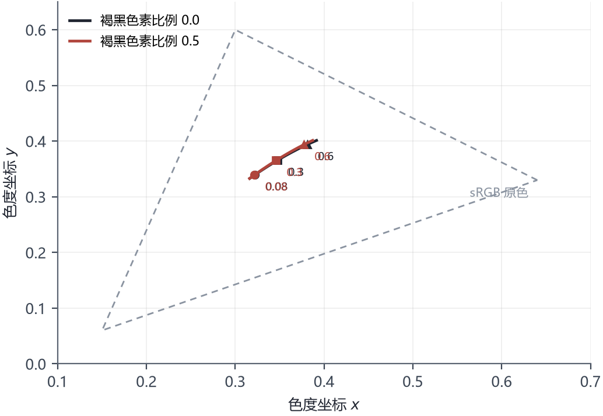
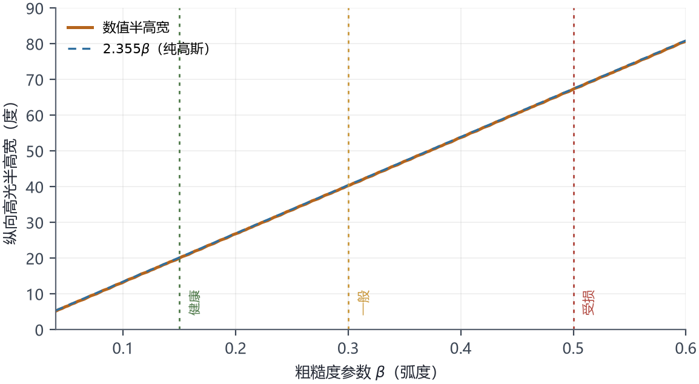
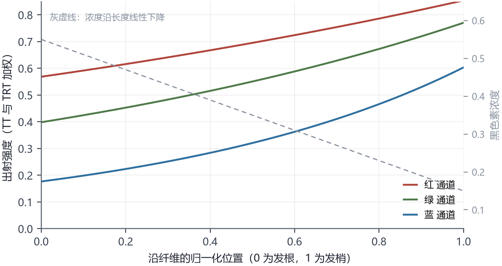

# 第 9 章 参数标定与美术控制

## 9.1 一段参数面板

美术拿到毛发材质，面板上有五个滑块：颜色、粗糙度、光泽、随机化、透光。他要把参考照片里的头发调出来，做法通常是来回拖，直到"看着像"。

拖出来的结果往往在某个光照下对，换一个光照就散了。原因不是他调得不好，而是这五个滑块和模型的参数之间没有明确的对应：颜色对应什么？光泽对应 $\beta$ 还是对应 Fresnel？透光对应哪一阶路径？

这一章做的是把面板上的滑块和模型参数对起来，让每一次拖动都有可预测的后果，并且给出从照片反推参数的方法。

## 9.2 五个参数和它们的可测量量

模型里真正自由的参数只有四个半。

折射率 $\eta$ 不是自由参数，取 1.55。它对角度的影响小于 1 度，把它当常数不会错。

粗糙度 $\beta$ 是可测的。它等于纵向高光半高宽除以 2.355，图 9-2 会给出这条关系。从一个正面光、光位明确的照片里量出高光的宽度，就能反推。

鳞片倾角的标准差也是可测的，但它对图像的影响和 $\beta$ 混在一起，实际标定时通常固定成 0.06 弧度，只调 $\beta$。

黑色素的两个量（浓度和褐黑比例）决定颜色。它们可以从照片的色度反推，但要注意亮度也受影响，两个信息要分开用。

最后半个是双散射的强度系数。它不该是自由的，由 (5.2) 决定。

## 9.3 从颜色反推黑色素

把 (3.9) 里的透射率当成反射色，代入 sRGB 的三刺激值，就得到一条在色度图上的轨迹。

图 9-1 有几个信息。

轨迹是一条短弧，从 $(0.32,0.33)$ 走到 $(0.44,0.42)$ 附近，方向是朝红偏。这说明只靠调浓度，能得到的色相范围很窄——从浅金到深棕，不可能调到纯红或纯紫。这也是真实头发的情况：天然发色都落在一条窄带上。

褐黑色素比例提高，轨迹整体往红的方向偏一点，偏移量很小。这意味着"红发"这个效果，靠比例是调不到高饱和的，需要额外加一层染色（把 $\sigma_a$ 整体系数按通道改）。

浓到一定程度之后，三个通道一起压到接近零，色度坐标变得不可靠（分母趋零），而视觉上已经是黑。所以标定时要同时看亮度：亮度低于某个阈值之后，色相不再重要。

实操的流程是：先取照片里最亮的一块头发（通常是高光旁那块），读它的 RGB，除以照明强度，得到相对反射率；再在图 9-1 的轨迹上找最近点，读出浓度；最后用亮度残差修正照明强度的估计。迭代两三次就收敛。

## 9.4 从高光宽度反推粗糙度

纵向高光的半高宽和 $\beta$ 的关系几乎是线性的：

$$\text{FWHM}\approx2.355\,\beta . \tag{9.1}$$

系数 2.355 来自高斯：高斯的标准差与半高宽之比是 $2\sqrt{2\ln2}\approx2.355$。

图 9-2 验证了 (9.1)。数值结果与解析式在整个范围内偏差小于 1 度，说明倾角（0.06 弧度）的贡献相对 $\beta$ 可以忽略。这条关系的实用价值在于：它把"看起来多亮"变成了"高光多宽"这个可以直接在照片上量的量。

测量的步骤是：找一块受单一光源照射、光位大致已知的头发；沿垂直于纤维的方向取一条亮度剖面；找峰值和半高点，量出角度宽度；除以 2.355 得到 $\beta$。

有两个坑。一是相机的动态范围：如果高光过曝，峰值被削平，量出来的宽度偏大。二是像素分辨率：一根头发只有几个像素时，宽度会被采样展宽，量出来也偏大。两个坑的方向相同，都会把 $\beta$ 估高，结果是渲染出来偏哑光。

典型值可以当起点：健康未染的头发 $\beta$ 在 0.12 到 0.18 之间；经常造型、热损伤的在 0.25 到 0.35；漂过的可以到 0.5 以上。这些数字对应图 9-2 上的三条竖线。

## 9.5 沿纤维的变化与随机化

真实头发不是均匀的。同一根头发，发根比发梢深；同一头头发，不同区域的纤维粗细、颜色、卷曲度都不同。

图 9-3 是发根到发梢的渐变。浓度从 0.55 线性降到 0.15，三个通道都上升，蓝色上升得最多（因为它的吸收系数最大，浓度下降时释放得最多）。结果是从发根到发梢，颜色变浅、饱和度下降。

这个渐变值得做成默认行为，因为它是真实头发的普遍特征：发梢经历的时间长，色素被分解了一部分。

随机化要分三个层次，混在一起会出问题。

纤维之间的随机化是最重要的一层。每根纤维的 $\beta$ 和浓度各给一个小的抖动（$\beta$ 抖动 ±0.02，浓度抖动 ±0.05），可以让整片头发不显得像一整块。抖动幅度太大会显得脏，太小会显得平。

沿纤维长度的随机化决定"发丝感"。每根纤维沿长度有几个起伏，幅度比纤维间的小一个量级。这一层如果做得太规则，会看到明显的周期性条纹。

发束之间的随机化决定"束感"。真实头发是成束的，束与束之间的方向、粗细、颜色都不同。这一层通常在几何上做，不在着色上做。

## 9.6 美术操作和物理参数的对应

面板上的常见操作，翻译成物理参数是这样。

"加点红光"——提高褐黑色素比例，或者直接给 $\sigma_a$ 的红通道乘一个小于 1 的系数。前者物理上正确但饱和度有限，后者能到高饱和但要小心能量。

"更哑光"——提高 $\beta$。代价是高光变宽、第二道高光被抹平，因为 (9.1) 对两条路径都成立。

"更亮"——先确认是亮度不够还是能量不够。如果是整体偏暗，检查白炉测试；如果只是高光不够亮，那是 $\beta$ 和 Fresnel 的事，不要动颜色。

"更透"——提高双散射的权重，或者降低浓度。两者在视觉上都能让逆光更亮，但前者只影响 $p\ge3$，后者影响所有进入纤维的路径，效果不同。

"更有层次"——加纤维间的随机化，不要加沿长度的随机化。前者产生层次，后者产生条纹。

## 9.7 标定流程

把上面这些串起来，一个可用的流程是五步。

先从参考照片里选三块区域：一块高光、一块中间调、一块暗部。读它们的 RGB。

用高光那块反推 $\beta$：量宽度，除以 2.355。注意排除过曝的像素。

用中间调那块反推黑色素浓度：把 RGB 归一化，在图 9-1 的轨迹上找最近点。

用暗部那块检查双散射：如果渲染出来的暗部比参考暗，说明高阶路径的能量不足，回去看 $\bar F$ 和吸收的取值。

最后对照发根发梢的差异，加一层沿长度的浓度渐变。

这五步走完，参数一般能落在参考照片的 10% 以内。剩下的差异通常是照明估计的误差，不是材质参数的误差。

## 9.8 一份可用的默认预设

标定之前，先有一个合理的起点能省很多时间。下面这组值是从第 3、4、9 章的公式和典型值里收拢的，适合作为新建材质的默认。

| 参数 | 默认值 | 改动方向 |
|---|---|---|
| 折射率 | 1.55 | 不建议改 |
| 粗糙度 $\beta$ | 0.18 | 大→哑光，小→锐利 |
| 鳞片倾角 | 0.06 | 大→第一道高光偏得多 |
| 黑色素浓度 | 0.35 | 大→暗、饱和度上升 |
| 褐黑比例 | 0.2 | 大→偏红 |
| 平均内反射率 | 0.25 | 大→逆光更透 |

有两件事默认就要打开，不要当选项。

一是沿纤维长度的浓度渐变。上深下浅是真实头发的普遍特征，没有它整片头发会显得平。幅度取 30% 到 40%，从发根到发梢。

二是纤维间的参数抖动。粗糙度抖 ±0.02，浓度抖 ±0.05。不抖的话，同一束头发的纤维会同时亮同时暗，看起来像塑料丝。

还有一个常见的坑：默认值不能直接从“黑发”开始调。黑发的总反射率只有 0.3，大部分能量被吸收，很多问题（双散射不足、能量不守恒）在黑发上看不出来。先用浅金调，调完再往深里走。

## 9.9 光源与白平衡

标定失败的案例里，有一半不是材质的问题，是照明的问题。

参考照片里的头发颜色是"头发的反射率乘以光源的光谱"，而模型的参数描述的是反射率。两者之间差一个未知的乘数，如果不把它消掉，反推出来的浓度一定是错的。消掉的办法有两个。

一是用照片里一个已知反射率的物体做参照，比如一张灰卡、一件白衬衫、或者墙面。把它的 RGB 读出来，就得到光源的相对光谱，再用它去除头发的 RGB。这是最可靠的做法，但要求照片里有参照物。

二是用头发自身的高光做参照。第一道高光来自表面反射，不经过吸收，它的颜色就是光源的颜色（严格说是光源乘以 Fresnel 的波长依赖，后者在可见光内几乎恒定）。把高光区的 RGB 当成光源，用它去除中间调，就得到相对反射率。这个办法不需要参照物，但要求高光没有过曝，而且高光区域要足够大。

两种办法都会留下一个残差：相机响应曲线。消费级相机的 JPEG 输出经过了一次未知的色调映射，直接读 RGB 会得到偏暗的中间调，反推出的浓度会偏低。解决的办法是拍 RAW，或者用相机自带的配置文件把 JPEG 反算回线性空间。没有这一步的话，标定的精度最多到 20%。

最后一点：毛发在强光下会有一点荧光一样的增亮感，那是多次散射加上颜色饱和的综合效果，不是真的荧光。渲染时不要给它加自发光，那会把白炉测试搞坏。

---

这一章把滑块和参数对起来了。

颜色只由黑色素的两个量决定，它们对应色度图上一条窄弧，能覆盖的范围就是天然发色的范围。粗糙度对应高光半高宽除以 2.355，可以从中直接量出来。发根到发梢的浓度梯度要默认加上，随机化要分三层做。

标定的顺序是：宽度定 $\beta$，色度定浓度，亮度校双散射。

下一章讲怎么证明这些都对。
