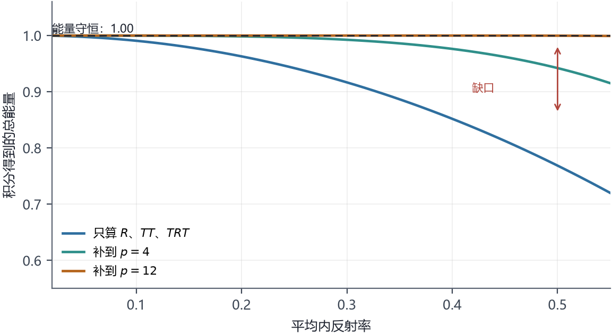
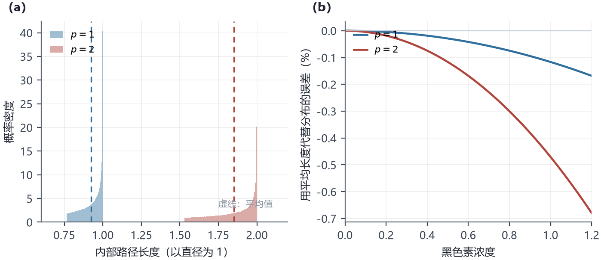
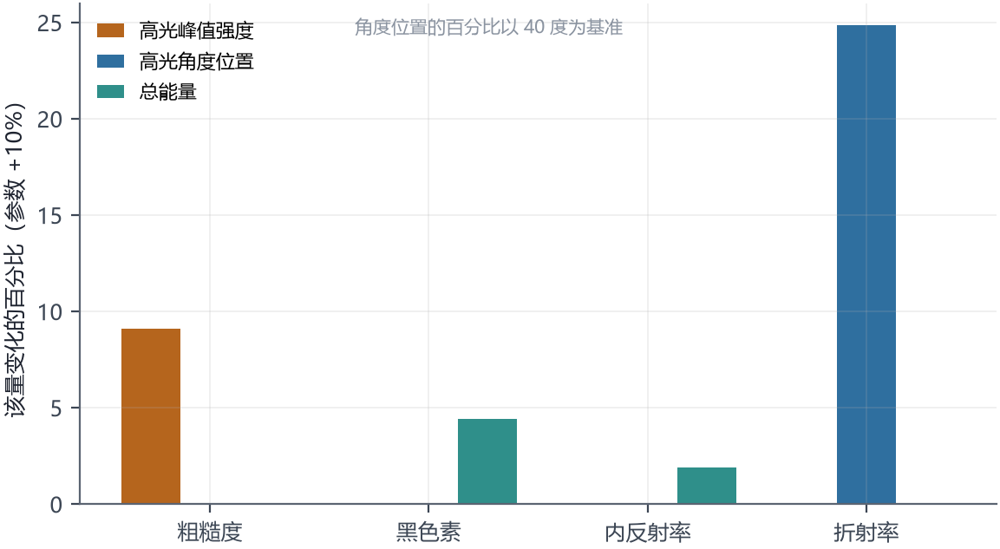

# 第 10 章 验证

## 10.1 看着对和真的对

一头头发渲染出来，美术说"像"，导演说"过"。三个月后同一个材质放进另一个镜头，光位变了，高光跑到了不该在的地方，颜色也偏了。

这类问题在制作流程里非常昂贵，因为发现得太晚。它们本来可以在一开始就被抓住，只要有一个不依赖眼睛的判据。

这一章给出四个这样的判据：能量守恒、路径长度分布、与参考的对比、参数敏感性。前三个是正确性检查，第四个是稳定性检查。

## 10.2 白炉测试

最有效的检查是白炉测试：把材质放进一个各方向亮度相同的环境，渲染结果应该处处等于环境亮度。

对毛发，这个检查可以用一维积分做完，不需要渲染器。散射函数在半球上的积分应该等于 1：

$$\int S(\omega_i,\omega_o)\cos\theta_o\,d\omega_o=1 . \tag{10.1}$$

前面三章的所有近似都可以在这里汇总成一条曲线。

图 10-1 有三条信息。

只算 R、TT、TRT 时，能量从 1.00 掉到 0.73，掉的幅度由平均内反射率决定。这就是第 5 章那个缺口，现在有了确切的数字。

补到 $p=4$（也就是加双散射）能把缺口补到 0.91 左右，剩下的 9% 需要更高阶。

补到 $p=12$ 时曲线回到 1.00，误差在千分之一以内。

通过标准要定得比想象中严。眼睛能看出的亮度差异大约 2%，但能量误差会通过多次反弹累积，一次 2% 在十次反弹后变成 18%。所以白炉测试的容差应该定在 1%。

测试时要注意一件事：积分要在出射半球上做，权重要带 $\cos\theta_o$。用 $d\omega_o$ 而漏掉余弦是常见的错误，结果是能量偏高，而且偏得没有规律。

积分的分辨率也要够。白炉测试的积分核是一个在 $\pm18$ 度处有尖峰的函数，用 32×32 的网格去积，会把这几个尖峰整个漏掉，算出来的能量偏低 10% 以上，看起来像是模型丢了能量。这不是模型的问题，是积分的问题。

判断办法是把网格加密一倍，看结果是否稳定。如果从 32 加到 64 结果变了 5%，说明分辨不够，继续加密直到变化小于 0.5%。对毛发，一个稳妥的取值是方位角 720 格、竖向 360 格，代价是单次测试几十秒，可以接受。

还有一件事：测试用的方向要覆盖整个半球，不能只测几个特殊角度。有些实现只在垂直入射下测，那个角度上下对称、折返点在正中间，很多错误在这个角度上正好抵消。至少要在入射角 0、30、60、85 度各测一次。

## 10.3 路径长度分布

第二个检查针对吸收项。

吸收项里用到的路径长度 $L_p(h)$ 实际上是随 $h$ 变化的，从 $2p$（穿过圆心）到 $2p\cos\theta_t^{\max}$（掠射）。实现里通常用一个平均值代替，这个近似合不合理需要用分布来回答。

图 10-2 给出了答案，而且答案有点出乎意料。

分布很窄。$p=1$ 的长度在 1.53 到 2.00 之间，八成落在 1.8 以上；$p=2$ 在 3.06 到 4.00 之间，形状相同。原因是 $L=2p\cos\theta_t$ 里的 $\cos\theta_t$ 在 $h$ 的整个范围里只从 1 降到 0.76，变化有限。

用平均值代替的误差不到 0.7%。$p=2$ 的误差比 $p=1$ 大一倍，因为它路径长、吸收累积得多，但这仍然远小于 1%。

这个结论的价值在于告诉实现者哪里可以偷懒。吸收项可以用一个标量长度，不需要对每个样本算 $L(h)$，省下的计算可以放到别处。反过来说，这也意味着不必为"路径长度的分布"建表。

需要提醒的是，这个结论只在圆截面假设下成立。如果纤维截面是椭圆（真实头发接近椭圆，长短轴比 1.2 到 1.4），长度的变化范围会大一些，误差会涨到 2% 到 3%，仍在可接受范围内，但不再是"可以忽略"。

## 10.4 与参考对比

第三个检查是与参考对比。参考有三个层次，从便宜到贵。

第一层是解析参考。对于 $h\to0$ 的极限，出射方向、能量、路径长度都有闭式解，可以逐项对照。这一层能抓住公式抄错、符号搞反。

第二层是暴力蒙特卡洛。不用任何表，直接在 $h$ 上均匀采样，对每个样本追踪一次，统计出射方向的直方图。把它和解析的表对比，能抓住表生成时的错误：格子边界差半格、插值方向反了、归一化做漏了。

第三层是照片。这一层最难，因为照片里混了照明、相机响应、后期。做法是选一个光照简单的场景（单光源、暗背景），把渲染结果和照片放在同一个色度坐标里比，只在色度上比，不比亮度。

三个层次查出的错误类型不同，不能互相替代。第一层查公式，第二层查实现，第三层查参数。

## 10.5 四个常见错误

有四个错误在实际项目里反复出现，每一个都能用上面某个检查抓住。

**TRT 的权重不归一化。** 做表时用 $A_p(h)$ 的和作为表值，忘了除以积分，结果三条路径的总能量不是 1 而是 $\sum E_p^2$ 之类的东西。用白炉测试一测就露馅，表现为能量随发色变化。

**pdf 少乘雅可比。** 采样在 $h$ 上做，映射到 $\varphi$ 时忘了 $|d\varphi/dh|$。这个错误不改变能量（因为 pdf 和 f 用同一个错），但改变分布的形状：第二道高光会跑到 0 度附近，两个峰合成一个。用第三层参考（照片）能看出来。

**双散射超能量。** 高阶项的能量系数是独立调的，调完之后总能量超过 1。白炉测试能抓住，但要注意测试的时候必须把双散射打开，只测单次散射是看不出这个问题的。

**法线用错。** 在切线的正交化里用了不稳定的构造，导致近距离时坐标基跳变。这类错误在静态图上看不出来，一旦镜头移动就看到高光闪烁。检查方法是让相机沿一段圆弧缓慢移动，看高光是否连续。

## 10.6 参数敏感性

最后一个检查针对稳定性：参数变化 10% 时，输出变化多少。

图 10-3 的结果值得逐条读。

粗糙度加 10%，高光峰值降 9%。这是直接的：峰值反比于宽度，宽度正比于 $\beta$。所以粗糙度是最敏感的形状参数，标定时要量准。

黑色素加 10%，总能量降 4%。这个系数可以用来判断"颜色调不对"是不是浓度的问题：如果亮度差 4%，调浓度；如果差 20%，那不是浓度。

内反射率加 10%，单次散射的能量降 2%。它不敏感，所以这个参数可以从别的地方估一个值，不必精确。

折射率加 10%，第二道高光的角度位置移动 10 度。这是四条里最敏感的。它说明 $\eta$ 不能随便取：取 1.55 还是 1.7，第二道高光会差 10 度，肉眼可见。真实头发的折射率确实在 1.55 附近，所以这不是问题，但如果有人为了"更好看"去调它，代价是整个高光结构错位。

## 10.7 检查清单

把四类检查排成顺序，做一次完整的验证大概需要半小时。

先跑白炉测试，容差 1%，双散射打开。不通过就不用往下做。

再跑路径长度分布的对比，确认用平均值代替的误差在你的截面假设下小于 3%。

然后拿一个 $h\to0$ 的解析解对照三个角度：R 的反射方向、TT 的出射方向、TRT 的折返角 18 度。

接着让相机沿一段圆弧移动，看高光是否连续、有无闪烁。

最后和一张单光源照片比色度，确认黑色素浓度的估计落在 20% 以内。

这五步都过了，材质在换光照时基本不会崩。剩下的差异属于艺术判断，不属于正确性问题。

这套检查值得写进项目的自动测试里。毛发材质的参数多、修改频繁，每次改动都人工过一遍不现实。把白炉积分、路径长度分布、折返角这三个数值固化成一个脚本，参数一改就重跑，输出和上一次的差异。差异超过阈值就报警，而不是等到出图那天才发现。

回归测试的价值在于它抓的是漂移，不是错误。单次改动通常不会让能量掉 5%，但十次小的调整加起来会。有人盯着这条曲线，就不会出现「这个材质三个月前是好的」这种无从追查的情况。

## 10.8 从数值上定位问题

清单里的五步只能告诉你“不对”，不能告诉你“哪里不对”。定位还需要一组具体的对比。

白炉不过时，先看是偏高还是偏低。偏高通常是重复计算了能量（比如双散射系数没有归一，或者 Fresnel 乘了两次）；偏低通常是缺了路径或者吸收多扣了一道。两种情况下，把 $\bar F$ 设成 0，看能量是否回到 1。回到 1 说明问题在高阶路径，回不到说明问题在 R 和 TT。

图像偏暗但白炉通过时，问题在入射端的能量分配。检查三件事：入射光的立体角是否被算了两次，颜色空间的转换是否漏了 $\gamma$，法线的正交基是否在手性上翻了个。

高光位置对但颜色不对时，问题在吸收。把浓度设成 0，高光应该变成纯白。如果还是带色，说明 Fresnel 算错了或者环境光没归一。

高光闪烁时隔步检查：先用静态相机看是否稳定，稳定则问题在几何精度（第 8.2 节），不稳定则问题在阴影光线的采样（第 8.5 节）。

这四条判断不需要特殊工具，只需要能改一个参数然后重降。建议把它们写成脚注放在渲染器的调试菜单里：毛发渲染的调试周期很长，能少跑一轮就是省一小时。

---

这一章给的是判据，不是流程。

能量守恒是最强的一条，容差 1%，不通过说明缺了路径或者归一化错了。路径长度的分布很窄，所以吸收项可以用标量长度，误差不到 1%。四个常见错误里，归一化和 pdf 用白炉与解析参考能抓住，法线问题只能靠动态检查。参数敏感性显示折射率对第二道高光的位置影响最大，粗糙度对峰值影响最大。

到这里这一册的内容就完整了：从一根纤维的几何开始，到三条路径、两个分布、采样、体积化、实现、参数、验证。附录里有符号表和参考文献，方便回头查。
