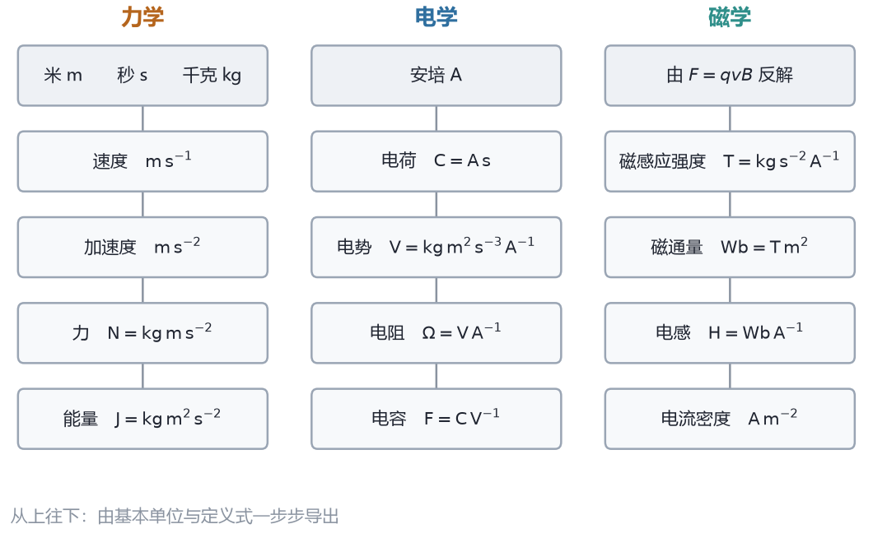
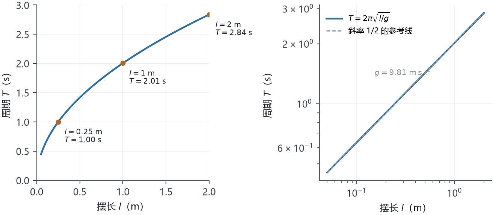
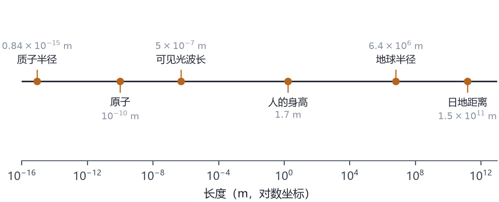

# 第 1 章 物理量、单位与量纲

## 1.1 一次因为单位而失败的任务

1999 年 9 月 23 日，火星气候探测者号在接近火星时失去联系。事后调查给出的原因很具体：地面导航软件输出的推力冲量单位是牛顿秒，而探测器上的推进器软件按磅力秒来解释这个数。两个数字相差 4.45 倍，累积几个月之后，探测器进入大气层的角度比预定值低了一百多公里，它在火星大气里烧毁。

这不是一个粗心的程序员的错误。两套软件各自都是对的，各自内部都一致，错误发生在它们交换数据的那一个接口上：同一个数字，两边赋予了不同的单位，于是它代表的物理量相差了四倍多。

物理学的每一条公式都隐含着一套单位约定。$F=ma$ 只有在力用牛顿、质量用千克、加速度用米每二次方秒时才成立；如果力用磅力、质量用千克，同一个式子就要多一个换算因子。公式写得越多，这种隐含约定越容易出错，最后不得不用一种系统的方式把它们固定下来。这一章讲的就是这套系统，以及它带来的一个额外工具：量纲分析。

## 1.2 物理量是数与单位的乘积

说一根杆长 2，这句话没有意义。说它长 2 米，才有意义。一个物理量由一个数和一个单位相乘构成：

$$L=2\ \mathrm{m} . \tag{1.1}$$

这里的 $L$ 是一个物理量，$2$ 是它的数值，$\mathrm{m}$ 是单位。数值可以换，单位也可以换，两者一起变，物理量本身不变：

$$2\ \mathrm{m}=200\ \mathrm{cm}=0.002\ \mathrm{km} . \tag{1.2}$$

三个写法描述的是同一根杆。这个看起来平常的事实是所有单位换算的依据：换算就是乘一个等于 1 的比值，比如 $1=100\ \mathrm{cm}/\mathrm{m}$，乘上去不改变物理量，只改变数值与单位的搭配。

单位本身需要一个定义。早期的定义是实物：一根铂铱合金棒上两道刻线之间的距离是一米，一个铂铱圆柱的质量是一千克。实物定义的麻烦在于它会被磨损、会被氧化，而且无法在别的星球上复现。现在的定义改用自然常数：一米是光在真空中 $1/299792458$ 秒内走过的距离，因为这个速度被定义成精确值，米的定义就完全确定了。

## 1.3 七个基本单位

不是所有单位都能由别的单位推出来。如果每一个单位都要定义，就会无限倒退；如果互相定义，就会循环。国际单位制（SI）的做法是选定七个互相独立的基本量，其余全部由它们导出。

七个基本量是长度、质量、时间、电流、温度、物质的量、发光强度，单位分别是米、千克、秒、安培、开尔文、摩尔、坎德拉。电磁学只直接用到前四个，其中安培的定义值得单独说一句。

2019 年以前，安培的定义是"两根相距一米的平行无限长导线，每米长度上受力为 $2\times10^{-7}$ 牛顿时，导线中的电流"。这个定义把真空磁导率 $\mu_0$ 固定成了精确的 $4\pi\times10^{-7}$。2019 年改版之后，安培改由基本电荷定义：一安培是一秒钟内通过 $1/(1.602176634\times10^{-19})$ 个元电荷的电流。改版的原因是基本电荷在量子层面比"无限长导线之间的力"更基本，也更容易在任意实验室复现。附录 B 给了完整的定义表与常数表。

基本单位定下来之后，其他单位都由公式推出。速度的单位是米每秒，加速度是米每二次方秒，力的单位牛顿由 $F=ma$ 定义为 $\mathrm{kg\,m\,s^{-2}}$，功的单位焦耳由 $W=Fs$ 定义为 $\mathrm{N\,m}$，功率的单位瓦特是 $\mathrm{J\,s^{-1}}$。电学的单位链条更长，图 1-1 画出了本书用到的导出关系。

看图时留意一条：箭头都是从基本单位指向导出单位，没有反向的箭头。这说明基本单位不是"更重要的单位"，只是逻辑上先立的那几个。如果有人把安培定义成"一秒钟通过一库仑电荷"，把库仑当基本单位，整套体系照样成立，只是换了一个起点。

## 1.4 量纲

单位是具体的，米、厘米、英尺都是长度的单位。量纲是抽象的，长度这个 category 本身，记作 $\mathrm{L}$。质量记作 $\mathrm{M}$，时间记作 $\mathrm{T}$，电流记作 $\mathrm{I}$。任何一个物理量的量纲都可以写成这四个符号的幂次乘积：

$$[X]=\mathrm{M}^{a}\mathrm{L}^{b}\mathrm{T}^{c}\mathrm{I}^{d} . \tag{1.3}$$

方括号读作"的量纲"。比如速度 $[v]=\mathrm{L}\mathrm{T}^{-1}$，加速度 $[a]=\mathrm{L}\mathrm{T}^{-2}$，力 $[F]=\mathrm{M}\mathrm{L}\mathrm{T}^{-2}$。

量纲的第一个用途是检查公式。任何一条成立的等式，两边量纲必须相同。这不是巧合，而是因为物理定律不依赖于单位的选择：你把米换成厘米，等式左边的数值乘 100，右边也必须乘 100，否则等式只在某一套单位下成立，那它就不是物理定律，而是一个数值巧合。

举一个具体的检查。匀加速运动的位移公式是

$$x=x_0+v_0t+\frac{1}{2}at^2 . \tag{1.4}$$

左边 $[x]=\mathrm{L}$。右边第一项 $[x_0]=\mathrm{L}$，第二项 $[v_0t]=\mathrm{L}\mathrm{T}^{-1}\cdot\mathrm{T}=\mathrm{L}$，第三项 $[at^2]=\mathrm{L}\mathrm{T}^{-2}\cdot\mathrm{T}^2=\mathrm{L}$。三项都是长度，可以相加。如果谁把公式写成 $x=v_0t^2$，量纲检查立刻能发现：右边是 $\mathrm{L}\mathrm{T}^{-1}\cdot\mathrm{T}^2=\mathrm{L}\mathrm{T}$，不是长度。

量纲的第二个用途是推导。如果一个问题里只有几个物理量，而你要找的量与它们的关系未知，可以假设它正比于这些量的某个幂次乘积，再用量纲必须齐次定出幂次。这个方法不能给出前面的无量纲常数，但能给出函数形式。

还有一条比齐次性更严的规矩：三角函数的自变量、指数函数的自变量，必须是无量纲的。$\sin(\omega t)$ 能写，$\sin(t)$ 不能写，因为 $\sin$ 的展开式是 $x-x^{3}/6+\cdots$，各项量纲不同，根本不能相加。这条规矩在第二十一章解 LR 电路时会用到：指数必须是 $e^{-t/\tau}$ 而不是 $e^{-Rt/L}$ 这种量纲不清的写法，虽然两者数值一样，但前者的意义是“时间除以时间常数”。

## 1.5 用单摆走一遍量纲分析

一根长为 $l$ 的细线，下端挂一个质量为 $m$ 的小球，拉开一个小角度放手，小球来回摆动。摆动的周期 $T$ 与哪些量有关？直觉上它与线长有关，与重力有关，可能与质量有关。

假设

$$T=C\,m^{a}l^{b}g^{c} , \tag{1.5}$$

$C$ 是一个无量纲的常数，$a$、$b$、$c$ 待定。把量纲代进去。周期 $[T]=\mathrm{T}$，质量 $[m]=\mathrm{M}$，长度 $[l]=\mathrm{L}$，重力加速度 $[g]=\mathrm{L}\mathrm{T}^{-2}$。右边整体的量纲是

$$\mathrm{M}^{a}\mathrm{L}^{b}\left(\mathrm{L}\mathrm{T}^{-2}\right)^{c}=\mathrm{M}^{a}\mathrm{L}^{b+c}\mathrm{T}^{-2c} . \tag{1.6}$$

两边量纲相同，三个基本量纲的指数必须分别相等：

$$a=0,\qquad b+c=0,\qquad -2c=1 . \tag{1.7}$$

从第三式得 $c=-1/2$，代入第二式得 $b=1/2$，第一式直接给出 $a=0$。于是

$$T=C\sqrt{\frac{l}{g}} . \tag{1.8}$$

质量被消掉了，这一点与实验一致：同样长的摆，挂铁球还是木球，周期一样。周期与线长的平方根成正比，与重力加速度的平方根成反比。

这个推导没有得到 $C$。$C$ 是一个纯数，量纲分析对它无能为力，因为任何纯数乘上去都不改变量纲。要定出 $C=2\pi$，必须解运动方程，那是第三章的事。但 (1.8) 已经给出了全部的函数结构，这个信息足以做很多判断：把摆长变成四倍，周期变成两倍；把摆拿到月球上，重力加速度是地球的六分之一，周期变成 $\sqrt{6}\approx2.45$ 倍。

图 1-2 把 (1.8) 画了出来，同时画了 $T\propto\sqrt{l}$ 的对数坐标直线。在对数坐标里，幂函数变成直线，斜率就是幂次，这是检查"是不是平方根关系"最直接的办法。

## 1.6 从量纲看出光速

量纲分析在电磁学里有一个漂亮的应用，可以提前透露第六篇的结论。

库仑定律说两个电荷之间的力是 $F=q_1q_2/(4\pi\varepsilon_0r^2)$。由此可以反解出 $\varepsilon_0$ 的量纲：

$$[\varepsilon_0]=\frac{[q^2]}{[F][r^2]}=\frac{\mathrm{I}^2\mathrm{T}^2}{\mathrm{M}\mathrm{L}\mathrm{T}^{-2}\cdot\mathrm{L}^2}=\mathrm{M}^{-1}\mathrm{L}^{-3}\mathrm{T}^{4}\mathrm{I}^{2} . \tag{1.9}$$

安培力定律说两根平行导线每米长度上的力是 $F/L=\mu_0I^2/(2\pi d)$，由此

$$[\mu_0]=\frac{[F]}{[I^2]}=\frac{\mathrm{M}\mathrm{L}\mathrm{T}^{-2}}{\mathrm{I}^2}=\mathrm{M}\mathrm{L}\mathrm{T}^{-2}\mathrm{I}^{-2} . \tag{1.10}$$

把两个量乘起来：

$$[\varepsilon_0\mu_0]=\mathrm{M}^{-1}\mathrm{L}^{-3}\mathrm{T}^{4}\mathrm{I}^{2}\cdot\mathrm{M}\mathrm{L}\mathrm{T}^{-2}\mathrm{I}^{-2}=\mathrm{L}^{-2}\mathrm{T}^{2} . \tag{1.11}$$

质量与电流的幂次都消掉了，剩下的是长度的负二次方乘时间的二次方。取倒数再开方：

$$\left[\frac{1}{\sqrt{\varepsilon_0\mu_0}}\right]=\mathrm{L}\mathrm{T}^{-1} , \tag{1.12}$$

这是速度的量纲。两个纯电学、磁学的常数，组合起来得到一个速度。这个速度只能由实验测出：代入 $\varepsilon_0=8.854\times10^{-12}\ \mathrm{F/m}$ 与 $\mu_0=4\pi\times10^{-7}\ \mathrm{H/m}$，

$$\frac{1}{\sqrt{\varepsilon_0\mu_0}}=\frac{1}{\sqrt{8.854\times10^{-12}\times1.257\times10^{-6}}}\approx2.998\times10^{8}\ \mathrm{m/s} , \tag{1.13}$$

与当时已经测得很准的光速一致。这个巧合在 1865 年被麦克斯韦指出，第二十七章会说明它不是巧合。现在只需要记住：量纲分析不能证明什么，但它能指出哪里可能有深刻的东西。

## 1.7 三个常数拼出一个长度

再看一个例子，它说明量纲分析不仅能检验，还能在没有理论的地方先给出答案的形状。

狭义相对论给出光速 $c$，量纲 $\mathrm{L}\mathrm{T}^{-1}$；量子力学给出普朗克常数 $h$，量纲 $\mathrm{M}\mathrm{L}^{2}\mathrm{T}^{-1}$；引力理论给出万有引力常数 $G$，量纲 $\mathrm{M}^{-1}\mathrm{L}^{3}\mathrm{T}^{-2}$。这三个常数分别属于三个不同的领域，彼此之间没有已知的关系。可是把它们乘除组合，可以唯一地拼出一个长度。

设

$$l_P=\hbar^{a}c^{b}G^{d} , \tag{1.14}$$

$\hbar=h/2\pi$ 与 $h$ 量纲相同，只差一个无量纲的 $2\pi$。把量纲写开：

$$\left[\hbar^{a}c^{b}G^{d}\right]=\left(\mathrm{M}\mathrm{L}^{2}\mathrm{T}^{-1}\right)^{a}\left(\mathrm{L}\mathrm{T}^{-1}\right)^{b}\left(\mathrm{M}^{-1}\mathrm{L}^{3}\mathrm{T}^{-2}\right)^{d} . \tag{1.15}$$

逐个数指数。质量：$a-d=0$。长度：$2a+b+3d=1$。时间：$-a-b-2d=0$。

由第一式 $a=d$。代入第三式：$-d-b-2d=0$，即 $b=-3d$。代入第二式：$2d-3d+3d=1$，得 $2d=1$，$d=1/2$。于是 $a=1/2$，$b=-3/2$。

$$l_P=\sqrt{\frac{\hbar G}{c^{3}}}\approx1.616\times10^{-35}\ \mathrm{m} . \tag{1.16}$$

这个长度叫普朗克长度。它的推导只用了量纲，没有用任何动力学。它的意义在于：当一个问题的特征长度小到这个尺度，量子效应与引力效应同时重要，现有的理论都不再适用。量纲分析说不出那个理论是什么，但它精确地告诉了你那个理论该在什么尺度上出现。

## 1.8 无量纲量

有些量没有量纲，比如两个长度之比、两个频率之比。无量纲量的特殊之处在于它的数值不随单位制改变：不管用米还是英尺量，两个长度之比都一样。

物理上真正有意义的判据往往是无量纲的。一根管子里的水流是层流还是湍流，取决于雷诺数 $\mathrm{Re}=\rho vd/\eta$，这是一个无量纲组合；$\mathrm{Re}$ 小于约 2000 是层流，大于约 4000 是湍流，这个分界与管子多粗、水流多快无关，只与 $\mathrm{Re}$ 有关。这就是为什么用小模型做风洞实验能预测大飞机的行为：只要 $\mathrm{Re}$ 相同，流场的形状就相似。

电磁学里最基本的无量纲量是精细结构常数

$$\alpha=\frac{e^2}{4\pi\varepsilon_0\hbar c}\approx\frac{1}{137.036} , \tag{1.17}$$

$\hbar=h/2\pi$ 是约化普朗克常数。这个数衡量电磁相互作用的强度，它的数值不依赖于任何单位制。整个量子电动力学都围绕这个数展开，而它为什么等于 1/137 而不是别的数，至今没有解释。

## 1.9 数量级

物理计算的第一步常常不是精确求解，而是估计数量级。一个电子与一个质子之间的电力与引力之比是多少？

电力 $F_e=ke^2/r^2$，引力 $F_g=Gm_em_p/r^2$，两者相除，距离消掉：

$$\frac{F_e}{F_g}=\frac{ke^2}{Gm_em_p}=\frac{8.99\times10^{9}\times(1.60\times10^{-19})^2}{6.67\times10^{-11}\times9.11\times10^{-31}\times1.67\times10^{-27}} . \tag{1.18}$$

分子是 $8.99\times10^{9}\times2.56\times10^{-38}\approx2.3\times10^{-28}$。分母是 $6.67\times9.11\times1.67\times10^{-69}\approx1.01\times10^{-68}$。相除得 $2.3\times10^{40}$。

电力比引力强四十个数量级。这个数字解释了为什么在研究原子、分子、固体的时候完全不用考虑引力：它小到可以忽略。也解释了为什么一根带电的塑料尺能吸起小纸片：纸片的质量很小，引力很小，而静电力虽然也小，但相比之下大得多。

反过来说，天体之所以能聚成行星与恒星，是因为天体整体近似电中性。正负电荷几乎完全抵消，剩下的净电荷产生的斥力远小于引力，引力才有机会起主导作用。一个由 $10^{50}$ 个质子组成的星球如果多出千分之一的电子，静电斥力会把它们炸开。

图 1-3 把本书涉及的长度尺度排在对数轴上，从质子到日地距离，跨度二十三个数量级。

## 1.10 换算的实际操作

单位换算在纸面上是乘比值，在手算时容易出错的是复合单位。这里给三个例子，方法都一样：把每个单位替换成它的基本单位表示，再约分。

第一个例子，把 $1\ \mathrm{kW\,h}$ 换成焦耳。$1\ \mathrm{kW}=10^{3}\ \mathrm{W}=10^{3}\ \mathrm{J/s}$，$1\ \mathrm{h}=3600\ \mathrm{s}$，相乘得 $3.6\times10^{6}\ \mathrm{J}$。

第二个例子，把电场强度的单位 $\mathrm{V/m}$ 换成基本单位。由 $W=qU$ 得 $1\ \mathrm{V}=1\ \mathrm{J/C}=1\ \mathrm{kg\,m^{2}\,s^{-2}\,A^{-1}\,s^{-1}}=\mathrm{kg\,m^{2}\,s^{-3}\,A^{-1}}$。除以米，得 $\mathrm{kg\,m\,s^{-3}\,A^{-1}}$。这个结果在验算洛伦兹力 $qE$ 时有用：$\mathrm{C}\cdot\mathrm{kg\,m\,s^{-3}\,A^{-1}}=\mathrm{A\,s}\cdot\mathrm{kg\,m\,s^{-3}\,A^{-1}}=\mathrm{kg\,m\,s^{-2}}$，是力的单位。

第三个例子，把 $1\ \mathrm{T}$ 换成基本单位。由 $F=qvB$ 得 $[B]=[F]/([q][v])=\mathrm{M}\mathrm{L}\mathrm{T}^{-2}/(\mathrm{I}\mathrm{T}\cdot\mathrm{L}\mathrm{T}^{-1})=\mathrm{M}\mathrm{T}^{-2}\mathrm{I}^{-1}$。反过来，$1\ \mathrm{T}\cdot1\ \mathrm{m^{2}}=1\ \mathrm{Wb}$，而 $\mathrm{Wb}/\mathrm{s}=1\ \mathrm{V}$，这两个关系在第五篇讲感应电动势时会反复用到。

换算的验算办法是回代。算完之后把结果代回原公式，看两边的量纲是否一致。这一步花十秒钟，能拦下大部分符号错误。

## 1.11 有效数字与不确定度

任何测量都有一个精度。写 $g=9.8\ \mathrm{m/s^2}$ 与写 $g=9.81\ \mathrm{m/s^2}$ 表达的是不同的信息：前者说明第三位不确定，后者说明第三位可信。

计算时不要给出超过测量精度的位数。用 $9.8$ 算出来的结果写到小数点后六位，那六位是假的。反过来，中间步骤不要过早四舍五入，因为误差会累积；保留多一位，最后再按最不精确的输入截断。

本书的常数一律取附录 B 的 CODATA 2018 值，计算中保留四到五位有效数字，最终结果按需要截断。当写到"$\approx$"时，说明这是一个保留了几位有效数字的近似值；写到"$=$"时，说明这是精确关系或者定义。

## 1.12 本书的单位约定

全书使用 SI，不混用高斯制。唯一可能的例外是第二十八章，那里为了对照会写出高斯制下的方程，但会明确标注。

几个具体约定。电荷用库仑，电场强度用伏特每米（不用牛顿每库仑，虽然两者等价，前者在电路问题里更自然），磁感应强度用特斯拉，磁通量用韦伯。电感用亨利，电容用法拉。能量的单位统一用焦耳，只有在原子尺度才用电子伏特，并在旁边注明换算。

公式里的单位不写出来，只在结果的数值旁写。这是物理书的标准做法，好处是式子干净，代价是读者必须记住每个符号的单位。附录 C 的符号表给出了每个符号的单位，卡住时查那里。

---

这一章没有讲任何物理定律，只立了规矩。规矩看起来枯燥，但它是后面所有推导的前提：没有单位，$F=ma$ 不成立；没有量纲，无法在写下一个式子之后立刻判断它对不对；没有数量级的概念，就会在电子与质子的对比里迷路。下一章开始描述运动，第一个要定义的量是位置，第二个是速度，而速度的定义会逼出导数。
