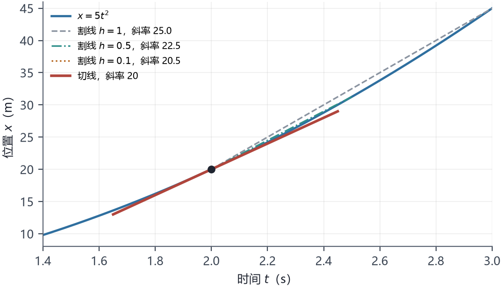
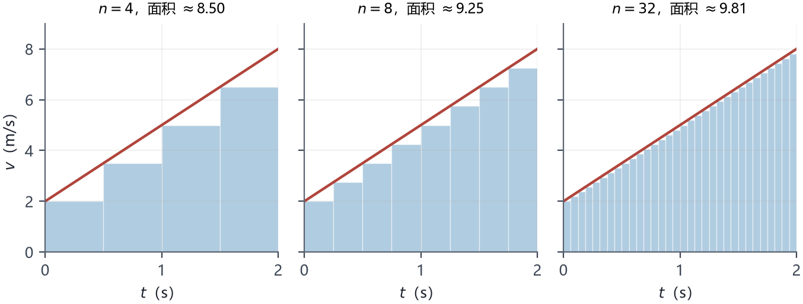
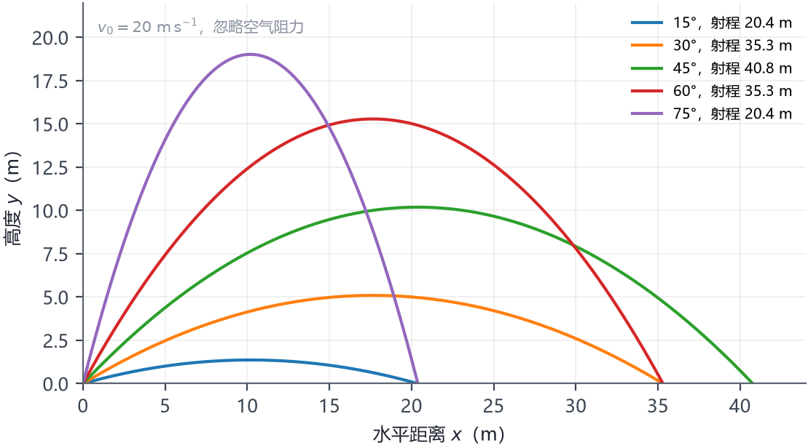
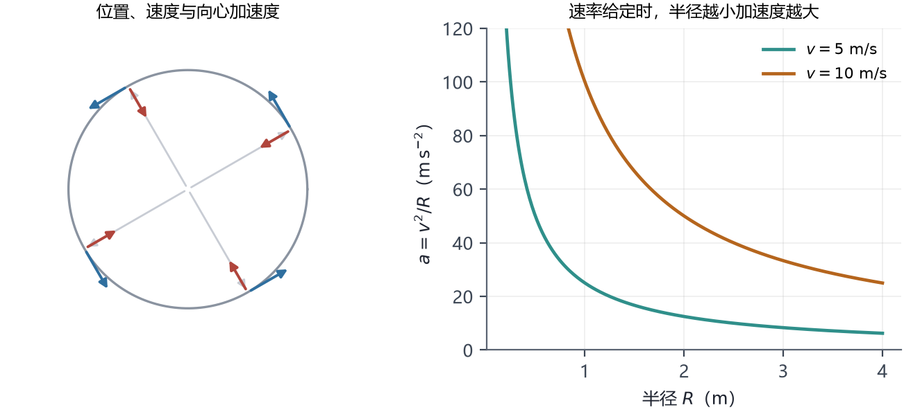

# 第 2 章 运动的描述：位置、速度、加速度

## 2.1 一块斜面上的小球

伽利略在 1638 年的《关于两门新科学的对话》里描述了一个实验。一块木板，中间刻一道光滑的槽，把槽的一端垫高，让铜球从槽里滚下来。他在槽边按相等的时间间隔做记号，记录球在每个时刻到达的位置。之所以用斜面而不用自由落体，是因为自由落体太快，当时没有钟表能测出下落过程中的位置。

记录的结果有一个规律：从静止释放，球在第一个时间间隔内走过一段距离，第二个间隔内走过的距离是前者的三倍，第三个是五倍。总距离与时间的平方成正比。用今天的写法，$x\propto t^2$。

这个规律本身已经很有价值，但它提出一个更基本的问题。既然球越滚越快，那么"它在某一时刻的速度"是什么意思？如果速度就是距离除以时间，那必须先选定一段时间，取的区间不同，算出的值就不同。伽利略的记录里，第一个间隔内的平均速度与最后一个间隔内的平均速度差了好几倍，它们描述的不是同一个东西。

要回答这个问题，只有一条路：把时间段取得越来越短，看比值趋向什么。这条路就是导数。

## 2.2 位置与位移

描述运动先要选定参照。一个质点在什么位置，必须相对于某个坐标系来说。取一条直线，在上面定一个原点 $O$、一个正方向和一个长度单位，质点在这条直线上的位置用一个带符号的数 $x$ 表示。$x>0$ 表示在原点正方向一侧，$x<0$ 表示在另一侧。

质点从 $x_1$ 移动到 $x_2$，位移是

$$\Delta x=x_2-x_1 . \tag{2.1}$$

位移可正可负。走的路程是轨迹的长度，永远非负；位移只看首末位置，与中间怎么走无关。绕操场跑一圈回到起点，路程是四百米，位移是零。这两者的区别在第四章讲功的时候很重要，因为功只跟位移在力的方向上的投影有关。

在平面上，位置要两个数 $(x,y)$ 才能确定，位置矢量记作 $\mathbf{r}=x\hat{\mathbf{x}}+y\hat{\mathbf{y}}$。位移是矢量差 $\Delta\mathbf{r}=\mathbf{r}_2-\mathbf{r}_1$。本书大部分一维问题用带符号的数就够了，三维问题从第五章开始正式用矢量。

还有一个隐含的前提：坐标系本身不能加速。坐在刹车的公交车里，手里的小球会往前冲，可它明明没有被推。这个现象不是因为小球受力，而是因为车厢这个参照系在减速，球相对于它“向前运动”了。牛顿定律只在惯性系里成立，这一点第三章会展开。现在只需要记住：说“静止”或“运动”之前，先选定参照系，并默认它是惯性的。

## 2.3 平均速度与瞬时速度

在一段时间 $\Delta t=t_2-t_1$ 内，平均速度定义为

$$\bar{v}=\frac{\Delta x}{\Delta t}=\frac{x(t_2)-x(t_1)}{t_2-t_1} . \tag{2.2}$$

它回答的是"平均来看跑得多快"，但丢掉了过程中的细节。要看某一时刻的快慢，把 $\Delta t$ 缩小，让区间套在这一时刻附近：

$$v(t)=\lim_{\Delta t\to 0}\frac{x(t+\Delta t)-x(t)}{\Delta t}=\frac{dx}{dt} . \tag{2.3}$$

右边就是导数。这个极限如果存在，就叫质点在该时刻的瞬时速度。图解上，$\Delta x/\Delta t$ 是 $x$-$t$ 图上两点连线的斜率，取了极限之后，连线变成该点的切线，斜率就是切线斜率。图 2-1 画了割线向切线收缩的过程。

把极限算出来。设 $x(t)=5t^2$，单位是米，要算 $t=2$ 秒时的速度。取一个增量 $h$：

$$x(2+h)-x(2)=5(2+h)^2-5\cdot2^2=5\left(4+4h+h^2\right)-20=20h+5h^2 . \tag{2.4}$$

除以 $h$：

$$\frac{x(2+h)-x(2)}{h}=20+5h . \tag{2.5}$$

让 $h\to0$，比值趋于 20。所以 $t=2$ 时的速度是 $20\ \mathrm{m/s}$。注意 $5h$ 这一项：它在 $h$ 还很大时不能忽略，一旦 $h$ 趋于零就消失了。导数的计算就是反复做这件“展开、约掉、看剩下什么”的事。

把同一个运动的平均速度算出来作对比。从 $0$ 到 $2$ 秒，位移是 $20$ 米，平均速度是 $10\ \mathrm{m/s}$，只有瞬时速度的一半。从 $1.9$ 到 $2.1$ 秒，位移是 $5(2.1^2-1.9^2)=4$ 米，平均速度是 $4/0.2=20\ \mathrm{m/s}$，与瞬时值相等，因为加速度是常数，速度随时间线性变化，区间对称时平均值恰好等于中点值。区间再窄一些，就靠到 $20$ 上。

对一般的幂函数 $x=t^n$，同样的做法可以算出

$$\frac{d}{dt}t^n=nt^{n-1} , \tag{2.6}$$

$n$ 是正整数时，用二项式定理展开 $(t+h)^n=t^n+nt^{n-1}h+\cdots$，除以 $h$ 之后只剩第一项在 $h\to0$ 时存活。这个结果对任意实数 $n$ 也成立，证明需要别的工具，本书直接引用。

导数满足两条基本规则。常数倍的导数等于导数的常数倍：$\frac{d}{dt}\left[cf(t)\right]=c\frac{df}{dt}$。和的导数等于导数的和：$\frac{d}{dt}\left[f(t)+g(t)\right]=\frac{df}{dt}+\frac{dg}{dt}$。两条合起来，多项式可以逐项求导。$x(t)=3t^3-2t^2+7$ 的导数是 $9t^2-4t$，常数项 7 的导数为零，因为常数的变化率为零。

速度也有符号。$v>0$ 表示沿正方向运动，$v<0$ 表示沿负方向。速度为零不代表静止不动，它只说明这一瞬间位置的变化率为零，下一瞬间可能又动了。竖直上抛的物体在最高点速度为零，但加速度一直是向下的 $g$。

## 2.4 加速度

速度本身也会变。速度的变化率叫加速度：

$$a(t)=\frac{dv}{dt}=\frac{d^2x}{dt^2} . \tag{2.7}$$

第二个等号说明加速度是位置的二阶导数，先求一次导得速度，再求一次得加速度。单位是 $\mathrm{m/s^2}$，读作米每二次方秒。

沿用了 $x(t)=5t^2$ 的例子，$v(t)=10t$，$a(t)=10\ \mathrm{m/s^2}$。这个运动的加速度是常数，速度每秒增加 10 米每秒。

加速度的符号也要小心。$a$ 与 $v$ 同号时，速度的绝对值变大，物体加速；异号时速度的绝对值变小，物体减速。汽车刹车时 $v>0$、$a<0$，说"减速度"只是口语，物理量还是加速度，只是符号为负。

加速度是矢量。在直线运动里它只有一个分量，正负号就表达了方向；在平面运动里它有两个分量，方向与速度方向不一定相同。匀速圆周运动的加速度不为零，这一点在 2.7 节会算出来。

测加速度最直接的办法是测速度在两端时刻的值。一辆车从 $0$ 加速到 $100\ \mathrm{km/h}$（即 $27.8\ \mathrm{m/s}$），用了 10 秒，平均加速度是 $2.78\ \mathrm{m/s^2}$。这个数只描述了平均情况，实际过程中加速度可能先大后小，要看瞬时值就得知道 $v(t)$ 的具体形式，再求导。

## 2.5 从加速度反推速度与位移

已知加速度求速度，是求导的逆运算，也就是积分。

先看一种简单情形：加速度是常数 $a$。速度的变化率是常数，意味着速度随时间线性变化：

$$v(t)=v_0+at , \tag{2.8}$$

$v_0$ 是 $t=0$ 时的速度。这个式子可以直接验证：两边对 $t$ 求导得 $dv/dt=a$，符合要求。

再求位置。$v=dx/dt$，所以 $x$ 是 $v$ 的原函数。把 (2.8) 积分：

$$x(t)=x_0+\int_0^t\left(v_0+a\tau\right)d\tau=x_0+v_0t+\frac{1}{2}at^2 . \tag{2.9}$$

这里用 $\tau$ 作积分变量，避免与上限 $t$ 混淆。积分逐项做：$\int_0^t v_0\,d\tau=v_0t$，$\int_0^t a\tau\,d\tau=\frac{1}{2}a\tau^2\Big|_0^t=\frac{1}{2}at^2$。验证的办法还是求导，$dx/dt=v_0+at$，与 (2.8) 一致。

积分在图上是什么？$v$-$t$ 图里，速度曲线与时间轴围成的面积就是位移。把时间分成许多小段，每段内速度近似不变，位移的增量近似为 $v\Delta t$，这是一个细长矩形的面积。把所有矩形加起来，再让每段变窄，矩形面积的极限就是曲线下的面积。图 2-2 画了这个过程，取 4 段、8 段、32 段，矩形总面积逐渐逼近曲线下的精确面积。

还有一条不含时间的公式，在不知道时间、只知道位移时有用。从 $a=dv/dt$ 出发，用链式法则把对时间的导数换成对位置的导数：

$$a=\frac{dv}{dt}=\frac{dv}{dx}\frac{dx}{dt}=v\frac{dv}{dx} . \tag{2.10}$$

两边乘 $dx$：

$$a\,dx=v\,dv . \tag{2.11}$$

从 $x_0$ 积分到 $x$，对应的速度从 $v_0$ 到 $v$：

$$\int_{x_0}^{x}a\,dx=\int_{v_0}^{v}v\,dv=\frac{1}{2}v^2-\frac{1}{2}v_0^2 . \tag{2.12}$$

$a$ 是常数，左边等于 $a(x-x_0)$。整理得

$$v^2=v_0^2+2a(x-x_0) . \tag{2.13}$$

这三条公式 (2.8)、(2.9)、(2.13) 是匀加速运动的全部内容。它们不是三个独立的定律，而是同一个事实（$a$ 为常数）在三种不同问法下的写法。

用 (2.13) 算一个具体问题。一辆车以 $20\ \mathrm{m/s}$ 行驶，刹车后加速度为 $-5\ \mathrm{m/s^2}$（负号表示与速度反向）。从踩下刹车到停住，走过多远？末速度 $v=0$，代入 (2.13)：

$$0=20^2+2\times(-5)\times(x-x_0) ,$$

$$x-x_0=\frac{400}{10}=40\ \mathrm{m} .$$

刹车距离与速率的平方成正比。同样一辆车开 $40\ \mathrm{m/s}$，刹车距离变成 $160$ 米；这个平方关系是交通限速的根据，而不是随便定的。

## 2.6 自由落体与抛体

把重力当成常数，忽略空气阻力，落体的加速度是 $g=9.81\ \mathrm{m/s^2}$，方向向下。取向下为正，$a=g$，从静止释放（$v_0=0$，$x_0=0$）：

$$v=gt,\qquad x=\frac{1}{2}gt^2 ,\qquad v^2=2gx . \tag{2.14}$$

落体一秒下落 $4.9$ 米，两秒 $19.6$ 米，三秒 $44.1$ 米。下落距离按时间平方增长，这就是伽利略从斜面上看出的规律。

平面上的抛体运动要分解成两个方向。取水平为 $x$、竖直向上为 $y$，初速度 $v_0$ 与水平方向成 $\theta$ 角。水平方向没有力，加速度为零；竖直方向只有重力，加速度为 $-g$。两个方向独立：

$$x(t)=v_0\cos\theta\cdot t,\qquad y(t)=v_0\sin\theta\cdot t-\frac{1}{2}gt^2 . \tag{2.15}$$

从第一个式子解出 $t=x/(v_0\cos\theta)$，代入第二个，得到轨迹方程

$$y=x\tan\theta-\frac{gx^2}{2v_0^2\cos^2\theta} . \tag{2.16}$$

这是一条抛物线。抛物线的名字来自伽利略，他证明了抛体的轨迹确实是抛物线，而不是当时人们以为的"先直线飞出去，然后突然掉落"。

落地时间由 $y=0$ 解出（除去 $t=0$）：

$$t=\frac{2v_0\sin\theta}{g} . \tag{2.17}$$

代入水平位移，得射程

$$R=v_0\cos\theta\cdot\frac{2v_0\sin\theta}{g}=\frac{v_0^2\sin2\theta}{g} . \tag{2.18}$$

$\sin2\theta$ 在 $\theta=45^\circ$ 时取最大值 1，所以初速度给定时，45 度角射得最远。这个结论只在落点与出发点等高的条件下成立，实际投掷还要考虑出手高度和空气阻力。图 2-3 画了同一初速度下五个角度的轨迹。

把这个结果用到竖直上抛，取 $\theta=90^\circ$。水平方向没有位移，竖直方向的位置是 $y=v_0t-\frac{1}{2}gt^2$。它什么时候到最高点？最高点速度为零，由 $v=v_0-gt=0$ 得 $t=v_0/g$。代入位置得最大高度

$$h=\frac{v_0^2}{g}-\frac{g}{2}\cdot\frac{v_0^2}{g^2}=\frac{v_0^2}{2g} , \tag{2.19}$$

滞空时间是落回原点的时间，由 $y=0$ 得 $t=2v_0/g$，正好是上升时间的两倍。把 (2.18) 里的 $\theta=90^\circ$ 代进去，得零水平射程，这是合理的：球从原地起飞又落回原地。

## 2.7 匀速圆周运动与向心加速度

一个质点沿半径为 $R$ 的圆以恒定速率 $v$ 运动。速率不变，速度却在变，因为方向一直在变。加速度不为零。

用参数方程描述这个运动最方便。把圆心放在原点，从 $x$ 轴正方向开始计时，角位置是 $\omega t$，$\omega$ 是角速度，单位弧度每秒。质点的坐标是

$$x(t)=R\cos\omega t,\qquad y(t)=R\sin\omega t . \tag{2.20}$$

位置矢量 $\mathbf{r}=R(\cos\omega t\,\hat{\mathbf{x}}+\sin\omega t\,\hat{\mathbf{y}})$。对时间求导得速度：

$$\mathbf{v}=\frac{d\mathbf{r}}{dt}=R\omega\left(-\sin\omega t\,\hat{\mathbf{x}}+\cos\omega t\,\hat{\mathbf{y}}\right) . \tag{2.21}$$

再求一次导得加速度：

$$\mathbf{a}=\frac{d\mathbf{v}}{dt}=R\omega^2\left(-\cos\omega t\,\hat{\mathbf{x}}-\sin\omega t\,\hat{\mathbf{y}}\right)=-\omega^2\mathbf{r} . \tag{2.22}$$

加速度与位置矢量反向，也就是始终指向圆心，大小是 $\omega^2R$。

把角速度换成速率。质点走一圈的时间是 $T=2\pi/\omega$，走过的弧长是 $2\pi R$，所以

$$v=\frac{2\pi R}{T}=\omega R . \tag{2.23}$$

代入加速度的大小：

$$a=\omega^2R=\frac{v^2}{R} . \tag{2.24}$$

这就是向心加速度。它的方向沿半径指向圆心，大小与速率的平方成正比，与半径成反比。转弯时车速加倍，需要的向心力变成四倍，这也是为什么高速公路上弯道的限速那么低。

把数代进去看一下量级。实验室的离心机转速常写成每分钟三万转，换算成角速度是 $\omega=2\pi\times30000/60\approx3140\ \mathrm{rad/s}$。转子半径取 $5\ \mathrm{cm}$，样品受到的加速度是 $\omega^2R=3140^2\times0.05\approx4.9\times10^{5}\ \mathrm{m/s^2}$，约是重力加速度的五万倍。这个加速度不靠增加速率，靠的是小半径下的高角速度，因为 $a=\omega^2R$ 对 $\omega$ 是平方关系。

图 2-4 左边画了四个时刻的三个矢量。速度始终垂直于半径，加速度始终与速度垂直，这一点可以从 (2.21) 与 (2.22) 的点乘看出来：

$$\mathbf{v}\cdot\mathbf{a}=R\omega\left(-\sin\omega t\right)\left(-R\omega^2\cos\omega t\right)+R\omega\cos\omega t\left(-R\omega^2\sin\omega t\right)=0 . \tag{2.25}$$

加速度垂直于速度，说明它不改变速率，只改变方向。这与上一节的抛体运动正好相反：那里加速度与速度不垂直，速率一直在变。

有一种更几何的推导，不用微积分。取两个相邻时刻，速度矢量的大小都是 $v$，方向差了一个小角 $\Delta\theta$。两个速度矢量构成一个等腰三角形，底边长 $|\Delta\mathbf{v}|\approx v\Delta\theta$。除以 $\Delta t$，得 $|\Delta\mathbf{v}|/\Delta t\approx v\,\Delta\theta/\Delta t=v\omega$。再用 $\omega=v/R$，得 $a=v^2/R$。这个推导与参数方程求导给出同一个结果，区别只在于它把“取极限”这一步藏在了“小角近似”里。

## 2.8 切向与法向

圆周运动的速度大小也可以变（转盘启动的瞬间）。这时加速度有两个分量，一个是沿切线方向的，一个是沿法线指向圆心的：

$$\mathbf{a}=\frac{dv}{dt}\hat{\mathbf{t}}+\frac{v^2}{R}\hat{\mathbf{n}} . \tag{2.26}$$

第一项描述速率变化，第二项描述方向变化。推导的办法是把速度写成 $\mathbf{v}=v\hat{\mathbf{t}}$，再对时间求导，用乘积法则：

$$\frac{d\mathbf{v}}{dt}=\frac{dv}{dt}\hat{\mathbf{t}}+v\frac{d\hat{\mathbf{t}}}{dt} . \tag{2.27}$$

第一项已经是切向的。第二项里 $\hat{\mathbf{t}}$ 是单位矢量，长度不变，只有方向在转；单位矢量转动 $d\theta$ 时，它的改变量垂直于它自身指向圆心，大小等于 $d\theta$（因为 $|\hat{\mathbf{t}}|=1$ 固定在单位圆上）。单位时间转过的角度是 $\omega=v/R$，所以 $|d\hat{\mathbf{t}}/dt|=\omega=v/R$，方向指向圆心。乘上 $v$ 得 $v^2/R$。

这个分解在第二章之后反复出现。第九章把静电场写成电势的负梯度，用的是同一件事：一个场的变化可以拆成沿几个独立方向的分量，每个分量单独算，再相加。

## 2.9 这一章得到了什么

这一章建立了三个量：位置、速度、加速度，它们之间是求导与积分的关系。速度是位置的变化率，加速度是速度的变化率；反过来，速度是加速度对时间的积分，位置是速度对时间的积分。匀加速的三条公式、抛体的轨迹、圆周运动的向心加速度，都是这一套运算在不同情境下的结果。

还有一件事值得记住：加速度垂直于速度时，速率不变，方向改变；加速度平行于速度时，方向不变，速率改变。这个分解在第四章讲功时会再出现一次，因为只有沿着位移方向的那一份力才做功。下一章把这些运动与"力"联系起来。
