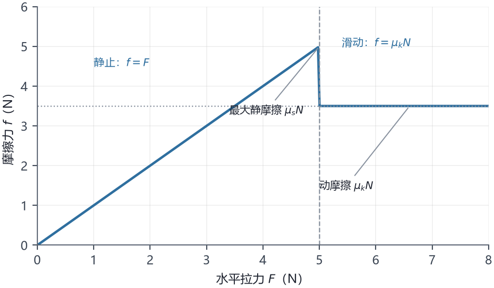
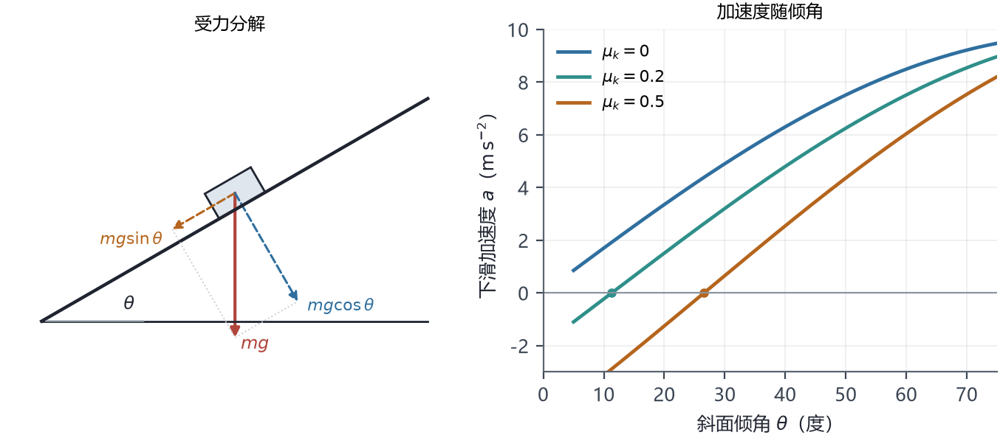
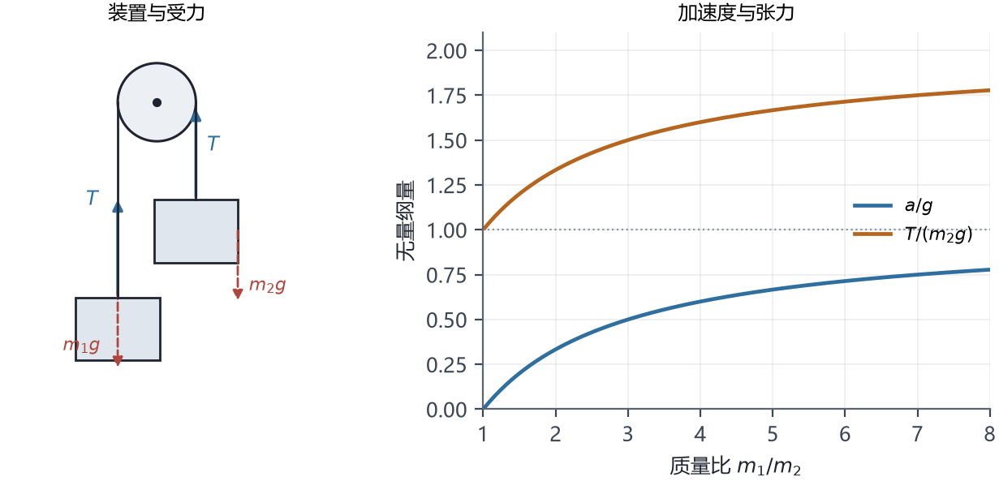

# 第 3 章 牛顿三定律与受力分析

## 3.1 急刹车时的那一下前倾

坐在公交车最后一排，车突然刹车，人会向前冲。抓住扶手就能撑住，松手就会撞到前面的椅背。这件事在中学课堂上有一个标准解释：人有惯性，车减速了，人要保持原来的速度，所以相对车厢向前运动。

解释是对的，但它没有说清"惯性"是什么。惯性不是一种力，它没有施力物体，也没有方向，抓不住也量不出来。它描述的是一个事实：物体不会自己改变速度。要改变速度，必须有别的物体推它或者拉它，而且这个推拉的大小决定了速度改变得多快。

把这句话写成公式，就是牛顿第二定律。要理解它为什么长那样，先得理解一个更基础的问题：如果没有推力，物体会怎么运动？

## 3.2 第一定律与惯性系

亚里士多德的说法是：物体的自然状态是静止，要让它持续运动，必须一直推。这个说法符合日常经验——推箱子，松手就停。但它错在一个隐藏的条件上：箱子停下来是因为地面有摩擦，不是因为"运动需要力维持"。

伽利略想清楚了这一点。他设想一个没有摩擦的斜面实验：小球从斜面上滚下，再滚上另一个斜面，它会上升到几乎相同的高度；把第二个斜面放平，小球会一直滚下去。摩擦越小，滚得越远，极限情形是永远滚下去。

牛顿把这层意思写成第一定律：一切物体在没有受到外力作用时，保持静止或匀速直线运动。用公式说，$\sum\mathbf{F}=0$ 时 $\mathbf{v}$ 为常矢量。

这条定律有两个作用。它定义了"力"这个概念的反面：不需要力也能运动，力只负责改变速度。它还隐含地定义了一类参照系：第一定律成立的参照系叫惯性系。在地面上做实验，第一定律近似成立；在急刹车的车厢里做实验，第一定律明显不成立，因为不受力的小球会自己加速。

严格地说，惯性系不止一个。相对于一个惯性系做匀速直线运动的参照系也是惯性系，因为速度的常量差值在求导之后消失。相对于惯性系加速的参照系不是惯性系。地球在自转，地面上的一点有向心加速度，所以地面不是严格的惯性系，但自转周期是一天，向心加速度约 $0.034\ \mathrm{m/s^2}$，只有重力加速度的千分之三，多数实验里可以忽略。本书此后默认在地面惯性系里讨论。

## 3.3 第二定律

第一定律说力为零时速度不变，第二定律说力不为零时速度怎么变。牛顿的表述是"运动的改变正比于施加的动力"，用今天的写法：

$$\mathbf{F}=m\mathbf{a} . \tag{3.1}$$

这个式子里每个符号都要交代。$\mathbf{F}$ 是作用在物体上的合力，不是某一个力。$m$ 是质量，单位千克。$\mathbf{a}$ 是加速度，由第二章定义为 $\mathbf{a}=d\mathbf{v}/dt$。

为什么是加速度而不是速度？如果力正比于速度，那么一个恒定的力会让速度无限增长，这不符合观察；如果力正比于速度的变化量，那么同样大小的力作用时间越长，效果越大，这符合"推得越久跑得越快"。加速度是速度对时间的导数，$F=ma$ 等价于

$$\mathbf{F}=m\frac{d\mathbf{v}}{dt}=\frac{d\mathbf{p}}{dt} , \tag{3.2}$$

$\mathbf{p}=m\mathbf{v}$ 是动量。这个写法在质量变化时也成立（比如火箭喷出燃料），第四章会用到。

第二定律是矢量方程，在直角坐标里可以拆成三个：

$$F_x=ma_x,\qquad F_y=ma_y,\qquad F_z=ma_z . \tag{3.3}$$

三个方向各自独立。抛体运动里水平方向 $F_x=0$ 所以 $a_x=0$，竖直方向 $F_y=-mg$ 所以 $a_y=-g$，这就是第二章把运动分解的依据。

质量在这里出现了两次，含义不同。一次是惯性质量，衡量物体抵抗加速的能力，$m=F/a$；一次是引力质量，出现在 $F=GmM/r^2$ 里，衡量物体产生和感受引力的强度。实验表明两者严格成正比，取合适的单位后数值相等，这个事实叫等效原理，是广义相对论的出发点。本书不做区分，统一用 $m$。

## 3.4 第三定律

两个物体之间的作用力总是成对出现，大小相等、方向相反、作用在同一条直线上：

$$\mathbf{F}_{12}=-\mathbf{F}_{21} . \tag{3.4}$$

$\mathbf{F}_{12}$ 是物体 2 对物体 1 的力，$\mathbf{F}_{21}$ 是物体 1 对物体 2 的力。

这条定律容易和"二力平衡"混淆。区别在于作用对象：平衡力作用在同一个物体上，可以互相抵消，物体加速度为零；作用力与反作用力分别作用在两个物体上，永远不能抵消，因为它们不在同一个物体的方程里。

书放在桌面上，书受重力和桌面的支持力，这两个力大小相等方向相反，但它们不是一对作用力与反作用力。重力是地球对书的引力，它的反作用是书对地球的引力；支持力是桌面对书的力，它的反作用是书对桌面的压力。四个力两两成对，只有重力和支持力这一对作用在书上，它们恰好平衡，所以书不动。

第三定律在第四章会用来证明动量守恒：两个物体碰撞时，它们之间的力大小相等方向相反，作用时间相同，于是冲量大小相等方向相反，总动量不变。

## 3.5 常见的力

力学问题里出现的力就那么几种，每一种都有明确的来源。

重力。地球对物体的引力，大小 $mg$，方向竖直向下。$g$ 在地表附近近似为常数 $9.81\ \mathrm{m/s^2}$，随纬度与海拔略有变化。严格地说重力是引力与地球自转惯性离心力的合力，本书只在需要时提一句。

支持力。两个表面接触且互相挤压时，表面垂直于接触面的力。它的大小不是固定的，由"物体不陷入表面"这个条件决定，也就是法向加速度为零。斜面上下滑的物体，支持力等于重力在法向的分量 $mg\cos\theta$，这个结果在 3.7 节会推。

张力。绳子被拉紧时，绳内各点之间沿绳方向的拉力。轻绳（质量可忽略）的张力处处相等，这一条可以从第二定律证明：取绳的一小段，质量为 $dm$，两端张力之差等于 $dm\cdot a$，令 $dm\to0$ 得两端张力相等。

摩擦力。两个表面接触且有相对运动或相对运动趋势时，沿接触面切向的力。静摩擦的大小可以在零到一个最大值之间变化，最大值 $f_s^{\max}=\mu_sN$；动摩擦的大小近似为 $f_k=\mu_kN$，方向与相对运动方向相反。$\mu_s$ 与 $\mu_k$ 是摩擦系数，与材料、表面粗糙度有关，同一对材料通常 $\mu_s>\mu_k$。图 3-1 画了摩擦力随水平拉力变化的过程。

弹簧力。弹簧被拉伸或压缩 $x$ 时，产生的恢复力 $F=-kx$，$k$ 是劲度系数，单位 $\mathrm{N/m}$。负号表示力总是指向平衡位置。这个线性关系只在形变不太大时成立，超出弹性限度后弹簧会永久变形。

万有引力。两个质量分别为 $m_1$、$m_2$、相距 $r$ 的物体之间的引力 $F=Gm_1m_2/r^2$，方向沿两者连线。重力是它的一个特例。把地球质量 $M=5.97\times10^{24}\ \mathrm{kg}$ 与半径 $R=6.37\times10^{6}\ \mathrm{m}$ 代入，得地表的自由落体加速度

$$g=\frac{GM}{R^{2}}=\frac{6.67\times10^{-11}\times5.97\times10^{24}}{\left(6.37\times10^{6}\right)^{2}}=\frac{3.98\times10^{14}}{4.06\times10^{13}}\approx9.8\ \mathrm{m/s^{2}} . \tag{3.5}$$

这个计算把“重力加速度”与“地球的质量、半径”接上了。它同时说明 $g$ 随高度下降：把 $R$ 换成 $R+h$，分母变大，$g$ 变小。在 $400\ \mathrm{km}$ 高的轨道上，$g$ 仍有 $8.7\ \mathrm{m/s^2}$，并不是零。

## 3.6 受力分析的步骤

受力分析没有技巧，只有纪律。步骤固定：

第一，选定研究对象。一个问题里往往有好几个物体，一次只分析一个物体的受力，其他物体对它的作用都当作外力。

第二，把研究对象从周围隔离出来，画一个简图，标出它受到的所有力。每个力都要能找到施力物体，找不到施力物体的"力"多半是虚构的，比如"向心力""惯性力"本身不是独立的力，它们是某些真实力的合力或者非惯性系里的修正项。

第三，选定坐标轴。斜面问题里把 $x$ 轴沿斜面、$y$ 轴垂直斜面最省事，因为支持力与摩擦力刚好沿坐标轴，不需要分解。

第四，把不在坐标轴上的力分解，写出每个方向的方程。

第五，解方程，检查结果的单位和极限情形。

举个容易出错的情形。用绳拴着小球在水平面内转圈，有人说小球受“向心力”“离心力”“绳的拉力”三个力。实际上只有绳的拉力一个真实力，它指向圆心，提供向心加速度；如果改到随小球转动的参照系里看，小球静止，需要补一个背离圆心的惯性离心力与拉力平衡。两种描述算出的加速度一样，但不能把“向心力”当成额外的力加进方程，否则会多算一次。

这套步骤的价值在于它把"直觉"换成"清单"。初学时觉得麻烦，做几道题之后会发现所有力学题都是同一套流程。

## 3.7 斜面上的滑块

一个质量为 $m$ 的滑块放在倾角为 $\theta$ 的斜面上，斜面与滑块之间的动摩擦系数是 $\mu_k$。求它下滑的加速度。

取 $x$ 轴沿斜面向下，$y$ 轴垂直斜面向上。重力 $mg$ 竖直向下，它与 $y$ 轴的夹角是 $\theta$，因为斜面与水平面的夹角是 $\theta$，而 $y$ 轴垂直于斜面，所以重力与 $y$ 轴的夹角等于斜面倾角。分解重力：

$$mg_x=mg\sin\theta,\qquad mg_y=-mg\cos\theta . \tag{3.6}$$

这里用了一个几何事实：斜面倾角为 $\theta$ 时，重力沿斜面的分量是 $mg\sin\theta$，垂直斜面的分量是 $mg\cos\theta$。可以这样记：$\theta=0$ 时斜面水平，沿斜面分量应为零，$\sin0=0$ 符合；$\theta=90^\circ$ 时斜面竖直，沿斜面分量应为 $mg$，$\sin90^\circ=1$ 符合。极限检验能确认三角函数没有写反。

$y$ 方向滑块不离开斜面，加速度为零：

$$N-mg\cos\theta=0\quad\Rightarrow\quad N=mg\cos\theta . \tag{3.7}$$

$x$ 方向：

$$mg\sin\theta-f_k=ma . \tag{3.8}$$

动摩擦力 $f_k=\mu_kN=\mu_kmg\cos\theta$，代入：

$$mg\sin\theta-\mu_kmg\cos\theta=ma . \tag{3.9}$$

两边除以 $m$：

$$a=g\left(\sin\theta-\mu_k\cos\theta\right) . \tag{3.10}$$

代入一组数。$\theta=30^\circ$，$\mu_k=0.20$，则 $\sin30^\circ=0.5$，$\cos30^\circ=0.866$，$a=9.81\times(0.5-0.173)\approx3.2\ \mathrm{m/s^2}$。从静止开始滑 $2$ 米，用时由 $s=\frac{1}{2}at^2$ 得 $t=\sqrt{2s/a}\approx1.12$ 秒，末速度 $v=at\approx3.6\ \mathrm{m/s}$。

质量消掉了。这个结果说明下滑的快慢与滑块多重无关，只与斜面角度和摩擦系数有关，这与伽利略的斜面实验一致。

检查两个极限。$\mu_k=0$ 时 $a=g\sin\theta$，光滑斜面上的加速度；$\theta=90^\circ$ 时 $a=g$，自由落体。$\theta$ 很小时，若 $\tan\theta<\mu_k$，式 (3.10) 给出负的加速度，这在物理上表示滑块不会自己滑下来，需要外力推。静止的条件是最大静摩擦力足以平衡重力分量：

$$mg\sin\theta\le\mu_smg\cos\theta\quad\Rightarrow\quad\tan\theta\le\mu_s . \tag{3.11}$$

这个角叫摩擦角。把一块木板一端慢慢抬高，上面的木块刚开始滑动的那个角度，正切值就是静摩擦系数，这是测 $\mu_s$ 最简便的实验方法。

## 3.8 连接体：阿特伍德机

两个质量 $m_1>m_2$ 的物体用一根轻绳跨过定滑轮连接，滑轮质量与摩擦忽略。求加速度与绳中张力。

这是 1784 年阿特伍德设计的装置，用来在实验室里得到小于 $g$ 的恒定加速度，从而把自由落体"放慢"到可以用当时的计时工具测量。

两个物体分别受力。$m_1$ 受重力 $m_1g$ 向下、张力 $T$ 向上，它向下加速；$m_2$ 受重力 $m_2g$ 向下、张力 $T$ 向上，它向上加速。绳不可伸长，两者加速度大小相同，记为 $a$。

对 $m_1$，取向下为正：

$$m_1g-T=m_1a . \tag{3.12}$$

对 $m_2$，取向上为正：

$$T-m_2g=m_2a . \tag{3.13}$$

两个方程，两个未知数 $a$ 与 $T$。相加消去 $T$：

$$m_1g-m_2g=\left(m_1+m_2\right)a , \tag{3.14}$$

$$a=\frac{m_1-m_2}{m_1+m_2}g . \tag{3.15}$$

代回 (3.13) 求张力：

$$T=m_2\left(a+g\right)=m_2g\left(\frac{m_1-m_2}{m_1+m_2}+1\right)=\frac{2m_1m_2}{m_1+m_2}g . \tag{3.16}$$

检查。$m_1=m_2$ 时 $a=0$，$T=m_1g$，两边平衡；$m_2=0$ 时 $a=g$，$T=0$，重的物体自由下落，绳子松弛。这两个极限都对。

张力小于两端重力的平均值，这一点常被忽略。如果 $m_1=3\ \mathrm{kg}$、$m_2=1\ \mathrm{kg}$，则 $a=g/2$，$T=1.5g\ \mathrm{N}$，而两个物体的重力分别是 $3g$ 和 $1g$。绳子既没有承受 $3g$ 也没有承受 $1g$，它承受的是两者之间的一个值。图 3-3 画了 $a/g$ 与 $T$ 随质量比的变化。

同一种列方程的办法适用于任何连接体。把同一个装置转成水平：质量 $m_1$ 的物块放在光滑桌面上，用绳跨过桌边的滑轮，另一端挂质量 $m_2$ 的物块。桌面上的物块只受绳的拉力（竖直方向的重力与支持力抵消），悬挂的物块受重力与拉力。取整体运动方向为正：

$$T=m_1a,\qquad m_2g-T=m_2a . \tag{3.17}$$

两式相加消去 $T$：

$$m_2g=\left(m_1+m_2\right)a\quad\Rightarrow\quad a=\frac{m_2}{m_1+m_2}g . \tag{3.18}$$

张力 $T=m_1a=m_1m_2g/(m_1+m_2)$。与阿特伍德机对比，那里驱动加速度的是重力之差，这里是 $m_2$ 的重力全部用来加速两个质量，所以分子是 $m_2$ 而不是 $m_2-m_1$。公式的差别来自装置，不来自定律。

## 3.9 非惯性系与惯性力

在加速的参照系里，牛顿定律要修正。设参照系本身有加速度 $\mathbf{a}_0$，物体相对于它的加速度是 $\mathbf{a}'$，相对于地面的加速度是 $\mathbf{a}=\mathbf{a}'+\mathbf{a}_0$。代入第二定律：

$$\mathbf{F}=m\left(\mathbf{a}'+\mathbf{a}_0\right)\quad\Rightarrow\quad\mathbf{F}-m\mathbf{a}_0=m\mathbf{a}' . \tag{3.19}$$

如果形式上看成"在加速系里也满足 $F=ma'$"，就需要在左边补一项 $-m\mathbf{a}_0$，这一项叫惯性力。它不是任何物体施加的，没有反作用力，只在非惯性系里出现。

电梯启动上升时人觉得变重，电梯加速下降时觉得变轻，都是这一项的效果。把惯性力写进方程，问题可以在非惯性系里解，结果与在地面系里解再变换回去完全一样。它是记账的方便，不是新的相互作用。

本书后面处理磁场中的带电粒子时，会用到类似的办法：在随粒子旋转的参照系里，离心力与洛伦兹力平衡，这样可以直观地看出回旋半径。到时候会说明那只是图像，真正的方程还是在惯性系里写的。

---

这一章把力与加速度接上了。第一定律说明不施力时速度不变，第二定律给出力与加速度的定量关系，第三定律保证两个物体之间的力成对出现。受力分析的五步流程把这三条定律变成可执行的程序：隔离、画图、选轴、分解、解方程。

有一点要记住：$\mathbf{F}=m\mathbf{a}$ 里的 $\mathbf{F}$ 是合力，不是某一个力；$\mathbf{a}$ 是相对于惯性系的加速度，不是相对于任意参照系的。下一章从这条定律出发，把力沿位移累积起来，得到功与能。
