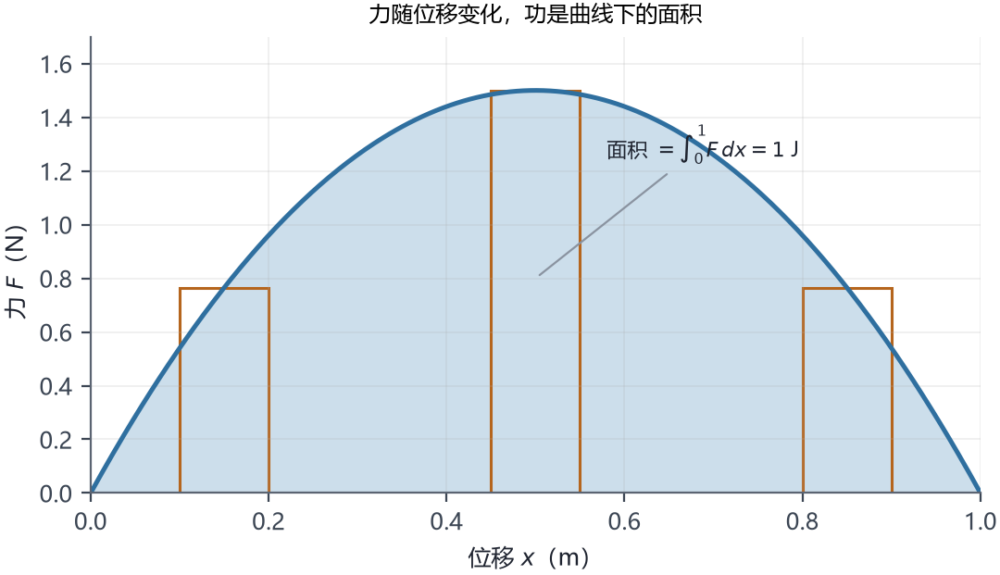
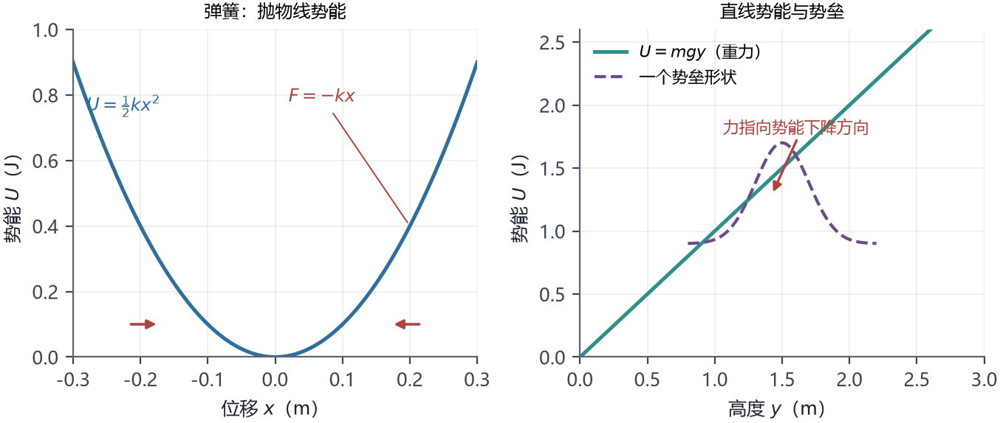
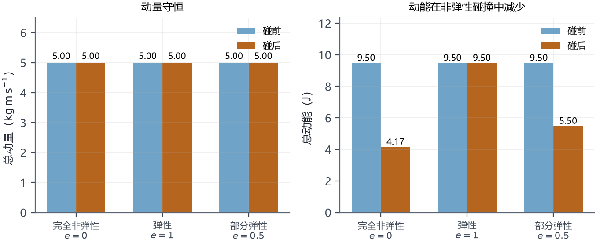

# 第 4 章 功、能量与动量

## 4.1 一个钉子被敲进去

锤子敲钉子，钉子进入木头几毫米。锤子越重、抡得越快，钉子进得越深。这个经验里有两个量在起作用：锤子的质量和它的速度。把它们组合成 $\frac{1}{2}mv^2$，会发现钉子被敲入的深度与这个量成正比，与锤子多重、多快分别无关。这个组合叫动能。

再看另一个经验。把一块石头从一米高的地方扔下来，和从两米高的地方扔下来，落地时的速度不一样。石头下落过程中重力一直在做功，做的功与下落高度成正比，落地动能也与高度成正比。这两个正比关系不是巧合，它们由同一条定理联系起来：合外力做的功等于动能的变化。

这一章把"力"沿空间累积，得到功与能；把"力"沿时间累积，得到冲量与动量。两条路线都从牛顿第二定律出发，得到的却是两个守恒量，它们在处理碰撞、爆炸、电路中的能量转换时比直接用力方便得多。

## 4.2 功

一个恒力 $\mathbf{F}$ 作用在物体上，物体发生位移 $\mathbf{d}$，功定义为

$$W=\mathbf{F}\cdot\mathbf{d}=Fd\cos\theta , \tag{4.1}$$

$\theta$ 是力与位移的夹角。功是标量，可正可负。力与位移同向时功为正，反向时为负，垂直时为零。

垂直时为零这一条值得停一下。提着水桶水平走路，手的拉力竖直向上，位移水平向前，拉力不做功。这符合直觉：桶的高度没变，重力势能没变，没有能量被存进去。但人会累，因为肌肉内部在反复收缩，能量变成了热，那部分能量不属于"对桶做的功"。

功的单位是焦耳，$1\ \mathrm{J}=1\ \mathrm{N\cdot m}$。这个单位与力矩的单位 $\mathrm{N\cdot m}$ 在量纲上相同，但物理意义不同，力矩是矢量，功是标量，本书不把两者混写。

功的正负不只是符号。一个物体从斜面滑下，重力做正功，动能增加；摩擦力做负功，动能减少；支持力不做功。三个力加起来等于合功，动能的净变化由合功决定。把每个力做的功分开算再相加，与先求合力再算功，结果一样，因为积分是线性的。这一点在电学里很有用：电场力与磁场力同时作用在一个电荷上，磁场力不做功，所以算能量时只需管电场力。

如果力在运动过程中变化，把路径分成许多小段，每段上力近似不变，功是这些小段功的和：

$$W=\int_{x_1}^{x_2}F(x)\,dx . \tag{4.2}$$

三维情形写成线积分 $W=\int\mathbf{F}\cdot d\mathbf{l}$。图 4-1 画了一个变力做功的例子：力先增大后减小，曲线下的面积就是功。把面积分成若干竖条，每条的面积是 $F(x)\Delta x$，求和取极限就是积分。

功对时间的变化率叫功率：

$$P=\frac{dW}{dt} .$$

把 $dW=\mathbf{F}\cdot d\mathbf{l}$ 代入，得

$$P=\mathbf{F}\cdot\frac{d\mathbf{l}}{dt}=\mathbf{F}\cdot\mathbf{v} .$$

功率的单位是瓦特，$1\ \mathrm{W}=1\ \mathrm{J/s}$。这个式子在第十三章算焦耳热时会用到：电场对电荷的力是 $qE$，电荷的漂移速度是 $v_d$，单位体积的功率就是 $nqEv_d=JE$。汽车爬坡时挂着低档，目的就是让发动机在功率不变的前提下降低车速、增大牵引力，因为 $F=P/v$。

## 4.3 动能定理

设一个物体在合力 $F$ 作用下沿 $x$ 轴运动。由牛顿第二定律 $F=ma$，把它代入功的定义：

$$W=\int_{x_1}^{x_2}F\,dx=\int_{x_1}^{x_2}ma\,dx . \tag{4.3}$$

加速度 $a=dv/dt$ 不是 $x$ 的函数，直接积分不方便。用第二章的链式法则把它换掉：

$$a=\frac{dv}{dt}=\frac{dv}{dx}\frac{dx}{dt}=v\frac{dv}{dx} . \tag{4.4}$$

代入：

$$W=\int_{x_1}^{x_2}m\,v\frac{dv}{dx}\,dx=\int_{v_1}^{v_2}mv\,dv . \tag{4.5}$$

第二个等号用了换元：$dx$ 与 $dv/dx$ 里的 $dx$ 约掉，积分变量从 $x$ 变成 $v$，上下限相应换成初末速度。积分直接算出：

$$W=\frac{1}{2}mv_2^2-\frac{1}{2}mv_1^2 . \tag{4.6}$$

定义动能 $E_k=\frac{1}{2}mv^2$，上式就是

$$W=E_{k2}-E_{k1}=\Delta E_k . \tag{4.7}$$

合外力对物体做的功等于动能的增量。这个结论叫动能定理。

推导里只有两步：把 $F$ 换成 $ma$（牛顿第二定律），把 $a$ 换成 $v\,dv/dx$（链式法则）。没有用到任何关于力的具体形式的信息，所以它对任何力都成立，无论力是恒定的还是变化的，是重力、弹力还是摩擦力。

动能定理在计算上有一个好处：不需要知道运动的细节。一颗子弹射入木板，阻力随深度变化，要算它射入多深，用牛顿定律要解变加速运动，用动能定理只需要算阻力做的功。代价是它只给出速率，不给方向，也不给时间。

用能量算一个具体问题。一辆 $1200\ \mathrm{kg}$ 的汽车以 $20\ \mathrm{m/s}$ 行驶，刹车后滑行 $40$ 米停下，刹车片与路面提供的平均阻力多大？动能的变化是

$$\Delta E_k=0-\frac{1}{2}\times1200\times20^2=-2.4\times10^5\ \mathrm{J} .$$

这个变化等于阻力做的功 $-f\times40$，所以 $f=2.4\times10^5/40=6000\ \mathrm{N}$。如果直接用力学算，需要先由 $v^2=2ax$ 求加速度（$a=5\ \mathrm{m/s^2}$），再乘质量，两步的结果一样，但能量路线跳过了时间。

## 4.4 保守力与势能

有些力做的功只与起点和终点有关，与路径无关。重力是这样的：把物体从高度 $y_1$ 移到 $y_2$，无论走直线、走曲线还是绕一圈，重力做的功都是

$$W_g=-mg\left(y_2-y_1\right) . \tag{4.8}$$

为什么与路径无关？把任意路径分成许多小段，每段的位移可以分解成水平分量与竖直分量。重力竖直向下，与水平分量垂直，那部分不做功；只有竖直分量贡献 $-mg\,dy$。把所有小段的 $-mg\,dy$ 加起来，等于 $-mg$ 乘以总的高度变化，中间怎么绕都消掉了。

弹簧力也是这样的。把弹簧从原长拉伸到 $x$，力 $F=-kx$ 与位移反向，做功

$$W_s=\int_0^x\left(-kx'\right)dx'=-\frac{1}{2}kx^2 . \tag{4.9}$$

它只与最终的伸长量有关，与拉伸的快慢、中间是否来回都无关。

这样的力叫保守力。判断一个力是否保守，有两条等价的标准：沿任意闭合路径做功为零；做功只与首末位置有关。静电力、万有引力、弹簧力都是保守力；摩擦力不是，沿闭合路径走一圈，摩擦力处处与运动方向相反，做的功是负的，不为零。

对保守力可以定义势能。规定一个参考点，把物体从参考点移到某位置时保守力做的功的负值，就是该位置的势能：

$$U(\mathbf{r})=-\int_{\mathbf{r}_0}^{\mathbf{r}}\mathbf{F}\cdot d\mathbf{l} . \tag{4.10}$$

负号的意思是：保守力做正功时势能减少。物体自由下落，重力做正功，势能减少，动能增加，总量不变。

由定义可以反解出力与势能的关系。一维情形下，把 (4.10) 对 $x$ 求导：

$$\frac{dU}{dx}=-F\quad\Rightarrow\quad F=-\frac{dU}{dx} . \tag{4.11}$$

力指向势能降低的方向。这个关系在后面讲电势时是关键：电场强度等于电势的负梯度，就是 (4.11) 的三维版本。

重力的势能取参考点在 $y=0$，得 $U_g=mgy$，求导得 $F=-mg$，方向向下，正确。弹簧的势能取原长为零，得 $U_s=\frac{1}{2}kx^2$，求导得 $F=-kx$，指向平衡位置，正确。图 4-2 画了这两条势能曲线。

势能的零点可以任选。选不同的零点，势能曲线整体平移一个常数，但斜率不变，所以由 (4.11) 算出的力不变。物理上有意义的只是势能差，不是势能的绝对值。重力势能常取地面为零，电势能常取无穷远为零，两者都是为了计算方便而做的约定，没有更深的意思。

## 4.5 机械能守恒

把动能定理与势能的定义合起来。合外力分成保守力与非保守力两部分：

$$W_{\text{保}}+W_{\text{非保}}=\Delta E_k . \tag{4.12}$$

保守力做的功等于势能减少量的负值：

$$W_{\text{保}}=-\Delta U . \tag{4.13}$$

代入：

$$-\Delta U+W_{\text{非保}}=\Delta E_k\quad\Rightarrow\quad W_{\text{非保}}=\Delta\left(E_k+U\right) . \tag{4.14}$$

定义机械能 $E=E_k+U$。如果没有非保守力做功，$W_{\text{非保}}=0$，机械能不变：

$$E_k+U=\text{常量} . \tag{4.15}$$

这就是机械能守恒。

用自由落体验证一下。物体从高度 $h$ 静止释放，落地速度由 $v^2=2gh$ 给出。初态机械能 $E_i=mgh+0$，末态 $E_f=0+\frac{1}{2}mv^2=mgh$，两者相等。
有摩擦时机械能不守恒，减少的量正好等于摩擦力做的功。滑块从斜面滑下，(3.10) 给出 $a=g(\sin\theta-\mu_k\cos\theta)$。用动能定理：重力做功 $mgL\sin\theta$，摩擦力做功 $-\mu_kmgL\cos\theta$，合功等于 $\frac{1}{2}mv^2$，解得 $v^2=2gL(\sin\theta-\mu_k\cos\theta)$，与用运动学公式 $v^2=2aL$ 算出的结果一致。两条路必须一致，因为它们是同一个牛顿定律的两种算法。

再看一个只有重力和绳张力做功的例子。单摆从水平位置释放，摆长为 $l$，求它到达最低点时的速率。小球受重力与绳的拉力，拉力始终垂直于速度，不做功，所以机械能守恒。取最低点为势能零点，初态 $E_i=mgl$，末态 $E_f=\frac{1}{2}mv^2$。令两者相等：

$$mgl=\frac{1}{2}mv^2\quad\Rightarrow\quad v=\sqrt{2gl} .$$

这个结果与自由落体从同样高度下落的速率一样。摆的路径是圆弧，落体是直线，但重力是保守力，做功只与高度差有关，所以末速率相同。这个例子在第八章会以电势的形式重现：电荷沿不同路径从一点移到另一点，静电力做的功相同，电势差只与两端位置有关。

## 4.6 冲量与动量
功是力对空间的累积。力对时间的累积叫冲量：

$$\mathbf{J}_{\text{imp}}=\int_{t_1}^{t_2}\mathbf{F}\,dt . \tag{4.16}$$

由牛顿第二定律的动量形式 $\mathbf{F}=d\mathbf{p}/dt$，两边对时间积分：

$$\int_{t_1}^{t_2}\mathbf{F}\,dt=\int_{t_1}^{t_2}\frac{d\mathbf{p}}{dt}dt=\mathbf{p}_2-\mathbf{p}_1 . \tag{4.17}$$

冲量等于动量的变化，这叫动量定理。$\mathbf{p}=m\mathbf{v}$ 是动量，单位 $\mathrm{kg\cdot m/s}$。

冲量定理解释了安全气囊为什么有用。汽车以 $20\ \mathrm{m/s}$ 撞墙，人的动量从 $20m$ 变成零，动量的变化量是固定的，与怎么停下来的无关。但冲量等于力乘时间，同样的动量变化，如果停下来用的时间长，力就小。气囊把停止时间从几十毫秒延长到几百毫秒，力降到原来的几分之一。

动量守恒在反冲问题里最直观。火箭在真空中飞行，没有空气可推，它靠的是向后喷出燃气。把火箭与燃料看成一个系统，总动量守恒：燃气向后获得的动量，等于箭体向前获得的动量。如果喷气速度相对于箭体是 $u$，在 $dt$ 时间内喷出质量 $dm$，箭体质量减少 $dm$，速度增加 $dv$，则 $m\,dv=u\,dm$，这就是火箭方程的前身。喷气速度越大，同样质量比下能获得的速度越大，这也是为什么运载火箭要用氢氧发动机。

## 4.7 动量守恒

考虑两个物体组成的系统，它们之间有力的作用，系统外没有别的力。设物体 1 对物体 2 的力是 $\mathbf{F}_{12}$，物体 2 对物体 1 的力是 $\mathbf{F}_{21}$。由牛顿第三定律 $\mathbf{F}_{12}=-\mathbf{F}_{21}$。

对两个物体分别写动量定理：

$$\mathbf{F}_{21}=\frac{d\mathbf{p}_1}{dt},\qquad\mathbf{F}_{12}=\frac{d\mathbf{p}_2}{dt} . \tag{4.18}$$

两式相加，左边为零：

$$\frac{d}{dt}\left(\mathbf{p}_1+\mathbf{p}_2\right)=0 . \tag{4.19}$$

所以总动量

$$\mathbf{p}_1+\mathbf{p}_2=\text{常量} . \tag{4.20}$$

这就是动量守恒。它对任意多个物体都成立：把所有物体的动量加起来，内部的作用力成对抵消，只有外力的冲量能改变总动量。系统不受外力（或外力冲量可以忽略）时，总动量不变。

动量守恒比牛顿定律更基本。在微观粒子的碰撞、粒子衰变中，牛顿定律不再适用，动量守恒仍然成立。它来自空间平移对称性，这一点在理论物理里由诺特定理说明。

## 4.8 碰撞

碰撞是动量守恒最直接的应用。两个物体碰撞前后，总动量不变：

$$m_1\mathbf{v}_1+m_2\mathbf{v}_2=m_1\mathbf{v}_1'+m_2\mathbf{v}_2' . \tag{4.21}$$

二维情形下这是一个矢量方程，相当于两个标量方程；一维情形下只剩一个。一个方程，两个未知数，还需要一个条件才能确定末速度。这个条件取决于碰撞的类型。

完全非弹性碰撞。碰后两物体粘在一起，速度相同，记为 $v'$。代入 (4.21)：

$$m_1v_1+m_2v_2=\left(m_1+m_2\right)v'\quad\Rightarrow\quad v'=\frac{m_1v_1+m_2v_2}{m_1+m_2} . \tag{4.22}$$

这个速度就是质心速度。算一下动能损失：

$$\Delta E_k=\frac{1}{2}\left(m_1+m_2\right)v'^2-\frac{1}{2}m_1v_1^2-\frac{1}{2}m_2v_2^2 . \tag{4.23}$$

用 $v'$ 的表达式代入，整理（把三项通分，利用 $m_1m_2$ 的对称性）得

$$\Delta E_k=-\frac{1}{2}\frac{m_1m_2}{m_1+m_2}\left(v_1-v_2\right)^2 . \tag{4.24}$$

损失的动能与相对速度的平方成正比，与约化质量 $\mu=m_1m_2/(m_1+m_2)$ 成正比。两车正面相撞，相对速度大，损失的能量是造成破坏的部分；这部分能量变成了形变与热。

弹性碰撞。碰后动能也守恒：

$$\frac{1}{2}m_1v_1^2+\frac{1}{2}m_2v_2^2=\frac{1}{2}m_1v_1'^2+\frac{1}{2}m_2v_2'^2 . \tag{4.25}$$

与 (4.21) 联立求解。把动量式与能量式都整理：

$$m_1\left(v_1-v_1'\right)=m_2\left(v_2'-v_2\right) , \tag{4.26}$$

$$m_1\left(v_1^2-v_1'^2\right)=m_2\left(v_2'^2-v_2^2\right) . \tag{4.27}$$

第二式用平方差展开，除以第一式（假设 $v_1\neq v_1'$），得

$$v_1+v_1'=v_2+v_2'\quad\Rightarrow\quad v_1-v_2=-\left(v_1'-v_2'\right) . \tag{4.28}$$

这条关系的含义是：碰撞前后相对速度大小不变，方向相反。把它与动量式联立，解出

$$v_1'=\frac{m_1-m_2}{m_1+m_2}v_1+\frac{2m_2}{m_1+m_2}v_2 , \tag{4.29}$$

$$v_2'=\frac{2m_1}{m_1+m_2}v_1+\frac{m_2-m_1}{m_1+m_2}v_2 . \tag{4.30}$$

检查几个极限。$m_1=m_2$ 时 $v_1'=v_2$，$v_2'=v_1$，两个球交换速度，这是台球桌上常见的现象。$m_1\gg m_2$ 且 $v_2=0$ 时 $v_1'\approx v_1$，$v_2'\approx2v_1$，重球几乎不受影响，轻球以两倍速度弹出。$m_1\ll m_2$ 且 $v_2=0$ 时 $v_1'\approx-v_1$，轻球以原速率反弹，这是球撞墙的情形。

真实碰撞介于两种极端之间。定义一个恢复系数

$$e=\frac{v_2'-v_1'}{v_1-v_2} , \tag{4.31}$$

它等于分离速度与接近速度之比。$e=1$ 是弹性碰撞，$e=0$ 是完全非弹性碰撞，皮球落地反弹大约是 $e=0.8$。给定 $e$ 之后，把 (4.21) 与 (4.31) 联立就能解出末速度，动能损失是

$$\Delta E_k=-\frac{1}{2}\left(1-e^2\right)\frac{m_1m_2}{m_1+m_2}\left(v_1-v_2\right)^2 . \tag{4.32}$$

$e=0$ 时回到 (4.24)，$e=1$ 时损失为零，两个极端都对得上。

图 4-3 把三种碰撞前后的动量与动能画成条形。动量在三种情况下都守恒，动能只在弹性碰撞中守恒。

## 4.9 质心

动量守恒允许定义一个特殊的点，叫质心。对两个物体，质心的位置是

$$\mathbf{R}=\frac{m_1\mathbf{r}_1+m_2\mathbf{r}_2}{m_1+m_2} , \tag{4.33}$$

两边对时间求导，分子就是总动量：

$$\frac{d\mathbf{R}}{dt}=\frac{\mathbf{p}_1+\mathbf{p}_2}{m_1+m_2} . \tag{4.34}$$

总动量不变时，质心速度不变，质心做匀速直线运动。两个物体的碰撞再怎么复杂，质心那一点始终按原速度前进，碰撞只改变两个物体相对于质心的运动。

这条结论把一个两体问题拆成了两件事：质心的匀速运动（无需关心）和相对质心的运动（只与相对速度有关）。用质心系看弹性碰撞尤其简单：两物体以相反方向接近，以相反方向分离，速度大小各自不变。完全非弹性碰撞后，两者都静止在质心系里，相对质心的动能全部耗掉，剩下的就是质心动能。

质心的概念不限于碰撞。均匀物体的质心在几何中心；一根密度不均匀的杆，质心偏向重的那一端。计算的方法是把它分成许多小元，每个元的贡献按其质量加权平均。第十二章算导线电阻时用的平均思路与这里类似。

---

这一章从牛顿第二定律出发，沿空间积分得到动能定理，沿时间积分得到动量定理。前者在有势能时化为机械能守恒，后者在两体相互作用时化为动量守恒。两条守恒律都不是新的物理，但它们把复杂的受力过程压成了一个等式，让“碰撞后速度是多少”“钉子被敲进多深”这类问题不需要追踪中间每一时刻。

静电力与重力一样是保守力，这是下一篇能定义电势能的前提。第八、九章会把 (4.11) 原样搬到电学里，力换成电场，势能换成电势能。
