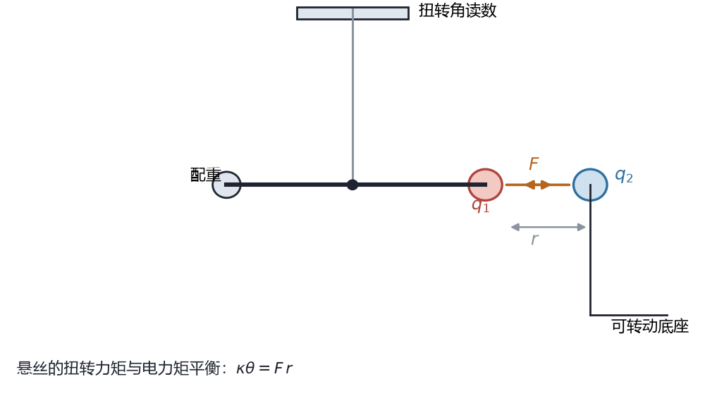
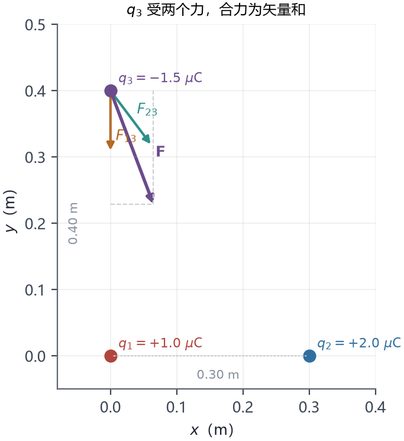

# 第 5 章 电荷、库仑定律与叠加原理

## 5.1 塑料尺吸起纸屑

冬天用塑料尺在毛衣上蹭几下，靠近桌上的碎纸屑，纸屑会跳起来贴到尺子上。贴上去之后还能悬一会儿，有的纸屑甚至悬在尺子下方不掉。把尺子换成玻璃棒，在丝绸上摩擦，效果一样。但如果先用这根玻璃棒去靠近刚才那根塑料尺，两者会互相排斥。

这些现象在两千年前就被记录过。琥珀（希腊语 elektron）摩擦后能吸引轻小物体，这个词后来变成了“电”。但直到十八世纪，人们才开始定量地研究它：到底有多少电荷，两个带电体之间的力有多大，与距离是什么关系。

还有一类现象容易和摩擦起电混在一起。把带电的塑料尺靠近（但不接触）一根细水流，水流会弯曲；靠近一个不带电的小纸片，纸片也会被吸过来。这些现象里没有电荷转移，只是带电体让附近导体或绝缘体内部的电荷重新分布，靠近的一端带上异号电荷，远离的一端带上同号电荷。这叫静电感应。感应出的两端电荷量相等、符号相反，所以物体整体仍不带电。

回答这些问题需要先解决一个更基础的问题：电荷是什么，怎么度量。

## 5.2 两种电荷与量子化

实验事实可以归结为三条。

第一，电荷有两种。同种电荷相斥，异种电荷相吸。富兰克林把两种电荷命名为正与负，这个命名是任意的，但一旦定下来，所有实验都自洽：电子带负电，质子带正电。

第二，电荷守恒。一个孤立系统的总电荷不变。摩擦起电不是创造了电荷，而是把电子从一个物体转移到另一个物体：毛衣上的电子跑到塑料尺上，尺子带负电，毛衣带等量的正电。把两者重新接触，电荷中和，总电荷仍为零。

第三，电荷量子化。任何带电体的电荷量都是某个基本单位的整数倍：

$$q=ne,\qquad e=1.602176634\times10^{-19}\ \mathrm{C} . \tag{5.1}$$

$n$ 是整数,可正可负。$e$ 叫基本电荷,等于一个电子电荷的绝对值。这个事实在 1909 年由密立根的油滴实验确立：把带电油滴悬浮在电场中，调节电场强度让它静止，由 $qE=mg$ 算出 $q$，反复测量许多油滴，发现所有结果都是同一个最小值的整数倍。密立根的原始数据里既用了带正电的油滴也用了带负电的，测出的 $e$ 与今天的光谱值与电解法结果一致，这本身也是对电荷守恒的一次检验：无论电荷怎么产生，总量总是不变的。

宏观物体带的电荷远大于 $e$。一库仑的电荷相当于 $6.24\times10^{18}$ 个电子，所以日常现象里电荷看起来是连续的。但在讨论单个电子、离子时，量子化不能忽略。

## 5.3 导体与绝缘体

电荷能在某些材料里自由移动，在另一些材料里不能。

金属是导体。金属原子最外层的电子脱离原子核的束缚，在整个金属块里自由运动，叫自由电子。给金属棒一端带电，电荷会迅速分布到整个表面。溶液里的离子、电离气体里的电子与离子也能导电。

玻璃、橡胶、干燥的空气是绝缘体。电子被束缚在原子或分子上，不能自由移动。摩擦起电之所以有效，正是因为两种材料都是绝缘体：电荷转移之后停留在原处，不会立刻流走。

介于两者之间的是半导体，导电能力随温度、掺杂而变。这一章只讨论静电，也就是电荷不动的情形，导体与绝缘体的区别表现为“电荷能不能重新分布”。第十一章讲电流时会回到这个区别。

绝缘体在电场中也会响应，只是幅度小得多。分子内部的电子云会相对于原子核发生微小位移，极性分子（比如水）则整体转动，两者合起来叫极化。极化的结果是绝缘体表面出现束缚电荷，它产生的场部分抵消外场，使介质内部的合场减小。这个效应在第十章处理电容时定量化，在那里它表现为介电常数 $\varepsilon_r>1$。

## 5.4 库仑定律

1785 年，库仑用扭秤测量了两个带电小球之间的力。装置如图 5-1：一根水平绝缘杆，一端是带电小球，另一端是配重，杆用一根细金属丝悬挂。另一个带电小球固定在旁边。两球之间的力让杆转动，直到金属丝的扭转力矩与电力矩平衡。由扭转角度可以算出力矩，再算出力。

库仑改变两球的距离，测量力的大小，得到结论：力与距离的平方成反比。改变电荷量，得到力与两个电荷量的乘积成正比。写成公式：

$$F=k\frac{|q_1q_2|}{r^2} . \tag{5.2}$$

$k$ 是比例常数，叫库仑常数，实验值

$$k=\frac{1}{4\pi\varepsilon_0}=8.9875517923\times10^{9}\ \mathrm{N\cdot m^2/C^2} . \tag{5.3}$$

$\varepsilon_0$ 是真空介电常数，$\varepsilon_0=8.8541878128\times10^{-12}\ \mathrm{F/m}$。为什么把 $k$ 写成 $1/(4\pi\varepsilon_0)$ 而不直接用一个常数？因为后面的高斯定理、点电荷的场、电容的公式里会反复出现 $4\pi$，提前把它吸收进常数，那些公式会干净很多。这个选择在第二十八章对比高斯制时会看得更清楚。

力的方向沿两电荷的连线。同号相斥，异号相吸。用矢量写：

$$\mathbf{F}_{12}=\frac{1}{4\pi\varepsilon_0}\frac{q_1q_2}{r_{12}^2}\hat{\mathbf{r}}_{12} , \tag{5.4}$$

$\mathbf{F}_{12}$ 是电荷 1 对电荷 2 的力，$\hat{\mathbf{r}}_{12}$ 是从 1 指向 2 的单位矢量。$q_1q_2>0$ 时力沿 $\hat{\mathbf{r}}_{12}$ 方向，是排斥；$q_1q_2<0$ 时力反向，是吸引。这个写法把符号自动处理了。

库仑定律的适用范围很广。从原子尺度到实验室尺度，从 $10^{-15}$ 米到几米，都没有发现偏离。平方反比的指数被实验检验到 $2\pm10^{-16}$ 的精度，也就是说如果力是 $1/r^{2+\delta}$，那么 $|\delta|<10^{-16}$。这个精度来自对导体球壳内部电场的测量：如果平方反比不严格成立，球壳内部的场就不严格为零。

把数代进去可以感受一下这个力有多大。两个各带 $1\ \mu\mathrm{C}$ 的小球相距一米，斥力是 $8.99\times10^{9}\times10^{-12}=9.0\times10^{-3}\ \mathrm{N}$，相当于一克物体重力的十分之一。如果相距一厘米，力变成 $90\ \mathrm{N}$，接近九公斤物体的重力。静电力的平方关系使得距离缩小十倍，力放大一百倍，这是静电实验里“稍微靠近一下就吸过去了”的原因。

## 5.5 与万有引力的比较

库仑定律与万有引力定律形式相同，都是平方反比，都与"荷"的乘积成正比。差别在三点。

第一，强度。第一章算过，两个质子之间的电力比引力强约 $10^{40}$ 倍。所以在原子、分子、固体里，引力完全可以忽略。

第二，符号。引力只有吸引，电力有吸引也有排斥。这导致宏观物体的行为完全不同：引力让物质聚集成团，电力让同号电荷互相推开，所以宏观物体总是趋向电中性。

第七，屏蔽。引力不能被屏蔽，质量在那里，引力就在那里。电力可以被屏蔽：把电荷放在金属壳里，壳外的场几乎为零。这个差别让电磁学的实验设计比引力实验自由得多，也让“场”这个概念在电学里更必要。

屏蔽的原理是导体表面的感应电荷恰好抵消了外部电场。把一块金属放进匀强电场，导体内的自由电子会向一侧移动，直到导体内部的合场为零。这不是瞬间完成的，但金属里的电子密度很高，建立平衡的时间在 $10^{-19}$ 秒量级，宏观上就是“立刻”。一个空心的金属壳把这个条件扩展到壳内：壳壁里的电荷分布会自动调整，使得壳内空间也没有外场。这个装置叫法拉第笼，电梯里的手机信号弱、精密仪器要放进金属屏蔽箱，都是同一个道理。

## 5.6 叠加原理

如果有多个电荷，任意两个之间的力由 (5.4) 给出，一个电荷受到的总力是其他所有电荷对它施加的力的矢量和：

$$\mathbf{F}=\sum_{i}\mathbf{F}_{i}=\frac{q}{4\pi\varepsilon_0}\sum_{i}\frac{q_i}{r_i^2}\hat{\mathbf{r}}_{i} . \tag{5.5}$$

这就是叠加原理。它不是从库仑定律推出来的，而是一条独立的实验事实：两个电荷之间的力不因为第三个电荷的存在而改变。这条事实在真空中严格成立，在介质中需要修正（介质会被极化，第十章讲）。

叠加原理让问题从"两个电荷"扩展到"任意多个电荷"，代价是要做矢量加法。下面用具体数字走一遍。

设 $q_1=+1.0\ \mu\mathrm{C}$ 在原点，$q_2=+2.0\ \mu\mathrm{C}$ 在 $(0.30\ \mathrm{m},0)$，求 $q_3=-1.5\ \mu\mathrm{C}$ 在 $(0,0.40\ \mathrm{m})$ 处受到的力。

$q_1$ 与 $q_3$ 的距离是 $0.40$ 米，电荷异号，力是吸引，方向从 $q_3$ 指向 $q_1$，即沿 $-y$ 方向。大小

$$F_{13}=k\frac{|q_1q_3|}{r_{13}^2}=8.99\times10^{9}\times\frac{1.0\times10^{-6}\times1.5\times10^{-6}}{0.40^2}=8.43\times10^{-2}\ \mathrm{N} . \tag{5.6}$$

$q_2$ 与 $q_3$ 的距离是 $\sqrt{0.30^2+0.40^2}=0.50$ 米。电荷异号，力是吸引，方向从 $q_3$ 指向 $q_2$，单位矢量是 $(0.30,-0.40)/0.50=(0.60,-0.80)$。大小

$$F_{23}=8.99\times10^{9}\times\frac{2.0\times10^{-6}\times1.5\times10^{-6}}{0.50^2}=1.08\times10^{-1}\ \mathrm{N} . \tag{5.7}$$

分解成两个分量：

$$F_{23x}=1.08\times10^{-1}\times0.60=6.47\times10^{-2}\ \mathrm{N},\qquad F_{23y}=1.08\times10^{-1}\times(-0.80)=-8.63\times10^{-2}\ \mathrm{N} . \tag{5.8}$$

$F_{13}$ 只有 $y$ 分量，是 $-8.43\times10^{-2}\ \mathrm{N}$。总力

$$F_x=6.47\times10^{-2}\ \mathrm{N},\qquad F_y=-8.43\times10^{-2}-8.63\times10^{-2}=-1.71\times10^{-1}\ \mathrm{N} . \tag{5.9}$$

大小 $\sqrt{0.0647^2+0.171^2}=1.82\times10^{-1}\ \mathrm{N}$，方向与 $x$ 轴成 $\arctan(-0.171/0.0647)\approx-69^\circ$，也就是指向右下方。图 5-2 画了这三个电荷与两个力的矢量合成。

这个例子里所有的力都指向 $q_3$ 或背离它，因为 $q_3$ 与另外两个电荷异号。如果 $q_3$ 是正电荷，两个力的方向都反过来，合力方向也随之改变。做这类题时先判方向，再算分量，比直接代公式少出错。

## 5.7 连续电荷分布

宏观物体带的电荷是大量微观电荷的集合，把它们一个个加起来不现实。把电荷看成连续分布，用密度描述。

体电荷密度 $\rho$：单位体积的电荷量，单位 $\mathrm{C/m^3}$。一个小体积 $dV$ 内的电荷是 $dq=\rho\,dV$。

面电荷密度 $\sigma$：单位面积的电荷量，单位 $\mathrm{C/m^2}$。一个小面元 $dS$ 上的电荷是 $dq=\sigma\,dS$。导体表面的电荷总是分布在表面上，所以面密度最常用。

线电荷密度 $\lambda$：单位长度的电荷量，单位 $\mathrm{C/m}$。一根细导线上的电荷是 $dq=\lambda\,dl$。

有了密度，叠加原理写成积分：

$$\mathbf{E}(\mathbf{r})=\frac{1}{4\pi\varepsilon_0}\int\frac{dq'}{|\mathbf{r}-\mathbf{r}'|^2}\hat{\mathbf{r}}' . \tag{5.10}$$

这里 $\mathbf{r}$ 是观察点的位置，$\mathbf{r}'$ 是电荷元的位置，$\hat{\mathbf{r}}'$ 是从电荷元指向观察点的单位矢量。积分遍及所有有电荷的地方。这个式子是后面所有电场计算的出发点，具体问题里能不能积出来，取决于电荷分布的对称性。

举一个能积出来的例子。一根长为 $L$ 的细杆，均匀带电，总电荷 $Q$，求延长线上距近端 $a$ 处的电场。取杆沿 $x$ 轴，从 $x=0$ 到 $x=L$，观察点在 $x=L+a$。电荷元 $dq=\lambda\,dx'$，$ \lambda=Q/L$，它到观察点的距离是 $L+a-x'$，方向沿 $+x$。于是

$$E=\frac{1}{4\pi\varepsilon_0}\int_0^{L}\frac{\lambda\,dx'}{\left(L+a-x'\right)^2} . \tag{5.11}$$

令 $u=L+a-x'$，$du=-dx'$，积分限从 $x'=0$ 时 $u=L+a$ 变到 $x'=L$ 时 $u=a$：

$$E=\frac{\lambda}{4\pi\varepsilon_0}\int_{a}^{L+a}\frac{du}{u^2}=\frac{\lambda}{4\pi\varepsilon_0}\left(\frac{1}{a}-\frac{1}{L+a}\right) . \tag{5.12}$$

通分：

$$E=\frac{Q}{4\pi\varepsilon_0}\cdot\frac{1}{a\left(L+a\right)} . \tag{5.13}$$

检查极限。$a\gg L$ 时，$a(L+a)\approx a^2$，$E\approx Q/(4\pi\varepsilon_0a^2)$，退化为点电荷的场，符合预期。$a\to0$ 时 $E\to\infty$，因为观察点无限接近线电荷，距离趋于零。这两个极限都合理。

再看一个必须用矢量分解的例子：均匀带电的细圆环，半径 $R$、总电荷 $Q$，求轴线上距圆心 $z$ 处的电场。把圆环分成许多小段，每段带电荷 $dq$，到观察点的距离都是 $r=\sqrt{R^2+z^2}$，每个小段的场大小都是 $dE=k\,dq/r^2$。

方向不都一样，要分解。把 $dE$ 拆成沿轴线的分量与垂直于轴线的分量。由于圆环对称，取直径两端的一对小段，它们的垂直分量大小相等、方向相反，相互抵消；所有小段的垂直分量加起来全抵消。沿轴线的分量是 $dE\cos\alpha$，$\alpha$ 是场方向与轴线的夹角，由几何关系 $\cos\alpha=z/r$。于是

$$E=\int k\frac{dq}{r^{2}}\cdot\frac{z}{r}=\frac{kz}{r^{3}}\int dq=\frac{kQz}{\left(R^{2}+z^{2}\right)^{3/2}} . \tag{5.14}$$

这里能把 $kz/r^3$ 提到积分号外，是因为圆环上每一点到观察点的距离 $r$ 都一样，$z$ 也是常数。积分 $\int dq$ 就是总电荷 $Q$。

检查两个极限。$z\gg R$ 时，$R^2+z^2\approx z^2$，$E\approx kQ/z^2$，回到点电荷的场。$z=0$ 时 $E=0$，因为圆心处上下左右对称，各方向的场互相抵消。这个结果在第十五章算圆环电流的磁场时会再出现一次，形式几乎一样。

把这个结果对 $z$ 求导，可以找到轴线上场强最大的位置：令 $dE/dz=0$，得 $z=R/\sqrt{2}$，此时 $E\approx0.385\,kQ/R^2$。这个细节说明轴线上的场不是单调递减的，它先增大再减小，在圆环附近有一个峰。

## 5.8 电荷在导体上的分布

静电平衡时，导体内部的电场为零。如果不为零，自由电子会移动，直到电场消失。这个条件推出几条结论。

导体内部没有净电荷。由高斯定理（下一章证明）可以推出，如果内部有净电荷，穿过包围它的曲面的电通量不为零，内部电场就不为零。所以电荷只能分布在导体表面。

导体表面附近的电场垂直于表面。如果电场有切向分量，表面电荷会沿表面移动，与静电平衡矛盾。

导体是等势体。内部电场为零，任意两点之间的电势差为零。

尖端放电。导体表面的电荷密度与表面曲率有关，曲率大的地方（尖端）电荷密度高，附近的电场强。空气的击穿场强约 $3\times10^6\ \mathrm{V/m}$，尖端附近的场强很容易超过它，空气被电离，产生放电。避雷针的原理就是利用这一点，把放电引到指定位置。这个现象的定量描述需要解边值问题，本书不展开。

## 5.9 这一章的位置

库仑定律是整本电磁学唯一的实验起点。后面所有的电场公式、电势公式、电容公式，都可以从它出发，加上叠加原理，推出来。这条推导链的第一步是把"两个电荷之间的力"改写成"一个电荷在空间中产生场"，这是下一章的内容。

之所以要改写，是因为力的描述有一个不便：力总是涉及两个电荷，谈“某一点的力”没有意义。而场是定义在空间每一点上的量，可以单独研究它的分布、它的势、它的能量。场这个概念由法拉第在 1830 年代提出，当时只是一个直观的图像，麦克斯韦把它变成了数学对象，最终成为这本书的主角。

先把量级摆出来，后面每章都会用到。把两个电荷之间的力除以试探电荷，得到电场强度，单位伏特每米。$1\ \mu\mathrm{C}$ 的电荷在一米外产生的场强约为 $9\times10^{3}\ \mathrm{V/m}$；空气的击穿场强是 $3\times10^{6}\ \mathrm{V/m}$，相当于把上述电荷放到几厘米处；而氢原子内部电子感受到的场强是 $5\times10^{11}\ \mathrm{V/m}$，比空气击穿场强高五个数量级。这三个数字说明宏观的“高压”在原子尺度上根本不算什么，也说明为什么在原子内部经典电磁学需要修正。
